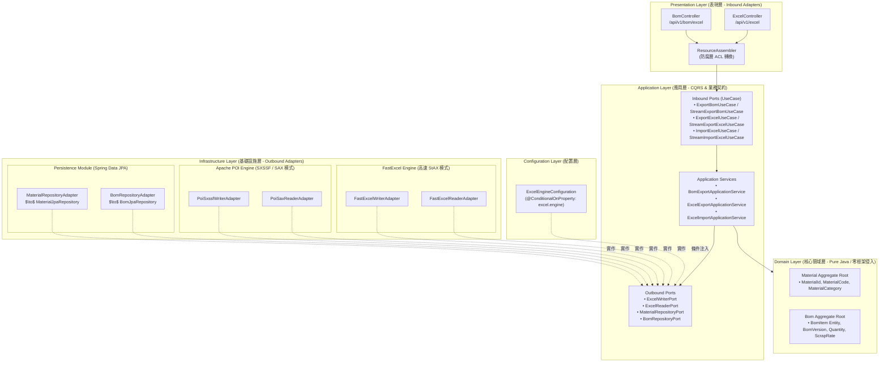
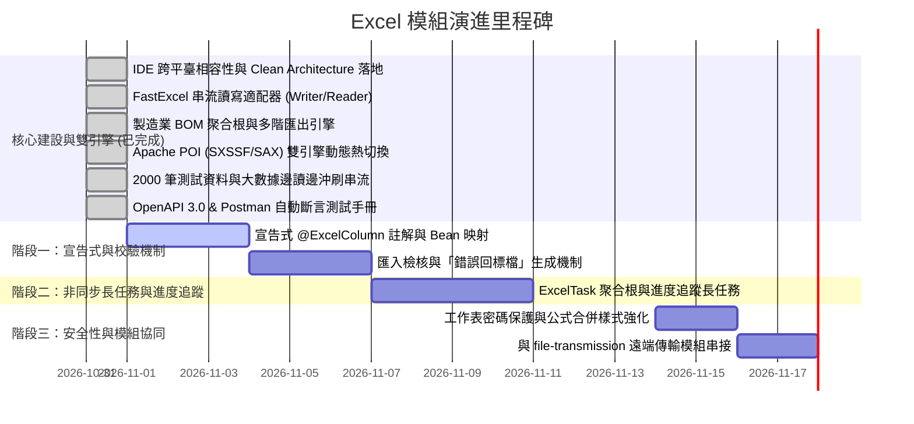

# Excel 企業級核心與物料清單 (BOM) 多階結構處理模組 (Excel & BOM Module)

[](https://adoptium.net/)
[](https://spring.io/projects/spring-boot)
[](#1-架構設計與雙引擎模型-architecture--dual-engine)
[](#2-雙引擎動態切換指南-dual-engine-configuration)
[](#7-自動化測試與品質保證-testing--verification)

> 📌 本模組為企業級高性能試算表處理解決方案，原生結合製造業 **物料清單 (Bill of Materials, BOM)** 多階遞迴展開與匯出引擎。嚴格遵循 **領域驅動設計 (DDD)**、**Clean Architecture** 與 **六角形架構 (Hexagonal / Ports & Adapters)**，實踐表現層、應用層、領域層與底層實作的完全解耦。

---

## 核心特性亮點 (Key Features)

* 🚀 **雙引擎動態熱切換 (Dual-Engine Pluggable)**：
  * **FastExcel 0.20.2**：StAX 事件導向極速串流，適合百萬級大數據與極限吞吐量。
  * **Apache POI 5.5.1 (SXSSF / SAX)**：低記憶體滑動窗口串流寫入＋SAX 讀取，支援凍結窗格（Freeze Panes）、標題樣式與磁碟暫存安全清理（`dispose()`）。
  * 透過 `application.properties` 設定旗標 `excel.engine`，業務程式碼 **100% 零修改**。
* ⚡ **大數據常數級串流 ($O(1)$ Memory Streaming)**：
  * 支援邊產製邊傳輸（HTTP 區塊傳輸編碼 `Transfer-Encoding: chunked`），透過 `flushInterval` 定期釋放記憶體。
  * 串流讀取支援逐列監聽（Listener）與分塊消費（Chunked Consumer），杜絕大檔上傳 OOM。
* 🏭 **製造業多階 BOM 匯出引擎 (Multi-Level BOM Engine)**：
  * 支援多階層產品結構遞迴展開、單階用量匯總、物料主檔對照表三合一 Excel 產製。
  * 預載工業級無人機等 2,000 筆物料主檔與 25 筆 BOM 配方實機資料。
* 🛡️ **高純度架構規範 (Strict Clean Architecture)**：
  * 領域層（Domain Layer）維持純粹 Java（Pure Java），**嚴禁使用 Lombok**，聚合根以業務語意封裝不變條件。
  * 應用層（Application Layer）嚴守 CQRS、Command/Query/Result 物件隔離與防腐層機制（ACL）。
* 📋 **完整測試資產 (Comprehensive Testing Assets)**：
  * 內建 OpenAPI 3.0 (Swagger UI) 與 Postman 整合測試集合（含 `pm.test` 自動斷言腳本）。

---

## 1. 架構設計與雙引擎模型 (Architecture & Dual-Engine)



---

## 2. 雙引擎動態切換指南 (Dual-Engine Configuration)

本專案支援由 [`ExcelEngineConfiguration.java`](file:///d:/桌面/ModuleWorkSpace/excel-module/src/main/java/com/example/demo/config/ExcelEngineConfiguration.java) 動態決定底層注入的適配器。

### 2.1 設定檔參數 (`application.properties`)

```properties
# Excel 底層處理引擎配置 (可選值: FAST_EXCEL / APACHE_POI)
# 預設值為 FAST_EXCEL (若未指定則自動 fallback 為 FAST_EXCEL)
excel.engine=FAST_EXCEL
```

### 2.2 引擎特性與使用情境對比

| 引擎旗標值 | 核心實現技術 | 輸出適配器 | 輸入適配器 | 核心優勢 | 適用情境 |
| :--- | :--- | :--- | :--- | :--- | :--- |
| **`FAST_EXCEL`**<br>*(預設)* | FastExcel 0.20.2<br>(StAX 串流) | [`FastExcelWriterAdapter`](file:///d:/桌面/ModuleWorkSpace/excel-module/src/main/java/com/example/demo/infrastructure/adapter/FastExcelWriterAdapter.java) | [`FastExcelReaderAdapter`](file:///d:/桌面/ModuleWorkSpace/excel-module/src/main/java/com/example/demo/infrastructure/adapter/FastExcelReaderAdapter.java) | 毫秒級吞吐量、低 CPU、純記憶體緩衝、極小依賴體積 | 百萬級大數據匯出、即時高併發 API、大檔案排程批次匯出 |
| **`APACHE_POI`** | Apache POI 5.5.1<br>(SXSSF + SAX) | [`PoiSxssfWriterAdapter`](file:///d:/桌面/ModuleWorkSpace/excel-module/src/main/java/com/example/demo/infrastructure/adapter/PoiSxssfWriterAdapter.java) | [`PoiSaxReaderAdapter`](file:///d:/桌面/ModuleWorkSpace/excel-module/src/main/java/com/example/demo/infrastructure/adapter/PoiSaxReaderAdapter.java) | 工業級豐富樣式、凍結窗格、磁碟快取緩衝、公式與多格式相容 | 企業級標準報表、樣式複雜之商業試算表、格式強檢驗需求 |

---

## 3. 物料清單 (BOM) 多階匯出架構

BOM 模組整合了製造業標準產品結構樹（Bill of Materials），由 [`BomExportApplicationService.java`](file:///d:/桌面/ModuleWorkSpace/excel-module/src/main/java/com/example/demo/application/service/BomExportApplicationService.java) 負責遞迴展開並組合為多工作表 Excel：

### 3.1 匯出 Excel 工作表規劃
1. **工作表一：多階展開清單 (Multi-Level BOM)**
   * 遞迴展開成品 $\to$ 半成品 $\to$ 零組件之完整樹狀結構。
   * 包含：階層標註（`.1`, `..2`, `...3`）、母件料號、子件料號、物料品名、規格、單階用量、累計總用量、損耗率、位號與備註。
2. **工作表二：單階用量清單 (Single-Level Summary)**
   * 針對直接組成零件彙總需求總量。
3. **工作表三：物料主檔對照表 (Material Master)**
   * 包含涉及的所有物料識別資訊、類別（成品/半成品/原物料）、基本單位與標準成本。

### 3.2 預載實機測試資料 (`material_bom_test_data.sql`)
資料庫初始化已載入 **2,000 筆物料主檔** 與 **25 筆 BOM 配方**，代表性成品料號如下：
* **`MAT-FG-001`**：工業級四軸無人機旗艦套件（3 階結構，展開 11 項核心料件）
* **`MAT-FG-002`**：智慧農業高壓植保無人機總成
* **`MAT-FG-003`**：專業航拍雙光熱成像雲台無人機
* **`MAT-SA-001`**：無人機飛控核心運算主板模組（2 階半成品）

---

## 4. API 介面與測試指引 (API Guide & Quick Start)

### 4.1 互動式介面 (Swagger UI)
啟動專案後直接透過瀏覽器開啟：
* **Swagger UI**：`http://localhost:8080/swagger-ui.html`
* **OpenAPI 3.0 規範**：`http://localhost:8080/v3/api-docs`

### 4.2 Postman 測試集合
* 測試檔案位置：[`doc/test/excel_bom_module_postman_collection.json`](file:///d:/桌面/ModuleWorkSpace/excel-module/doc/test/excel_bom_module_postman_collection.json)
* 內建 11 組完整測試案例（含成功下載、結構化篩選、大數據串流下載、400/404 異常斷言）。

### 4.3 常用 cURL 操作指令

#### ① 下載指定成品多階層 BOM Excel (標準批次)
```bash
curl -i -X GET "http://localhost:8080/api/v1/bom/excel?parentMaterialCode=MAT-FG-001" -O -J
```

#### ② 大數據邊讀邊沖刷串流下載 (GET /stream)
```bash
curl -i -X GET "http://localhost:8080/api/v1/bom/excel/stream?parentMaterialCode=MAT-FG-001&flushInterval=500" -O -J
```

#### ③ 條件式過濾匯出 (POST /export，只產製單階工作表)
```bash
curl -i -X POST "http://localhost:8080/api/v1/bom/excel/export" \
     -H "Content-Type: application/json" \
     -d '{
       "parentMaterialCode": "MAT-FG-001",
       "version": "V1.0",
       "includeMultiLevel": false,
       "includeSingleLevel": true,
       "includeMaterialMaster": false
     }' \
     -O -J
```

#### ④ Excel 通用動態資料匯出
```bash
curl -i -X POST "http://localhost:8080/api/v1/excel/export" \
     -H "Content-Type: application/json" \
     -d '{
       "fileName": "測試報表.xlsx",
       "sheetName": "銷售統計",
       "headers": ["訂單編號", "客戶名稱", "金額"],
       "rows": [
         ["ORD-001", "台灣積體電路", 88000.50],
         ["ORD-002", "聯發科技", 65000.00]
       ]
     }' \
     -O -J
```

---

## 5. 專案分層與核心目錄結構 (Project Structure)

```text
excel-module/
├── doc/
│   ├── design/
│   │   ├── material_bom_aggregate_design.md    # BOM 聚合根與資料庫詳細設計
│   │   ├── streaming-processing.md             # 串流處理專題技術手冊
│   │   └── README.md                           # 架構演進藍圖
│   └── test/
│       ├── README.md                           # API 測試手冊與 cURL 操作大全
│       ├── openapi_specification.yaml          # OpenAPI 3.0 規範定義檔
│       └── excel_bom_module_postman_collection.json # Postman 測試集合
├── src/
│   ├── main/
│   │   ├── java/com/example/demo/
│   │   │   ├── domain/                         # 【領域層】純 Java，零框架，禁止 Lombok
│   │   │   │   ├── material/aggregate/         # 物料主檔聚合 (Material Aggregate)
│   │   │   │   └── bom/aggregate/              # 物料清單聚合 (Bom & BomItem)
│   │   │   ├── application/                    # 【應用層】CQRS 調度、Port 介面
│   │   │   │   ├── port/in/                    # Inbound Ports (UseCase)
│   │   │   │   ├── port/out/                   # Outbound Ports (Repository & Excel Ports)
│   │   │   │   ├── service/                    # Application Services (協調 UseCase)
│   │   │   │   ├── command/ & query/           # Command & Query 純資料載體
│   │   │   │   ├── dto/                        # Gotten/Searched Result DTOs
│   │   │   │   └── assembler/                  # DTO 組裝器 (ACL 防腐層)
│   │   │   ├── infrastructure/                 # 【基礎設施層】Outbound Adapters
│   │   │   │   ├── adapter/                    # FastExcel & POI & JPA 適配器實作
│   │   │   │   └── persistence/                # JPA ORM 實體與 Spring Data Repository
│   │   │   ├── presentation/                   # 【表現層】Inbound Adapters
│   │   │   │   ├── controller/                 # REST Controllers (BomController / ExcelController)
│   │   │   │   ├── resource/                   # In/Out Resources (純資料傳輸)
│   │   │   │   └── assembler/                  # 表現層 Resource 組裝器
│   │   │   └── config/                         # 【配置層】全域配置與 Bean 註冊
│   │   │       ├── ExcelEngineConfiguration.java # 雙引擎動態注入配置
│   │   │       └── OpenApiConfig.java          # Swagger UI / OpenAPI 設定
│   │   └── resources/
│   │       ├── application.properties          # 系統與 excel.engine 配置檔
│   │       └── sql/material_bom_test_data.sql  # 2000 筆物料與 25 筆 BOM 測試 SQL
│   └── test/java/com/example/demo/             # 【測試套件】涵蓋 75 個單元與整合測試
```

---

## 6. 企業級擴充藍圖 (Roadmap & Evolution)



### Workspace 模組協同矩陣 (Module Synergy Matrix)
* **`customized-validation-module`**：整合商業欄位校驗引擎，提供上傳時之防腐校驗。
* **`file-transmission-module`**：匯出大檔時透過 Outbound Port 串接 MinIO / S3 / SFTP，回傳預簽章下載 URL。
* **`pdf-module`**：共用報表 DTO，依使用者需求無縫切換輸出為 Excel 試算表或防偽 PDF。
* **`locale-management-module`**：匯出時依據使用者的語系代碼，將表頭動態轉譯為多國語言。

---

## 7. 自動化測試與品質保證 (Testing & Verification)

本模組落實 **極致清晰之 Javadoc** 與 **BDD / Gherkin (Feature, Scenario, Given-When-Then)** 測試註解規範。

### 執行全套測試指令
```bash
./mvnw clean test
```

### 測試執行報告 (75/75 Passed)
```text
[INFO] -------------------------------------------------------
[INFO]  T E S T S
[INFO] -------------------------------------------------------
[INFO] Running BomExportApplicationService 物料清單匯出服務測試 (4 tests)
[INFO] Running ExcelExportApplicationService 匯出業務服務測試 (2 tests)
[INFO] Running ExcelImportApplicationService 匯入業務服務測試 (2 tests)
[INFO] Running ExcelEngineConfiguration 模組開關配置測試 (3 tests)
[INFO] Running Bom 物料清單聚合根測試 (9 tests)
[INFO] Running Material 物料主檔聚合根測試 (7 tests)
[INFO] Running FastExcelWriterAdapter 寫入適配器測試 (3 tests)
[INFO] Running FastExcelReaderAdapter 讀取適配器測試 (4 tests)
[INFO] Running PoiSxssfWriterAdapter 寫入適配器測試 (3 tests)
[INFO] Running PoiSaxReaderAdapter 讀取適配器測試 (3 tests)
[INFO] Running MaterialRepositoryAdapter 物料儲存庫適配器持久化整合測試 (7 tests)
[INFO] Running BomRepositoryAdapter BOM 儲存庫適配器持久化整合測試 (6 tests)
[INFO] Running BomController 表現層 REST 控制器與參數校驗測試 (7 tests)
[INFO] Running BomIntegrationTest 完整流程整合測試 (4 tests)
[INFO] Running BomPoiIntegrationTest (Apache POI 模式下之 BOM 匯出整合測試) (3 tests)
[INFO] Running ExcelController 表現層 REST 控制器與參數校驗測試 (8 tests)
[INFO] 
[INFO] Results:
[INFO] Tests run: 75, Failures: 0, Errors: 0, Skipped: 0
[INFO] ------------------------------------------------------------------------
[INFO] BUILD SUCCESS
[INFO] ------------------------------------------------------------------------
```
