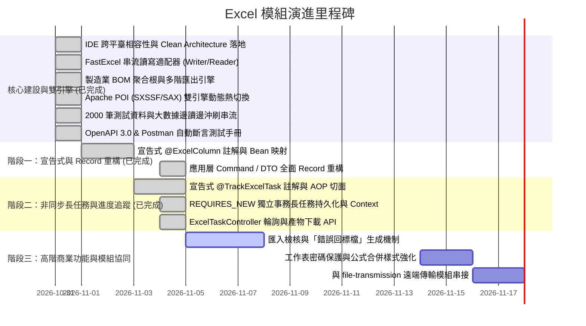

# Excel 企業級核心與物料清單 (BOM) 多階結構處理模組 (Excel & BOM Module)

[](https://adoptium.net/)
[](https://spring.io/projects/spring-boot)
[](#1-架構設計與雙引擎模型-architecture--dual-engine)
[](#2-雙引擎動態切換指南-dual-engine-configuration)
[](#7-自動化測試與品質保證-testing--verification)

> 📌 本模組為企業級高性能試算表處理解決方案，原生結合製造業 **物料清單 (Bill of Materials, BOM)** 多階遞迴展開與匯出引擎。嚴格遵循 **領域驅動設計 (DDD)**、**Clean Architecture** 與 **六角形架構 (Hexagonal / Ports & Adapters)**，實踐表現層、應用層、領域層與底層實作的完全解耦。

---

## 核心特性亮點 (Key Features)

* 🚀 **雙引擎動態熱切換 (Dual-Engine Pluggable)**：
  * **FastExcel 0.20.2**：StAX 事件導向極速串流，適合百萬級大數據與極限吞吐量。
  * **Apache POI 5.5.1 (SXSSF / SAX)**：低記憶體滑動窗口串流寫入＋SAX 讀取，支援凍結窗格（Freeze Panes）、標題樣式與磁碟暫存安全清理（`dispose()`）。
  * 透過 `application.properties` 設定旗標 `excel.engine`，業務程式碼 **100% 零修改**。
* ⚡ **大數據常數級串流 ($O(1)$ Memory Streaming)**：
  * 支援邊產製邊傳輸（HTTP 區塊傳輸編碼 `Transfer-Encoding: chunked`），透過 `flushInterval` 定期釋放記憶體。
  * 串流讀取支援逐列消費（`ExcelRowConsumer`）、分塊批次消費（`ExcelChunkConsumer`）與全生命週期監聽（`ExcelStreamListener`），杜絕大檔上傳 OOM。
* ⏱️ **宣告式非同步長任務追蹤與進度回報 (@TrackExcelTask)**：
  * 基於 Spring AOP 無感攔截底層讀寫適配器方法，結合動態 SpEL 表達式解析目標檔名與預估總列數。
  * 串流分批沖刷（`flush`）時透過 `ExcelTaskContextHolder` (`ThreadLocal`) 自動累計進度並即時更新至資料庫。
  * 任務持久化全面宣告獨立交易傳播（`@Transactional(propagation = Propagation.REQUIRES_NEW)`），解決在 MySQL 唯讀交易中寫入任務實體的阻斷問題。
  * 專職控制器 [`ExcelTaskController`](file:///d:/桌面/ModuleWorkSpace/excel-module/src/main/java/com/example/demo/presentation/controller/ExcelTaskController.java) 支援前端即時輪詢進度 (`/progress`) 與產出檔案下載 (`/download`)。
* 📝 **宣告式物件映射 (@ExcelSheet & @ExcelColumn / ExcelBeanAssembler)**：
  * 原生支援 Java 21 Record 與標準 JavaBean 雙軌映射，內建高並發元數據快取（`ConcurrentHashMap`）。
  * 雙向寬鬆表頭/索引匹配、自動清除貨幣符號與千分位逗號、多元日期時間格式與枚舉安全解析。
* 🛡️ **宣告式客製驗證與「錯誤回標檔」生成 (EasyRules & Error Feedback)**：
  * 原生支援多層次檢核管線，封裝輕量級規則引擎 **EasyRules**（支援條件與動作解耦、Priority 優先級排程與非短路全量錯誤事實累積）。
  * 支援 Java 21 Record 與標準 POJO 雙軌驗證，搭配整表防重複比對 SPI（`ExcelSheetValidatorPort`）。
  * 檢核失敗時自動生成視覺化「錯誤回標檔」：出錯儲存格套用國際標準淡紅色背景（`#FFC7CE` / `ROSE`）＋深紅色文字（`#9C0006`），最右側動態追加「檢核結果與錯誤原因」欄位，供使用者直觀修正後直接重新上傳。
* 📦 **應用層模型 Java 21 Record 全面重構**：
  * `application/shared/` 內的所有 **Command**、**Query** 與 **DTO** 全數重構為不可變 `record`，純資料載體零業務邏輯侵入，同時保留 Builder 與相容存取別名，確保 100% 向後相容。
* 🏭 **製造業多階 BOM 匯出引擎 (Multi-Level BOM Engine)**：
  * 支援多階層產品結構遞迴展開、單階用量匯總、物料主檔對照表三合一 Excel 產製。
  * 預載工業級無人機等 2,000 筆物料主檔與 25 筆 BOM 配方實機資料。
* 🛡️ **高純度架構規範 (Strict Clean Architecture)**：
  * 領域層（Domain Layer）維持純粹 Java（Pure Java），**嚴禁使用 Lombok**，聚合根以業務語意封裝不變條件。
  * 應用層（Application Layer）嚴守 CQRS、Command/Query/Result 物件隔離與防腐層機制（ACL）。
* 📋 **完整測試資產 (Comprehensive Testing Assets - 163/163 Passed)**：
  * 內建 OpenAPI 3.0 (Swagger UI) 與 Postman 整合測試集合（含 `pm.test` 自動斷言腳本）。
  * 單元與整合測試全量綠燈通過。

---

## 1. 架構設計與雙引擎模型 (Architecture & Dual-Engine)

```mermaid
flowchart TD
    subgraph Presentation ["Presentation Layer (表現層 - Inbound Adapters)"]
        BomCtrl["BomController<br/>/api/v1/bom/excel"]
        ExcelCtrl["ExcelController<br/>/api/v1/excel"]
        BeanCtrl["ExcelBeanMappingController<br/>/api/v1/excel/bean-mapping"]
        MatBomCtrl["MaterialBomExcelController<br/>/api/v1/excel/material-bom"]
        TaskCtrl["ExcelTaskController<br/>/api/v1/excel/tasks"]
        ValCtrl["ExcelValidationController<br/>/api/v1/excel/validation"]
        ResAssembler["ResourceAssembler<br/>(防腐層 ACL 轉換)"]
    end

    subgraph Application ["Application Layer (應用層 - CQRS & 業務契約)"]
        InPorts["Inbound Ports (UseCase)<br/>• ExportBomUseCase / StreamExportBomUseCase<br/>• ExportExcelUseCase / StreamExportExcelUseCase<br/>• ImportExcelUseCase / StreamImportExcelUseCase<br/>• GetExcelTaskUseCase / ValidateExcelUseCase"]
        AppServices["Application Services<br/>• BomCommandService / BomQueryService<br/>• ExcelCommandService / ExcelQueryService<br/>• ExcelTaskCommandService / ExcelTaskQueryService<br/>• ExcelValidationApplicationService"]
        AppAssembler["ExcelBeanAssembler<br/>(雙向 Record/POJO 映射)"]
        SharedModels["Shared Models (Java 21 Records)<br/>• Commands (WriteExcelCommand, ExportBomCommand...)<br/>• Queries (ReadExcelQuery, GetExcelTaskQuery...)<br/>• DTOs (ExcelGottenResult, ExcelValidationGottenResult...)"]
        OutPorts["Outbound Ports (port.out)<br/>• ExcelWriterPort / ExcelReaderPort<br/>• BomRepositoryPort / MaterialRepositoryPort<br/>• ExcelTaskRepositoryPort<br/>• ExcelRowValidatorPort / ExcelErrorMarkerPort"]
    end

    subgraph Domain ["Domain Layer (核心領域層 - Pure Java / 零外層依賴)"]
        MatAgg["Material Aggregate Root<br/>• MaterialId, MaterialCode, MaterialCategory"]
        BomAgg["Bom Aggregate Root<br/>• BomItem Entity, BomVersion, Quantity, ScrapRate"]
    end

    subgraph Infrastructure ["Infrastructure Layer (基礎設施層 - Outbound Adapters)"]
        subgraph EngineAdapters ["adapter.engine (讀寫核心引擎)"]
            FEWriter["FastExcelWriterAdapter<br/>(@TrackExcelTask)"]
            FEReader["FastExcelReaderAdapter"]
            PoiWriter["PoiSxssfWriterAdapter<br/>(@TrackExcelTask)"]
            PoiReader["PoiSaxReaderAdapter"]
        end
        subgraph PersistenceAdapters ["adapter.persistence (持久化倉儲)"]
            MatRepo["MaterialRepositoryAdapter $\to$ MaterialJpaRepository"]
            BomRepo["BomRepositoryAdapter $\to$ BomJpaRepository"]
            TaskRepo["ExcelTaskRepositoryAdapter<br/>(REQUIRES_NEW 獨立事務)"]
        end
        subgraph ValidatorAdapters ["adapter.validator (規則引擎校驗)"]
            EasyRulesAdapter["EasyRulesExcelValidatorAdapter<br/>(非短路全量錯誤累積)"]
        end
        subgraph FeedbackAdapters ["adapter.feedback (視覺化錯誤回標)"]
            PoiFeedbackAdapter["PoiExcelErrorMarkerAdapter<br/>(ROSE 樣式高亮 + 錯誤欄位追加)"]
        end
        subgraph AOP_Module ["AOP 橫切基礎設施 (Cross-Cutting AOP)"]
            TaskAspect["ExcelTaskTrackingAspect (@TrackExcelTask)"]
            ValAspect["ExcelValidationAspect (@ValidateExcel)"]
            TaskContext["ExcelTaskContextHolder"]
            ValContext["ExcelValidationContextHolder"]
        end
    end

    subgraph ConfigLayer ["Configuration Layer (配置層)"]
        EngineConfig["ExcelEngineConfiguration<br/>(@ConditionalOnProperty: excel.engine)"]
        WebMvcCfg["WebMvcConfig<br/>(註冊 ValidatedExcelDataArgumentResolver)"]
    end

    BomCtrl --> ResAssembler
    ExcelCtrl --> ResAssembler
    BeanCtrl --> ResAssembler
    TaskCtrl --> ResAssembler
    ValCtrl --> ResAssembler
    ResAssembler --> InPorts
    InPorts --> AppServices
    AppServices --> Domain
    AppServices --> AppAssembler
    AppServices --> OutPorts
    EngineConfig -. 條件注入 .-> OutPorts
    FEWriter -.->|實作| OutPorts
    FEReader -.->|實作| OutPorts
    PoiWriter -.->|實作| OutPorts
    PoiReader -.->|實作| OutPorts
    MatRepo -.->|實作| OutPorts
    BomRepo -.->|實作| OutPorts
    TaskRepo -.->|實作| OutPorts
    EasyRulesAdapter -.->|實作| OutPorts
    PoiFeedbackAdapter -.->|實作| OutPorts
    TaskAspect -. 攔截 .-> FEWriter
    TaskAspect -. 攔截 .-> PoiWriter
    TaskAspect --> TaskContext
    TaskAspect --> TaskRepo
    ValAspect -. 攔截 .-> ValCtrl
    ValAspect --> ValContext
    ValAspect --> InPorts
```



---

## 2. 雙引擎動態切換指南 (Dual-Engine Configuration)

本專案支援由 [`ExcelEngineConfiguration.java`](file:///d:/桌面/ModuleWorkSpace/excel-module/src/main/java/com/example/demo/config/ExcelEngineConfiguration.java) 動態決定底層注入的適配器。

### 2.1 設定檔參數 (`application.properties`)

```properties
# Excel 底層處理引擎配置 (可選值: FAST_EXCEL / APACHE_POI)
# 預設值為 FAST_EXCEL (若未指定則自動 fallback 為 FAST_EXCEL)
excel.engine=FAST_EXCEL
```

### 2.2 引擎特性與使用情境對比

| 引擎旗標值 | 核心實現技術 | 輸出適配器 | 輸入適配器 | 核心優勢 | 適用情境 |
| :--- | :--- | :--- | :--- | :--- | :--- |
| **`FAST_EXCEL`**<br>*(預設)* | FastExcel 0.20.2<br>(StAX 串流) | [`FastExcelWriterAdapter`](file:///d:/桌面/ModuleWorkSpace/excel-module/src/main/java/com/example/demo/infrastructure/adapter/engine/FastExcelWriterAdapter.java) | [`FastExcelReaderAdapter`](file:///d:/桌面/ModuleWorkSpace/excel-module/src/main/java/com/example/demo/infrastructure/adapter/engine/FastExcelReaderAdapter.java) | 毫秒級吞吐量、低 CPU、純記憶體緩衝、極小依賴體積 | 百萬級大數據匯出、即時高併發 API、大檔案排程批次匯出 |
| **`APACHE_POI`** | Apache POI 5.5.1<br>(SXSSF + SAX) | [`PoiSxssfWriterAdapter`](file:///d:/桌面/ModuleWorkSpace/excel-module/src/main/java/com/example/demo/infrastructure/adapter/engine/PoiSxssfWriterAdapter.java) | [`PoiSaxReaderAdapter`](file:///d:/桌面/ModuleWorkSpace/excel-module/src/main/java/com/example/demo/infrastructure/adapter/engine/PoiSaxReaderAdapter.java) | 工業級豐富樣式、凍結窗格、磁碟快取緩衝、公式與多格式相容 | 企業級標準報表、樣式複雜之商業試算表、格式強檢驗需求 |

### 2.3 核心模組與 Package 定位速查表 (Module & Package Navigation Matrix)

為方便開發者迅速定位各業務功能與技術實作所在的 Java Package，以下彙整垂直切片模組之套件路徑與核心類別對照表：

#### ① 宣告式註解模組 (`com.example.demo.application.annotation`)
| 模組分類 | 套件路徑 (Package) | 核心註解類別 | 職責與用途說明 |
| :--- | :--- | :--- | :--- |
| **`mapping`**<br>(物件映射) | [`application.annotation.mapping`](file:///d:/桌面/ModuleWorkSpace/excel-module/src/main/java/com/example/demo/application/annotation/mapping) | [`@ExcelSheet`](file:///d:/桌面/ModuleWorkSpace/excel-module/src/main/java/com/example/demo/application/annotation/mapping/ExcelSheet.java)<br>[`@ExcelColumn`](file:///d:/桌面/ModuleWorkSpace/excel-module/src/main/java/com/example/demo/application/annotation/mapping/ExcelColumn.java) | 標註於 Model 類別或 Record 元件，宣告工作表名稱、表頭名稱、欄位索引、日期/數值格式化與預設值 |
| **`task`**<br>(任務追蹤) | [`application.annotation.task`](file:///d:/桌面/ModuleWorkSpace/excel-module/src/main/java/com/example/demo/application/annotation/task) | [`@TrackExcelTask`](file:///d:/桌面/ModuleWorkSpace/excel-module/src/main/java/com/example/demo/application/annotation/task/TrackExcelTask.java) | 標註於讀寫方法，由 AOP 自動接管非同步長任務建檔、SpEL 檔名解析、進度累計與生命週期狀態更新 |
| **`validation`**<br>(資料檢核) | [`application.annotation.validation`](file:///d:/桌面/ModuleWorkSpace/excel-module/src/main/java/com/example/demo/application/annotation/validation) | [`@ValidateExcel`](file:///d:/桌面/ModuleWorkSpace/excel-module/src/main/java/com/example/demo/application/annotation/validation/ValidateExcel.java)<br>[`@ValidatedExcelData`](file:///d:/桌面/ModuleWorkSpace/excel-module/src/main/java/com/example/demo/application/annotation/validation/ValidatedExcelData.java) | `@ValidateExcel` 宣告於 Controller 端點自動執行 EasyRules 檢核與錯誤回標短路；`@ValidatedExcelData` 用於注入檢核通過之合規資料清單 |

#### ② 基礎設施輸出適配器模組 (`com.example.demo.infrastructure.adapter`)
| 模組分類 | 套件路徑 (Package) | 核心適配器實作 (Adapter) | 對應 Outbound Port 合約與技術說明 |
| :--- | :--- | :--- | :--- |
| **`engine`**<br>(讀寫核心引擎) | [`infrastructure.adapter.engine`](file:///d:/桌面/ModuleWorkSpace/excel-module/src/main/java/com/example/demo/infrastructure/adapter/engine) | * [`FastExcelReaderAdapter`](file:///d:/桌面/ModuleWorkSpace/excel-module/src/main/java/com/example/demo/infrastructure/adapter/engine/FastExcelReaderAdapter.java)<br>* [`FastExcelWriterAdapter`](file:///d:/桌面/ModuleWorkSpace/excel-module/src/main/java/com/example/demo/infrastructure/adapter/engine/FastExcelWriterAdapter.java)<br>* [`PoiSaxReaderAdapter`](file:///d:/桌面/ModuleWorkSpace/excel-module/src/main/java/com/example/demo/infrastructure/adapter/engine/PoiSaxReaderAdapter.java)<br>* [`PoiSxssfWriterAdapter`](file:///d:/桌面/ModuleWorkSpace/excel-module/src/main/java/com/example/demo/infrastructure/adapter/engine/PoiSxssfWriterAdapter.java) | 實作 [`ExcelReaderPort`](file:///d:/桌面/ModuleWorkSpace/excel-module/src/main/java/com/example/demo/application/port/out/ExcelReaderPort.java) 與 [`ExcelWriterPort`](file:///d:/桌面/ModuleWorkSpace/excel-module/src/main/java/com/example/demo/application/port/out/ExcelWriterPort.java)，提供 FastExcel 與 Apache POI 雙引擎之批次、多工作表與 $O(1)$ 串流讀寫 |
| **`persistence`**<br>(持久化倉儲) | [`infrastructure.adapter.persistence`](file:///d:/桌面/ModuleWorkSpace/excel-module/src/main/java/com/example/demo/infrastructure/adapter/persistence) | * [`BomRepositoryAdapter`](file:///d:/桌面/ModuleWorkSpace/excel-module/src/main/java/com/example/demo/infrastructure/adapter/persistence/BomRepositoryAdapter.java)<br>* [`MaterialRepositoryAdapter`](file:///d:/桌面/ModuleWorkSpace/excel-module/src/main/java/com/example/demo/infrastructure/adapter/persistence/MaterialRepositoryAdapter.java)<br>* [`ExcelTaskRepositoryAdapter`](file:///d:/桌面/ModuleWorkSpace/excel-module/src/main/java/com/example/demo/infrastructure/adapter/persistence/ExcelTaskRepositoryAdapter.java) | 實作 [`BomRepositoryPort`](file:///d:/桌面/ModuleWorkSpace/excel-module/src/main/java/com/example/demo/application/port/out/BomRepositoryPort.java)、[`MaterialRepositoryPort`](file:///d:/桌面/ModuleWorkSpace/excel-module/src/main/java/com/example/demo/application/port/out/MaterialRepositoryPort.java) 與 [`ExcelTaskRepositoryPort`](file:///d:/桌面/ModuleWorkSpace/excel-module/src/main/java/com/example/demo/application/port/out/ExcelTaskRepositoryPort.java)，銜接 Spring Data JPA Repository 與資料庫，進行實體與 DTO 防腐轉換 |
| **`validator`**<br>(規則引擎校驗) | [`infrastructure.adapter.validator`](file:///d:/桌面/ModuleWorkSpace/excel-module/src/main/java/com/example/demo/infrastructure/adapter/validator) | * [`EasyRulesExcelValidatorAdapter`](file:///d:/桌面/ModuleWorkSpace/excel-module/src/main/java/com/example/demo/infrastructure/adapter/validator/EasyRulesExcelValidatorAdapter.java) | 實作 [`ExcelRowValidatorPort`](file:///d:/桌面/ModuleWorkSpace/excel-module/src/main/java/com/example/demo/application/port/out/ExcelRowValidatorPort.java)，封裝 EasyRules 規則引擎，提供非短路全量錯誤累積推論 |
| **`feedback`**<br>(視覺化回標) | [`infrastructure.adapter.feedback`](file:///d:/桌面/ModuleWorkSpace/excel-module/src/main/java/com/example/demo/infrastructure/adapter/feedback) | * [`PoiExcelErrorMarkerAdapter`](file:///d:/桌面/ModuleWorkSpace/excel-module/src/main/java/com/example/demo/infrastructure/adapter/feedback/PoiExcelErrorMarkerAdapter.java) | 實作 [`ExcelErrorMarkerPort`](file:///d:/桌面/ModuleWorkSpace/excel-module/src/main/java/com/example/demo/application/port/out/ExcelErrorMarkerPort.java)，使用 POI 將出錯儲存格套用淡紅底 (ROSE) 與深紅字 (DARK_RED) 標註，並動態追加錯誤原因說明欄 |

#### ③ AOP 橫切攔截與執行緒上下文模組
| 模組職責 | 套件路徑 (Package) | 核心類別 | 職責與用途說明 |
| :--- | :--- | :--- | :--- |
| **長任務追蹤切面** | [`infrastructure.aop`](file:///d:/桌面/ModuleWorkSpace/excel-module/src/main/java/com/example/demo/infrastructure/aop) | [`ExcelTaskTrackingAspect`](file:///d:/桌面/ModuleWorkSpace/excel-module/src/main/java/com/example/demo/infrastructure/aop/ExcelTaskTrackingAspect.java) | 攔截 `@TrackExcelTask`，負責長任務獨立事務建檔 (`REQUIRES_NEW`)、SpEL 表達式解析、進度累加與 Context 綁定 |
| **長任務上下文** | [`application.shared.context`](file:///d:/桌面/ModuleWorkSpace/excel-module/src/main/java/com/example/demo/application/shared/context) | [`ExcelTaskContextHolder`](file:///d:/桌面/ModuleWorkSpace/excel-module/src/main/java/com/example/demo/application/shared/context/ExcelTaskContextHolder.java) | `ThreadLocal` 任務上下文持有者，提供串流處理期間跨方法、跨層級之安全進度回報 |
| **檔案檢核切面** | [`infrastructure.aop`](file:///d:/桌面/ModuleWorkSpace/excel-module/src/main/java/com/example/demo/infrastructure/aop) | [`ExcelValidationAspect`](file:///d:/桌面/ModuleWorkSpace/excel-module/src/main/java/com/example/demo/infrastructure/aop/ExcelValidationAspect.java) | 攔截 `@ValidateExcel`，自動解析上傳檔案執行校驗，若出錯直接回標短路；若通過則將合規資料注入參數 |
| **檢核上下文** | [`application.shared.context`](file:///d:/桌面/ModuleWorkSpace/excel-module/src/main/java/com/example/demo/application/shared/context) | [`ExcelValidationContextHolder`](file:///d:/桌面/ModuleWorkSpace/excel-module/src/main/java/com/example/demo/application/shared/context/ExcelValidationContextHolder.java) | `ThreadLocal` 檢核結果上下文持有者，供切面與參數解析器無縫共享合規資料集 |
| **範本動態註冊表** | [`application.shared.registry`](file:///d:/桌面/ModuleWorkSpace/excel-module/src/main/java/com/example/demo/application/shared/registry) | [`ExcelTemplateRegistry`](file:///d:/桌面/ModuleWorkSpace/excel-module/src/main/java/com/example/demo/application/shared/registry/ExcelTemplateRegistry.java) | 集中管理 Excel 模型元數據（開放封閉原則 OCP），支援多重別名解析、Zero-Config 工作表名稱自動反查與統一動態路由 |

#### ④ 業務規則引擎與具體檢核規則 (`com.example.demo.infrastructure.validator.rules`)
| 角色 | 套件路徑 (Package) | 核心類別 | 說明 |
| :--- | :--- | :--- | :--- |
| **規則抽象基類** | [`infrastructure.validator.rules`](file:///d:/桌面/ModuleWorkSpace/excel-module/src/main/java/com/example/demo/infrastructure/validator/rules) | [`AbstractExcelRowValidationRule`](file:///d:/桌面/ModuleWorkSpace/excel-module/src/main/java/com/example/demo/infrastructure/validator/rules/AbstractExcelRowValidationRule.java) | 封裝 EasyRules 的 `@Condition` 與 `@Action`，簡化型別比對與錯誤生成樣板代碼 |
| **訂單金額規則** | [`infrastructure.validator.rules`](file:///d:/桌面/ModuleWorkSpace/excel-module/src/main/java/com/example/demo/infrastructure/validator/rules) | [`OrderAmountValidationRule`](file:///d:/桌面/ModuleWorkSpace/excel-module/src/main/java/com/example/demo/infrastructure/validator/rules/OrderAmountValidationRule.java) | 驗證 `OrderModel` 購買金額必須大於 0.00 |
| **訂單數量規則** | [`infrastructure.validator.rules`](file:///d:/桌面/ModuleWorkSpace/excel-module/src/main/java/com/example/demo/infrastructure/validator/rules) | [`OrderQuantityValidationRule`](file:///d:/桌面/ModuleWorkSpace/excel-module/src/main/java/com/example/demo/infrastructure/validator/rules/OrderQuantityValidationRule.java) | 驗證 `OrderModel` 購買數量必須介於 1 至 9,999 |
| **商品售價規則** | [`infrastructure.validator.rules`](file:///d:/桌面/ModuleWorkSpace/excel-module/src/main/java/com/example/demo/infrastructure/validator/rules) | [`ProductPriceValidationRule`](file:///d:/桌面/ModuleWorkSpace/excel-module/src/main/java/com/example/demo/infrastructure/validator/rules/ProductPriceValidationRule.java) | 驗證 Java 21 Record `ProductRecordModel` 商品售價必須大於 0 |

#### ⑤ 表現層控制器與參數解析器 (`com.example.demo.presentation.*`)
| 模組職責 | 套件路徑 (Package) | 核心類別 | 說明 |
| :--- | :--- | :--- | :--- |
| **客製檢核控制器** | [`presentation.controller`](file:///d:/桌面/ModuleWorkSpace/excel-module/src/main/java/com/example/demo/presentation/controller) | [`ExcelValidationController`](file:///d:/桌面/ModuleWorkSpace/excel-module/src/main/java/com/example/demo/presentation/controller/ExcelValidationController.java) | 基於 OCP 統一接口精簡為 5 隻核心 API（`/{templateKey}/feedback`, `/{templateKey}`, `/feedback`, `/templates`, `/declarative/orders`），支援任意業務範本動態檢核與錯誤回標 |
| **物料/BOM 映射控制器** | [`presentation.controller`](file:///d:/桌面/ModuleWorkSpace/excel-module/src/main/java/com/example/demo/presentation/controller) | [`MaterialBomExcelController`](file:///d:/桌面/ModuleWorkSpace/excel-module/src/main/java/com/example/demo/presentation/controller/MaterialBomExcelController.java) | 精簡為 4 隻高內聚核心 API，提供物料主檔與單階 BOM 配方清單之實機一鍵下載 (`/materials/export`, `/bom-items/export`) 與宣告式快速解析 (`/materials/import`, `/bom-items/import`) |
| **參數解析器** | [`presentation.resolver`](file:///d:/桌面/ModuleWorkSpace/excel-module/src/main/java/com/example/demo/presentation/resolver) | [`ValidatedExcelDataArgumentResolver`](file:///d:/桌面/ModuleWorkSpace/excel-module/src/main/java/com/example/demo/presentation/resolver/ValidatedExcelDataArgumentResolver.java) | Spring MVC `HandlerMethodArgumentResolver`，自動將檢核通過之資料清單注入 Controller 方法參數 |
| **全域例外處理** | [`presentation.exception`](file:///d:/桌面/ModuleWorkSpace/excel-module/src/main/java/com/example/demo/presentation/exception) | [`GlobalExceptionHandler`](file:///d:/桌面/ModuleWorkSpace/excel-module/src/main/java/com/example/demo/presentation/exception/GlobalExceptionHandler.java) | 攔截 `ExcelValidationFailedException` 等業務例外，轉譯為 HTTP 422 Unprocessable Entity |

---

## 3. 物料清單 (BOM) 多階匯出架構

BOM 模組整合了製造業標準產品結構樹（Bill of Materials），由 [`BomCommandService.java`](file:///d:/桌面/ModuleWorkSpace/excel-module/src/main/java/com/example/demo/application/service/BomCommandService.java) 與 [`BomQueryService.java`](file:///d:/桌面/ModuleWorkSpace/excel-module/src/main/java/com/example/demo/application/service/BomQueryService.java) 負責遞迴展開並組合為多工作表 Excel：

### 3.1 匯出 Excel 工作表規劃
1. **工作表一：多階展開清單 (Multi-Level BOM)**
   * 遞迴展開成品 $\to$ 半成品 $\to$ 零組件之完整樹狀結構。
   * 包含：階層標註（`.1`, `..2`, `...3`）、母件料號、子件料號、物料品名、規格、單階用量、累計總用量、損耗率、位號與備註。
2. **工作表二：單階用量清單 (Single-Level Summary)**
   * 針對直接組成零件彙總需求總量。
3. **工作表三：物料主檔對照表 (Material Master)**
   * 包含涉及的所有物料識別資訊、類別（成品/半成品/原物料）、基本單位與標準成本。

### 3.2 預載實機測試資料 (`material_bom_test_data.sql`)
資料庫初始化已載入 **2,000 筆物料主檔** 與 **25 筆 BOM 配方**，代表性成品料號如下：
* **`MAT-FG-001`**：工業級四軸無人機旗艦套件（3 階結構，展開 11 項核心料件）
* **`MAT-FG-002`**：智慧農業高壓植保無人機總成
* **`MAT-FG-003`**：專業航拍雙光熱成像雲台無人機
* **`MAT-SA-001`**：無人機飛控核心運算主板模組（2 階半成品）

---

## 4. API 介面與測試指引 (API Guide & Quick Start)

### 4.1 互動式介面 (Swagger UI)
啟動專案後直接透過瀏覽器開啟：
* **Swagger UI**：`http://localhost:8080/swagger-ui.html`
* **OpenAPI 3.0 規範**：`http://localhost:8080/v3/api-docs`

### 4.2 常用 cURL 操作指令

#### ① 下載指定成品多階層 BOM Excel (標準批次)
```bash
curl -i -X GET "http://localhost:8080/api/v1/bom/excel?parentMaterialCode=MAT-FG-001" -O -J
```

#### ② 大數據邊讀邊沖刷串流下載 (觸發 @TrackExcelTask 長任務追蹤)
```bash
curl -i -X GET "http://localhost:8080/api/v1/bom/excel/stream?parentMaterialCode=MAT-FG-001&flushInterval=500" -O -J
```

#### ③ 查詢非同步長任務進度與狀態 (輪詢進度)
```bash
curl -i -X GET "http://localhost:8080/api/v1/excel/tasks/{taskId}/progress"
```

#### ④ 下載已完成長任務之產出檔案
```bash
curl -i -X GET "http://localhost:8080/api/v1/excel/tasks/{taskId}/download" -O -J
```

#### ⑤ Excel 通用大數據串流匯出 (帶入自訂沖刷筆數)
```bash
curl -X POST http://localhost:8080/api/v1/excel/export/stream \
  -H "Content-Type: application/json" \
  -d '{
    "fileName": "stress_export.xlsx",
    "sheetName": "StressSheet",
    "headers": ["序號", "批次碼", "隨機數值", "建立時間"],
    "rowCount": 5000,
    "batchFlushSize": 500
  }' \
  --output stress_export.xlsx
```

---

## 5. 專案分層與核心目錄結構 (Project Structure)

```text
excel-module/
├── doc/
│   ├── design/
│   │   ├── architecture-design.md              # 架構設計與演進藍圖指南
│   │   ├── annotation-driven-task-tracking.md  # 宣告式長任務監控詳細架構設計
│   │   ├── custom-validation-and-error-feedback.md # 客製驗證引擎與錯誤回標檔設計指南
│   │   ├── declarative-bean-mapping.md         # 宣告式物件映射架構指南
│   │   ├── material_bom_aggregate_design.md    # BOM 聚合根與資料庫詳細設計
│   │   └── streaming-processing.md             # 串流處理專題技術手冊
│   ├── maintenance/
│   │   ├── custom-validation-and-error-feedback-manual.md # 客製驗證與錯誤回標檔使用與維護手冊
│   │   └── declarative-bean-mapping-manual.md  # 宣告式物件映射開發與維護手冊
│   ├── template/
│   │   ├── README.md                           # 測試範本使用說明與自動生成指南
│   │   ├── BOM_IMPORT.xlsx                     # BOM 匯入範本
│   │   ├── ORDER_IMPORT_SUCCESS.xlsx           # 合規訂單測試範本 (JavaBean)
│   │   ├── ORDER_IMPORT_WITH_ERRORS.xlsx       # 含違規資料訂單測試範本 (錯誤回標)
│   │   ├── PRODUCT_IMPORT_SUCCESS.xlsx         # 合規商品主檔測試範本 (Java 21 Record)
│   │   ├── PRODUCT_IMPORT_WITH_ERRORS.xlsx     # 含違規售價商品測試範本 (錯誤回標)
│   │   └── PO_IMPORT.xlsx                      # 採購明細匯入範本
│   └── test/
│       ├── README.md                           # API 測試手冊與 cURL 操作大全
│       ├── annotation_driven_task_testing_guide.md # 長任務端到端測試操作指引
│       ├── custom_validation_testing_guide.md  # 客製檢核與錯誤回標完整操作指引
│       ├── declarative_bean_mapping_guide.md   # 物件映射測試操作指引
│       ├── openapi_specification.yaml          # OpenAPI 3.0 規範定義檔
│       └── excel_bom_module_postman_collection.json # Postman 測試集合
├── src/
│   ├── main/
│   │   ├── java/com/example/demo/
│   │   │   ├── domain/                         # 【領域層】純 Java，零框架，禁止 Lombok
│   │   │   │   ├── material/aggregate/         # 物料主檔聚合 (Material Aggregate)
│   │   │   │   └── bom/aggregate/              # 物料清單聚合 (Bom & BomItem)
│   │   │   ├── application/                    # 【應用層】CQRS 調度、Port 介面
│   │   │   │   ├── annotation/                 # 宣告式註解 (垂直模組切片)
│   │   │   │   │   ├── mapping/                # 物件映射 (@ExcelSheet, @ExcelColumn)
│   │   │   │   │   ├── task/                   # 任務追蹤 (@TrackExcelTask)
│   │   │   │   │   └── validation/             # 檢核過濾 (@ValidateExcel, @ValidatedExcelData)
│   │   │   │   ├── port/in/                    # Inbound Ports (Export, Import, Task, Validate UseCases)
│   │   │   │   ├── port/out/                   # Outbound Ports (Writer, Reader, Task, Repo, Validator, Marker)
│   │   │   │   ├── service/                    # Application Services (Bom, Excel, Task, Validation)
│   │   │   │   ├── shared/                     # 共享不可變模型 (Java 21 Records)
│   │   │   │   │   ├── command/                # 業務命令 (WriteExcelCommand, ExportBomCommand...)
│   │   │   │   │   ├── query/                  # 查詢條件 (ReadExcelQuery, GetExcelTaskQuery)
│   │   │   │   │   ├── dto/                    # 結果載體 (ExcelGottenResult, ExcelValidationGottenResult...)
│   │   │   │   │   ├── model/                  # 檢核事實與業務模型 (ExcelRowError, OrderModel, ProductRecordModel)
│   │   │   │   │   ├── registry/               # OCP 動態範本註冊表 (ExcelTemplateRegistry)
│   │   │   │   │   ├── context/                # ThreadLocal 上下文 (ExcelTaskContextHolder, ExcelValidationContextHolder)
│   │   │   │   │   ├── exception/              # 應用層例外 (ExcelValidationFailedException...)
│   │   │   │   │   └── vo/                     # 實質物件 (ExcelTaskStatus, ExcelTaskType)
│   │   │   │   └── assembler/                  # DTO/Model 組裝器 (ExcelBeanAssembler, BomDtoAssembler)
│   │   │   ├── infrastructure/                 # 【基礎設施層】Outbound Adapters
│   │   │   │   ├── aop/                        # AOP 橫切切面 (ExcelTaskTrackingAspect, ExcelValidationAspect)
│   │   │   │   ├── adapter/                    # 垂直模組輸出適配器實作
│   │   │   │   │   ├── engine/                 # FastExcel / Apache POI 核心讀寫適配器
│   │   │   │   │   ├── persistence/            # Bom, Material, ExcelTask JPA 持久化適配器
│   │   │   │   │   ├── validator/              # EasyRules 規則引擎校驗適配器
│   │   │   │   │   └── feedback/               # Apache POI 視覺化錯誤回標適配器
│   │   │   │   ├── validator/rules/            # EasyRules 行級規則實作 (Order, Product Rules)
│   │   │   │   └── persistence/                # JPA ORM 實體與 Spring Data Repository
│   │   │   ├── presentation/                   # 【表現層】Inbound Adapters
│   │   │   │   ├── controller/                 # REST Controllers (Bom, Excel, Task, Bean, Validation)
│   │   │   │   ├── resolver/                   # 自訂參數解析器 (ValidatedExcelDataArgumentResolver)
│   │   │   │   ├── resource/                   # In/Out Resources (純資料載體)
│   │   │   │   ├── assembler/                  # 表現層 Resource 組裝器
│   │   │   │   └── exception/                  # 全域例外轉譯器 (GlobalExceptionHandler)
│   │   │   └── config/                         # 【配置層】全域配置與 Bean 註冊
│   │   │       ├── ExcelEngineConfiguration.java # 雙引擎動態注入配置
│   │   │       ├── AopConfiguration.java       # AspectJ 動態代理啟用配置
│   │   │       ├── AsyncConfiguration.java     # 長任務非同步執行緒池配置
│   │   │       ├── WebMvcConfig.java           # Spring MVC 參數解析器註冊
│   │   │       └── OpenApiConfig.java          # Swagger UI / OpenAPI 設定
│   │   └── resources/
│   │       ├── application.properties          # 系統與 excel.engine 配置檔
│   │       ├── templates/                      # 內建業務與錯誤回標測試範本 (.xlsx)
│   │       └── sql/material_bom_test_data.sql  # 2000 筆物料與 25 筆 BOM 測試 SQL
│   └── test/java/com/example/demo/             # 【測試套件】涵蓋 163 個單元與整合測試 (全數通過 BUILD SUCCESS)
```

---

## 6. 企業級擴充藍圖 (Roadmap & Evolution)



### Workspace 模組協同矩陣 (Module Synergy Matrix)
* **`customized-validation-module`**：整合商業欄位校驗引擎，提供上傳時之防腐校驗。
* **`file-transmission-module`**：匯出大檔時透過 Outbound Port 串接 MinIO / S3 / SFTP，回傳預簽章下載 URL。
* **`pdf-module`**：共用報表 DTO，依使用者需求無縫切換輸出為 Excel 試算表或防偽 PDF。
* **`locale-management-module`**：匯出時依據使用者的語系代碼，將表頭動態轉譯為多國語言。

---

## 7. 自動化測試與品質保證 (Testing & Verification)

本模組落實 **極致清晰之 Javadoc** 與 **BDD / Gherkin (Feature, Scenario, Given-When-Then)** 測試註解規範。

### 執行全套測試指令
```bash
./mvnw clean test
```

### 測試執行報告 (175/175 Passed)
```text
[INFO] -------------------------------------------------------
[INFO]  T E S T S
[INFO] -------------------------------------------------------
[INFO] Running BomDtoAssembler 資料與 BOM 資料組裝器測試 (4 tests)
[INFO] Running ExcelBeanAssembler 宣告式映射與 Application Service 流程測試 (7 tests)
[INFO] Running BomCommandService 物料清單匯出命令服務測試 (3 tests)
[INFO] Running BomQueryService 物料與 BOM 查詢服務測試 (6 tests)
[INFO] Running ExcelCommandService 匯出命令業務服務測試 (3 tests)
[INFO] Running ExcelQueryService 匯入查詢業務服務測試 (4 tests)
[INFO] Running ExcelTaskCommandService 非同步長任務命令服務測試 (4 tests)
[INFO] Running ExcelTaskQueryService 長任務查詢業務服務測試 (2 tests)
[INFO] Running ExcelValidationApplicationService 資料檢核應用服務測試 (4 tests)
[INFO] Running ExcelTaskContextHolder 任務上下文測試 (3 tests)
[INFO] Running ExcelValidationContextHolder 檢核上下文測試 (2 tests)
[INFO] Running ExcelTemplateRegistry 宣告式範本註冊表測試 (5 tests)
[INFO] Running ExcelEngineConfiguration 模組開關配置測試 (3 tests)
[INFO] Running Bom 物料清單聚合根測試 (9 tests)
[INFO] Running Material 物料主檔聚合根測試 (7 tests)
[INFO] Running FastExcelReaderAdapter 讀取適配器測試 (4 tests)
[INFO] Running FastExcelStreamingTest 大數據百萬級串流沖刷測試 (4 tests)
[INFO] Running FastExcelWriterAdapter 寫入適配器測試 (3 tests)
[INFO] Running PoiSaxReaderAdapter 讀取適配器測試 (3 tests)
[INFO] Running PoiSxssfWriterAdapter 寫入適配器測試 (3 tests)
[INFO] Running BomTemplateGeneratorTest 範本產製器測試 (1 test)
[INFO] Running TestTemplateGeneratorTest 業務範本自動生成測試 (1 test)
[INFO] Running BomRepositoryAdapter BOM 儲存庫適配器持久化整合測試 (6 tests)
[INFO] Running ExcelTaskRepositoryAdapter 儲存庫適配器持久化整合測試 (5 tests)
[INFO] Running MaterialRepositoryAdapter 物料儲存庫適配器持久化整合測試 (7 tests)
[INFO] Running EasyRulesExcelValidatorAdapter 規則引擎適配器測試 (3 tests)
[INFO] Running PoiExcelErrorMarkerAdapter 錯誤標註適配器測試 (1 test)
[INFO] Running ExcelTaskTrackingAspect 宣告式任務切面測試 (3 tests)
[INFO] Running ExcelValidationAspect 宣告式驗證切面測試 (3 tests)
[INFO] Running BomController 表現層 REST 控制器與參數校驗測試 (7 tests)
[INFO] Running BomIntegrationTest 完整流程整合測試 (4 tests)
[INFO] Running BomPoiIntegrationTest (Apache POI 模式下之 BOM 匯出整合測試) (3 tests)
[INFO] Running ExcelBeanMappingController 宣告式 Bean 映射控制器測試 (8 tests)
[INFO] Running ExcelController 表現層 REST 控制器與參數校驗測試 (9 tests)
[INFO] Running ExcelTaskController 非同步長任務 REST 控制器測試 (4 tests)
[INFO] Running ExcelValidationController 客製檢核與回標控制器測試 (9 tests)
[INFO] Running ExcelValidationIntegrationTest 宣告式檢核與錯誤回標整合測試 (端到端真實檔案上傳) (6 tests)
[INFO] Running MaterialBomExcelController 物料與 BOM 宣告式 Excel 控制器測試 (5 tests)
[INFO] Running ExcelBeanAssemblerTest 宣告式物件映射組裝器測試 (14 tests)
[INFO] 
[INFO] Results:
[INFO] Tests run: 175, Failures: 0, Errors: 0, Skipped: 0
[INFO] ------------------------------------------------------------------------
[INFO] BUILD SUCCESS
[INFO] ------------------------------------------------------------------------
```
