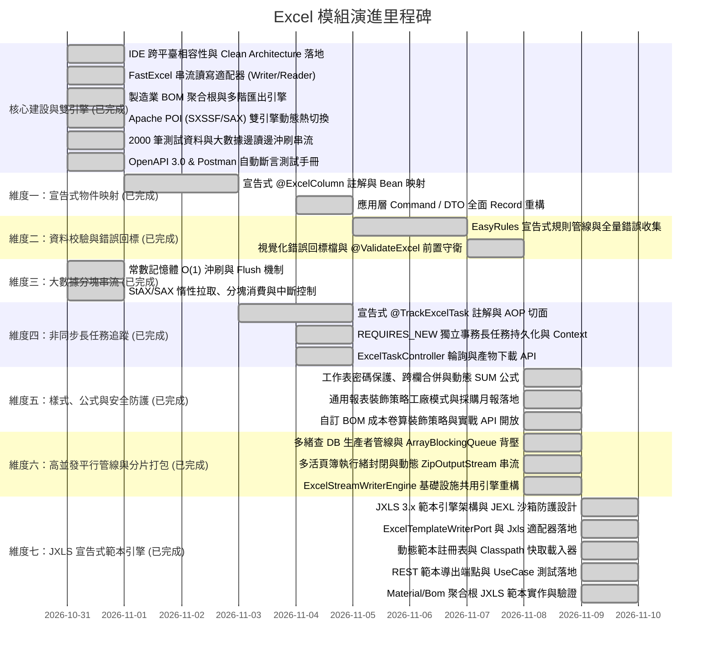

# Excel 企業級核心與物料清單 (BOM) 多階結構處理模組 (Excel & BOM Module)

[](https://adoptium.net/)
[](https://spring.io/projects/spring-boot)
[](#1-架構設計與雙引擎模型-architecture--dual-engine)
[](#2-雙引擎動態切換指南-dual-engine-configuration)
[](https://github.com/j-easy/easy-rules)
[](#7-自動化測試與品質保證-testing--verification)

> 📌 本模組為企業級高性能試算表處理解決方案，原生結合製造業 **物料清單 (Bill of Materials, BOM)** 多階遞迴展開與匯出引擎。嚴格遵循 **領域驅動設計 (DDD)**、**Clean Architecture** 與 **六角形架構 (Hexagonal / Ports & Adapters)**，實踐表現層、應用層、領域層與底層實作的完全解耦。

---

## 🧩 七大核心子模組一覽 (7 Core Sub-Modules Overview)

本專案依據 **DDD 垂直切片 (Vertical Slice Architecture)** 與 **六角形架構 (Hexagonal / Ports & Adapters)**，將核心功能嚴密劃分為 **七大對稱子模組**。各子模組於 `presentation`、`application`、`infrastructure` 以及 `test` 層級皆具備獨立專屬的 Package 命名空間，結構對稱、職責單一：

| 子模組代碼 | 子模組名稱 | 核心業務職責與特性 | 主要 API 端點 / 關鍵標註 | 專屬設計文檔 |
| :---: | :--- | :--- | :--- | :---: |
| 🏗️ **`bom`** | **物料清單多階展開** | 製造業 BOM 樹狀結構遞迴展開、單階用量匯總、物料主檔對照表三合一 Excel 產製與成本卷算。 | `/api/v1/bom/excel`<br>`/api/v1/excel/material-bom` | [BOM 聚合設計](doc/design/material_bom_aggregate_design.md) |
| ⚡ **`core`** | **雙引擎讀寫與物件映射** | FastExcel (StAX) 與 Apache POI (SXSSF) 雙引擎動態熱切換、百萬級串流讀寫、Record/POJO 宣告式雙向物件映射。 | `/api/v1/excel`<br>`/api/v1/excel/bean-mapping`<br>`@ExcelSheet`, `@ExcelColumn` | [串流讀寫設計](doc/design/streaming-processing.md)<br>[宣告式映射設計](doc/design/declarative-bean-mapping.md) |
| 🚀 **`parallel`** | **平行管線與分片打包** | 模式 A 多執行緒 DB 查詢管線加速（`ArrayBlockingQueue` 背壓防護）＋模式 B 獨立活頁簿並行產製與 ZIP 串流壓縮打包（突破單表 104 萬列物理限制）。 | `/api/v1/excel/parallel/pipeline/stream`<br>`/api/v1/excel/parallel/partition/zip/stream` | [平行與執行緒安全](doc/design/thread-safety-and-concurrency.md)<br>[分片寫入器對比](doc/design/excel-writer-vs-partition-writer-comparison.md) |
| 🎨 **`report`** | **企業報表裝飾與安全** | 通用裝飾策略工廠 SPI、合計列自動追加、動態 `=SUM(...)` 原生公式注入、跨欄合併、工作表密碼防護與列印頁首頁尾巨集。 | `/api/v1/excel/reports/{reportKey}/export`<br>`CellRange`, `@SheetProtectionConfig` | [報表裝飾與安全](doc/design/template-styles-and-security.md) |
| ⏱️ **`task`** | **非同步長任務追蹤** | 策略 B 顯式宣告 AOP 攔截、SpEL 動態參數解析、ThreadLocal 跨方法進度累計、`REQUIRES_NEW` 獨立交易進度持久化、TeeOutputStream 雙向分流檔案落盤與多次下載。 | `/api/v1/excel/tasks/{taskId}`<br>`/api/v1/excel/tasks/{taskId}/progress`<br>`/api/v1/excel/tasks/{taskId}/download`<br>`@TrackExcelTask` | [長任務追蹤設計](doc/design/annotation-driven-task-tracking.md) |
| 📑 **`template`** | **JXLS 範本渲染與維護** | JXLS 3.x 所見即所得 (WYSIWYG) 標籤渲染、JEXL 嚴格沙箱權限防護 (CVE 免疫)、動態公式平移與 Template 實體 DB-First CRUD 動態管理。 | `/api/v1/excel/templates`<br>`/api/v1/excel/templates/{templateKey}/stream`<br>`jx:area`, `jx:each` | [JXLS 範本總覽](doc/design/jxls-template-export.md)<br>[範本 CRUD 維護](doc/design/jxls-template-export/06-excel-template-management-crud.md) |
| 🛡️ **`validation`** | **規則檢核與錯誤回標** | EasyRules 宣告式規則管線、非短路全量錯誤累積、雙向資料合規校驗、自動產製視覺化「錯誤回標檔」（紅底黑字＋錯誤原因說明欄）。 | `/api/v1/excel/validation/import-and-validate`<br>`@ValidateExcel` | [客製檢核與錯誤回標](doc/design/custom-validation-and-error-feedback.md) |

#### 📦 子模組對稱 Package 結構矩陣 (Symmetrical Package Matrix)

```text
com.example.demo
├── presentation/
│   ├── controller/               # REST 控制器 (bom, core, parallel, report, task, template, validation)
│   ├── assembler/                # 防腐層 Resource/Command 組裝器
│   └── resource/                 # 表現層資料載體 (in/ 與 out/)
├── application/
│   ├── port/in/                  # Inbound Ports / UseCases (各子模組專屬業務合約)
│   ├── port/out/                 # Outbound Ports (各子模組基礎設施依賴介面)
│   ├── service/                  # Application Services (CQRS Command/Query 協調者)
│   └── shared/                   # 不可變 Commands, Queries, DTOs 與共用策略 SPI
├── infrastructure/
│   ├── adapter/                  # Outbound Adapters (實作 application.port.out)
│   ├── persistence/              # 持久化實體與 JPA Repositories (bom, task, template)
│   ├── engine/                   # FastExcel / POI / JXLS 底層引擎適配
│   ├── report/                   # 企業報表具體裝飾策略實現
│   └── validation/               # EasyRules 具體業務檢核規則
└── domain/                       # 核心領域層 (純 Java，零框架依賴，Aggregate Root 與 VO)
    ├── bom/                      # BOM 樹狀聚合根與物料實體
    └── task/                     # 長任務聚合根與狀態機
```

---

## 核心技術棧 (Core Technology Stack)

本專案採用現代化 Java 企業級主流技術棧，全面發揮語言與框架特性：

| 技術範疇 | 技術元件與版本 | 核心用途與架構實踐 |
| :--- | :--- | :--- |
| **執行環境與語言** | **Java 22 / 21+ LTS** | 廣泛採用不可變 **Java 21 Record** 作為純資料載體（Command, Query, DTO, Value Object）；利用規範建構子（Canonical Constructor）進行不可變校驗；模式匹配與嚴密型別防護。 |
| **後端核心框架** | **Spring Boot 4.1.2** | 應用上下文管理、條件化 Bean 裝配（`@ConditionalOnProperty` / `@ConditionalOnMissingBean`）、MVC 參數解析器擴充。 |
| **極速串流引擎** | **FastExcel 0.20.2** | StAX 事件導向拉取式讀取與直接沖刷寫出，常數級 $O(1)$ 記憶體佔用，專門承載百萬級巨量大數據匯出與高吞吐量 API。 |
| **全功能報表引擎** | **Apache POI 5.5.1** | `SXSSFWorkbook` 低記憶體滑動窗口硬碟暫存寫入＋`SAX eventusermodel` 輕量事件讀取；多階儲存格跨欄跨列合併、動態 SUM 公式求值、工作表密碼保護、列印頁首頁尾巨集。 |
| **規則引擎** | **EasyRules 4.1.0** | 宣告式業務檢核管線；POJO 規則組件庫封裝 `@Rule`, `@Condition`, `@Action`；非短路全量錯誤累積與優先級排程。 |
| **資料校驗標準** | **Hibernate Validator 9.1.5** | Jakarta Bean Validation (JSR-380) 標準標籤相容檢核（`@NotBlank`, `@Min`, `@Pattern` 等）。 |
| **橫切關注點 (AOP)** | **Spring AOP (AspectJ)** | `@TrackExcelTask` 長任務生命週期自動接管；`@ValidateExcel` 表現層前置短路守衛。 |
| **表達式語言** | **Spring Expression Language (SpEL)** | 支援動態解析方法參數，於執行期即時計算匯出檔名與預估總列數。 |
| **執行緒上下文** | **ThreadLocal Context** | [`ExcelTaskContextHolder`](file:///d:/桌面/ModuleWorkSpace/excel-module/src/main/java/com/example/demo/application/shared/context/ExcelTaskContextHolder.java) 提供長任務跨方法進度累計與巢狀防覆蓋保護（Task Context Joining）；`ExcelValidationContextHolder` 共享合規資料集。 |
| **資料持久化** | **Spring Data JPA & Hibernate** | 關聯式資料庫持久化，支援 MySQL 8 與 H2；長任務進度儲存採用獨立交易傳播（`Propagation.REQUIRES_NEW`）。 |
| **API 規範與測試** | **SpringDoc OpenAPI 3.0 & Postman** | 自動化 Swagger UI 互動介面、OpenAPI YAML 規格與 Postman 自動化斷言測試集合。 |

---

## 核心特性亮點 (Key Features)

* 🚀 **雙引擎動態熱切換 (Dual-Engine Pluggable)**：
  * **FastExcel 0.20.2**：StAX 事件導向極速串流，適合百萬級大數據與極限吞吐量。
  * **Apache POI 5.5.1 (SXSSF / SAX)**：低記憶體滑動窗口串流寫入＋SAX 讀取，支援凍結窗格（Freeze Panes）、標題樣式、工作表防護與磁碟暫存安全清理（`dispose()`）。
  * 透過 `application.properties` 設定旗標 `excel.engine`，業務程式碼 **100% 零修改**。
* ⚡ **大數據常數級串流 ($O(1)$ Memory Streaming)**：
  * 支援邊產製邊傳輸（HTTP 區塊傳輸編碼 `Transfer-Encoding: chunked`），透過 `flushInterval` 定期釋放記憶體。
  * 串流讀取支援逐列消費（`ExcelRowConsumer`）、分塊批次消費（`ExcelChunkConsumer`）與全生命週期監聽（`ExcelStreamListener`），杜絕大檔上傳 OOM。
* ⏱️ **宣告式非同步長任務追蹤與進度回報 (@TrackExcelTask)**：
  * 基於 Spring AOP 無感攔截底層讀寫適配器方法，結合動態 SpEL 表達式解析目標檔名與預估總列數。
  * 串流分批沖刷（`flush`）時透過 `ExcelTaskContextHolder` (`ThreadLocal`) 自動累計進度並即時更新至資料庫。
  * 任務持久化全面宣告獨立交易傳播（`@Transactional(propagation = Propagation.REQUIRES_NEW)`），解決在唯讀交易中寫入任務實體的阻斷問題。
  * 專職控制器 [`ExcelTaskController`](file:///d:/桌面/ModuleWorkSpace/excel-module/src/main/java/com/example/demo/presentation/controller/task/ExcelTaskController.java) 支援前端即時輪詢進度 (`/progress`) 與產出檔案下載 (`/download`)。
* 📝 **宣告式物件映射 (@ExcelSheet & @ExcelColumn / ExcelSheetModelRegistryPort)**：
  * 原生支援 Java 21 Record 與標準 JavaBean 雙軌映射，內建高並發元數據快取（`ConcurrentHashMap`）。
  * **零配置自動探測與動態工作表路由 (Zero-Config Auto-Discovery)**：Spring 啟動時透過 ASM 位元組碼掃描全自動註冊 `@ExcelSheet` 模型，由純淨輸出埠 `ExcelSheetModelRegistryPort` 提供 $O(1)$ 精確、模糊與智慧子字串多別名解析，徹底消除 Controller 硬編碼字串比對。
  * 雙向寬鬆表頭/索引匹配、自動清除貨幣符號與千分位逗號、多元日期時間格式與枚舉安全解析。
* 🛡️ **宣告式客製驗證與「錯誤回標檔」生成 (EasyRules & Error Feedback)**：
  * 原生支援多層次檢核管線，封裝輕量級規則引擎 **EasyRules**（支援條件與動作解耦、Priority 優先級排程與非短路全量錯誤事實累積）。
  * 支援 Java 21 Record 與標準 POJO 雙軌驗證，搭配整表防重複比對 SPI（`ExcelSheetValidatorPort`）。
  * 檢核失敗時自動生成視覺化「錯誤回標檔」：出錯儲存格套用國際標準淡紅色背景（`#FFC7CE` / `ROSE`）＋深紅色文字（`#9C0006`），最右側動態追加「檢核結果與錯誤原因」欄位，供使用者直觀修正後直接重新上傳。
* 🎨 **企業級報表樣式、動態公式與安全防護 (Template, Styles & Security)**：
  * **純 Java 不可變模型**：應用層以純 Java 21 Record 定義 [`CellRange`](file:///d:/桌面/ModuleWorkSpace/excel-module/src/main/java/com/example/demo/application/shared/model/CellRange.java)（跨欄跨列合併）、[`SheetProtectionConfig`](file:///d:/桌面/ModuleWorkSpace/excel-module/src/main/java/com/example/demo/application/shared/model/SheetProtectionConfig.java)（密碼保護）與 [`SheetHeaderFooterConfig`](file:///d:/桌面/ModuleWorkSpace/excel-module/src/main/java/com/example/demo/application/shared/model/SheetHeaderFooterConfig.java)（列印頁首頁尾機密標籤），100% 杜絕技術框架侵入。
  * **動態 SUM 公式注入**：支援在合計列注入 `=SUM(E2:E50)` 原生公式，微調數值時自動連動重算。
* 🏭 **通用報表裝飾策略工廠模式 (Customizable Report Decorator Factory Pattern)**：
  * **微觀算術徹底抽離**：將合計列追加、SUM 公式計算與跨欄合併自 Application Service 抽離。
  * **工廠輸出埠與策略 SPI**：在應用層定義 [`ExcelReportDecoratorFactoryPort`](file:///d:/桌面/ModuleWorkSpace/excel-module/src/main/java/com/example/demo/application/port/out/report/ExcelReportDecoratorFactoryPort.java) 與策略合約 [`ExcelReportDecoratorStrategy`](file:///d:/桌面/ModuleWorkSpace/excel-module/src/main/java/com/example/demo/application/shared/strategy/ExcelReportDecoratorStrategy.java) 及標準識別鍵常數 [`ExcelReportStrategyKeys`](file:///d:/桌面/ModuleWorkSpace/excel-module/src/main/java/com/example/demo/application/shared/strategy/ExcelReportStrategyKeys.java)。
  * **Spring 容器自動收集**：基礎設施適配器 [`SpringReportDecoratorFactoryAdapter`](file:///d:/桌面/ModuleWorkSpace/excel-module/src/main/java/com/example/demo/infrastructure/adapter/report/SpringReportDecoratorFactoryAdapter.java) 於啟動時自動掃描收錄所有策略 Bean，支援 $O(1)$ 依 `reportKey` 動態路由與多租戶客製化風格切換。
  * **具體策略抽離 Adapter 套件**：將具體裝飾策略（[`ProcurementReportDecoratorStrategy`](file:///d:/桌面/ModuleWorkSpace/excel-module/src/main/java/com/example/demo/infrastructure/report/ProcurementReportDecoratorStrategy.java)、[`BomCostAnalysisReportDecoratorStrategy`](file:///d:/桌面/ModuleWorkSpace/excel-module/src/main/java/com/example/demo/infrastructure/report/BomCostAnalysisReportDecoratorStrategy.java) 與 [`DefaultNoOpDecoratorStrategy`](file:///d:/桌面/ModuleWorkSpace/excel-module/src/main/java/com/example/demo/infrastructure/report/DefaultNoOpDecoratorStrategy.java)）全數抽離至獨立的 `infrastructure.report` 套件，嚴格恪守 Rule 2 僅 Outbound Port 介面適配器留存於 `adapter/`。
  * **生產級實踐**：提供物料採購損益月報端點與 BOM 成本分析端點 [`ExcelReportController`](file:///d:/桌面/ModuleWorkSpace/excel-module/src/main/java/com/example/demo/presentation/controller/report/ExcelReportController.java)。
* 🔒 **高並發架構與執行緒安全保證 (Thread Safety & Concurrency Architecture)**：
  * **底層安全機制**：徹底釐清 Apache POI (`SXSSFWorkbook`) 與 FastExcel 底層物件非執行緒安全之本質，杜絕跨執行緒同時修改同一個活頁簿。
  * **棧隔離安全 (Stack Confinement)**：Spring 適配器保持嚴格無狀態，工作簿限定於各 HTTP 請求執行緒呼叫棧內部，多使用者並發 100% 互不干擾。
  * **巨量資料並行組合拳**：微觀「生產者-消費者管線 (模式 A，多緒查 DB + 單緒寫入)」與宏觀「多活頁簿 ZIP 分片 (模式 B)」完全不衝突、相輔相成，突破單表 104 萬列天花板並釋放多核性能。
  * **六角架構純粹解耦**：基礎設施層落地內部共用引擎 [`ExcelStreamWriterEngine`](file:///d:/桌面/ModuleWorkSpace/excel-module/src/main/java/com/example/demo/infrastructure/engine/ExcelStreamWriterEngine.java)，適配器 [`ParallelPartitionExcelWriterAdapter`](file:///d:/桌面/ModuleWorkSpace/excel-module/src/main/java/com/example/demo/infrastructure/adapter/parallel/ParallelPartitionExcelWriterAdapter.java) 嚴禁跨層依賴應用層 Port，實現無縫雙引擎共用。
  * 專題技術架構詳見：👉 [高並發與執行緒安全設計架構總覽 (thread-safety-and-concurrency.md)](file:///d:/桌面/ModuleWorkSpace/excel-module/doc/design/thread-safety-and-concurrency.md) 與 [寫入輸出埠對比與選型指引 (excel-writer-vs-partition-writer-comparison.md)](file:///d:/桌面/ModuleWorkSpace/excel-module/doc/design/excel-writer-vs-partition-writer-comparison.md)。
* ⚡ **高並發平行管線與多活頁簿 ZIP 分片 (Parallel Pipeline & ZIP Partition)**：
  * **模式 A (微觀管線加速)**：多執行緒平行查詢 DB 區塊，推入有界阻斷佇列（`ArrayBlockingQueue` 背壓防護），單一專屬消費者循序串流寫出，解決 DB 延遲瓶頸。
  * **模式 B (宏觀分片打包)**：多執行緒並行產製多個獨立 Excel 活頁簿（物理執行緒封閉），動態串流壓縮打包寫入 `ZipOutputStream`，完美突破 Excel 單表 1,048,576 列物理天花板！
  * **模式 A + B 終極組合拳**：宏觀切分多檔案，各分片內部再啟動多執行緒管線查詢，徹底榨乾伺服器多核心算力。
  * 專屬端點：[`ExcelParallelExportController`](file:///d:/桌面/ModuleWorkSpace/excel-module/src/main/java/com/example/demo/presentation/controller/parallel/ExcelParallelExportController.java) 提供 `/pipeline/stream` 與 `/partition/zip/stream`。
* 📑 **JXLS 3.x 宣告式範本定義與安全填充模組 (Declarative Template Engine)**：
  * **所見即所得 (WYSIWYG)**：業務人員或設計師直接在 Microsoft Excel 繪製精美範本（企業 Logo、多階嵌套、色彩框線、動態公式），在儲存格批註宣告指令（`jx:area`, `jx:each`, `jx:if`），後端 0 行程式碼改動即可完成排版微調。
  * **JEXL 安全沙箱防護 (CVE 免疫)**：啟用 `JxlsJexlPermissions.RESTRICTED` 嚴格沙箱權限，封鎖 Class, System, Runtime 等敏感反射，阻斷 CVE-2020-13973 / CVE-2022-26136 等 RCE 任意代碼執行風險。
  * **動態公式自動平移計算**：支援原生公式語法 `$[SUM(G4)]`、`$[H5*(1+I5)]`、`$[J5*K5]`，當資料列動態展開時自動擴展為 `=SUM(G4:G{N})`，保有原生試算表加總與公式連動靈動性。
  * **領域聚合根範本落地**：內建 Material 物料主檔（`material_master.xlsx`）、BOM 成本卷算（`bom_cost_analysis.xlsx`）與採購比價（`procurement_comparison.xlsx`）高保真範本。
  * **六角架構與雙軌輸出**：在應用層定義 [`ExcelTemplateWriterPort`](file:///d:/桌面/ModuleWorkSpace/excel-module/src/main/java/com/example/demo/application/port/out/template/ExcelTemplateWriterPort.java) 與 [`ExcelTemplateRegistryPort`](file:///d:/桌面/ModuleWorkSpace/excel-module/src/main/java/com/example/demo/application/port/out/template/ExcelTemplateRegistryPort.java)，表現層提供 [`ExcelTemplateExportController`](file:///d:/桌面/ModuleWorkSpace/excel-module/src/main/java/com/example/demo/presentation/controller/template/ExcelTemplateExportController.java)（支援緩衝 byte[] 與 HTTP 串流直通下載）。
* 🏭 **製造業多階 BOM 匯出引擎 (Multi-Level BOM Engine)**：
  * 支援多階層產品結構遞迴展開、單階用量匯總、物料主檔對照表三合一 Excel 產製。
  * 預載工業級無人機等 2,000 筆物料主檔與 25 筆 BOM 配方實機資料。
* 🛡️ **高純度架構規範 (Strict Clean Architecture)**：
  * 領域層（Domain Layer）維持純粹 Java（Pure Java），**嚴禁使用 Lombok**，聚合根以業務語意封裝不變條件。
  * 應用層（Application Layer）嚴守 CQRS、Command/Query/Result 物件隔離與防腐層機制（ACL）。
* 📋 **完整測試資產 (Comprehensive Testing Assets - 281/281 Passed)**：
  * 內建 OpenAPI 3.0 (Swagger UI) 與 Postman 整合測試集合（含 `pm.test` 自動斷言腳本）。
  * 281 項單元與整合測試全量綠燈通過（`BUILD SUCCESS`）。

---

## 1. 架構設計與雙引擎模型 (Architecture & Dual-Engine)

```mermaid
flowchart TD
    subgraph Presentation ["Presentation Layer (表現層 - Inbound Adapters)"]
        BomCtrl["BomController<br/>/api/v1/bom/excel"]
        ExcelCtrl["ExcelController<br/>/api/v1/excel"]
        BeanCtrl["ExcelBeanMappingController<br/>/api/v1/excel/bean-mapping"]
        MatBomCtrl["MaterialBomExcelController<br/>/api/v1/excel/material-bom"]
        TaskCtrl["ExcelTaskController<br/>/api/v1/excel/tasks"]
        ValCtrl["ExcelValidationController<br/>/api/v1/excel/validation"]
        ReportCtrl["ExcelReportController<br/>/api/v1/excel/reports"]
        ParallelCtrl["ExcelParallelExportController<br/>/api/v1/excel/parallel"]
        TemplateCtrl["ExcelTemplateExportController<br/>/api/v1/excel/templates"]
        ValAspect["ExcelValidationAspect<br/>(@ValidateExcel 前置防衛閘門)"]
        ResAssembler["ResourceAssembler<br/>(防腐層 ACL 轉換)"]
    end

    subgraph Application ["Application Layer (應用層 - CQRS & 業務契約)"]
        InPorts["Inbound Ports (UseCase)<br/>• ExportBomUseCase / StreamExportBomUseCase<br/>• ExportExcelUseCase / StreamExportExcelUseCase<br/>• ImportExcelUseCase / StreamImportExcelUseCase<br/>• GetExcelTaskUseCase / DownloadExcelTaskFileUseCase<br/>• SubmitAsyncExcelExportUseCase / SubmitAsyncExcelImportUseCase<br/>• ValidateExcelUseCase<br/>• ExportFinancialReportUseCase<br/>• ExportParallelExcelUseCase<br/>• ExportTemplateExcelUseCase / StreamExportTemplateExcelUseCase"]
        AppServices["Application Services<br/>• BomCommandService / BomQueryService<br/>• ExcelCommandService / ExcelQueryService<br/>• ExcelTaskCommandService / ExcelTaskQueryService<br/>• ExcelValidationApplicationService<br/>• ExcelReportApplicationService<br/>• ExcelParallelCommandService<br/>• ExcelTemplateCommandService"]
        AppAssembler["ExcelBeanAssembler<br/>(雙向 Record/POJO 映射)"]
        SharedModels["Shared Models (Java 21 Records)<br/>• Commands (WriteExcelCommand, ExportTemplateExcelCommand...)<br/>• Context (ReportDecorationContext)<br/>• Models (CellRange, SheetProtectionConfig...)"]
        StrategySPI["ExcelReportDecoratorStrategy<br/>(共用策略契約 SPI)"]
        OutPorts["Outbound Ports (port.out)<br/>• ExcelWriterPort / ExcelReaderPort<br/>• ExcelPartitionWriterPort<br/>• BomRepositoryPort / MaterialRepositoryPort<br/>• ExcelTaskRepositoryPort<br/>• ExcelRowValidatorPort / ExcelErrorMarkerPort<br/>• ExcelReportDecoratorFactoryPort<br/>• ExcelTemplateWriterPort / ExcelTemplateRegistryPort"]
    end

    subgraph Domain ["Domain Layer (核心領域層 - Pure Java / 零外層依賴)"]
        MatAgg["Material Aggregate Root<br/>• MaterialId, MaterialCode, MaterialCategory"]
        BomAgg["Bom Aggregate Root<br/>• BomItem Entity, BomVersion, Quantity, ScrapRate"]
    end

    subgraph Infrastructure ["Infrastructure Layer (基礎設施層 - Outbound Adapters & Engines)"]
        subgraph EngineAdapters ["adapter.engine (讀寫核心引擎適配器)"]
            FEWriter["FastExcelWriterAdapter (純適配器，無註解零開銷)"]
            FEReader["FastExcelReaderAdapter"]
            PoiWriter["PoiSxssfWriterAdapter (純適配器，無註解零開銷)"]
            PoiReader["PoiSaxReaderAdapter"]
        end
        subgraph TemplateAdapters ["adapter.template (JXLS 範本適配器)"]
            JxlsWriter["JxlsTemplateWriterAdapter (JEXL RESTRICTED 沙箱)"]
            TplRegistry["ClasspathExcelTemplateRegistryAdapter (記憶體快取)"]
        end
        subgraph ParallelAdapters ["adapter.parallel (平行管線與分片適配器)"]
            ParallelAdapter["ParallelPartitionExcelWriterAdapter<br/>(生產者管線、背壓佇列、ZIP串流)"]
        end
        subgraph SharedEngines ["engine (基礎設施共用串流引擎 SPI)"]
            StreamEngine["ExcelStreamWriterEngine<br/>(底層二進位串流序列化)"]
            PoiStreamEngine["PoiSxssfStreamWriterEngine<br/>(SXSSF 暫存沖刷)"]
            FastStreamEngine["FastExcelStreamWriterEngine<br/>(StAX 極速串流)"]
            StreamEngine -.->|實作| PoiStreamEngine
            StreamEngine -.->|實作| FastStreamEngine
        end
        subgraph ReportAdapters ["adapter.report (裝飾策略工廠適配器)"]
            ReportFactory["SpringReportDecoratorFactoryAdapter"]
        end
        subgraph ReportStrategies ["report (具體報表裝飾策略)"]
            ProcStrategy["ProcurementReportDecoratorStrategy"]
            BomStrategy["BomCostAnalysisReportDecoratorStrategy"]
            NoOpStrategy["DefaultNoOpDecoratorStrategy"]
        end
        subgraph PersistenceAdapters ["adapter.persistence (持久化倉儲)"]
            MatRepo["MaterialRepositoryAdapter $\to$ MaterialJpaRepository"]
            BomRepo["BomRepositoryAdapter $\to$ BomJpaRepository"]
            TaskRepo["ExcelTaskRepositoryAdapter<br/>(REQUIRES_NEW 獨立事務)"]
        end
        subgraph ValidatorAdapters ["adapter.validator (規則引擎校驗)"]
            EasyRulesAdapter["EasyRulesExcelValidatorAdapter<br/>(非短路全量錯誤累積)"]
        end
        subgraph FeedbackAdapters ["adapter.feedback (視覺化錯誤回標)"]
            PoiFeedbackAdapter["PoiExcelErrorMarkerAdapter<br/>(ROSE 樣式高亮 + 錯誤欄位追加)"]
        end
        subgraph AOP_Module ["AOP 橫切基礎設施 (Cross-Cutting AOP)"]
            TaskAspect["ExcelTaskTrackingAspect (@TrackExcelTask)"]
            TaskContext["ExcelTaskContextHolder"]
            TaskStorage["LocalDirectoryExcelTaskStorageAdapter<br/>(TeeOutputStream 檔案落盤)"]
        end
    end

    subgraph ConfigLayer ["Configuration Layer (配置層)"]
        EngineConfig["ExcelEngineConfiguration<br/>(@ConditionalOnProperty: excel.engine)"]
        ParallelConfig["ExcelParallelConfiguration<br/>(excelParallelExecutorService)"]
        WebMvcCfg["WebMvcConfig"]
    end

    ParallelCtrl --> ResAssembler
    ReportCtrl --> ResAssembler
    BomCtrl --> ResAssembler
    ExcelCtrl --> ResAssembler
    BeanCtrl --> ResAssembler
    MatBomCtrl --> ResAssembler
    TaskCtrl --> ResAssembler
    ValCtrl --> ResAssembler
    ResAssembler --> InPorts
    InPorts --> AppServices
    AppServices --> Domain
    AppServices --> AppAssembler
    AppServices --> OutPorts
    EngineConfig -. 條件注入 .-> OutPorts
    EngineConfig -. 注入共用引擎 .-> SharedEngines
    FEWriter -.->|實作| OutPorts
    FEReader -.->|實作| OutPorts
    PoiWriter -.->|實作| OutPorts
    PoiReader -.->|實作| OutPorts
    ParallelAdapter -.->|實作| OutPorts
    ParallelAdapter -->|內部調用| StreamEngine
    FEWriter -->|委託串流| FastStreamEngine
    PoiWriter -->|委託串流| PoiStreamEngine
    ReportFactory -.->|實作| OutPorts
    ReportFactory --> StrategySPI
    StrategySPI -.-> ProcStrategy
    StrategySPI -.-> BomStrategy
    StrategySPI -.-> NoOpStrategy
    MatRepo -.->|實作| OutPorts
    BomRepo -.->|實作| OutPorts
    TaskRepo -.->|實作| OutPorts
    EasyRulesAdapter -.->|實作| OutPorts
    PoiFeedbackAdapter -.->|實作| OutPorts
    TaskAspect -. 攔截 .-> FEWriter
    TaskAspect -. 攔截 .-> PoiWriter
    TaskAspect --> TaskContext
    TaskAspect --> TaskRepo
    ValAspect -. 攔截 .-> ValCtrl
    ValAspect --> InPorts
```



---

## 2. 雙引擎動態切換指南 (Dual-Engine Configuration)

本專案支援由 [`ExcelEngineConfiguration.java`](file:///d:/桌面/ModuleWorkSpace/excel-module/src/main/java/com/example/demo/config/ExcelEngineConfiguration.java) 動態決定底層注入的適配器。

### 2.1 設定檔參數 (`application.properties`)

```properties
# Excel 底層處理引擎配置 (可選值: FAST_EXCEL / APACHE_POI)
# 預設值為 FAST_EXCEL (若未指定則自動 fallback 為 FAST_EXCEL)
excel.engine=FAST_EXCEL
```

### 2.2 引擎特性與使用情境對比

| 引擎旗標值 | 核心實現技術 | 輸出適配器 | 輸入適配器 | 核心優勢 | 適用情境 |
| :--- | :--- | :--- | :--- | :--- | :--- |
| **`FAST_EXCEL`**<br>*(預設)* | FastExcel 0.20.2<br>(StAX 串流) | [`FastExcelWriterAdapter`](file:///d:/桌面/ModuleWorkSpace/excel-module/src/main/java/com/example/demo/infrastructure/adapter/core/FastExcelWriterAdapter.java) | [`FastExcelReaderAdapter`](file:///d:/桌面/ModuleWorkSpace/excel-module/src/main/java/com/example/demo/infrastructure/adapter/core/FastExcelReaderAdapter.java) | 毫秒級吞吐量、低 CPU、純記憶體緩衝、極小依賴體積 | 百萬級大數據匯出、即時高併發 API、大檔案排程批次匯出 |
| **`APACHE_POI`** | Apache POI 5.5.1<br>(SXSSF + SAX) | [`PoiSxssfWriterAdapter`](file:///d:/桌面/ModuleWorkSpace/excel-module/src/main/java/com/example/demo/infrastructure/adapter/core/PoiSxssfWriterAdapter.java) | [`PoiSaxReaderAdapter`](file:///d:/桌面/ModuleWorkSpace/excel-module/src/main/java/com/example/demo/infrastructure/adapter/core/PoiSaxReaderAdapter.java) | 工業級豐富樣式、跨欄跨列合併、動態 SUM 公式、工作表密碼保護、凍結窗格與列印頁首頁尾標籤 | 企業級標準報表、樣式複雜之商業試算表、格式強檢驗需求 |

### 2.3 核心模組與 Package 定位速查表 (Module & Package Navigation Matrix)

#### ① 宣告式註解模組 (`com.example.demo.application.annotation`)
| 模組分類 | 套件路徑 (Package) | 核心註解類別 | 職責與用途說明 |
| :--- | :--- | :--- | :--- |
| **`mapping`**<br>(物件映射) | [`application.annotation.mapping`](file:///d:/桌面/ModuleWorkSpace/excel-module/src/main/java/com/example/demo/application/annotation/mapping) | [`@ExcelSheet`](file:///d:/桌面/ModuleWorkSpace/excel-module/src/main/java/com/example/demo/application/annotation/mapping/ExcelSheet.java)<br>[`@ExcelColumn`](file:///d:/桌面/ModuleWorkSpace/excel-module/src/main/java/com/example/demo/application/annotation/mapping/ExcelColumn.java) | 標註於 Model 類別或 Record 元件，宣告工作表名稱、表頭名稱、欄位索引、日期/數值格式化、公式與預設值 |
| **`task`**<br>(任務追蹤) | [`application.annotation.task`](file:///d:/桌面/ModuleWorkSpace/excel-module/src/main/java/com/example/demo/application/annotation/task) | [`@TrackExcelTask`](file:///d:/桌面/ModuleWorkSpace/excel-module/src/main/java/com/example/demo/application/annotation/task/TrackExcelTask.java) | 標註於業務服務節點（策略 B 顯式模式），由 AOP 自動接管長任務建檔、SpEL 檔名解析、TeeOutputStream 檔案落盤、進度累計與生命週期狀態更新 |
| **`validation`**<br>(資料檢核) | [`application.annotation.validation`](file:///d:/桌面/ModuleWorkSpace/excel-module/src/main/java/com/example/demo/application/annotation/validation) | [`@ValidateExcel`](file:///d:/桌面/ModuleWorkSpace/excel-module/src/main/java/com/example/demo/application/annotation/validation/ValidateExcel.java)<br>[`@ValidatedExcelData`](file:///d:/桌面/ModuleWorkSpace/excel-module/src/main/java/com/example/demo/application/annotation/validation/ValidatedExcelData.java) | `@ValidateExcel` 宣告於 Controller 端點自動執行 EasyRules 檢核與錯誤回標短路；`@ValidatedExcelData` 用於注入檢核通過之合規資料清單 |

#### ② 基礎設施輸出適配器模組 (`com.example.demo.infrastructure.adapter`)
| 模組分類 | 套件路徑 (Package) | 核心適配器實作 (Adapter) | 對應 Outbound Port 合約與技術說明 |
| :--- | :--- | :--- | :--- |
| **`engine`**<br>(讀寫核心引擎) | [`infrastructure.adapter.engine`](file:///d:/桌面/ModuleWorkSpace/excel-module/src/main/java/com/example/demo/infrastructure/adapter/core) | * [`FastExcelReaderAdapter`](file:///d:/桌面/ModuleWorkSpace/excel-module/src/main/java/com/example/demo/infrastructure/adapter/core/FastExcelReaderAdapter.java)<br>* [`FastExcelWriterAdapter`](file:///d:/桌面/ModuleWorkSpace/excel-module/src/main/java/com/example/demo/infrastructure/adapter/core/FastExcelWriterAdapter.java)<br>* [`PoiSaxReaderAdapter`](file:///d:/桌面/ModuleWorkSpace/excel-module/src/main/java/com/example/demo/infrastructure/adapter/core/PoiSaxReaderAdapter.java)<br>* [`PoiSxssfWriterAdapter`](file:///d:/桌面/ModuleWorkSpace/excel-module/src/main/java/com/example/demo/infrastructure/adapter/core/PoiSxssfWriterAdapter.java) | 實作 [`ExcelReaderPort`](file:///d:/桌面/ModuleWorkSpace/excel-module/src/main/java/com/example/demo/application/port/out/core/ExcelReaderPort.java) 與 [`ExcelWriterPort`](file:///d:/桌面/ModuleWorkSpace/excel-module/src/main/java/com/example/demo/application/port/out/core/ExcelWriterPort.java)，提供雙引擎之批次、多工作表、跨欄合併、公式與 $O(1)$ 串流讀寫 |
| **`parallel`**<br>(平行管線與分片) | [`infrastructure.adapter.parallel`](file:///d:/桌面/ModuleWorkSpace/excel-module/src/main/java/com/example/demo/infrastructure/adapter/parallel) | * [`ParallelPartitionExcelWriterAdapter`](file:///d:/桌面/ModuleWorkSpace/excel-module/src/main/java/com/example/demo/infrastructure/adapter/parallel/ParallelPartitionExcelWriterAdapter.java) | 實作 [`ExcelPartitionWriterPort`](file:///d:/桌面/ModuleWorkSpace/excel-module/src/main/java/com/example/demo/application/port/out/parallel/ExcelPartitionWriterPort.java)，提供微觀多緒查詢管線 (模式 A)、宏觀多活頁簿 ZIP 分片 (模式 B)，內部協調專屬執行緒池與背壓佇列 |
| **`shared.engine`**<br>(共用串流引擎) | [`infrastructure.engine`](file:///d:/桌面/ModuleWorkSpace/excel-module/src/main/java/com/example/demo/infrastructure/engine) | * [`ExcelStreamWriterEngine`](file:///d:/桌面/ModuleWorkSpace/excel-module/src/main/java/com/example/demo/infrastructure/engine/ExcelStreamWriterEngine.java)<br>* [`PoiSxssfStreamWriterEngine`](file:///d:/桌面/ModuleWorkSpace/excel-module/src/main/java/com/example/demo/infrastructure/engine/poi/PoiSxssfStreamWriterEngine.java)<br>* [`FastExcelStreamWriterEngine`](file:///d:/桌面/ModuleWorkSpace/excel-module/src/main/java/com/example/demo/infrastructure/engine/fastexcel/FastExcelStreamWriterEngine.java) | **Infrastructure 內部共用引擎 SPI**，專注於單一活頁簿二進位串流序列化。由 `PoiSxssfWriterAdapter`、`FastExcelWriterAdapter` 與 `ParallelPartitionExcelWriterAdapter` 內部共用，嚴禁作為應用層 Port 外露 |
| **`report`**<br>(裝飾策略工廠) | [`infrastructure.adapter.report`](file:///d:/桌面/ModuleWorkSpace/excel-module/src/main/java/com/example/demo/infrastructure/adapter/report) | * [`SpringReportDecoratorFactoryAdapter`](file:///d:/桌面/ModuleWorkSpace/excel-module/src/main/java/com/example/demo/infrastructure/adapter/report/SpringReportDecoratorFactoryAdapter.java) | 實作 [`ExcelReportDecoratorFactoryPort`](file:///d:/桌面/ModuleWorkSpace/excel-module/src/main/java/com/example/demo/application/port/out/report/ExcelReportDecoratorFactoryPort.java)，自動收集並管理 [`ExcelReportDecoratorStrategy`](file:///d:/桌面/ModuleWorkSpace/excel-module/src/main/java/com/example/demo/application/shared/strategy/ExcelReportDecoratorStrategy.java) 實作 Bean，提供執行期 O(1) 動態路由與合計列/SUM 公式/合併裝飾 |
| **`strategy`**<br>(具體裝飾策略) | [`infrastructure.report`](file:///d:/桌面/ModuleWorkSpace/excel-module/src/main/java/com/example/demo/infrastructure/report) | * [`ProcurementReportDecoratorStrategy`](file:///d:/桌面/ModuleWorkSpace/excel-module/src/main/java/com/example/demo/infrastructure/report/ProcurementReportDecoratorStrategy.java)<br>* [`BomCostAnalysisReportDecoratorStrategy`](file:///d:/桌面/ModuleWorkSpace/excel-module/src/main/java/com/example/demo/infrastructure/report/BomCostAnalysisReportDecoratorStrategy.java)<br>* [`DefaultNoOpDecoratorStrategy`](file:///d:/桌面/ModuleWorkSpace/excel-module/src/main/java/com/example/demo/infrastructure/report/DefaultNoOpDecoratorStrategy.java) | 抽離出 `adapter/` 套件的具體報表裝飾策略實作，綁定 [`ExcelReportStrategyKeys`](file:///d:/桌面/ModuleWorkSpace/excel-module/src/main/java/com/example/demo/application/shared/strategy/ExcelReportStrategyKeys.java) 標準鍵值，落實 Clean Architecture 職責純粹性 |
| **`persistence`**<br>(持久化與檔案儲存) | [`infrastructure.adapter.persistence`](file:///d:/桌面/ModuleWorkSpace/excel-module/src/main/java/com/example/demo/infrastructure/adapter/persistence) | * [`BomRepositoryAdapter`](file:///d:/桌面/ModuleWorkSpace/excel-module/src/main/java/com/example/demo/infrastructure/adapter/bom/BomRepositoryAdapter.java)<br>* [`MaterialRepositoryAdapter`](file:///d:/桌面/ModuleWorkSpace/excel-module/src/main/java/com/example/demo/infrastructure/adapter/bom/MaterialRepositoryAdapter.java)<br>* [`ExcelTaskRepositoryAdapter`](file:///d:/桌面/ModuleWorkSpace/excel-module/src/main/java/com/example/demo/infrastructure/adapter/task/ExcelTaskRepositoryAdapter.java)<br>* [`LocalDirectoryExcelTaskStorageAdapter`](file:///d:/桌面/ModuleWorkSpace/excel-module/src/main/java/com/example/demo/infrastructure/adapter/task/LocalDirectoryExcelTaskStorageAdapter.java) | 實作持久化 Ports 與檔案儲存 Ports，銜接 JPA Repository 與本機目錄暫存，進行實體與 DTO 防腐轉換以及 TeeOutputStream 雙向分流 |
| **`validator`**<br>(規則引擎校驗) | [`infrastructure.adapter.validator`](file:///d:/桌面/ModuleWorkSpace/excel-module/src/main/java/com/example/demo/infrastructure/adapter/validation) | * [`EasyRulesExcelValidatorAdapter`](file:///d:/桌面/ModuleWorkSpace/excel-module/src/main/java/com/example/demo/infrastructure/adapter/validation/EasyRulesExcelValidatorAdapter.java) | 實作 [`ExcelRowValidatorPort`](file:///d:/桌面/ModuleWorkSpace/excel-module/src/main/java/com/example/demo/application/port/out/validation/ExcelRowValidatorPort.java)，封裝 EasyRules 規則引擎，提供非短路全量錯誤累積推論 |
| **`feedback`**<br>(視覺化回標) | [`infrastructure.adapter.feedback`](file:///d:/桌面/ModuleWorkSpace/excel-module/src/main/java/com/example/demo/infrastructure/adapter/validation) | * [`PoiExcelErrorMarkerAdapter`](file:///d:/桌面/ModuleWorkSpace/excel-module/src/main/java/com/example/demo/infrastructure/adapter/validation/PoiExcelErrorMarkerAdapter.java) | 實作 [`ExcelErrorMarkerPort`](file:///d:/桌面/ModuleWorkSpace/excel-module/src/main/java/com/example/demo/application/port/out/validation/ExcelErrorMarkerPort.java)，使用 POI 將出錯儲存格套用淡紅底 (ROSE) 與深紅字 (DARK_RED) 標註，並動態追加錯誤原因說明欄 |

#### ③ 表現層控制器 (`com.example.demo.presentation.*`)
| 模組職責 | 套件路徑 (Package) | 核心類別 | 說明 |
| :--- | :--- | :--- | :--- |
| **平行與分片控制器** | [`presentation.controller`](file:///d:/桌面/ModuleWorkSpace/excel-module/src/main/java/com/example/demo/presentation/controller) | [`ExcelParallelExportController`](file:///d:/桌面/ModuleWorkSpace/excel-module/src/main/java/com/example/demo/presentation/controller/parallel/ExcelParallelExportController.java) | 提供 `/api/v1/excel/parallel/pipeline/stream` (模式 A) 與 `/api/v1/excel/parallel/partition/zip/stream` (模式 B) 高吞吐量並行加速 API |
| **企業報表控制器** | [`presentation.controller`](file:///d:/桌面/ModuleWorkSpace/excel-module/src/main/java/com/example/demo/presentation/controller) | [`ExcelReportController`](file:///d:/桌面/ModuleWorkSpace/excel-module/src/main/java/com/example/demo/presentation/controller/report/ExcelReportController.java) | 提供 `POST /api/v1/excel/reports/procurement-analysis` 採購損益月報分析匯出端點，支援動態報表標題、密碼保護與機密標記 |
| **客製檢核控制器** | [`presentation.controller`](file:///d:/桌面/ModuleWorkSpace/excel-module/src/main/java/com/example/demo/presentation/controller) | [`ExcelValidationController`](file:///d:/桌面/ModuleWorkSpace/excel-module/src/main/java/com/example/demo/presentation/controller/validation/ExcelValidationController.java) | 基於 OCP 統一接口提供 5 隻核心 API（`/{templateKey}/feedback`, `/{templateKey}`, `/feedback`, `/templates`, `/declarative/orders`） |
| **長任務監控控制器** | [`presentation.controller`](file:///d:/桌面/ModuleWorkSpace/excel-module/src/main/java/com/example/demo/presentation/controller) | [`ExcelTaskController`](file:///d:/桌面/ModuleWorkSpace/excel-module/src/main/java/com/example/demo/presentation/controller/task/ExcelTaskController.java) | 提供 `GET /tasks/{taskId}/progress` 與 `GET /tasks/{taskId}/download` 輪詢與產物下載 API |
| **物料/BOM 映射控制器** | [`presentation.controller`](file:///d:/桌面/ModuleWorkSpace/excel-module/src/main/java/com/example/demo/presentation/controller) | [`MaterialBomExcelController`](file:///d:/桌面/ModuleWorkSpace/excel-module/src/main/java/com/example/demo/presentation/controller/bom/MaterialBomExcelController.java) | 提供物料主檔與單階 BOM 配方清單之實機一鍵下載與宣告式快速解析 API |
| **物件映射控制器** | [`presentation.controller`](file:///d:/桌面/ModuleWorkSpace/excel-module/src/main/java/com/example/demo/presentation/controller) | [`ExcelBeanMappingController`](file:///d:/桌面/ModuleWorkSpace/excel-module/src/main/java/com/example/demo/presentation/controller/core/ExcelBeanMappingController.java) | 提供 JavaBean 與 Java 21 Record 匯入匯出 REST API |

---

## 3. 物料清單 (BOM) 多階匯出架構

BOM 模組整合了製造業標準產品結構樹（Bill of Materials），由 [`BomCommandService.java`](file:///d:/桌面/ModuleWorkSpace/excel-module/src/main/java/com/example/demo/application/service/bom/BomCommandService.java) 與 [`BomQueryService.java`](file:///d:/桌面/ModuleWorkSpace/excel-module/src/main/java/com/example/demo/application/service/bom/BomQueryService.java) 負責遞迴展開並組合為多工作表 Excel：

### 3.1 匯出 Excel 工作表規劃
1. **工作表一：多階展開清單 (Multi-Level BOM)**
   * 遞迴展開成品 $\to$ 半成品 $\to$ 零組件之完整樹狀結構。
   * 包含：階層標註（`.1`, `..2`, `...3`）、母件料號、子件料號、物料品名、規格、單階用量、累計總用量、損耗率、位號與備註。
2. **工作表二：單階用量清單 (Single-Level Summary)**
   * 針對直接組成零件彙總需求總量。
3. **工作表三：物料主檔對照表 (Material Master)**
   * 包含涉及的所有物料識別資訊、類別（成品/半成品/原物料）、基本單位與標準成本。

### 3.2 預載實機測試資料 (`material_bom_test_data.sql`)
資料庫初始化已載入 **2,000 筆物料主檔** 與 **25 筆 BOM 配方**，代表性成品料號如下：
* **`MAT-FG-001`**：工業級四軸無人機旗艦套件（3 階結構，展開 11 項核心料件）
* **`MAT-FG-002`**：智慧農業高壓植保無人機總成
* **`MAT-FG-003`**：專業航拍雙光熱成像雲台無人機
* **`MAT-SA-001`**：無人機飛控核心運算主板模組（2 階半成品）

---

## 4. API 介面與測試指引 (API Guide & Quick Start)

### 4.1 互動式介面 (Swagger UI)
啟動專案後直接透過瀏覽器開啟：
* **Swagger UI**：`http://localhost:8080/swagger-ui.html`
* **OpenAPI 3.0 規範**：`http://localhost:8080/v3/api-docs`

### 4.2 常用 cURL 操作指令

#### ① 匯出產品結構配方與標準成本卷算分析表 (自訂 Strategy: BOM_COST_ANALYSIS 串聯 Bom/Material 聚合根)
```bash
# 【一鍵實測】瀏覽器或 cURL 直接 GET 下載 (母件預設 MAT-FG-001，自動穿透資料庫聚合根與配方)
curl -i -X GET "http://localhost:8080/api/v1/excel/reports/bom-cost-analysis?materialCode=MAT-FG-001" -O -J

# 【自訂傳入】POST 請求傳入自訂母件料號、密碼與自訂子項明細清單
curl -i -X POST "http://localhost:8080/api/v1/excel/reports/bom-cost-analysis" \
  -H "Content-Type: application/json" \
  -d '{
    "parentMaterialCode": "MAT-FG-001",
    "reportTitle": "2026年Q4產品結構與成本分析表",
    "password": "BomAuditSecure888",
    "classification": "極機密・核心配方與成本審計"
  }' \
  -O -J
```

#### ② 匯出企業採購損益月報分析 (含合計列、SUM 公式、跨欄合併與密碼保護)
```bash
curl -i -X POST "http://localhost:8080/api/v1/excel/reports/procurement-analysis" \
  -H "Content-Type: application/json" \
  -d '{
    "reportTitle": "2026年第四季物料採購損益分析月報",
    "password": "AuditSecure2026",
    "classification": "內部機密・嚴禁外流",
    "dataList": [
      {
        "materialCode": "MAT-RM-301",
        "materialName": "ARM 主控晶片",
        "category": "原物料",
        "quantity": 1000,
        "unitPrice": 3500.00,
        "taxRate": 0.05,
        "procurementDate": "2026-11-01"
      },
      {
        "materialCode": "MAT-RM-302",
        "materialName": "高精度陀螺儀傳感器",
        "category": "原物料",
        "quantity": 2000,
        "unitPrice": 800.00,
        "taxRate": 0.05,
        "procurementDate": "2026-11-03"
      }
    ]
  }' \
  -O -J
```

#### ② 下載指定成品多階層 BOM Excel (標準批次)
```bash
curl -i -X GET "http://localhost:8080/api/v1/bom/excel?parentMaterialCode=MAT-FG-001" -O -J
```

#### ③ 大數據邊讀邊沖刷串流下載 (觸發 @TrackExcelTask 長任務追蹤)
```bash
curl -i -X GET "http://localhost:8080/api/v1/bom/excel/stream?parentMaterialCode=MAT-FG-001&flushInterval=500" -O -J
```

#### ④ 查詢非同步長任務進度與狀態 (支援雙路徑 RESTful 輪詢)
```bash
curl -i -X GET "http://localhost:8080/api/v1/excel/tasks/{taskId}/progress"
# 或直接透過資源路徑查詢
curl -i -X GET "http://localhost:8080/api/v1/excel/tasks/{taskId}"
```

#### ⑤ 下載已完成長任務之產出檔案
```bash
curl -i -X GET "http://localhost:8080/api/v1/excel/tasks/{taskId}/download" -O -J
```

#### ⑥ 高並發平行管線串流匯出 (模式 A: 多緒平行查 DB + 有界背壓佇列 + 循序寫出)
```bash
curl -i -X POST "http://localhost:8080/api/v1/excel/parallel/pipeline/stream" \
  -H "Content-Type: application/json" \
  -d '{
    "applicationName": "ParallelOrderPipeline",
    "sheetName": "高並發訂單明細",
    "headers": ["ID", "訂單編號", "金額", "時間戳"],
    "totalRows": 100000,
    "chunkSize": 1000,
    "queueCapacity": 20,
    "parallelProducers": 8,
    "freezeHeader": true
  }' \
  -O -J
```

#### ⑦ 巨量資料多活頁簿 ZIP 分片壓縮串流匯出 (模式 B / A+B: 突破 104 萬列硬限制)
```bash
curl -i -X POST "http://localhost:8080/api/v1/excel/parallel/partition/zip/stream" \
  -H "Content-Type: application/json" \
  -d '{
    "baseFileName": "巨量交易資料分片匯出",
    "sheetName": "交易明細",
    "headers": ["ID", "交易編號", "交易金額", "建立時間"],
    "totalRows": 2500000,
    "maxRowsPerFile": 1000000,
    "chunkSize": 2000,
    "parallelProducersPerPartition": 4,
    "usePipelinePerPartition": true,
    "freezeHeader": true
  }' \
  -O -J
```

#### ⑧ JXLS 範本匯出（記憶體緩衝 Byte Array 模式：物料主檔報表）
```bash
curl -i -X POST "http://localhost:8080/api/v1/excel/templates/material_master/export" \
  -H "Content-Type: application/json" \
  -d '{
    "templateKey": "material_master",
    "outputFileName": "神盾航太_物料主檔報表",
    "dataModel": {
      "companyName": "神盾航太科技股份有限公司",
      "exportDate": "2026-11-09",
      "materials": [
        {
          "materialCode": "MAT-RM-001",
          "materialName": "3K 碳纖維管機臂",
          "specification": "外徑 25mm 碳管",
          "category": "原物料",
          "unit": "支",
          "standardCost": 450.00,
          "status": "ACTIVE"
        },
        {
          "materialCode": "MAT-RM-002",
          "materialName": "無刷直流馬達",
          "specification": "T-Motor U8 II 85KV",
          "category": "原物料",
          "unit": "顆",
          "standardCost": 3200.00,
          "status": "ACTIVE"
        }
      ]
    }
  }' \
  -O -J
```

#### ⑨ JXLS 範本串流匯出（直通 HTTP 輸出串流：BOM 結構配方與成本分析表）
```bash
curl -i -X POST "http://localhost:8080/api/v1/excel/templates/bom_cost_analysis/stream" \
  -H "Content-Type: application/json" \
  -d '{
    "templateKey": "bom_cost_analysis",
    "outputFileName": "神鷹號無人機_BOM成本分析表",
    "dataModel": {
      "parentMaterialCode": "MAT-FG-001",
      "parentMaterialName": "神鷹號長航時工業級巡檢無人機",
      "version": "V1.2.0",
      "status": "APPROVED",
      "baseQuantity": 1,
      "currency": "TWD",
      "items": [
        {
          "itemSequence": 10,
          "level": 1,
          "childMaterialCode": "MAT-SFG-002",
          "childMaterialName": "六軸碳纖機身結構總成",
          "specification": "軸距 1600mm",
          "category": "半成品",
          "unit": "套",
          "baseQuantity": 1.0,
          "scrapRate": 0.02,
          "standardCost": 18500.00
        },
        {
          "itemSequence": 20,
          "level": 1,
          "childMaterialCode": "MAT-SFG-003",
          "childMaterialName": "高負載動力推進系統模組",
          "specification": "含 6 組馬達與電調",
          "category": "半成品",
          "unit": "套",
          "baseQuantity": 1.0,
          "scrapRate": 0.01,
          "standardCost": 25800.00
        }
      ]
    }
  }' \
  -O -J
```

---

## 5. 專案分層與核心目錄結構 (Project Structure)

```text
excel-module/
├── doc/
│   ├── design/                                         # 【架構設計總覽與專題文件庫】
│   │   ├── architecture-design.md                      # 模組全局架構與演進藍圖總綱
│   │   ├── declarative-bean-mapping.md                 # 維度一總覽主文件 (Declarative Bean Mapping Hub)
│   │   ├── declarative-bean-mapping/                   # 維度一專屬子目錄 (01-反射快取 / 02-Ports & UseCases)
│   │   ├── custom-validation-and-error-feedback.md     # 維度二總覽主文件 (Validation & Error Feedback Hub)
│   │   ├── custom-validation-and-error-feedback/       # 維度二專屬子目錄 (01-EasyRules管線 / 02-錯誤回標與切面)
│   │   ├── streaming-processing.md                     # 維度三總覽主文件 (Streaming Processing Hub)
│   │   ├── streaming-processing/                       # 維度三專屬子目錄 (01-串流寫出Flush / 02-串流讀取消費)
│   │   ├── annotation-driven-task-tracking.md          # 維度四總覽主文件 (Task Tracking Hub)
│   │   ├── annotation-driven-task-tracking/            # 維度四專屬子目錄 (01-AOP上下文保護 / 02-JPA與前端閉環)
│   │   ├── template-styles-and-security.md             # 維度五總覽主文件 (Template & Security Hub)
│   │   ├── template-styles-and-security/               # 維度五專屬子目錄 (01-底層引擎規範 / 02-裝飾策略工廠)
│   │   ├── thread-safety-and-concurrency.md            # 高並發與執行緒安全總覽主文件 (Thread Safety & Concurrency Hub)
│   │   ├── thread-safety-and-concurrency/              # 執行緒安全專屬子目錄 (01-棧隔離剖析 / 02-生產者消費者與ZIP分片)
│   │   ├── excel-writer-vs-partition-writer-comparison.md # 寫入輸出埠對比與選型指引 (Writer Ports Comparison)
│   │   ├── jxls-template-export.md                     # 維度七總覽主文件 (JXLS Template Export Hub)
│   │   ├── jxls-template-export/                       # 維度七專屬子目錄 (01-語法沙箱 / 02-六角架構 / 03-聚合範本 / 04-欄位映射 / 05-動態裝飾)
│   │   ├── material_bom_aggregate_design.md            # 領域 DDD 總覽主文件 (Material & BOM Design Hub)
│   │   └── material-bom-aggregate/                     # 領域 DDD 專屬子目錄 (01-聚合根規則 / 02-資料庫與適配器)
│   ├── maintenance/                                    # 【維護手冊】
│   │   ├── custom-validation-and-error-feedback-manual.md # 客製驗證與錯誤回標檔使用與維護手冊
│   │   └── declarative-bean-mapping-manual.md          # 宣告式物件映射開發與維護手冊
│   ├── template/                                       # 【測試範本】
│   │   ├── README.md                                   # 測試範本使用說明與自動生成指南
│   │   ├── BOM_IMPORT.xlsx                             # BOM 匯入範本
│   │   ├── ORDER_IMPORT_SUCCESS.xlsx                   # 合規訂單測試範本 (JavaBean)
│   │   ├── ORDER_IMPORT_WITH_ERRORS.xlsx               # 含違規資料訂單測試範本 (錯誤回標)
│   │   ├── PRODUCT_IMPORT_SUCCESS.xlsx                 # 合規商品主檔測試範本 (Java 21 Record)
│   │   ├── PRODUCT_IMPORT_WITH_ERRORS.xlsx             # 含違規售價商品測試範本 (錯誤回標)
│   │   ├── PO_IMPORT.xlsx                              # 採購明細匯入範本
│   │   ├── material_master.xlsx                        # Material 聚合根專屬 JXLS 範本
│   │   ├── bom_cost_analysis.xlsx                      # Bom 聚合根配方與成本卷算 JXLS 範本
│   │   └── procurement_comparison.xlsx                 # 採購比價 JXLS 範本
│   └── test/                                           # 【測試指引與 API 規範】
│       ├── README.md                                   # API 測試手冊與 cURL 操作大全
│       ├── parallel_and_partition_export_testing_guide.md # 高並發平行管線與 ZIP 分片打包測試指引
│       ├── annotation_driven_task_testing_guide.md     # 長任務端到端測試操作指引
│       ├── custom_validation_testing_guide.md          # 客製檢核與錯誤回標完整操作指引
│       ├── declarative_bean_mapping_guide.md           # 物件映射測試操作指引
│       ├── openapi_specification.yaml                  # OpenAPI 3.0 規範定義檔
│       └── excel_bom_module_postman_collection.json    # Postman 測試集合
├── src/
│   ├── main/
│   │   ├── java/com/example/demo/
│   │   │   ├── domain/                                 # 【領域層】純 Java，零框架，禁止 Lombok
│   │   │   │   ├── material/aggregate/                 # 物料主檔聚合 (Material Aggregate)
│   │   │   │   └── bom/aggregate/                      # 物料清單聚合 (Bom & BomItem)
│   │   │   ├── application/                            # 【應用層】CQRS 調度、Port 介面、策略 SPI
│   │   │   │   ├── annotation/                         # 宣告式註解 (mapping, task, validation)
│   │   │   │   ├── port/in/                            # Inbound Ports (Export, Import, Task, Validate, Financial, Parallel UseCases)
│   │   │   │   ├── port/out/                           # Outbound Ports (全數以 *Port 結尾: ExcelWriterPort, ExcelPartitionWriterPort...)
│   │   │   │   ├── service/                            # Application Services (Bom, Excel, Task, Validation, Report, Parallel)
│   │   │   │   ├── shared/                             # 共享不可變模型 (Java 21 Records)
│   │   │   │   │   ├── command/                        # 業務命令 (WriteExcelCommand, ExportPipelineExcelCommand, ExportPartitionZipCommand...)
│   │   │   │   │   ├── query/                          # 查詢條件 (ReadExcelQuery, GetExcelTaskQuery)
│   │   │   │   │   ├── dto/                            # 結果載體 (ExcelGottenResult, ExcelValidationGottenResult...)
│   │   │   │   │   ├── model/                          # 純資料模型 (CellRange, SheetProtectionConfig, Context...)
│   │   │   │   │   ├── pipeline/                       # 高並發管線契約 (ExcelChunkProvider)
│   │   │   │   │   ├── strategy/                       # 策略模式 SPI 與標準鍵 (ExcelReportDecoratorStrategy, Keys)
│   │   │   │   │   ├── context/                        # ThreadLocal 上下文 (ExcelTaskContextHolder...)
│   │   │   │   │   └── vo/                             # 實質物件 (ExcelTaskStatus, ExcelTaskType)
│   │   │   │   └── assembler/                          # 組裝器 (ExcelBeanAssembler, BomDtoAssembler)
│   │   │   ├── infrastructure/                         # 【基礎設施層】Outbound Adapters & Engines
│   │   │   │   ├── aop/                                # AOP 橫切切面 (ExcelTaskTrackingAspect)
│   │   │   │   ├── engine/                             # 基礎設施共用串流引擎 (ExcelStreamWriterEngine, Poi/Fast實作)
│   │   │   │   ├── adapter/                            # 輸出適配器 (全數以 *Adapter 結尾)
│   │   │   │   │   ├── engine/                         # FastExcel / Apache POI 核心讀寫適配器
│   │   │   │   │   ├── parallel/                       # 高並發平行管線與分片適配器 (ParallelPartitionExcelWriterAdapter)
│   │   │   │   │   ├── report/                         # 裝飾策略工廠適配器 (SpringReportDecoratorFactoryAdapter)
│   │   │   │   │   ├── persistence/                    # Bom, Material, ExcelTask JPA 持久化適配器
│   │   │   │   │   ├── validator/                      # EasyRules 規則引擎校驗適配器
│   │   │   │   │   └── feedback/                       # Apache POI 視覺化錯誤回標適配器
│   │   │   │   ├── report/                             # 具體報表裝飾策略 (ProcurementReport, BomCost, NoOp...)
│   │   │   │   ├── template/                           # 範本元數據註冊容器與 SPI (ExcelTemplateRegistry, Customizer)
│   │   │   │   └── persistence/                        # JPA ORM 實體與 Spring Data Repository
│   │   │   ├── presentation/                           # 【表現層】Inbound Adapters
│   │   │   │   ├── controller/                         # REST Controllers (Bom, Excel, Task, Bean, Validation, Report, Parallel)
│   │   │   │   ├── aspect/                             # 表現層前置防衛切面 (ExcelValidationAspect)
│   │   │   │   ├── resource/                           # In/Out Resources (純資料載體)
│   │   │   │   ├── assembler/                          # 表現層 Resource 組裝器 (ACL 防腐層)
│   │   │   │   └── exception/                          # 全域例外轉譯器 (GlobalExceptionHandler)
│   │   │   └── config/                                 # 【配置層】全域配置與 Bean 註冊 (ExcelEngineConfiguration, ExcelParallelConfiguration...)
│   │   └── resources/
│   │       ├── application.properties                  # 系統與 excel.engine 配置檔
│   │       ├── templates/                              # 內建業務與錯誤回標測試範本 (.xlsx)
│   │       └── sql/material_bom_test_data.sql          # 2000 筆物料與 25 筆 BOM 測試 SQL
│   └── test/java/com/example/demo/                     # 【測試套件】涵蓋 217 個單元與整合測試 (100% BUILD SUCCESS)
```

---

## 6. 企業級擴充藍圖 (Roadmap & Evolution)



### Workspace 模組協同矩陣 (Module Synergy Matrix)
* **`customized-validation-module`**：整合商業欄位校驗引擎，提供上傳時之防腐校驗。
* **`file-transmission-module`**：匯出大檔時透過 Outbound Port 串接 MinIO / S3 / SFTP，回傳預簽章下載 URL。
* **`pdf-module`**：共用報表 DTO，依使用者需求無縫切換輸出為 Excel 試算表或防偽 PDF。
* **`locale-management-module`**：匯出時依據使用者的語系代碼，將表頭動態轉譯為多國語言。

---

## 7. 自動化測試與品質保證 (Testing & Verification)

本模組落實 **極致清晰之 Javadoc** 與 **BDD / Gherkin (Feature, Scenario, Given-When-Then)** 測試註解規範。

### 執行全套測試指令
```bash
./mvnw clean test
```

### 測試執行報告 (249/249 Passed)
```text
[INFO] -------------------------------------------------------
[INFO]  T E S T S
[INFO] -------------------------------------------------------
[INFO] Running BomDtoAssembler 資料與 BOM 資料組裝器測試 (4 tests)
[INFO] Running ExcelBeanAssembler 宣告式映射與 Application Service 流程測試 (10 tests)
[INFO] Running BomCommandService 物料清單匯出命令服務測試 (3 tests)
[INFO] Running BomQueryService 物料與 BOM 查詢服務測試 (6 tests)
[INFO] Running ExcelCommandService 匯出命令業務服務測試 (3 tests)
[INFO] Running ExcelParallelCommandService 平行管線與分片命令服務測試 (4 tests)
[INFO] Running ExcelQueryService 匯入查詢業務服務測試 (4 tests)
[INFO] Running ExcelReportApplicationService 企業進階報表服務測試 (6 tests)
[INFO] Running ExcelTemplateCommandService 宣告式範本命令服務測試 (5 tests)
[INFO] Running ExcelTaskCommandService 非同步長任務命令服務測試 (4 tests)
[INFO] Running ExcelTaskQueryService 長任務查詢業務服務測試 (2 tests)
[INFO] Running ExcelValidationApplicationService 資料檢核應用服務測試 (4 tests)
[INFO] Running ExcelTaskContextHolder 任務上下文測試 (3 tests)
[INFO] Running ExcelValidationContextHolder 檢核上下文測試 (2 tests)
[INFO] Running ExcelTemplateRegistry 宣告式範本註冊表測試 (6 tests)
[INFO] Running ExcelEngineConfiguration 模組開關配置測試 (3 tests)
[INFO] Running Bom 物料清單聚合根測試 (9 tests)
[INFO] Running Material 物料主檔聚合根測試 (7 tests)
[INFO] Running ExcelModuleApplicationTests Spring Boot 應用啟動測試 (1 test)
[INFO] Running BomTemplateGeneratorTest 範本產製器測試 (1 test)
[INFO] Running FastExcelReaderAdapter 讀取適配器測試 (4 tests)
[INFO] Running FastExcelStreamingTest 大數據百萬級串流沖刷測試 (4 tests)
[INFO] Running FastExcelWriterAdapter 寫入適配器測試 (4 tests)
[INFO] Running PoiSaxReaderAdapter 讀取適配器測試 (3 tests)
[INFO] Running PoiSxssfWriterAdapter 寫入適配器測試 (3 tests)
[INFO] Running ParallelPartitionExcelWriterAdapter 平行管線與分片適配器測試 (4 tests)
[INFO] Running JxlsTemplateWriterAdapter JXLS 範本寫入適配器測試 (3 tests)
[INFO] Running ClasspathExcelTemplateRegistryAdapter 範本註冊表適配器測試 (4 tests)
[INFO] Running ExcelTemplateCommandService 範本命令服務業務調度單元測試 (8 tests)
[INFO] Running ExcelTemplateQueryService 範本查詢服務業務調度單元測試 (5 tests)
[INFO] Running ExcelTemplateRepositoryAdapter 範本持久化儲存庫適配器測試 (5 tests)
[INFO] Running JxlsAggregateTemplateGeneratorTest JXLS 聚合範本生成與整合渲染驗證 (3 tests)
[INFO] Running JxlsFieldMappingAdapter JXLS 欄位映射適配器測試 (1 test)
[INFO] Running JxlsFieldMappingIntegrationTest JXLS 欄位動態映射與實體範本渲染整合測試 (1 test)
[INFO] Running FieldConverter 格式轉換策略庫測試 (4 tests)
[INFO] Running JxlsFieldMappingEngine JXLS 欄位動態映射核心引擎測試 (2 tests)
[INFO] Running ValueObjectSmartUnboxer 領域 Value Object 智慧自動開箱器測試 (1 test)
[INFO] Running JsonTemplateMappingLoader JSON 範本映射規格載入器測試 (2 tests)
[INFO] Running ProcurementReportDecoratorStrategy 採購月報裝飾策略測試 (2 tests)
[INFO] Running BomCostAnalysisReportDecoratorStrategy BOM 成本分析裝飾策略測試 (2 tests)
[INFO] Running SpringReportDecoratorFactoryAdapter 報表裝飾策略工廠適配器測試 (2 tests)
[INFO] Running TestTemplateGeneratorTest 業務範本自動生成測試 (1 test)
[INFO] Running PoiExcelErrorMarkerAdapter 錯誤標註適配器測試 (1 test)
[INFO] Running BomRepositoryAdapter BOM 儲存庫適配器持久化整合測試 (3 tests)
[INFO] Running ExcelTaskRepositoryAdapter 儲存庫適配器持久化整合測試 (7 tests)
[INFO] Running MaterialRepositoryAdapter 物料儲存庫適配器持久化整合測試 (4 tests)
[INFO] Running EasyRulesExcelValidatorAdapter 規則引擎適配器測試 (3 tests)
[INFO] Running ExcelTaskTrackingAspect 宣告式任務切面測試 (6 tests)
[INFO] Running ExcelValidationAspect 宣告式驗證切面測試 (4 tests)
[INFO] Running ExcelTaskResourceAssembler 表現層組裝器測試 (1 test)
[INFO] Running MaterialBomResourceAssembler 物料與 BOM 表現層組裝器測試 (4 tests)
[INFO] Running BomController 表現層 REST 控制器與參數校驗測試 (5 tests)
[INFO] Running BomIntegrationTest 完整流程整合測試 (6 tests)
[INFO] Running BomPoiIntegrationTest (Apache POI 模式下之 BOM 匯出整合測試) (3 tests)
[INFO] Running ExcelBeanMappingController 宣告式 Bean 映射控制器測試 (8 tests)
[INFO] Running ExcelController 表現層 REST 控制器與參數校驗測試 (9 tests)
[INFO] Running ExcelParallelExportController 平行與分片控制器測試 (6 tests)
[INFO] Running ExcelReportController 企業報表控制器測試 (6 tests)
[INFO] Running ExcelTaskController 非同步長任務 REST 控制器測試 (4 tests)
[INFO] Running ExcelValidationController 客製檢核與回標控制器測試 (9 tests)
[INFO] Running ExcelValidationIntegrationTest 宣告式檢核與錯誤回標整合測試 (端到端真實檔案上傳) (6 tests)
[INFO] Running ExcelTemplateExportController 範本匯出與 CRUD 管理 REST 控制器測試 (11 tests)
[INFO] Running MaterialBomExcelController 物料與 BOM 宣告式 Excel 控制器測試 (5 tests)
[INFO] Running RealBomImportTest BOM Excel 實體檔案匯入宣告式解析整合測試 (3 tests)
[INFO] 
[INFO] Results:
[INFO] Tests run: 281, Failures: 0, Errors: 0, Skipped: 0
[INFO] ------------------------------------------------------------------------
[INFO] BUILD SUCCESS
[INFO] ------------------------------------------------------------------------
```
