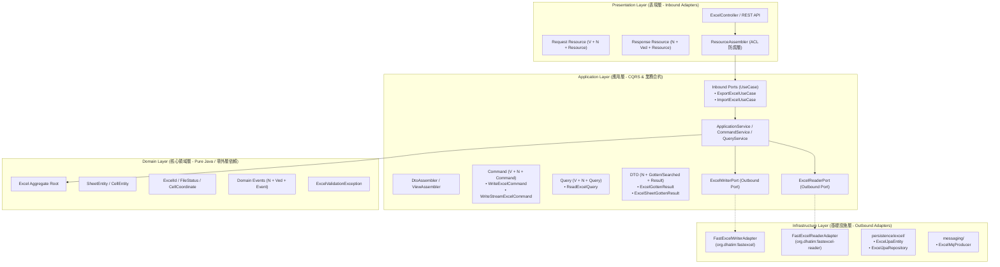
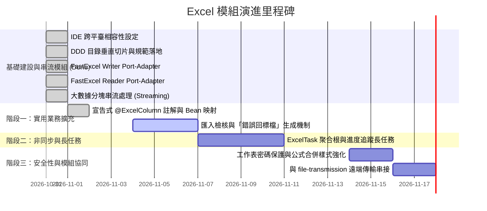

# Excel 模組架構設計與演進藍圖 (Excel Module Architecture & Design Guide)

> 📌 本文件座落於 `doc/design/README.md`，作為 `excel-module` 的架構設計規範、現行技術實作以及未來企業級擴充之總體指導文件。

---

## 1. 模組架構總覽 (Architecture Overview)

本模組嚴格遵循 **領域驅動設計 (DDD)**、**Clean Architecture** 與 **六角形架構 (Hexagonal / Ports & Adapters)**，隔離第三方底層技術，確保業務邏輯的純粹性與高可擴充性。

### 1.1 分層架構與核心流向



---

## 2. 現行實作技術規格 (Current Implementation)

目前已完成以 **FastExcel 0.20.2** 為核心之高效能讀寫適配器，並完整支援常數級記憶體 $O(1)$ 串流處理：

| 項目 | 輸出端口 (Port) | 基礎設施適配器 (Adapter) | 傳入/回傳型別 | 關鍵特性 |
| :--- | :--- | :--- | :--- | :--- |
| **Excel 寫入** | [`ExcelWriterPort`](file:///d:/桌面/ModuleWorkSpace/excel-module/src/main/java/com/example/demo/application/port/out/ExcelWriterPort.java) | [`FastExcelWriterAdapter`](file:///d:/桌面/ModuleWorkSpace/excel-module/src/main/java/com/example/demo/infrastructure/adapter/FastExcelWriterAdapter.java) | `WriteExcelCommand`<br>$\to$ `OutputStream` / `byte[]` | 批次寫入、多工作表、標題樣式、凍結窗格 (Freeze Panes)、多元型別自動對應 |
| **Excel 串流寫入** | [`ExcelWriterPort`](file:///d:/桌面/ModuleWorkSpace/excel-module/src/main/java/com/example/demo/application/port/out/ExcelWriterPort.java) | [`FastExcelWriterAdapter`](file:///d:/桌面/ModuleWorkSpace/excel-module/src/main/java/com/example/demo/infrastructure/adapter/FastExcelWriterAdapter.java) | `WriteStreamExcelCommand`<br>$\to$ `OutputStream` / `byte[]` | 巨量資料寫入、`worksheet.flush()` 週期性清空緩衝區、嚴格 $O(1)$ 常數記憶體 |
| **Excel 讀取** | [`ExcelReaderPort`](file:///d:/桌面/ModuleWorkSpace/excel-module/src/main/java/com/example/demo/application/port/out/ExcelReaderPort.java) | [`FastExcelReaderAdapter`](file:///d:/桌面/ModuleWorkSpace/excel-module/src/main/java/com/example/demo/infrastructure/adapter/FastExcelReaderAdapter.java) | `InputStream` / `byte[]`, `ReadExcelQuery`<br>$\to$ `ExcelGottenResult` | 全量載入模式、標題自適應、儲存格型別還原、列數限制過濾、`getDataRowsAsMaps()` 標題映射 |
| **Excel 串流讀取** | [`ExcelReaderPort`](file:///d:/桌面/ModuleWorkSpace/excel-module/src/main/java/com/example/demo/application/port/out/ExcelReaderPort.java) | [`FastExcelReaderAdapter`](file:///d:/桌面/ModuleWorkSpace/excel-module/src/main/java/com/example/demo/infrastructure/adapter/FastExcelReaderAdapter.java) | `InputStream`, `ExcelRowConsumer`<br>`ExcelChunkConsumer`<br>`ExcelStreamListener` | StAX 惰性解析、逐列消費、分塊批次消費、提早中斷 (`context.stop()`)、全生命週期監聽 |

> 📖 **專題技術文件**：關於串流處理模組的底層原理、Flush 機制、回呼契約與詳細代碼範例，請參閱專題文件：
> 👉 [串流處理模組架構與實作指南 (streaming-processing.md)](file:///d:/桌面/ModuleWorkSpace/excel-module/doc/design/streaming-processing.md)

---

## 3. 企業級擴充藍圖 (5 大演進維度)

### 維度一：宣告式物件映射 (Declarative Bean Mapping) [已完成 ✅]

* **解決痛點**：克服以往僅能使用 `List<List<Object>>` 或 `Map<String, Object>` 傳遞資料所造成的型別不安全與手動重複轉換負擔；同時**100% 完整保留原有 Map 方法**，達成「強型別 Model 導向」與「動態資料字典 (Map) 導向」之雙軌相容。
* **已交付核心架構與元件**：
  1. **宣告式註解 ([`application/annotation/`](file:///d:/桌面/ModuleWorkSpace/excel-module/src/main/java/com/example/demo/application/annotation))**：
     * [`@ExcelSheet`](file:///d:/桌面/ModuleWorkSpace/excel-module/src/main/java/com/example/demo/application/annotation/ExcelSheet.java)：指定工作表名稱、標題列與資料列起始索引。
     * [`@ExcelColumn`](file:///d:/桌面/ModuleWorkSpace/excel-module/src/main/java/com/example/demo/application/annotation/ExcelColumn.java)：指定欄位名稱、顯式索引 (`index`)、日期/數值格式 (`format`)、預設值 (`defaultValue`) 與忽略開關 (`ignore`)。
     ```java
     // 範例一：標準 JavaBean (支援無參建構子 + Getter/Setter)
     @ExcelSheet(name = "訂單匯入清單")
     public class OrderImportModel {
         @ExcelColumn(name = "訂單編號", index = 0)
         private String orderNo;

         @ExcelColumn(name = "訂購人", index = 1, defaultValue = "匿名訪客")
         private String customerName;

         @ExcelColumn(name = "購買金額", index = 2, format = "#,##0.00")
         private BigDecimal amount;

         @ExcelColumn(name = "下單日期", index = 3, format = "yyyy-MM-dd")
         private LocalDate orderDate;
     }

     // 範例二：原生支援 Java 21 不可變 Record (Canonical Constructor 自動綁定)
     @ExcelSheet("商品主檔清單")
     public record ProductRecordModel(
         @ExcelColumn(name = "商品代碼", index = 0) String productCode,
         @ExcelColumn(name = "商品名稱", index = 1) String productName,
         @ExcelColumn(name = "售價", index = 2, format = "#,##0.00") BigDecimal price
     ) {}
     ```
  2. **高純度高效能組裝器 ([`ExcelBeanAssembler.java`](file:///d:/桌面/ModuleWorkSpace/excel-module/src/main/java/com/example/demo/application/assembler/ExcelBeanAssembler.java))**：
     * **反射快取**：以 `ConcurrentHashMap` 快取屬性存取器、Record 元件與建構子，消除原生反射重複解析開銷。
     * **智慧型別轉換**：自動解析包含千分位逗號之數值、浮點數、高精度 `BigDecimal`、`LocalDate`、`LocalDateTime` 及枚舉。
     * **雙向 Map 相容轉換**：提供 `toMaps(beans, modelClass)` 與 `fromMaps(mapList, modelClass)`，確保 Bean 與 Map 雙向流轉自由。
  3. **六角形架構分層協調 (Ports & UseCases)**：
     * **Inbound Ports (UseCases)**：
       * [`ExportExcelUseCase`](file:///d:/桌面/ModuleWorkSpace/excel-module/src/main/java/com/example/demo/application/port/in/ExportExcelUseCase.java)：`<T> byte[] exportBeans(List<T> dataList, Class<T> modelClass)`
       * [`StreamExportExcelUseCase`](file:///d:/桌面/ModuleWorkSpace/excel-module/src/main/java/com/example/demo/application/port/in/StreamExportExcelUseCase.java)：`<T> void streamExportBeans(OutputStream os, List<T> dataList, Class<T> modelClass)`
       * [`ImportExcelUseCase`](file:///d:/桌面/ModuleWorkSpace/excel-module/src/main/java/com/example/demo/application/port/in/ImportExcelUseCase.java)：`<T> List<T> importBeans(InputStream is, Class<T> modelClass)`
       * [`StreamImportExcelUseCase`](file:///d:/桌面/ModuleWorkSpace/excel-module/src/main/java/com/example/demo/application/port/in/StreamImportExcelUseCase.java)：`<T> void streamImportBeans(InputStream is, ReadExcelQuery query, Class<T> modelClass, int chunkSize, Consumer<List<T>> chunkConsumer)`
     * **Application Services (業務與資料流程調度)**：
       * [`ExcelExportApplicationService`](file:///d:/桌面/ModuleWorkSpace/excel-module/src/main/java/com/example/demo/application/service/ExcelExportApplicationService.java) 與 [`ExcelImportApplicationService`](file:///d:/桌面/ModuleWorkSpace/excel-module/src/main/java/com/example/demo/application/service/ExcelImportApplicationService.java) 作為中樞，協調調用 `ExcelBeanAssembler` 將 Model 轉換為 Command/DTO，再呼叫底層 Outbound Port。
     * **Outbound Ports (純粹技術抽象契約，0 外部組裝器相依)**：
       * [`ExcelWriterPort`](file:///d:/桌面/ModuleWorkSpace/excel-module/src/main/java/com/example/demo/application/port/out/ExcelWriterPort.java)：維持純粹 Command/I/O 契約，不侵入任何 Assembler 實作，並保留 `writeMaps(sheetName, headers, mapRows)` 便捷方法。
       * [`ExcelReaderPort`](file:///d:/桌面/ModuleWorkSpace/excel-module/src/main/java/com/example/demo/application/port/out/ExcelReaderPort.java)：維持純粹查詢與串流回呼契約，不侵入任何 Assembler 實作。
     * **DTO (純資料載體，嚴守單一職責)**：
       * [`ExcelSheetGottenResult`](file:///d:/桌面/ModuleWorkSpace/excel-module/src/main/java/com/example/demo/application/shared/dto/ExcelSheetGottenResult.java)：保留 `List<Map<String, Object>> getDataRowsAsMaps()` 純資料載體字典，不內嵌組裝邏輯。

---

### 維度二：宣告式資料校驗與「錯誤回標檔」生成 (Validation & Error Feedback)

* **現狀痛點**：使用者上傳千筆資料時，若第 50 筆格式有誤，通常只能中斷報錯，前台使用者無法一次得知所有錯誤欄位。
* **目標設計**：
  1. **行級校驗器 (Row-level Validator)**：整合 Jakarta Validation（如 `@NotBlank`, `@Min`, `@Pattern`）或工作區的 `customized-validation-module`。
  2. **錯誤資訊封裝模型**：
     ```java
     public class ExcelRowError {
         private final int rowIndex;
         private final String columnName;
         private final Object invalidValue;
         private final String errorMessage;
     }
     ```
  3. **錯誤回標檔適配器 (Error-Marked Export Adapter)**：
     * 自動複製上傳的原始內容，在最右側動態追加「**錯誤原因**」欄位。
     * 將出錯的儲存格背景標記為淡紅色（`#FFC7CE`），文字標註深紅（`#9C0006`）。
     * 回傳該 Excel 檔案二進位串流供前端下載，使用者修正標註紅框處後可直接重新上傳。

---

### 維度三：大數據分塊串流消費 (Chunked Stream Consumer) - [已完成實作]

* **成果說明**：已於 `ExcelWriterPort` 與 `ExcelReaderPort` 完整落地。
* **技術特性**：
  * **寫入**：支援 `WriteStreamExcelCommand`，每寫入達指定列數（如 1,000 列）自動呼叫 FastExcel `worksheet.flush()`，清空緩衝區達成 $O(1)$ 記憶體佔用。
  * **讀取**：基於 StAX 串流 pull parsing，支援 `readStream` (逐列)、`readChunked` (分批塊) 以及 `readWithListener` (全生命週期)，支援由消費端以 `context.stop()` 提前中斷。

---

### 四、 非同步長任務與進度追蹤 (Async Import/Export Task)

* **現狀痛點**：耗時長達數十秒的大型匯出匯入請求，HTTP 連線容易發生 Gateway Timeout (504)。
* **目標設計（DDD 聚合實作）**：
  1. **Domain Aggregate**：`ExcelTask` 聚合根。
     * 狀態 Value Object：`TaskStatus` (`PENDING`, `PROCESSING`, `COMPLETED`, `FAILED`)。
     * 進度欄位：`totalRows`, `processedRows`, `progressPercentage`。
     * 領域事件：`ExcelImportCompletedEvent`, `ExcelExportFailedEvent`。
  2. **非同步流程**：
     * Controller 接收請求後立即產生 `taskId` 回傳予前端。
     * 背景執行緒（`@Async` 或 Spring Task）執行處理，持續推進 `ExcelTask` 進度。
     * 前端可透過 Polling 或 SSE/WebSocket 即時展示「已完成 45% (4,500 / 10,000 列)」。

---

### 五、 企業級報表樣式、公式與安全防護 (Template, Styles & Security)

* **現狀痛點**：特定財務、原物料報表需具備動態公式、合併儲存格與密碼保護。
* **目標設計**：
  1. **儲存格合併與動態公式**：
     * 提供 `mergeCells(int top, int left, int bottom, int right)` 支援複雜表頭。
     * 支援跨列加總公式注入（如 `=SUM(D2:D50)`）。
  2. **工作表防護 (Sheet Protection)**：
     * 調用 FastExcel `worksheet.protect("Password", SheetProtectionOption...)`，防止公式被修改。
  3. **頁首頁尾與機密標記**：
     * 內建頁首頁尾自訂適配（如標籤「機密資料・內部流轉・匯出時間：2026-10-31」）。

---

## 4. Workspace 模組協同整合矩陣 (Module Synergy Matrix)

本專案座落於多模組架構環境，可與工作區現有模組進行無縫協作：

| 目標連動模組 | 協作場景 | 整合架構與方式 |
| :--- | :--- | :--- |
| **`customized-validation-module`** | 匯入欄位商業規則檢核 | 在應用層引入該模組的檢核引擎，於 Excel 逐列解析時直接調用防腐校驗 |
| **`file-transmission-module`** | 大檔雲端/遠端儲存 | 匯出完成後透過 Outbound Port 串接 SFTP/MinIO/S3，回傳預簽章下載連結 |
| **`pdf-module`** | 雙軌報表產出 | 共用相同的報表業務 DTO，依前端需求無縫切換輸出為 Excel 或防偽 PDF |
| **`locale-management-module`** | 多國語系動態表頭 | 匯出時依據使用者的語系代碼，將標題列欄位轉化為對應語系之字典文字 |

---

## 5. 實作規劃里程碑 (Milestones & Phased Roadmap)


