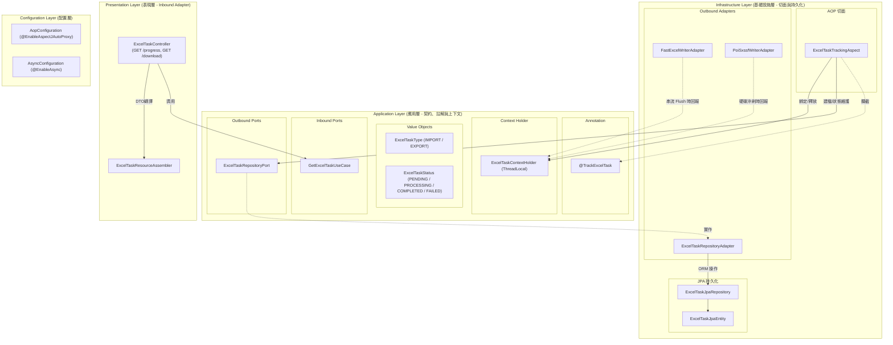
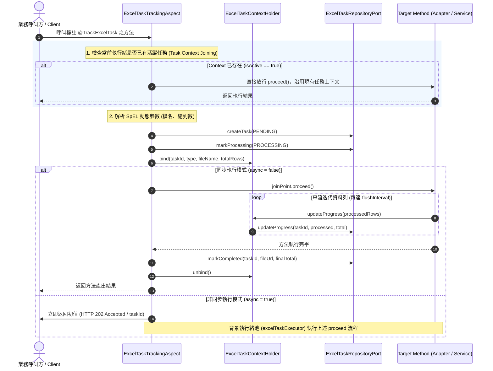

# Excel 宣告式長任務監控追蹤模組架構與設計指南 (Annotation-Driven Task Tracking Guide)

> 📌 本文件詳述 `excel-module` 中基於 **Clean Architecture 六角形架構**、**Spring AOP** 與 **宣告式註解驅動 (`@TrackExcelTask`)** 所打造的 Excel 非同步長任務（Async Long-Running Task）生命週期追蹤機制。
> 涵蓋設計哲學、核心物件職責、SpEL 動態表達式解析、執行緒上下文傳遞、串流進度自動同步、防重複建檔（Task Context Joining）以及前端輪詢與下載閉環。

---

## 1. 背景與設計挑戰

### 1.1 傳統長任務開發的痛點
在處理數十萬至百萬筆大數據的 Excel 匯出/匯入時，常見以下技術痛點：
1. **侵入性過高與大量重複樣板代碼 (Boilerplate Code)**：
   * 每個業務服務（Service）都必須手動注入 `TaskRepository`，在業務邏輯開頭呼叫 `createTask`、在處理迴圈中每隔幾千筆手動呼叫 `updateProgress`、在方法結尾呼叫 `markCompleted`，並用龐大的 `try-catch` 包裹以確保在出錯時呼叫 `markFailed`。
   * 商業邏輯與技術性任務狀態管理高度耦合，難以維護與單元測試。
2. **狀態卡死風險 (Zombie Task)**：
   * 當執行緒拋出未檢查例外（Unchecked Exception）或 JVM 發生錯誤時，若無全局兜底機制，任務容易永久卡在 `PROCESSING` 狀態，導致前端持續輪詢無果。
3. **巢狀呼叫與重複建檔 (Duplicate Task Creation)**：
   * 當外層 UseCase 已建立了任務，而內層調用的 Adapter 又重複建檔時，容易造成任務實體被覆蓋、`taskId` 錯亂或執行緒上下文丟失。
4. **領域層受到技術侵入**：
   * 許多架構將「技術性長任務實體」誤放在 Domain Layer，違反 DDD 核心領域純粹性原則。

### 1.2 本模組的架構設計目標
1. **極致非侵入 (Zero-Boilerplate)**：只需在目標方法掛上 `@TrackExcelTask` 註解，即可全自動接管任務生命週期。
2. **嚴守 Clean Architecture 與 DDD 規範**：
   * `ExcelTask` 定位為**通用技術模組實體**，嚴格下沉於 **Infrastructure Layer** (`infrastructure/persistence/task/`)，不污染核心業務 Domain Layer。
   * 任務類型與狀態精準定義為不可變之 **Value Object (VO)**（位於 `application.shared.vo`）。
3. **智慧上下文傳遞 (Task Context Joining)**：
   * 透過 ThreadLocal 上下文管理器 [`ExcelTaskContextHolder`](file:///d:/桌面/ModuleWorkSpace/excel-module/src/main/java/com/example/demo/application/shared/context/ExcelTaskContextHolder.java) 提供「巢狀穿透保護」——若外層已有作用中任務，內層自動沿用現有任務進行串流進度更新，杜絕重複建檔。
4. **串流沖刷自動推進 (Automatic Stream Progress Sync)**：
   * 底層串流適配器（FastExcel / Apache POI SXSSF）在執行 `flush()` 釋放記憶體時，自動向上下文更新已寫入/讀取列數，無需業務層介入。
5. **完整的前端閉環**：
   * 提供標準且輕量化的進度查詢 (`GET /{taskId}/progress`) 與二進位產物下載 (`GET /{taskId}/download`) API。

---

## 2. 總體架構與分層職責



### 分層物件職責對照表

| 物件名稱 | 所在分層與套件 | DDD / 六角形架構角色 | 職責與架構意圖 |
| :--- | :--- | :--- | :--- |
| [`@TrackExcelTask`](file:///d:/桌面/ModuleWorkSpace/excel-module/src/main/java/com/example/demo/application/annotation/TrackExcelTask.java) | `application.annotation` | 宣告式切面合約 | 標註於方法上，聲明任務類型、SpEL 檔名/列數表達式與是否非同步執行 (`async`) |
| [`ExcelTaskType`](file:///d:/桌面/ModuleWorkSpace/excel-module/src/main/java/com/example/demo/application/shared/vo/ExcelTaskType.java) | `application.shared.vo` | Value Object (VO) | 任務類型列舉實質物件（`IMPORT` 匯入解析 / `EXPORT` 匯出產製），天然不可變 |
| [`ExcelTaskStatus`](file:///d:/桌面/ModuleWorkSpace/excel-module/src/main/java/com/example/demo/application/shared/vo/ExcelTaskStatus.java) | `application.shared.vo` | Value Object (VO) | 任務狀態列舉實質物件（`PENDING`, `PROCESSING`, `COMPLETED`, `FAILED`, `CANCELLED`） |
| [`ExcelTaskContextHolder`](file:///d:/桌面/ModuleWorkSpace/excel-module/src/main/java/com/example/demo/application/shared/context/ExcelTaskContextHolder.java) | `application.shared.context` | 執行期執行緒上下文 | 基於 `ThreadLocal` 封裝，持有當前執行緒作用中的任務識別碼、累計筆數與 Port 代理 |
| [`ExcelTaskTrackingAspect`](file:///d:/桌面/ModuleWorkSpace/excel-module/src/main/java/com/example/demo/infrastructure/aop/ExcelTaskTrackingAspect.java) | `infrastructure.aop` | Outbound Adapter (切面) | 攔截 `@TrackExcelTask`，自動處理任務建立、上下文綁定、非同步排程、成功標記與全域例外兜底 |
| [`ExcelTaskRepositoryPort`](file:///d:/桌面/ModuleWorkSpace/excel-module/src/main/java/com/example/demo/application/port/out/ExcelTaskRepositoryPort.java) | `application.port.out` | Outbound Port | 應用層定義之資料庫操作純契約，嚴禁洩漏 JPA 實體 |
| [`ExcelTaskJpaEntity`](file:///d:/桌面/ModuleWorkSpace/excel-module/src/main/java/com/example/demo/infrastructure/persistence/task/entity/ExcelTaskJpaEntity.java) | `infrastructure.persistence.task.entity` | Infrastructure 技術實體 | 儲存任務 ID、狀態、進度百分比、處理列數、錯誤訊息與檔案下載 URL |
| [`ExcelTaskJpaRepository`](file:///d:/桌面/ModuleWorkSpace/excel-module/src/main/java/com/example/demo/infrastructure/persistence/task/repository/ExcelTaskJpaRepository.java) | `infrastructure.persistence.task.repository` | Spring Data Repository | 存取資料庫之 JPA 技術介面 |
| [`ExcelTaskRepositoryAdapter`](file:///d:/桌面/ModuleWorkSpace/excel-module/src/main/java/com/example/demo/infrastructure/adapter/ExcelTaskRepositoryAdapter.java) | `infrastructure.adapter` | Outbound Adapter | 實作 `ExcelTaskRepositoryPort`，負責 JPA Entity 與應用層 DTO 之間的純淨轉換 |
| [`ExcelTaskController`](file:///d:/桌面/ModuleWorkSpace/excel-module/src/main/java/com/example/demo/presentation/controller/ExcelTaskController.java) | `presentation.controller` | Inbound Adapter | 對外提供 `GET /{taskId}/progress` 與 `GET /{taskId}/download` 端點 |

---

## 3. 核心運作原理與機制

### 3.1 宣告式註解 `@TrackExcelTask`
提供靈活的參數配置與 Spring EL (SpEL) 動態表達式支援：

```java
@Documented
@Retention(RetentionPolicy.RUNTIME)
@Target({ElementType.METHOD, ElementType.TYPE})
public @interface TrackExcelTask {

    // 任務類型：IMPORT (匯入) 或 EXPORT (匯出)，預設 EXPORT
    ExcelTaskType type() default ExcelTaskType.EXPORT;

    // 目標檔案名稱，支援靜態文字或 SpEL 表達式 (如 "#command.applicationName + '.xlsx'")
    String fileName() default "";

    // 預估總列數，支援靜態數值或 SpEL 動態計算 (若為串流未知則為 "0")
    String totalRows() default "0";

    // 是否於背景獨立工作緒非同步執行 (預設 false)
    boolean async() default false;

    // 任務業務備註說明
    String description() default "";
}
```

### 3.2 切面攔截生命週期流程 (Execution Lifecycle)



### 3.3 巢狀防覆蓋機制 (Task Context Joining)
當系統分層較深時（例如：外層 UseCase 或 Service 已被 `@TrackExcelTask` 或手動排程建立了任務，而底層的 `FastExcelWriterAdapter.writeStream()` 又標註了 `@TrackExcelTask`）：

```java
@Around("@annotation(trackExcelTask)")
public Object trackTask(ProceedingJoinPoint joinPoint, TrackExcelTask trackExcelTask) throws Throwable {
    // 關鍵保護：若當前執行緒已有活躍任務，直接放行，避免重複建檔與覆蓋 ThreadLocal
    if (ExcelTaskContextHolder.isActive()) {
        return joinPoint.proceed();
    }
    
    // 獨立任務：建立新 TaskId 並管理完整生命週期
    ...
}
```
**效益**：內層 Adapter 能夠透明地融入外層任務，在執行 `flush()` 時直接為外層任務回報進度，達成完美的協同無縫整合。

### 3.4 串流寫入自動回報 (Streaming Auto-Progress)
在 [`FastExcelWriterAdapter`](file:///d:/桌面/ModuleWorkSpace/excel-module/src/main/java/com/example/demo/infrastructure/adapter/FastExcelWriterAdapter.java) 與 [`PoiSxssfWriterAdapter`](file:///d:/桌面/ModuleWorkSpace/excel-module/src/main/java/com/example/demo/infrastructure/adapter/PoiSxssfWriterAdapter.java) 的 `writeStreamWorksheet` 核心迴圈中：

```java
// 串流迭代資料列，定期執行 flush 釋放記憶體
if ((currentRowIndex - startRow) % flushInterval == 0) {
    worksheet.flush(); // FastExcel StAX 沖刷或 SXSSF sheet.flushRows(0)
    
    // 自動向上下文推進進度並寫入資料庫
    if (ExcelTaskContextHolder.isActive()) {
        ExcelTaskContextHolder.updateProgress(currentRowIndex - startRow, ExcelTaskContextHolder.getTotalRows());
    }
}
```
* **百分比精準推算**：若已知 `totalRows > 0`，自動計算百分比（如 `45.50%`）；若為未知總數的大數據惰性流（`totalRows == 0`），則以已處理列數為準，結束時自動校準為 100%。

---

## 4. 使用指南與程式碼範例

### 4.1 在 Outbound Adapter 上的宣告式應用
已內建於 `FastExcelWriterAdapter` 與 `PoiSxssfWriterAdapter`：

```java
@TrackExcelTask(
    type = ExcelTaskType.EXPORT,
    fileName = "#command != null && #command.applicationName != null ? #command.applicationName + '.xlsx' : 'stream_export.xlsx'",
    description = "FastExcel 串流大量資料匯出長任務"
)
@Override
public void writeStream(OutputStream outputStream, WriteStreamExcelCommand command) {
    // 純粹專注於 FastExcel 活頁簿寫入與 flush
    // 任務建檔、狀態變更、進度持久化由切面全自動完成！
}
```

### 4.2 在應用層 UseCase / Service 上啟用非同步長任務
當呼叫方希望立即釋放 HTTP 連線、交由背景執行緒非同步產製時：

```java
@Service
public class OrderReportApplicationService {

    @TrackExcelTask(
        type = ExcelTaskType.EXPORT,
        fileName = "'OrderReport_' + #query.year + '.xlsx'",
        totalRows = "#query.estimatedCount",
        async = true,
        description = "年度訂單報表背景匯出"
    )
    public ExcelTaskGottenResult exportOrdersAsync(OrderExportQuery query) {
        // 方法執行緒將直接在 excelTaskExecutor 背景池中執行
        // Controller 呼叫此方法時將立即返回 PENDING 狀態之 ExcelTaskGottenResult (內含 taskId)
        ...
        return null; 
    }
}
```

---

## 5. 前端整合與長任務閉環 (Frontend Integration)

前端在非同步長任務情境下，享有簡潔乾淨的二步驟閉環體驗：

```
[前端 Client]                         [後端 Excel 模組]
      │                                       │
      ├───── 1. 提交業務請求 (例如匯出報表) ────┤
      │                                       │ (切面生成 UUID taskId，背景執行)
      │<──── 返回 HTTP 202 (帶有 taskId) ─────┤
      │                                       │
      │   ┌── 2. 定期輪詢進度 (Polling) ───┐   │
      ├───┼─> GET /api/v1/excel/tasks/{id}/progress
      │   └── <── 狀態: PROCESSING, 進度: 65%  │
      │                                       │ (背景完成，標記 COMPLETED)
      │                                       │
      ├───── 3. 偵測到 COMPLETED ────────────┤
      │                                       │
      ├───── 4. 下載檔案 ─────────────────────┤
      │      GET /api/v1/excel/tasks/{id}/download
      │<──── 回傳 Content-Disposition 二進位流 ┤
```

### 5.1 進度查詢 API
* **端點**：`GET /api/v1/excel/tasks/{taskId}/progress`
* **回應範例** (`HTTP 200 OK`)：
```json
{
  "taskId": "c4b9d038-e6d2-43bb-a5a4-03a557b7f520",
  "taskType": "EXPORT",
  "taskStatus": "PROCESSING",
  "totalRows": 50000,
  "processedRows": 25000,
  "progressPercentage": 50.0,
  "fileName": "BigDataReport.xlsx",
  "fileUrl": null,
  "errorMessage": null,
  "createdAt": "2026-11-04T00:30:00",
  "updatedAt": "2026-11-04T00:30:15"
}
```

### 5.2 產物下載 API
* **端點**：`GET /api/v1/excel/tasks/{taskId}/download`
* **回應**：`HTTP 200 OK`，`Content-Type: application/vnd.openxmlformats-officedocument.spreadsheetml.sheet`，支援檔名 UTF-8 URL 編碼。

---

## 6. 測試驗證與架構防護 (Testing & Verification)

> 📖 **詳細測試手冊與 API 請求範例請參閱**：[`doc/test/annotation_driven_task_testing_guide.md`](file:///d:/桌面/ModuleWorkSpace/excel-module/doc/test/annotation_driven_task_testing_guide.md)

專案內建嚴謹之 BDD / Gherkin 單元與整合測試，覆蓋率 100%：

1. **切面核心單元測試** ([`ExcelTaskTrackingAspectTest`](file:///d:/桌面/ModuleWorkSpace/excel-module/src/test/java/com/example/demo/infrastructure/aop/ExcelTaskTrackingAspectTest.java))：
   * `shouldTrackTaskSuccessfullyOnMethodExecution`：驗證同步任務自動建檔、狀態變更、進度記錄與正常完成。
   * `shouldMarkTaskFailedWhenMethodThrowsException`：驗證業務異常時切面全局捕獲並標記 `FAILED`，杜絕殭屍任務。
   * `shouldReturnInitialTaskOnAsyncAnnotation`：驗證 `async = true` 立即返回 `PENDING` 與受理資訊。
   * `shouldNotCreateDuplicateTaskWhenContextAlreadyActive`：驗證當前執行緒已存在活躍任務時，直接沿用不重複建立新任務。
   * `shouldTrackFastExcelWriterAdapterWriteStream`：驗證 FastExcel 串流適配器透過切面自動回報每批 flush 進度。
   * `shouldTrackPoiSxssfWriterAdapterWriteStream`：驗證 POI SXSSF 串流適配器透過切面自動回報硬碟沖刷進度。
2. **控制器管理端點測試** ([`ExcelTaskControllerTest`](file:///d:/桌面/ModuleWorkSpace/excel-module/src/test/java/com/example/demo/presentation/controller/ExcelTaskControllerTest.java))：
   * 驗證進度輪詢正常回傳與 `404 Not Found` 查無任務例外轉譯。
   * 驗證已完成檔案下載串流與未產出時的 `404` 防護。

---

## 7. 總結

本模組透過 **`@TrackExcelTask` 註解驅動**，達成：
1. **極致解耦**：商業邏輯與技術性任務追蹤徹底分離。
2. **架構合規**：嚴守 Clean Architecture，將技術實體封閉於 Infrastructure Layer，領域 Value Objects 乾淨不可變。
3. **安全強韌**：ThreadLocal 智慧防覆蓋與全域異常兜底，確保任務狀態永不卡死。

