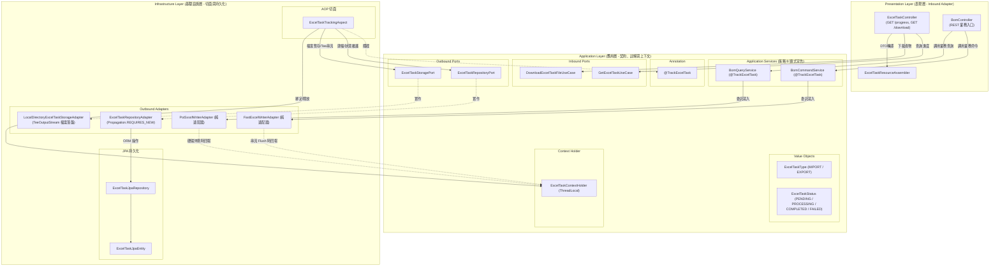
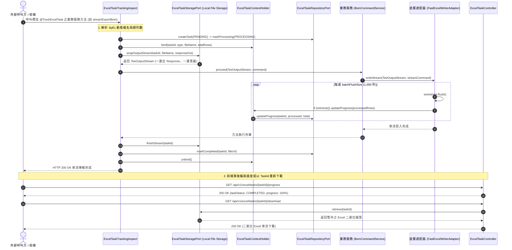

# 維度四：非同步長任務與進度追蹤架構總覽 (Dimension 4: Annotation-Driven Task Tracking Hub)

> 📌 本文件座落於 [`doc/design/annotation-driven-task-tracking.md`](file:///d:/桌面/ModuleWorkSpace/excel-module/doc/design/annotation-driven-task-tracking.md)，作為 `excel-module` 企業級擴充藍圖 **「維度四：非同步長任務與進度追蹤」** 的核心入口與子模組總覽導讀。  
> 總體架構請參閱：👉 [Excel 模組架構設計與演進藍圖 (architecture-design.md)](file:///d:/桌面/ModuleWorkSpace/excel-module/doc/design/architecture-design.md)。

---

## 1. 子模組定位與設計哲學 (Sub-Module Vision & Architecture)

在處理數十萬至百萬筆大數據的 Excel 匯入與匯出時，傳統將狀態管理硬編碼於業務服務的方式，常造成重複樣板代碼、狀態卡死（Zombie Task）以及技術實體污染 Domain 層等嚴重缺陷。

維度四基於 **Clean Architecture 六角形架構**、**Spring AOP** 與 **宣告式註解驅動 (`@TrackExcelTask`)**，打造全自動化的非同步長任務生命週期追蹤機制：
1. **極致非侵入 (Zero-Boilerplate)**：業務層標註 `@TrackExcelTask` 即自動接管建檔、狀態轉換、成功標記與全域例外兜底。
2. **策略 B 顯式業務宣告模式 (Explicit Business Annotation Pattern)**：底層技術適配器 (`FastExcelWriterAdapter`, `PoiSxssfWriterAdapter`) 維持純粹與零開銷，不預設標註追蹤；僅在真正需要長任務監控的業務服務節點（如 `BomCommandService`, `BomQueryService`）顯式宣告，杜絕全域無效任務記錄與磁碟冗餘。
3. **架構合規與層級隔離**：長任務技術實體封裝於 Infrastructure Layer (`infrastructure/persistence/task/`)，產物落盤儲存封裝於 `infrastructure/adapter/task/`，不污染核心業務 Domain Layer。
4. **雙向分流產物暫存 (TeeOutputStream & Disk Caching)**：同步串流匯出時透過 TeeOutputStream 一路即時推送到前端 HTTP Response，另一路同步暫存於本機目錄 (`temp/excel-tasks/{taskId}.xlsx`)，支援事後依 TaskId 多次下載。
5. **智慧上下文傳遞 (Task Context Joining)**：透過 `ThreadLocal` 提供巢狀防覆蓋保護，內外層透明協同。
6. **串流沖刷自動同步**：FastExcel / POI SXSSF 執行 `flush()` 沖刷記憶體時，自動向上下文累積已處理列數。
7. **完整前端輪詢與下載閉環**：標準化進度查詢與二進位產物下載 REST API。



---

## 2. 專題子文件導讀與跳轉索引 (Specialized Documentation Navigation)

本子模組之詳細技術規格已依職責切分收納於專屬目錄 [`doc/design/annotation-driven-task-tracking/`](file:///d:/桌面/ModuleWorkSpace/excel-module/doc/design/annotation-driven-task-tracking/) 中：

| 專題技術文件 | 核心關注點 | 適合閱讀對象 | 涵蓋核心元件 |
| :--- | :--- | :--- | :--- |
| 👉 **[Part 1：宣告式註解、AOP 切面生命週期與執行緒上下文保護 (01-aop-lifecycle-and-context-protection.md)](file:///d:/桌面/ModuleWorkSpace/excel-module/doc/design/annotation-driven-task-tracking/01-aop-lifecycle-and-context-protection.md)** | **切面攔截與上下文機制**<br/>• `@TrackExcelTask` 參數與 SpEL 解析<br/>• 切面環繞通知與全域例外兜底<br/>• `ExcelTaskContextHolder` 防覆蓋保護<br/>• 串流 Flush 自動推進進度 | 架構師、AOP 核心開發者、串流效能調優人員 | `@TrackExcelTask`<br/>`ExcelTaskTrackingAspect`<br/>`ExcelTaskContextHolder`<br/>`FastExcelWriterAdapter`<br/>`PoiSxssfWriterAdapter` |
| 👉 **[Part 2：JPA 持久化、REST 端點與前端非同步閉環 (02-persistence-api-and-frontend-lifecycle.md)](file:///d:/桌面/ModuleWorkSpace/excel-module/doc/design/annotation-driven-task-tracking/02-persistence-api-and-frontend-lifecycle.md)** | **持久化儲存與前端閉環**<br/>• JPA 技術實體與獨立事務適配器<br/>• `Propagation.REQUIRES_NEW` 狀態隔離<br/>• 進度輪詢與檔案下載 API<br/>• 前端非同步兩步驟整合閉環 | 業務應用開發者、前端工程師、API 串接者 | `ExcelTaskJpaEntity`<br/>`ExcelTaskJpaRepository`<br/>`ExcelTaskRepositoryAdapter`<br/>`ExcelTaskController`<br/>`GetExcelTaskUseCase` |

---

## 3. 六角形架構端到端元件矩陣 (Component & Port Matrix)

| 分層 (Layer) | 元件名稱 / 介面 | 角色與職責 | AGENTS.md 命名規範 |
| :--- | :--- | :--- | :--- |
| **Presentation** | [`ExcelTaskController`](file:///d:/桌面/ModuleWorkSpace/excel-module/src/main/java/com/example/demo/presentation/controller/task/ExcelTaskController.java) | 對外提供 `GET /{id}`、`GET /{id}/progress` 與 `GET /{id}/download` API | Controller |
| **Presentation** | [`ExcelTaskResourceAssembler`](file:///d:/桌面/ModuleWorkSpace/excel-module/src/main/java/com/example/demo/presentation/assembler/ExcelTaskResourceAssembler.java) | ACL 防腐層，負責 Task DTO 轉 Resource | Assembler |
| **Application (Port In)** | [`GetExcelTaskUseCase`](file:///d:/桌面/ModuleWorkSpace/excel-module/src/main/java/com/example/demo/application/port/in/task/GetExcelTaskUseCase.java)<br>[`DownloadExcelTaskFileUseCase`](file:///d:/桌面/ModuleWorkSpace/excel-module/src/main/java/com/example/demo/application/port/in/task/DownloadExcelTaskFileUseCase.java) | 長任務進度查詢與檔案下載 UseCase 合約 | `*UseCase` (Rule 3-8) |
| **Application (Port Out)**| [`ExcelTaskRepositoryPort`](file:///d:/桌面/ModuleWorkSpace/excel-module/src/main/java/com/example/demo/application/port/out/task/ExcelTaskRepositoryPort.java)<br>[`ExcelTaskStoragePort`](file:///d:/桌面/ModuleWorkSpace/excel-module/src/main/java/com/example/demo/application/port/out/task/ExcelTaskStoragePort.java) | 任務資料庫持久化契約與產物二進位檔案本機儲存/串流分流契約 | `*Port` (Rule 3-8) |
| **Application (Annotation)**| [`@TrackExcelTask`](file:///d:/桌面/ModuleWorkSpace/excel-module/src/main/java/com/example/demo/application/annotation/task/TrackExcelTask.java) | 宣告式長任務監控註解，支援 SpEL 動態計算（策略 B 標註於業務服務節點） | Annotation |
| **Application (Service)** | [`BomCommandService`](file:///d:/桌面/ModuleWorkSpace/excel-module/src/main/java/com/example/demo/application/service/bom/BomCommandService.java)<br>[`BomQueryService`](file:///d:/桌面/ModuleWorkSpace/excel-module/src/main/java/com/example/demo/application/service/bom/BomQueryService.java) | 標註 `@TrackExcelTask` 之具體業務節點，精準接管 BOM 匯出與串流 | `*Service` (Rule 3-9) |
| **Application (VO)**      | [`ExcelTaskType`](file:///d:/桌面/ModuleWorkSpace/excel-module/src/main/java/com/example/demo/application/shared/vo/ExcelTaskType.java)<br>[`ExcelTaskStatus`](file:///d:/桌面/ModuleWorkSpace/excel-module/src/main/java/com/example/demo/application/shared/vo/ExcelTaskStatus.java) | 任務類型與狀態不可變值物件 | Value Object |
| **Application (Context)** | [`ExcelTaskContextHolder`](file:///d:/桌面/ModuleWorkSpace/excel-module/src/main/java/com/example/demo/application/shared/context/ExcelTaskContextHolder.java) | ThreadLocal 執行期執行緒上下文管理器 | Context Holder |
| **Infrastructure (AOP)**  | [`ExcelTaskTrackingAspect`](file:///d:/桌面/ModuleWorkSpace/excel-module/src/main/java/com/example/demo/infrastructure/aspect/ExcelTaskTrackingAspect.java) | 切面攔截 `@TrackExcelTask`，管理生命週期、TeeOutputStream 檔案落盤與防覆蓋 | Outbound Aspect |
| **Infrastructure (Persistence)** | [`ExcelTaskJpaEntity`](file:///d:/桌面/ModuleWorkSpace/excel-module/src/main/java/com/example/demo/infrastructure/persistence/task/entity/ExcelTaskJpaEntity.java)<br>[`ExcelTaskJpaRepository`](file:///d:/桌面/ModuleWorkSpace/excel-module/src/main/java/com/example/demo/infrastructure/persistence/task/repository/ExcelTaskJpaRepository.java) | 長任務 JPA ORM 技術實體與 Spring Data Repository | Technical Entity |
| **Infrastructure (Adapter)** | [`ExcelTaskRepositoryAdapter`](file:///d:/桌面/ModuleWorkSpace/excel-module/src/main/java/com/example/demo/infrastructure/adapter/task/ExcelTaskRepositoryAdapter.java)<br>[`LocalDirectoryExcelTaskStorageAdapter`](file:///d:/桌面/ModuleWorkSpace/excel-module/src/main/java/com/example/demo/infrastructure/adapter/task/LocalDirectoryExcelTaskStorageAdapter.java) | 實作 `ExcelTaskRepositoryPort` (獨立事務) 與 `ExcelTaskStoragePort` (本機目錄與 TeeOutputStream) | `*Adapter` (Rule 3-9) |

---

## 4. 端到端調用執行時序 (End-to-End Sequence - 策略 B 顯式模式)



---

## 5. 測試驗證全景 (Testing & Verification Status)

* [`ExcelTaskTrackingAspectTest`](file:///d:/桌面/ModuleWorkSpace/excel-module/src/test/java/com/example/demo/infrastructure/aspect/ExcelTaskTrackingAspectTest.java)：驗證同步與非同步任務自動建檔、狀態變更、進度記錄、例外標記 `FAILED` 兜底、ThreadLocal 巢狀保護以及 FastExcel / POI 串流沖刷進度自動回報。
* [`ExcelTaskControllerTest`](file:///d:/桌面/ModuleWorkSpace/excel-module/src/test/java/com/example/demo/presentation/controller/task/ExcelTaskControllerTest.java)：驗證進度輪詢正常回傳、`404 Not Found` 查無任務防護以及二進位檔案串流下載。

---

## 6. 子模組 Package 套件結構與分層對照 (Package Structure & Layer Mapping)

本非同步長任務追蹤子模組遵循 Clean Architecture 六角形架構規範，落實依賴反向原則 (DIP) 與清晰的模組邊界，所屬原始碼與測試 Package 結構如下：

### 6.1 主程式 Package 結構 (`src/main/java`)

```text
com.example.demo
├── presentation/                                    # 表現層 (Inbound Adapters)
│   ├── controller/task/                             # 任務 REST 控制器
│   │   └── ExcelTaskController.java                 # GET /tasks/{id}/progress, GET /tasks/{id}/download
│   ├── assembler/                                   # 防腐層 Resource 組裝器
│   │   └── ExcelTaskResourceAssembler.java          # 負責 Resource 與 Command/DTO 轉換
│   └── resource/out/                                # 任務專屬 Response 資料載體 (Rule 3-2)
│       ├── ExcelTaskRetrievedResource.java          # 任務詳細資訊回應載體
│       └── ExcelTaskProgressResource.java           # 任務進度狀態回應載體
│
├── application/                                     # 應用層 (Application Core)
│   ├── annotation/task/                             # 宣告式長任務標註
│   │   ├── TrackExcelTask.java                      # 方法級切面監聽註解
│   │   └── ExcelTaskId.java                         # 顯式指定 Task ID 參數標註
│   ├── shared/context/                              # 上下文生命週期維護
│   │   └── ExcelTaskContextHolder.java              # ThreadLocal 上下文傳遞與巢狀防護
│   ├── port/in/task/                                # Inbound Ports (UseCases - Rule 3-8)
│   │   ├── GetExcelTaskUseCase.java                 # 查詢任務狀態合約
│   │   ├── DownloadExcelTaskFileUseCase.java        # 下載任務產物檔案合約
│   │   ├── SubmitAsyncExcelExportUseCase.java       # 提交非同步匯出合約
│   │   └── SubmitAsyncExcelImportUseCase.java       # 提交非同步匯入合約
│   ├── port/out/task/                               # Outbound Ports (業務輸出埠 - Rule 3-8)
│   │   ├── ExcelTaskRepositoryPort.java             # 任務持久化儲存合約
│   │   └── ExcelTaskStoragePort.java                # 任務產物落盤暫存與串流分流合約
│   ├── service/task/                                # Application Services (CQRS - Rule 3-9)
│   │   ├── ExcelTaskCommandService.java             # 負責任務建立、進度更新、完成與失敗
│   │   └── ExcelTaskQueryService.java               # 負責任務查詢與產物檢索
│   └── shared/                                      # 跨層共享不可變模型
│       ├── command/                                 # Command 寫入命令 (Rule 3-4)
│       │   ├── CreateExcelTaskCommand.java          # 建立任務命令
│       │   ├── UpdateExcelTaskProgressCommand.java  # 更新進度命令
│       │   ├── CompleteExcelTaskCommand.java        # 標記完成命令
│       │   ├── FailExcelTaskCommand.java            # 標記失敗命令
│       │   ├── SubmitAsyncExportCommand.java        # 提交非同步匯出命令
│       │   └── SubmitAsyncImportCommand.java        # 提交非同步匯入命令
│       ├── query/                                   # Query 查詢命令 (Rule 3-5)
│       │   └── GetExcelTaskQuery.java               # 依 ID 查詢命令
│       ├── dto/                                     # DTO 查詢結果純載體 (Rule 3-6)
│       │   └── ExcelTaskGottenResult.java           # 任務狀態結果 DTO
│       └── vo/                                      # 任務業務值物件 (Value Objects)
│           ├── ExcelTaskStatus.java                 # 任務狀態枚舉 (PENDING, PROCESSING, COMPLETED, FAILED)
│           └── ExcelTaskType.java                   # 任務類型枚舉 (IMPORT, EXPORT)
│
└── infrastructure/                                  # 基礎設施層 (Outbound Adapters & Persistence)
    ├── aspect/                                      # Spring AOP 橫切切面
    │   └── ExcelTaskTrackingAspect.java             # 攔截 @TrackExcelTask 自動接管生命週期
    ├── adapter/task/                                # 輸出適配器 (Rule 3-9)
    │   ├── ExcelTaskRepositoryAdapter.java          # 實作 ExcelTaskRepositoryPort (REQUIRES_NEW 事務)
    │   └── LocalDirectoryExcelTaskStorageAdapter.java # 實作 ExcelTaskStoragePort (本機目錄與 TeeOutputStream)
    └── persistence/task/                            # JPA 技術持久化聚合切片 (Rule 2)
        ├── entity/                                  # JPA ORM 實體
        │   └── ExcelTaskJpaEntity.java              # 長任務資料庫對應實體
        └── repository/                              # Spring Data JPA 存取介面
            └── ExcelTaskJpaRepository.java          # 任務底層資料庫 CRUD 介面
```

### 6.2 測試套件 Package 結構 (`src/test/java`)

```text
com.example.demo
├── presentation/controller/task/
│   └── ExcelTaskControllerTest.java                 # 任務 REST API 端點整合測試 (MockMvc)
├── application/service/task/
│   ├── ExcelTaskCommandServiceTest.java             # 任務指令服務單元測試
│   └── ExcelTaskQueryServiceTest.java               # 任務查詢服務單元測試
└── infrastructure/
    ├── aspect/
    │   └── ExcelTaskTrackingAspectTest.java         # AOP 切面行為、進度回報與例外兜底測試
    └── adapter/task/
        ├── ExcelTaskRepositoryAdapterTest.java      # 任務適配器與 JPA 整合測試
        └── LocalDirectoryExcelTaskStorageAdapterTest.java # 產物檔案落盤與串流分流測試
```
