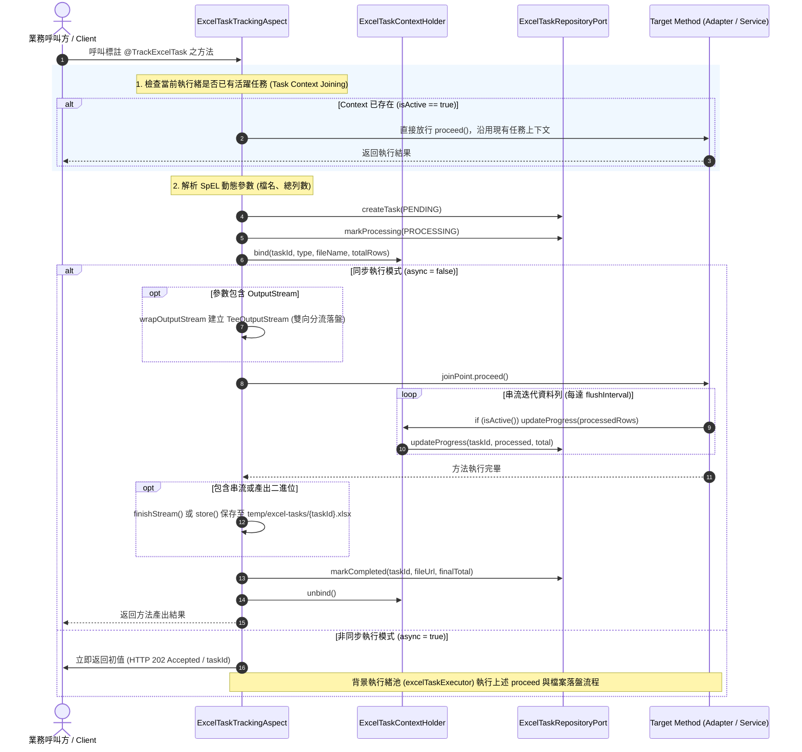

# 維度四 Part 1：宣告式註解、AOP 切面生命週期與執行緒上下文保護 (Annotation, AOP Lifecycle & Context Protection)

> 📌 本文件座落於 [`doc/design/annotation-driven-task-tracking/01-aop-lifecycle-and-context-protection.md`](file:///d:/桌面/ModuleWorkSpace/excel-module/doc/design/annotation-driven-task-tracking/01-aop-lifecycle-and-context-protection.md)，屬於「維度四：非同步長任務與進度追蹤」之【Part 1：宣告式註解、AOP 切面生命週期與執行緒上下文保護】。  
> 詳述 `@TrackExcelTask` 宣告式註解系統、Spring AOP 環繞切面攔截、SpEL 動態參數解析、ThreadLocal 上下文管理器、巢狀防覆蓋機制 (Task Context Joining) 與串流沖刷自動進度同步。  
> 
> 🔗 **模組導讀與關聯文件**：  
> • 模組入口主文件：👉 [維度四：非同步長任務與進度追蹤架構總覽 (annotation-driven-task-tracking.md)](file:///d:/桌面/ModuleWorkSpace/excel-module/doc/design/annotation-driven-task-tracking.md)  
> • 持久化與前端閉環：👉 [維度四 Part 2：JPA 持久化、REST 端點與前端非同步閉環 (02-persistence-api-and-frontend-lifecycle.md)](file:///d:/桌面/ModuleWorkSpace/excel-module/doc/design/annotation-driven-task-tracking/02-persistence-api-and-frontend-lifecycle.md)

---

## 1. 背景與設計挑戰

在處理巨量資料（數萬至百萬筆）的 Excel 匯出或匯入時，傳統手動管理長任務狀態存在以下嚴重缺陷：
1. **業務侵入過深與重複樣板程式碼**：業務 Service 必須手動注入 TaskRepository，手動撰寫建檔、進度更新、成功標記與龐大的 `try-catch` 例外兜底。
2. **狀態卡死風險 (Zombie Tasks)**：未檢查例外或中斷導致任務永久卡在 `PROCESSING`，前端無止盡輪詢。
3. **巢狀呼叫與重複建檔 (Context Collision)**：外層 UseCase 已建檔，底層 Adapter 又重複建檔，導致 `taskId` 覆蓋與上下文錯亂。

---

## 2. 宣告式註解 `@TrackExcelTask` 規格

座落於 [`com.example.demo.application.annotation.task.TrackExcelTask`](file:///d:/桌面/ModuleWorkSpace/excel-module/src/main/java/com/example/demo/application/annotation/task/TrackExcelTask.java)，宣告於方法層級：

```java
package com.example.demo.application.annotation.task;

import java.lang.annotation.Documented;
import java.lang.annotation.ElementType;
import java.lang.annotation.Retention;
import java.lang.annotation.RetentionPolicy;
import java.lang.annotation.Target;

import com.example.demo.application.shared.vo.ExcelTaskType;

@Documented
@Retention(RetentionPolicy.RUNTIME)
@Target({ElementType.METHOD, ElementType.TYPE})
public @interface TrackExcelTask {

    // 任務類型：IMPORT (匯入) 或 EXPORT (匯出)，預設 EXPORT
    ExcelTaskType type() default ExcelTaskType.EXPORT;

    // 目標檔案名稱，支援靜態文字或 SpEL 表達式 (如 "#command.applicationName + '.xlsx'")
    String fileName() default "";

    // 預估總列數，支援靜態數值或 SpEL 動態計算 (若為串流未知則為 "0")
    String totalRows() default "0";

    // 是否於背景獨立工作緒非同步執行 (預設 false)
    boolean async() default false;

    // 任務業務備註說明
    String description() default "";
}
```

---

## 3. 切面攔截生命週期流程 (AOP Lifecycle & State Machine)

座落於 [`com.example.demo.infrastructure.aspect.ExcelTaskTrackingAspect`](file:///d:/桌面/ModuleWorkSpace/excel-module/src/main/java/com/example/demo/infrastructure/aop/ExcelTaskTrackingAspect.java)：



---

## 4. 執行緒上下文傳遞與巢狀保護 (Task Context Joining)

座落於 [`com.example.demo.application.shared.context.ExcelTaskContextHolder`](file:///d:/桌面/ModuleWorkSpace/excel-module/src/main/java/com/example/demo/application/shared/context/ExcelTaskContextHolder.java)：

```java
public final class ExcelTaskContextHolder {
    private static final ThreadLocal<ExcelTaskContext> CONTEXT = new ThreadLocal<>();

    public static boolean isActive() {
        return CONTEXT.get() != null;
    }

    public static void bind(String taskId, ExcelTaskType type, String fileName, long totalRows, ExcelTaskRepositoryPort repoPort) {
        CONTEXT.set(new ExcelTaskContext(taskId, type, fileName, totalRows, repoPort));
    }

    public static void updateProgress(long processedRows, long totalRows) {
        ExcelTaskContext ctx = CONTEXT.get();
        if (ctx != null) {
            ctx.updateProgress(processedRows, totalRows);
        }
    }

    public static void unbind() {
        CONTEXT.remove();
    }
}
```

### 巢狀防覆蓋與策略 B (顯式業務宣告模式)：
本架構採納 **策略 B (顯式業務宣告模式 / Explicit Business Annotation Pattern)**：
1. **底層適配器零開銷**：底層技術適配器 (`FastExcelWriterAdapter`, `PoiSxssfWriterAdapter`) 保持純粹的資料轉譯職責，不再預設標註 `@TrackExcelTask`。一般呼叫（如小量物料主檔匯出）不經過切面、不建立資料庫長任務記錄、不佔用磁碟暫存空間。
2. **全域開關控制 (Global Configuration Flag)**：透過 `application.properties` 提供 `excel.task.enabled` 開關（預設為 `true`）。
   - 當 `excel.task.enabled=false` 時，Spring 條件裝配 `@ConditionalOnProperty` 直接不註冊切面 Bean，且切面內部具備 Fast-path 檢查 (`if (!taskTrackingEnabled) return joinPoint.proceed();`)，實現零 AOP 開銷與零資料庫寫入。
3. **業務節點精準監控**：`@TrackExcelTask` 僅顯式標註於真正具有巨量資料或長時間執行特性的業務服務節點（例如 `BomCommandService` 與 `BomQueryService` 之批次與串流端點）。
4. **上下文透明推進**：當標註之業務節點被切面攔截並呼叫 `ExcelTaskContextHolder.bind(...)` 後，底層引擎在每次分批 flush 時自動探測 `if (ExcelTaskContextHolder.isActive())` 並推進進度；未標註任務時則 `isActive() == false`，達成真正的零開銷。
5. **防重入與防覆蓋保護**：若外部 UseCase 或排程已建立任務，切面直接放行：
```java
@Around("@annotation(trackExcelTask)")
public Object trackTask(ProceedingJoinPoint joinPoint, TrackExcelTask trackExcelTask) throws Throwable {
    // 0. 開關檢查：若未啟用長任務追蹤 (excel.task.enabled = false)，直接放行
    if (!taskTrackingEnabled) {
        return joinPoint.proceed();
    }
    // 1. 防重入檢查：若當前執行緒已有活躍任務，直接放行，避免重複建檔與覆蓋 ThreadLocal
    if (ExcelTaskContextHolder.isActive()) {
        return joinPoint.proceed();
    }
    // 建立新 TaskId、包裝 TeeOutputStream 落盤並管理完整生命週期...
}
```

---

## 5. 串流寫入自動推進 (Streaming Auto-Progress)

在 `FastExcelWriterAdapter` 與 `PoiSxssfWriterAdapter` 迭代迴圈中，無縫與上下文連動：

```java
if ((currentRowIndex - startRow) % flushInterval == 0) {
    worksheet.flush(); // FastExcel 沖刷或 SXSSF sheet.flushRows(0)
    
    // 自動向上下文推進進度並寫入資料庫
    if (ExcelTaskContextHolder.isActive()) {
        ExcelTaskContextHolder.updateProgress(currentRowIndex - startRow, ExcelTaskContextHolder.getTotalRows());
    }
}
```
* **精準百分比計算**：已知總筆數時自動計算 `processed / total * 100`；未知時累積已處理筆數，完成時校準為 100.0%。

