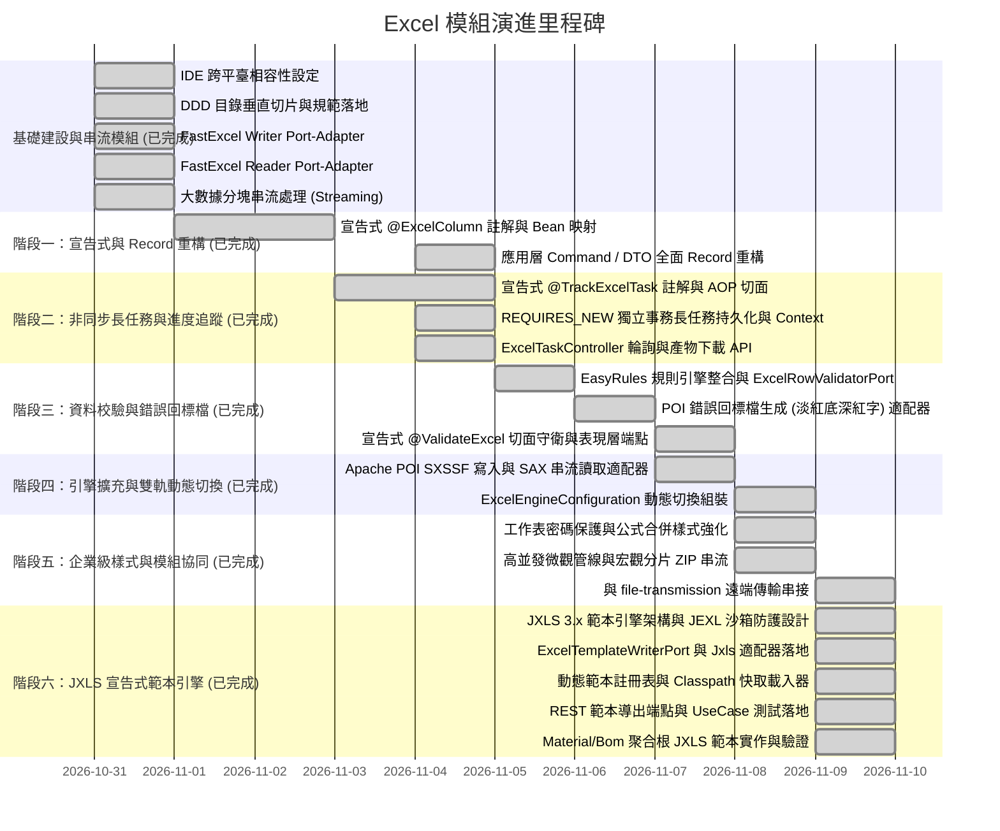

# Excel 模組架構設計與演進藍圖 (Excel Module Architecture & Design Guide)

> 📌 本文件座落於 [`doc/design/architecture-design.md`](file:///d:/桌面/ModuleWorkSpace/excel-module/doc/design/architecture-design.md)，作為 `excel-module` 的架構設計規範、現行技術實作以及未來企業級擴充之總體指導文件。

---

## 1. 模組架構總覽 (Architecture Overview)

本模組嚴格遵循 **領域驅動設計 (DDD)**、**Clean Architecture** 與 **六角形架構 (Hexagonal / Ports & Adapters)**，隔離第三方底層技術，確保業務邏輯的純粹性與高可擴充性。

### 1.1 分層架構與核心流向

```mermaid
flowchart TD
    subgraph Presentation ["Presentation Layer (表現層 - Inbound Adapters)"]
        Controller["ExcelController / BomController / MaterialBomExcelController"]
        TaskController["ExcelTaskController (/tasks/{id}/progress, /download)"]
        ValCtrl["ExcelValidationController (/validation)"]
        ValAspect["ExcelValidationAspect (@ValidateExcel 請求前置守衛)"]
        TplCtrl["ExcelTemplateExportController (/templates/{key}/export)"]
        ResourceIn["Request Resource (V + N + Resource)"]
        ResourceOut["Response Resource (N + Ved + Resource)"]
        PresAssembler["ResourceAssembler (ACL 防腐層)"]
    end

    subgraph Application ["Application Layer (應用層 - CQRS & 業務合約)"]
        InPort["Inbound Ports (UseCase)<br/>• ExportExcelUseCase / ImportExcelUseCase<br/>• StreamExportExcelUseCase / StreamImportExcelUseCase<br/>• ExportBomUseCase / StreamExportBomUseCase<br/>• GetExcelTaskUseCase / DownloadExcelTaskFileUseCase<br/>• SubmitAsyncExcelExportUseCase / SubmitAsyncExcelImportUseCase<br/>• ValidateExcelUseCase<br/>• ExportTemplateExcelUseCase / StreamExportTemplateExcelUseCase"]
        AppService["Application Services (CQRS 分離)<br/>• ExcelCommandService / ExcelQueryService<br/>• BomCommandService / BomQueryService<br/>• ExcelTaskCommandService / ExcelTaskQueryService<br/>• ExcelValidationApplicationService<br/>• ExcelTemplateCommandService"]
        AppAssembler["ExcelBeanAssembler (雙向 Record/POJO 映射)"]
        SharedModels["Shared Models (Java 21 Records)<br/>• Command (WriteExcelCommand, ExportTemplateExcelCommand...)<br/>• Query (ReadExcelQuery, GetExcelTaskQuery)<br/>• DTO (ExcelGottenResult, ExcelTaskGottenResult)<br/>• Validation (ExcelRowError, ExcelValidationGottenResult)"]
        OutPortWriter["ExcelWriterPort (Outbound Port)"]
        OutPortReader["ExcelReaderPort (Outbound Port)"]
        OutPortTask["ExcelTaskRepositoryPort (Outbound Port)"]
        OutPortValidator["ExcelRowValidatorPort / ExcelSheetValidatorPort"]
        OutPortMarker["ExcelErrorMarkerPort (Outbound Port)"]
        OutPortTemplate["ExcelTemplateWriterPort (Outbound Port)"]
        OutPortRepo["MaterialRepositoryPort / BomRepositoryPort"]
    end

    subgraph Domain ["Domain Layer (核心領域層 - Pure Java / 零外層依賴)"]
        MaterialAggregate["Material Aggregate Root"]
        BomAggregate["Bom Aggregate Root"]
        BomItemEntity["BomItem Entity"]
        VO["MaterialCode / BomVersion / Quantity"]
    end

    subgraph Infrastructure ["Infrastructure Layer (基礎設施層 - Outbound Adapters)"]
        subgraph Adapters ["技術適配器 (Adapters)"]
            EngineAdapters["動態雙引擎適配器<br/>• FastExcelWriterAdapter / FastExcelReaderAdapter (0.20.2)<br/>• PoiSxssfWriterAdapter / PoiSaxReaderAdapter (POI 5.5.1)"]
            JxlsAdapter["JxlsTemplateWriterAdapter (JXLS 3.x / JEXL 安全沙箱適配器)"]
            TaskRepoAdapter["ExcelTaskRepositoryAdapter (Propagation.REQUIRES_NEW)"]
            ValidatorAdapter["EasyRulesExcelValidatorAdapter (EasyRules 4.1.0 複合規則檢核)"]
            MarkerAdapter["PoiExcelErrorMarkerAdapter (POI 5.5.1 淡紅底深紅字錯誤回標)"]
            DomainRepoAdapter["MaterialRepositoryAdapter / BomRepositoryAdapter"]
        end
        subgraph AOP ["AOP 橫切基礎設施"]
            TaskAspect["ExcelTaskTrackingAspect (長任務持久化與上下文綁定)"]
            TaskContext["ExcelTaskContextHolder (ThreadLocal 進度累積)"]
        end
        subgraph Persistence ["Persistence Module (Spring Data JPA)"]
            TaskJpa["ExcelTaskJpaEntity / ExcelTaskJpaRepository"]
            DomainJpa["MaterialJpaEntity / BomJpaEntity / BomItemJpaEntity"]
        end
    end

    Controller --> PresAssembler
    TaskController --> PresAssembler
    ValCtrl --> PresAssembler
    TplCtrl --> PresAssembler
    ValAspect -. 前置攔截防衛 .-> ValCtrl
    PresAssembler --> InPort
    InPort --> AppService
    AppService --> SharedModels
    AppService --> AppAssembler
    AppService --> MaterialAggregate
    AppService --> BomAggregate
    AppService --> OutPortWriter
    AppService --> OutPortReader
    AppService --> OutPortTask
    AppService --> OutPortValidator
    AppService --> OutPortMarker
    AppService --> OutPortTemplate
    AppService --> OutPortRepo
    OutPortWriter -.-> EngineAdapters
    OutPortReader -.-> EngineAdapters
    OutPortTemplate -.-> JxlsAdapter
    OutPortTask -.-> TaskRepoAdapter
    OutPortValidator -.-> ValidatorAdapter
    OutPortMarker -.-> MarkerAdapter
    OutPortRepo -.-> DomainRepoAdapter
    TaskRepoAdapter --> TaskJpa
    DomainRepoAdapter --> DomainJpa
    TaskAspect -. 攔截 .-> EngineAdapters
    TaskAspect --> TaskContext
    TaskAspect --> OutPortTask
```



> 📖 **領域驅動設計專題文件**：關於物料 (Material) 與多階層物料清單 (BOM) 核心領域模型、防循環引用規則與資料庫設計，請參閱：
> • 領域總覽入口：👉 [物料與多階層 BOM 聚合設計總覽 (material_bom_aggregate_design.md)](file:///d:/桌面/ModuleWorkSpace/excel-module/doc/design/material_bom_aggregate_design.md)
> • Part 1 領域聚合根與規則：👉 [領域聚合根、實體與商業規則 (01-domain-aggregates-and-entities.md)](file:///d:/桌面/ModuleWorkSpace/excel-module/doc/design/material-bom-aggregate/01-domain-aggregates-and-entities.md)
> • Part 2 資料庫與六角形架構：👉 [資料庫設計、JPA 映射與六角形適配器 (02-hexagonal-ports-and-persistence.md)](file:///d:/桌面/ModuleWorkSpace/excel-module/doc/design/material-bom-aggregate/02-hexagonal-ports-and-persistence.md)

---

## 2. 現行實作技術規格 (Current Implementation)

本模組內建**動態雙引擎架構 (Dynamic Dual-Engine Architecture)**，可依據業務規模與複雜度無縫切換底層引擎：
* **FastExcel (v0.20.2)**：極致輕量、記憶體佔用極低、專為百萬級大數據串流輸出與解析設計（預設引擎）。
* **Apache POI (v5.5.1 SXSSF / SAX eventusermodel)**：全功能經典企業級引擎，具備全格式相容性、硬碟暫存沖刷、進階樣式與註解支援。

透過配置層 [`ExcelEngineConfiguration`](file:///d:/桌面/ModuleWorkSpace/excel-module/src/main/java/com/example/demo/config/ExcelEngineConfiguration.java) 根據設定檔屬性 `excel.engine=FAST_EXCEL | APACHE_POI` 動態決定注入至應用層 Outbound Port 之實作：

| 業務功能 | 輸出端口 (Port) | 基礎設施適配器 (Adapter) | 傳入/回傳型別 | 關鍵架構與技術特性 |
| :--- | :--- | :--- | :--- | :--- |
| **Excel 寫入** | [`ExcelWriterPort`](file:///d:/桌面/ModuleWorkSpace/excel-module/src/main/java/com/example/demo/application/port/out/core/ExcelWriterPort.java) | [`FastExcelWriterAdapter`](file:///d:/桌面/ModuleWorkSpace/excel-module/src/main/java/com/example/demo/infrastructure/adapter/core/FastExcelWriterAdapter.java)<br>[`PoiSxssfWriterAdapter`](file:///d:/桌面/ModuleWorkSpace/excel-module/src/main/java/com/example/demo/infrastructure/adapter/core/PoiSxssfWriterAdapter.java) | `WriteExcelCommand`<br>$\to$ `OutputStream` / `byte[]` | 批次寫入、多工作表、標題樣式、凍結窗格 (Freeze Panes)、多元型別自動轉換 |
| **Excel 串流寫入** | [`ExcelWriterPort`](file:///d:/桌面/ModuleWorkSpace/excel-module/src/main/java/com/example/demo/application/port/out/core/ExcelWriterPort.java) | [`FastExcelWriterAdapter`](file:///d:/桌面/ModuleWorkSpace/excel-module/src/main/java/com/example/demo/infrastructure/adapter/core/FastExcelWriterAdapter.java)<br>[`PoiSxssfWriterAdapter`](file:///d:/桌面/ModuleWorkSpace/excel-module/src/main/java/com/example/demo/infrastructure/adapter/core/PoiSxssfWriterAdapter.java) | `WriteStreamExcelCommand`<br>$\to$ `OutputStream` / `byte[]` | 巨量資料寫入、週期性緩衝區沖刷 (`flushRows` / `worksheet.flush()`)、嚴格 $O(1)$ 常數記憶體、整合 `@TrackExcelTask` |
| **Excel 讀取** | [`ExcelReaderPort`](file:///d:/桌面/ModuleWorkSpace/excel-module/src/main/java/com/example/demo/application/port/out/core/ExcelReaderPort.java) | [`FastExcelReaderAdapter`](file:///d:/桌面/ModuleWorkSpace/excel-module/src/main/java/com/example/demo/infrastructure/adapter/core/FastExcelReaderAdapter.java)<br>[`PoiSaxReaderAdapter`](file:///d:/桌面/ModuleWorkSpace/excel-module/src/main/java/com/example/demo/infrastructure/adapter/core/PoiSaxReaderAdapter.java) | `InputStream` / `byte[]`, `ReadExcelQuery`<br>$\to$ `ExcelGottenResult` | 全量載入模式、標題自適應、儲存格型別還原、列數限制過濾、`getDataRowsAsMaps()` 字典映射 |
| **Excel 串流讀取** | [`ExcelReaderPort`](file:///d:/桌面/ModuleWorkSpace/excel-module/src/main/java/com/example/demo/application/port/out/core/ExcelReaderPort.java) | [`FastExcelReaderAdapter`](file:///d:/桌面/ModuleWorkSpace/excel-module/src/main/java/com/example/demo/infrastructure/adapter/core/FastExcelReaderAdapter.java)<br>[`PoiSaxReaderAdapter`](file:///d:/桌面/ModuleWorkSpace/excel-module/src/main/java/com/example/demo/infrastructure/adapter/core/PoiSaxReaderAdapter.java) | `InputStream`, `ExcelRowConsumer`<br>`ExcelChunkConsumer`<br>`ExcelStreamListener` | StAX / SAX 惰性拉取式解析、逐列消費、分塊批次消費、提早中斷 (`context.stop()`)、全生命週期監聽回呼 |
| **資料規則校驗** | [`ExcelRowValidatorPort`](file:///d:/桌面/ModuleWorkSpace/excel-module/src/main/java/com/example/demo/application/port/out/validation/ExcelRowValidatorPort.java)<br>[`ExcelSheetValidatorPort`](file:///d:/桌面/ModuleWorkSpace/excel-module/src/main/java/com/example/demo/application/port/out/validation/ExcelSheetValidatorPort.java) | [`EasyRulesExcelValidatorAdapter`](file:///d:/桌面/ModuleWorkSpace/excel-module/src/main/java/com/example/demo/infrastructure/adapter/validation/EasyRulesExcelValidatorAdapter.java) | `List<T>`, `Class<T>`<br>$\to$ `List<ExcelRowError>` | EasyRules 4.1.0 宣告式規則管線、整合 Jakarta Validation 標籤、動態正規表達式與跨欄位複合商業校驗 |
| **錯誤回標檔生成** | [`ExcelErrorMarkerPort`](file:///d:/桌面/ModuleWorkSpace/excel-module/src/main/java/com/example/demo/application/port/out/validation/ExcelErrorMarkerPort.java) | [`PoiExcelErrorMarkerAdapter`](file:///d:/桌面/ModuleWorkSpace/excel-module/src/main/java/com/example/demo/infrastructure/adapter/validation/PoiExcelErrorMarkerAdapter.java) | `byte[] originalExcel`, `List<ExcelRowError>`<br>$\to$ `byte[] errorMarkedExcel` | 原檔高傳真複製、末端動態追加「錯誤原因」欄位、違規儲存格淡紅底深紅字高亮 (`#FFC7CE` / `#9C0006`)、儲存格批註說明 |
| **非同步任務追蹤** | [`ExcelTaskRepositoryPort`](file:///d:/桌面/ModuleWorkSpace/excel-module/src/main/java/com/example/demo/application/port/out/task/ExcelTaskRepositoryPort.java) | [`ExcelTaskRepositoryAdapter`](file:///d:/桌面/ModuleWorkSpace/excel-module/src/main/java/com/example/demo/infrastructure/adapter/task/ExcelTaskRepositoryAdapter.java) | `ExcelTaskGottenResult`, `CreateExcelTaskCommand`<br>$\to$ `ExcelTaskGottenResult` | Spring Data JPA、`REQUIRES_NEW` 獨立事務隔離、百分比進度計算、產物檔案即時串流下載 |
| **範本 Excel 匯出** | [`ExcelTemplateWriterPort`](file:///d:/桌面/ModuleWorkSpace/excel-module/src/main/java/com/example/demo/application/port/out/template/ExcelTemplateWriterPort.java) | [`JxlsTemplateWriterAdapter`](file:///d:/桌面/ModuleWorkSpace/excel-module/src/main/java/com/example/demo/infrastructure/adapter/template/JxlsTemplateWriterAdapter.java) | `ExportTemplateExcelCommand`<br>$\to$ `OutputStream` / `byte[]` | JXLS 宣告式範本填充、JEXL 安全沙箱防護、動態公式自動平移 (`${=SUM(C4)}`)、多階區塊嵌套循環 (`jx:each`)、條件顯隱與多工作表生成 |

> 📖 **專題技術文件**：關於串流處理模組的底層原理、Flush 機制、回呼契約與詳細代碼範例，請參閱專題文件：
> 👉 [串流處理模組架構與實作指南 (streaming-processing.md)](file:///d:/桌面/ModuleWorkSpace/excel-module/doc/design/streaming-processing.md)

---

## 3. 企業級擴充藍圖 (7 大演進維度)

### 維度一：宣告式物件映射 (Declarative Bean Mapping) [已完成實作 ✅]

> 📖 **專題技術文件**：
> • 維度一總覽入口：👉 [宣告式物件映射架構總覽 (declarative-bean-mapping.md)](file:///d:/桌面/ModuleWorkSpace/excel-module/doc/design/declarative-bean-mapping.md)
> • Part 1 註解與反射快取：👉 [宣告式註解、雙層反射快取與型別容錯轉換 (01-reflection-cache-and-converters.md)](file:///d:/桌面/ModuleWorkSpace/excel-module/doc/design/declarative-bean-mapping/01-reflection-cache-and-converters.md)
> • Part 2 UseCase 與 REST 端點：👉 [應用層 UseCase、CQRS 服務調度與 REST 端點 (02-ports-usecases-and-rest-binding.md)](file:///d:/桌面/ModuleWorkSpace/excel-module/doc/design/declarative-bean-mapping/02-ports-usecases-and-rest-binding.md)

* **解決痛點**：克服以往僅能使用 `List<List<Object>>` 或 `Map<String, Object>` 傳遞資料所造成的型別不安全與手動重複轉換負擔；同時**100% 完整保留原有 Map 方法**，達成「強型別 Model 導向」與「動態資料字典 (Map) 導向」之雙軌相容。
* **已交付核心架構與元件**：
  1. **宣告式註解 ([`application/annotation/`](file:///d:/桌面/ModuleWorkSpace/excel-module/src/main/java/com/example/demo/application/annotation))**：
     * [`@ExcelSheet`](file:///d:/桌面/ModuleWorkSpace/excel-module/src/main/java/com/example/demo/application/annotation/ExcelSheet.java)：指定工作表名稱、標題列與資料列起始索引。
     * [`@ExcelColumn`](file:///d:/桌面/ModuleWorkSpace/excel-module/src/main/java/com/example/demo/application/annotation/ExcelColumn.java)：指定欄位名稱、顯式索引 (`index`)、日期/數值格式 (`format`)、預設值 (`defaultValue`) 與忽略開關 (`ignore`)。
     ```java
     // 範例一：標準 JavaBean (支援無參建構子 + Getter/Setter)
     @ExcelSheet(name = "訂單匯入清單")
     public class OrderImportModel {
         @ExcelColumn(name = "訂單編號", index = 0)
         private String orderNo;

         @ExcelColumn(name = "訂購人", index = 1, defaultValue = "匿名訪客")
         private String customerName;

         @ExcelColumn(name = "購買金額", index = 2, format = "#,##0.00")
         private BigDecimal amount;

         @ExcelColumn(name = "下單日期", index = 3, format = "yyyy-MM-dd")
         private LocalDate orderDate;
     }

     // 範例二：原生支援 Java 21 不可變 Record (Canonical Constructor 自動綁定)
     @ExcelSheet("商品主檔清單")
     public record ProductRecordModel(
         @ExcelColumn(name = "商品代碼", index = 0) String productCode,
         @ExcelColumn(name = "商品名稱", index = 1) String productName,
         @ExcelColumn(name = "售價", index = 2, format = "#,##0.00") BigDecimal price
     ) {}
     ```
  2. **高純度高效能組裝器 ([`ExcelBeanAssembler.java`](file:///d:/桌面/ModuleWorkSpace/excel-module/src/main/java/com/example/demo/application/assembler/ExcelBeanAssembler.java))**：
     * **反射快取**：以 `ConcurrentHashMap` 快取屬性存取器、Record 元件與建構子，消除原生反射重複解析開銷。
     * **智慧型別轉換**：自動解析包含千分位逗號之數值、浮點數、高精度 `BigDecimal`、`LocalDate`、`LocalDateTime` 及枚舉。
     * **雙向 Map 相容轉換**：提供 `toMaps(beans, modelClass)` 與 `fromMaps(mapList, modelClass)`，確保 Bean 與 Map 雙向流轉自由。
  3. **六角形架構分層協調 (Ports & UseCases)**：
     * **Inbound Ports (UseCases)**：
       * [`ExportExcelUseCase`](file:///d:/桌面/ModuleWorkSpace/excel-module/src/main/java/com/example/demo/application/port/in/core/ExportExcelUseCase.java)：`<T> byte[] exportBeans(List<T> dataList, Class<T> modelClass)`
       * [`StreamExportExcelUseCase`](file:///d:/桌面/ModuleWorkSpace/excel-module/src/main/java/com/example/demo/application/port/in/core/StreamExportExcelUseCase.java)：`<T> void streamExportBeans(OutputStream os, List<T> dataList, Class<T> modelClass)`
       * [`ImportExcelUseCase`](file:///d:/桌面/ModuleWorkSpace/excel-module/src/main/java/com/example/demo/application/port/in/core/ImportExcelUseCase.java)：`<T> List<T> importBeans(InputStream is, Class<T> modelClass)`
       * [`StreamImportExcelUseCase`](file:///d:/桌面/ModuleWorkSpace/excel-module/src/main/java/com/example/demo/application/port/in/core/StreamImportExcelUseCase.java)：`<T> void streamImportBeans(InputStream is, ReadExcelQuery query, Class<T> modelClass, int chunkSize, Consumer<List<T>> chunkConsumer)`
     * **Application Services (CQRS 分離原則)**：
       * [`ExcelCommandService`](file:///d:/桌面/ModuleWorkSpace/excel-module/src/main/java/com/example/demo/application/service/core/ExcelCommandService.java)：實作匯出寫入業務邏輯，調用 `ExcelBeanAssembler` 將 Model 轉換為 Command 後呼叫底層寫入埠。
       * [`ExcelQueryService`](file:///d:/桌面/ModuleWorkSpace/excel-module/src/main/java/com/example/demo/application/service/core/ExcelQueryService.java)：實作匯入讀取業務邏輯，調用底層讀取埠取得結構化字典後委派組裝器反序列化為 Model 清單。
     * **Outbound Ports (純粹技術抽象契約，0 外部組裝器相依)**：
       * [`ExcelWriterPort`](file:///d:/桌面/ModuleWorkSpace/excel-module/src/main/java/com/example/demo/application/port/out/core/ExcelWriterPort.java)：維持純粹 Command/I/O 契約，不侵入任何 Assembler 實作，並保留 `writeMaps(sheetName, headers, mapRows)` 便捷方法。
       * [`ExcelReaderPort`](file:///d:/桌面/ModuleWorkSpace/excel-module/src/main/java/com/example/demo/application/port/out/core/ExcelReaderPort.java)：維持純粹查詢與串流回呼契約，不侵入任何 Assembler 實作。
     * **DTO (純資料載體，嚴守單一職責)**：
       * [`ExcelSheetGottenResult`](file:///d:/桌面/ModuleWorkSpace/excel-module/src/main/java/com/example/demo/application/shared/dto/ExcelSheetGottenResult.java)：保留 `List<Map<String, Object>> getDataRowsAsMaps()` 純資料載體字典，不內嵌組裝邏輯。

---

### 維度二：宣告式資料校驗與「錯誤回標檔」生成 (Validation & Error Feedback) [已完成實作 ✅]

> 📖 **專題技術文件**：
> • 維度二總覽入口：👉 [宣告式資料校驗與錯誤回標架構總覽 (custom-validation-and-error-feedback.md)](file:///d:/桌面/ModuleWorkSpace/excel-module/doc/design/custom-validation-and-error-feedback.md)
> • Part 1 EasyRules 規則管線：👉 [EasyRules 檢核管線與全量錯誤診斷模型 (01-easyrules-validation-pipeline.md)](file:///d:/桌面/ModuleWorkSpace/excel-module/doc/design/custom-validation-and-error-feedback/01-easyrules-validation-pipeline.md)
> • Part 2 高傳真回標與切面：👉 [高傳真錯誤回標檔、前置切面守衛與 OCP 範本註冊 (02-error-marked-excel-and-guard-aspect.md)](file:///d:/桌面/ModuleWorkSpace/excel-module/doc/design/custom-validation-and-error-feedback/02-error-marked-excel-and-guard-aspect.md)

* **解決痛點**：使用者批次上傳數千筆資料時，若中間若干列格式或業務規則有誤，傳統作法往往拋出例外中斷執行，前端使用者無法一次獲知所有問題欄位與列號。本維度實現「全量錯誤收集」與「視覺化錯誤回標檔 (Error-Marked Excel)」生成，大幅縮短人工排錯修正週期。
* **已交付核心架構與元件**：
  1. **行級校驗器與複合規則適配器 ([`ExcelRowValidatorPort`](file:///d:/桌面/ModuleWorkSpace/excel-module/src/main/java/com/example/demo/application/port/out/validation/ExcelRowValidatorPort.java))**：
     * [`EasyRulesExcelValidatorAdapter`](file:///d:/桌面/ModuleWorkSpace/excel-module/src/main/java/com/example/demo/infrastructure/adapter/validation/EasyRulesExcelValidatorAdapter.java)：基於 EasyRules 4.1.0 宣告式規則引擎，無縫整合 Jakarta Bean Validation（如 `@NotBlank`, `@Min`, `@Pattern`）以及跨欄位複合商業校驗規則。
     * 支援列級別全量診斷，產出精確至列號、欄位名與具體錯誤訊息之清單。
  2. **錯誤資訊封裝模型 (Java 21 Record 純資料載體)**：
     * [`ExcelRowError`](file:///d:/桌面/ModuleWorkSpace/excel-module/src/main/java/com/example/demo/application/shared/model/ExcelRowError.java)：封裝 `rowIndex`、`columnName`、`invalidValue` 與 `errorMessage`。
     * [`ExcelValidationGottenResult`](file:///d:/桌面/ModuleWorkSpace/excel-module/src/main/java/com/example/demo/application/shared/dto/ExcelValidationGottenResult.java)：封裝驗證總結（`valid`、`totalRows`、`errorRows`、`errors` 清單與可選的 `errorMarkedFileBytes` 錯誤回標檔案二進位資料）。
  3. **錯誤回標檔適配器 ([`ExcelErrorMarkerPort`](file:///d:/桌面/ModuleWorkSpace/excel-module/src/main/java/com/example/demo/application/port/out/validation/ExcelErrorMarkerPort.java))**：
     * [`PoiExcelErrorMarkerAdapter`](file:///d:/桌面/ModuleWorkSpace/excel-module/src/main/java/com/example/demo/infrastructure/adapter/validation/PoiExcelErrorMarkerAdapter.java)：利用 Apache POI 高傳真讀取原始上傳 Excel，在最右側動態追加「錯誤原因」標題欄位。
     * 將所有違規儲存格背景自動設定為淡紅色（`#FFC7CE`），文字標註深紅（`#9C0006`），並注入包含具體違規原因之儲存格批註 (Cell Comment)。
     * 於尾端「錯誤原因」欄位彙總該列所有錯誤項目，輸出成完整 Excel 檔案位元組串流供使用者一鍵下載與修正後重傳。
  4. **表現層前置守衛與宣告式 AOP 切面**：
     * [`@ValidateExcel`](file:///d:/桌面/ModuleWorkSpace/excel-module/src/main/java/com/example/demo/application/annotation/validation/ValidateExcel.java)：宣告式方法註解，支援指定範本鍵值、驗證模型類型與短路行為 (`AUTO_FEEDBACK` 直接回傳檔案，或 `THROW_EXCEPTION` 拋出例外轉譯為 HTTP 422)。
     * [`ExcelValidationAspect`](file:///d:/桌面/ModuleWorkSpace/excel-module/src/main/java/com/example/demo/presentation/aspect/ExcelValidationAspect.java)：座落於表現層切面套件，作為 Inbound Guard 攔截請求，自動進行檔案實體防呆、調用應用層驗證、短路回標或在驗證通過時自動將乾淨資料反序列化注入 `@ValidatedExcelData` 參數。
  5. **表現層 REST API 控制器與動態範本註冊**：
     * [`ExcelValidationController`](file:///d:/桌面/ModuleWorkSpace/excel-module/src/main/java/com/example/demo/presentation/controller/validation/ExcelValidationController.java)：提供 5 隻核心 OCP REST 端點，包括範本探索 (`GET /templates`)、動態範本校驗與回標 (`POST /{templateKey}/feedback`)、結構化 JSON 診斷報告 (`POST /{templateKey}`)、以及智慧工作表探測回標 (`POST /feedback`)。
     * [`ExcelTemplateRegistry`](file:///d:/桌面/ModuleWorkSpace/excel-module/src/main/java/com/example/demo/infrastructure/template/ExcelTemplateRegistry.java)：基礎設施層技術註冊容器，零業務模型依賴。
     * [`ExcelTemplateConfiguration`](file:///d:/桌面/ModuleWorkSpace/excel-module/src/main/java/com/example/demo/config/ExcelTemplateConfiguration.java)：全域配置層，集中裝配核心單據範本並支援 [`ExcelTemplateCustomizer`](file:///d:/桌面/ModuleWorkSpace/excel-module/src/main/java/com/example/demo/infrastructure/template/ExcelTemplateCustomizer.java) SPI 外掛擴充，嚴守開放封閉原則 (OCP)。

---

### 維度三：大數據分塊串流消費 (Chunked Stream Consumer) [已完成實作 ✅]

> 📖 **專題技術文件**：
> • 維度三總覽入口：👉 [大數據分塊串流消費架構總覽 (streaming-processing.md)](file:///d:/桌面/ModuleWorkSpace/excel-module/doc/design/streaming-processing.md)
> • Part 1 串流寫出與 Flush：👉 [大數據串流寫出與常數記憶體沖刷 (01-streaming-write-and-memory-flush.md)](file:///d:/桌面/ModuleWorkSpace/excel-module/doc/design/streaming-processing/01-streaming-write-and-memory-flush.md)
> • Part 2 串流讀取與消費者：👉 [StAX/SAX 惰性拉取式串流讀取與分塊消費 (02-streaming-read-and-chunk-consumer.md)](file:///d:/桌面/ModuleWorkSpace/excel-module/doc/design/streaming-processing/02-streaming-read-and-chunk-consumer.md)

* **成果說明**：已於 `ExcelWriterPort` 與 `ExcelReaderPort` 完整落地。
* **技術特性**：
  * **寫入**：支援 `WriteStreamExcelCommand`，每寫入達指定列數（如 1,000 列）自動呼叫 FastExcel `worksheet.flush()` 或 POI `((SXSSFSheet) sheet).flushRows()`，清空緩衝區達成 $O(1)$ 記憶體佔用。
  * **讀取**：基於 StAX / SAX 串流拉取式解析，支援 `readStream` (逐列)、`readChunked` (分批塊) 以及 `readWithListener` (全生命週期)，支援由消費端以 `context.stop()` 提前中斷。

---

### 維度四：非同步長任務與進度追蹤 (Async Import/Export Task) [已完成實作 ✅]

> 📖 **專題技術文件**：
> • 維度四總覽入口：👉 [非同步長任務與進度追蹤架構總覽 (annotation-driven-task-tracking.md)](file:///d:/桌面/ModuleWorkSpace/excel-module/doc/design/annotation-driven-task-tracking.md)
> • Part 1 AOP 與上下文保護：👉 [宣告式註解、AOP 切面生命週期與執行緒上下文保護 (01-aop-lifecycle-and-context-protection.md)](file:///d:/桌面/ModuleWorkSpace/excel-module/doc/design/annotation-driven-task-tracking/01-aop-lifecycle-and-context-protection.md)
> • Part 2 JPA 持久化與前端閉環：👉 [JPA 持久化、REST 端點與前端非同步閉環 (02-persistence-api-and-frontend-lifecycle.md)](file:///d:/桌面/ModuleWorkSpace/excel-module/doc/design/annotation-driven-task-tracking/02-persistence-api-and-frontend-lifecycle.md)

* **架構定位與設計決策**：
  * **模組定位（Module Positioning）**：本專案定位為**通用技術功能模組 (Reusable Capability Module / Starter)**，而非具備獨立核心商業領域邊界的微服務 (Microservice)。
  * **分層職責歸屬（Infrastructure Layer Placement）**：非同步長任務的進度追蹤、狀態儲存（如資料表狀態或快取）純屬**技術基礎設施職責**，**嚴格禁止將此類技術性實體置於 Domain Layer**。因此，`ExcelTask` 不作為 Domain Aggregate，而是下沉為 **Infrastructure Layer 的技術實體與狀態管理機制**，維持 Domain Layer 的純粹性。
* **已交付核心架構與元件**：
  1. **Infrastructure Layer (基礎設施層 - 技術實體與儲存庫)**：
     * **JPA ORM 技術實體**：[`ExcelTaskJpaEntity.java`](file:///d:/桌面/ModuleWorkSpace/excel-module/src/main/java/com/example/demo/infrastructure/persistence/task/entity/ExcelTaskJpaEntity.java)
       * 任務識別碼：`taskId` (UUID)
       * 任務類型：`taskType` (`IMPORT` / `EXPORT`)
       * 任務狀態：`taskStatus` (`PENDING`, `PROCESSING`, `COMPLETED`, `FAILED`)
       * 進度欄位：`totalRows`, `processedRows`, `progressPercentage`
       * 時間戳記與錯誤訊息：`createdAt`, `updatedAt`, `errorMessage`, `fileUrl`
     * **Spring Data JPA 儲存庫**：[`ExcelTaskJpaRepository.java`](file:///d:/桌面/ModuleWorkSpace/excel-module/src/main/java/com/example/demo/infrastructure/persistence/task/repository/ExcelTaskJpaRepository.java)
     * **技術適配器 (Outbound Adapter)**：[`ExcelTaskRepositoryAdapter.java`](file:///d:/桌面/ModuleWorkSpace/excel-module/src/main/java/com/example/demo/infrastructure/adapter/task/ExcelTaskRepositoryAdapter.java)（實作應用層 Outbound Port，嚴格轉換領域/應用 DTO，`Propagation.REQUIRES_NEW` 獨立事務隔離，保證進度即時寫入 DB）。
  2. **Application Layer (應用層 - 技術合約、CQRS 與進度回呼)**：
     * **Inbound Ports (UseCases)**：
       * [`SubmitAsyncExcelExportUseCase`](file:///d:/桌面/ModuleWorkSpace/excel-module/src/main/java/com/example/demo/application/port/in/task/SubmitAsyncExcelExportUseCase.java)
       * [`SubmitAsyncExcelImportUseCase`](file:///d:/桌面/ModuleWorkSpace/excel-module/src/main/java/com/example/demo/application/port/in/task/SubmitAsyncExcelImportUseCase.java)
       * [`GetExcelTaskUseCase`](file:///d:/桌面/ModuleWorkSpace/excel-module/src/main/java/com/example/demo/application/port/in/task/GetExcelTaskUseCase.java)
       * [`DownloadExcelTaskFileUseCase`](file:///d:/桌面/ModuleWorkSpace/excel-module/src/main/java/com/example/demo/application/port/in/task/DownloadExcelTaskFileUseCase.java)
     * **Application Services (CQRS 分離)**：
       * [`ExcelTaskCommandService`](file:///d:/桌面/ModuleWorkSpace/excel-module/src/main/java/com/example/demo/application/service/task/ExcelTaskCommandService.java)
       * [`ExcelTaskQueryService`](file:///d:/桌面/ModuleWorkSpace/excel-module/src/main/java/com/example/demo/application/service/task/ExcelTaskQueryService.java)
     * **Outbound Port**：[`ExcelTaskRepositoryPort.java`](file:///d:/桌面/ModuleWorkSpace/excel-module/src/main/java/com/example/demo/application/port/out/task/ExcelTaskRepositoryPort.java)（定義 `createTask`, `updateProgress`, `markCompleted`, `markFailed`, `findTaskById` 等純資料合約）。
     * **串流生命週期聯動**：結合現有 `ExcelStreamListener`，於串流讀寫的 `onChunk` / `onRow` 時即時回呼觸發進度更新，達成極低耦合度。
  3. **宣告式註解驅動長任務追蹤 (Annotation-Driven Task Tracking)**：
     * **宣告式註解**：[`@TrackExcelTask`](file:///d:/桌面/ModuleWorkSpace/excel-module/src/main/java/com/example/demo/application/annotation/task/TrackExcelTask.java)，支援定義任務類型 (`IMPORT`/`EXPORT`)、SpEL 表達式動態檔名解析與非同步旗標 (`async = true/false`)。
     * **切面生命週期攔截**：[`ExcelTaskTrackingAspect.java`](file:///d:/桌面/ModuleWorkSpace/excel-module/src/main/java/com/example/demo/infrastructure/aop/ExcelTaskTrackingAspect.java)，自動完成任務持久化建檔、處理中標記、ThreadLocal 上下文綁定、進度同步、正常結束與異常兜底。
     * **上下文進度傳遞**：[`ExcelTaskContextHolder.java`](file:///d:/桌面/ModuleWorkSpace/excel-module/src/main/java/com/example/demo/application/shared/context/ExcelTaskContextHolder.java)，提供串流過程中的進度回報，若當前執行緒已存在作用中任務上下文則無縫沿用，防止重複建檔。
     * **Adapter 整合**：於 [`FastExcelWriterAdapter`](file:///d:/桌面/ModuleWorkSpace/excel-module/src/main/java/com/example/demo/infrastructure/adapter/core/FastExcelWriterAdapter.java) 與 [`PoiSxssfWriterAdapter`](file:///d:/桌面/ModuleWorkSpace/excel-module/src/main/java/com/example/demo/infrastructure/adapter/core/PoiSxssfWriterAdapter.java) 的串流匯出方法 (`writeStream`) 標註 `@TrackExcelTask`，於巨量資料串流輸出與分批 flush 時自動追蹤與回報非同步長任務狀態。
  4. **表現層 REST API 端點**：
     * [`ExcelTaskController`](file:///d:/桌面/ModuleWorkSpace/excel-module/src/main/java/com/example/demo/presentation/controller/task/ExcelTaskController.java)：
       * `GET /api/v1/excel/tasks/{taskId}/progress`：提供前端輪詢（Polling）任務當前處理進度與統計資訊。
       * `GET /api/v1/excel/tasks/{taskId}/download`：非同步匯出完成後，提供前端直接串流下載產物檔案。

---

### 維度五：企業級報表樣式、動態公式與安全防護架構 (Report Styles, Dynamic Formulas & Sheet Protection) [已完成實作 ✅]

> 📖 **專題技術文件**：
> • 維度五總覽入口：👉 [企業級報表樣式、動態公式與安全防護架構總覽 (template-styles-and-security.md)](file:///d:/桌面/ModuleWorkSpace/excel-module/doc/design/template-styles-and-security.md)
> • Part 1 底層引擎規範：👉 [底層樣式、動態公式與安全防護引擎規範 (01-engine-styles-and-protection.md)](file:///d:/桌面/ModuleWorkSpace/excel-module/doc/design/template-styles-and-security/01-engine-styles-and-protection.md)
> • Part 2 業務策略工廠：👉 [企業級報表裝飾策略工廠模式設計指南 (02-customizable-report-decorator.md)](file:///d:/桌面/ModuleWorkSpace/excel-module/doc/design/template-styles-and-security/02-customizable-report-decorator.md)

* **現狀痛點**：特定財務、原物料報表需具備動態公式、合併儲存格與密碼保護。
* **目標設計**：
  1. **儲存格合併與動態公式**：
     * 純 Java 不可變物件 `CellRange` 支援複雜多階複合表頭與資料列合併。
     * 支援宣告式註解 `@ExcelColumn(formula = "B{row}*C{row}")` 與命令式動態公式注入（如 `=SUM(D2:D50)`）。
  2. **工作表防護 (Sheet Protection)**：
     * 純 Java 配置 `SheetProtectionConfig` 提供工作表密碼保護（如 POI `sheet.protectSheet(...)` / FastExcel `worksheet.protect(...)`），防止關鍵計算公式被誤改或篡改。
  3. **頁首頁尾與機密標記**：
     * 純 Java 配置 `SheetHeaderFooterConfig` 支援標準列印巨集標籤（如 `&P / &N`、`&D &T`）與審計等級標籤（如「機密資料・內部流轉・嚴禁外流」）。
  4. **通用裝飾策略工廠模式 (Decorator Strategy & Factory Pattern)**：
     * 將排版微觀算術自 Application Service 徹底抽離，退階為應用層共用策略契約介面 [`ExcelReportDecoratorStrategy`](file:///d:/桌面/ModuleWorkSpace/excel-module/src/main/java/com/example/demo/application/shared/strategy/ExcelReportDecoratorStrategy.java)（座落於 `application/shared/strategy/`，確保 `port/out/` 嚴格僅包含以 `Port` 結尾之 Outbound Ports）。
     * 透過應用層工廠輸出埠 [`ExcelReportDecoratorFactoryPort`](file:///d:/桌面/ModuleWorkSpace/excel-module/src/main/java/com/example/demo/application/port/out/report/ExcelReportDecoratorFactoryPort.java) 依據 `reportKey`（如 `"PROCUREMENT_ANALYSIS"`）或樣式鍵動態路由策略實例，支援 Spring 自動收錄與無操作保底策略（[`DefaultNoOpDecoratorStrategy`](file:///d:/桌面/ModuleWorkSpace/excel-module/src/main/java/com/example/demo/infrastructure/adapter/report/DefaultNoOpDecoratorStrategy.java)），賦予模組支援無限擴充報表與多租戶排版之彈性。

---

### 維度六：高並發與執行緒安全設計架構 (Thread Safety & Concurrency Architecture) [已完成實作 ✅]

> 📖 **專題技術文件**：
> • 執行緒安全總覽入口：👉 [高並發與執行緒安全設計架構總覽 (thread-safety-and-concurrency.md)](file:///d:/桌面/ModuleWorkSpace/excel-module/doc/design/thread-safety-and-concurrency.md)
> • Part 1 執行緒安全與棧隔離：👉 [執行緒安全深入剖析與棧隔離設計 (01-thread-safety-analysis-and-stack-confinement.md)](file:///d:/桌面/ModuleWorkSpace/excel-module/doc/design/thread-safety-and-concurrency/01-thread-safety-analysis-and-stack-confinement.md)
> • Part 2 生產者-消費者與 ZIP 分片：👉 [生產者-消費者管線與多活頁簿 ZIP 分片 (02-producer-consumer-and-multithread-zip-partition.md)](file:///d:/桌面/ModuleWorkSpace/excel-module/doc/design/thread-safety-and-concurrency/02-producer-consumer-and-multithread-zip-partition.md)
> • 輸出埠選型對比指引：👉 [ExcelWriterPort 與 ExcelPartitionWriterPort 設計對比 (excel-writer-vs-partition-writer-comparison.md)](file:///d:/桌面/ModuleWorkSpace/excel-module/doc/design/excel-writer-vs-partition-writer-comparison.md)

* **現狀痛點與底層限制**：
  * Apache POI (`SXSSFWorkbook`) 與 FastExcel 底層物件皆為**非執行緒安全 (Not Thread-Safe)**，禁止跨執行緒直接寫入同一個活頁簿。
* **模組架構保證與加速方案**：
  1. **Web 請求並發安全 (維度 A)**：Spring 適配器無狀態化，工作簿物件限定於方法內部 Call Stack（棧隔離），請求間 100% 獨立隔離。
  2. **生產者-消費者管線 (模式 A)**：多執行緒平行查詢資料庫並推入有界阻斷佇列（背壓防護），專屬單一寫入緒循序寫入 SXSSF 並定期沖刷磁碟，徹底消除 70% 的 DB I/O 阻塞。
  3. **多活頁簿 ZIP 分片 (模式 B)**：突破 Excel 單表 1,048,576 列天花板，多個工作緒各自平行產製獨立 `.xlsx` 檔，並以 `ZipOutputStream` 串流封裝壓縮。
  4. **終極組合拳 (模式 A + 模式 B)**：宏觀分片與微觀管線完全不衝突，構建千萬級歷史數據極速導出的高可用架構。

---

### 維度七：JXLS 宣告式範本定義模組 (JXLS Declarative Template Definition & Export Engine) [已完成實作 ✅]

> 📖 **專題技術文件**：
> • 維度七總覽入口：👉 [JXLS 宣告式範本定義與安全填充架構總覽 (jxls-template-export.md)](file:///d:/桌面/ModuleWorkSpace/excel-module/doc/design/jxls-template-export.md)
> • Part 1 範本語法與 JEXL 沙箱：👉 [JXLS 範本指令語法、動態公式與 JEXL 安全沙箱規範 (01-jxls-template-syntax-and-engine.md)](file:///d:/桌面/ModuleWorkSpace/excel-module/doc/design/jxls-template-export/01-jxls-template-syntax-and-engine.md)
> • Part 2 六角形架構與 REST 整合：👉 [六角形架構合約、範本註冊中心與 REST 表現層整合 (02-hexagonal-architecture-and-ports.md)](file:///d:/桌面/ModuleWorkSpace/excel-module/doc/design/jxls-template-export/02-hexagonal-architecture-and-ports.md)
> • Part 3 領域聚合範本規格：👉 [Domain Aggregate JXLS 範本規格與實作說明 (03-domain-aggregate-jxls-templates.md)](file:///d:/桌面/ModuleWorkSpace/excel-module/doc/design/jxls-template-export/03-domain-aggregate-jxls-templates.md)
> • Part 4 欄位動態映射引擎：👉 [JXLS 欄位動態映射與資料轉換引擎架構 (04-dynamic-field-mapping-engine.md)](file:///d:/桌面/ModuleWorkSpace/excel-module/doc/design/jxls-template-export/04-dynamic-field-mapping-engine.md)
> • Part 5 動態範本裝飾引擎：👉 [動態範本裝飾與 JXLS 批註指令注入引擎架構 (05-dynamic-template-decorator.md)](file:///d:/桌面/ModuleWorkSpace/excel-module/doc/design/jxls-template-export/05-dynamic-template-decorator.md)

* **現狀痛點與架構需求**：
  * **硬編碼樣式之痛**：傳統以 Java 程式碼建構複合表頭、字型色彩、儲存格框線與企業識別 (CI/CD Logo)，一旦財務或業務單位微調排版格式，必須頻繁重構程式碼並重新編譯部署。
  * **複雜報表排版極限**：面對包含多區塊嵌套循環、動態交叉報表、多工作表分頁、依條件顯隱特定區塊（如無折讓即隱藏折讓列）之報表，以純程式碼描繪極為冗贅且難以維護。
* **目標設計與架構保證**：
  1. **所見即所得 (WYSIWYG) 範本驅動**：
     * 商業分析師或 UI 設計師可直接於 Microsoft Excel 繪製精美 `.xlsx` 範本，透過儲存格批註 (Cell Comments) 或標籤宣告 JXLS 指令（如 `jx:area`, `jx:each`, `jx:if`, `jx:image`）。
     * 後端僅需準備純業務資料物件或 Map 上下文，由引擎動態編譯評估並填充，達成「排版視覺化」與「程式邏輯純粹化」之徹底解耦。
  2. **JEXL 表達式安全沙箱 (Security Sandbox & CVE 防護)**：
     * 針對 Apache JEXL 表達式評估潛在的任意代碼執行風險（CVE-2020-13973 / CVE-2022-26136），架構設計嚴格的沙箱權限過濾器 (`JexlPermissions.RESTRICTED`)，封鎖 `System`, `Runtime`, `Class` 等高危反射調用，僅開放白名單安全資料型別與標準運算。
  3. **動態公式自動座標平移**：
     * 支援 JXLS 動態公式 `${=SUM(E4)}`，當 `jx:each` 展開導致資料列由 1 列擴展為 $N$ 列時，公式參照範圍自動平移擴展為 `=SUM(E4:E{3+N})`，無須後端手動計算儲存格座標。
  4. **六角形架構無侵入適配**：
     * 定義純淨應用層 Outbound Port [`ExcelTemplateWriterPort`](file:///d:/桌面/ModuleWorkSpace/excel-module/src/main/java/com/example/demo/application/port/out/template/ExcelTemplateWriterPort.java)，輸入純不可變 Java 21 Record [`ExportTemplateExcelCommand`](file:///d:/桌面/ModuleWorkSpace/excel-module/src/main/java/com/example/demo/application/shared/command/ExportTemplateExcelCommand.java)。
     * JXLS 引擎細節完全封裝於基礎設施層適配器 [`JxlsTemplateWriterAdapter`](file:///d:/桌面/ModuleWorkSpace/excel-module/src/main/java/com/example/demo/infrastructure/adapter/template/JxlsTemplateWriterAdapter.java)，並提供範本字節快取與 `SxssfTransformer` 巨量資料大檔串流相容機制。

---

## 4. Workspace 模組協同整合矩陣 (Module Synergy Matrix)

本專案座落於多模組架構環境，可與工作區現有模組進行無縫協作：

| 目標連動模組 | 協作場景 | 整合架構與方式 |
| :--- | :--- | :--- |
| **`customized-validation-module`** | 匯入欄位商業規則檢核 | 在應用層引入該模組的檢核引擎，於 Excel 逐列解析時直接調用防腐校驗 |
| **`file-transmission-module`** | 大檔雲端/遠端儲存 | 匯出完成後透過 Outbound Port 串接 SFTP/MinIO/S3，回傳預簽章下載連結 |
| **`pdf-module`** | 雙軌報表產出 | 共用相同的報表業務 DTO，依前端需求無縫切換輸出為 Excel 或防偽 PDF |
| **`locale-management-module`** | 多國語系動態表頭 | 匯出時依據使用者的語系代碼，將標題列欄位轉化為對應語系之字典文字 |

---

## 5. 實作規劃里程碑 (Milestones & Phased Roadmap)



---

## 6. 各子模組完整 Package 套件結構與分層對照總表 (Sub-Module Package Architecture Matrix)

本專案全數子模組落實 **Clean Architecture 5 大分層架構** 與 **DDD 垂直切片**，在 `presentation/controller`、`application/port/in`、`application/port/out`、`application/service` 以及 `infrastructure/adapter` 全面達成 **7 大標準子模組對稱切片**：

```
src/main/java/com/example/demo/
├── presentation/controller/            # 1. 表現層控制器 (7 大子模組切片)
│   ├── bom/                            #   ├── BOM 與物料管理 API
│   ├── core/                           #   ├── 核心讀寫與 Bean 映射 API
│   ├── parallel/                       #   ├── 平行分區與 ZIP 匯出 API
│   ├── report/                         #   ├── 報表裝飾與安全匯出 API
│   ├── task/                           #   ├── 非同步任務與進度查詢 API
│   ├── template/                       #   ├── JXLS 範本與欄位映射 API
│   └── validation/                     #   └── 資料校驗與錯誤回標 API
│
├── application/                        # 2. 應用層業務契約與調度中樞
│   ├── port/in/                        #   ├── Inbound Ports (7 大子模組 UseCase 契約)
│   │   ├── bom/, core/, parallel/, report/, task/, template/, validation/
│   ├── port/out/                       #   ├── Outbound Ports (7 大子模組業務輸出埠)
│   │   ├── bom/, core/, parallel/, report/, task/, template/, validation/
│   └── service/                        #   └── Application Services (7 大子模組 CQRS 服務)
│       ├── bom/, core/, parallel/, report/, task/, template/, validation/
│
├── domain/                             # 3. 領域層 (Pure Java / 依 Aggregate Root 切片)
│   ├── bom/ (aggregate/{root, entity, vo}, event, exception)
│   └── material/ (aggregate/{root, vo}, event, exception)
│
├── infrastructure/                     # 4. 基礎設施層 (適配器與技術實作)
│   ├── adapter/                        #   ├── Outbound Adapters (7 大子模組對稱適配器)
│   │   ├── bom/, core/, parallel/, report/, task/, template/, validation/
│   ├── persistence/                    #   ├── JPA 技術實體與 Repository (依 Aggregate 切片)
│   │   ├── bom/, material/, task/, template/
│   └── [engine/, report/, template/, validator/, aspect/] # 內部 SPI 與技術引擎
│
└── config/                             # 5. 配置層 (The Dirtiest Layer / 集中裝配)
    └── ExcelEngineConfiguration, ExcelJxlsConfiguration, etc.
```

### 6.1 七大子模組分層 Package 對照全覽表

| 子模組名稱 | 領域層 (Domain) | 表現層 (Presentation) | 應用層 (Application) | 基礎設施層 (Infrastructure) |
| :--- | :--- | :--- | :--- | :--- |
| **BOM 與物料 (`bom`)** | `domain.bom`<br>`domain.material` | `presentation.controller.bom`<br>`presentation.assembler` | `application.port.in.bom`<br>`application.port.out.bom`<br>`application.service.bom` | `infrastructure.adapter.bom`<br>`infrastructure.persistence.bom`<br>`infrastructure.persistence.material` |
| **核心串流讀寫 (`core`)** | *(技術共用模組)* | `presentation.controller.core`<br>`presentation.assembler` | `application.port.in.core`<br>`application.port.out.core`<br>`application.service.core`<br>`application.annotation.mapping` | `infrastructure.adapter.core`<br>`infrastructure.engine` |
| **平行分區匯出 (`parallel`)** | *(技術擴充模組)* | `presentation.controller.parallel`<br>`presentation.assembler` | `application.port.in.parallel`<br>`application.port.out.parallel`<br>`application.service.parallel` | `infrastructure.adapter.parallel` |
| **報表樣式與安全 (`report`)** | *(樣式擴充模組)* | `presentation.controller.report`<br>`presentation.assembler` | `application.port.in.report`<br>`application.port.out.report`<br>`application.service.report`<br>`application.shared.strategy` | `infrastructure.adapter.report`<br>`infrastructure.report` |
| **非同步任務追蹤 (`task`)** | *(技術實體模組)* | `presentation.controller.task`<br>`presentation.assembler` | `application.port.in.task`<br>`application.port.out.task`<br>`application.service.task`<br>`application.annotation.task`<br>`application.shared.context` | `infrastructure.adapter.task`<br>`infrastructure.persistence.task`<br>`infrastructure.aspect` |
| **JXLS 範本匯出 (`template`)** | *(範本元數據模組)* | `presentation.controller.template`<br>`presentation.assembler` | `application.port.in.template`<br>`application.port.out.template`<br>`application.service.template`<br>`application.shared.mapping` | `infrastructure.adapter.template`<br>`infrastructure.persistence.template`<br>`infrastructure.template` |
| **資料校驗與回標 (`validation`)** | *(規則引擎模組)* | `presentation.controller.validation`<br>`presentation.aspect` | `application.port.in.validation`<br>`application.port.out.validation`<br>`application.service.validation`<br>`application.annotation.validation` | `infrastructure.adapter.validation`<br>`infrastructure.validator.rules` |

---

## 7. 專題子模組導讀地圖 (Specialized Sub-Module Navigation)

各子模組均包含獨立且詳盡的架構設計總覽、時序圖、元件矩陣與專屬 Package 結構標示：

1. **物料與多階層 BOM 聚合設計**：👉 [`doc/design/material_bom_aggregate_design.md`](file:///d:/桌面/ModuleWorkSpace/excel-module/doc/design/material_bom_aggregate_design.md)
2. **核心串流處理與常數記憶體 Flush**：👉 [`doc/design/streaming-processing.md`](file:///d:/桌面/ModuleWorkSpace/excel-module/doc/design/streaming-processing.md)
3. **宣告式 Bean 映射與反射快取**：👉 [`doc/design/declarative-bean-mapping.md`](file:///d:/桌面/ModuleWorkSpace/excel-module/doc/design/declarative-bean-mapping.md)
4. **平行分區寫入與 ZIP 串流打包**：👉 [`doc/design/excel-writer-vs-partition-writer-comparison.md`](file:///d:/桌面/ModuleWorkSpace/excel-module/doc/design/excel-writer-vs-partition-writer-comparison.md)
5. **企業級報表裝飾策略與安全防護**：👉 [`doc/design/template-styles-and-security.md`](file:///d:/桌面/ModuleWorkSpace/excel-module/doc/design/template-styles-and-security.md)
6. **非同步長任務與進度追蹤切面**：👉 [`doc/design/annotation-driven-task-tracking.md`](file:///d:/桌面/ModuleWorkSpace/excel-module/doc/design/annotation-driven-task-tracking.md)
7. **JXLS 宣告式範本匯出與動態映射**：👉 [`doc/design/jxls-template-export.md`](file:///d:/桌面/ModuleWorkSpace/excel-module/doc/design/jxls-template-export.md)
8. **宣告式資料校驗與錯誤回標檔**：👉 [`doc/design/custom-validation-and-error-feedback.md`](file:///d:/桌面/ModuleWorkSpace/excel-module/doc/design/custom-validation-and-error-feedback.md)
