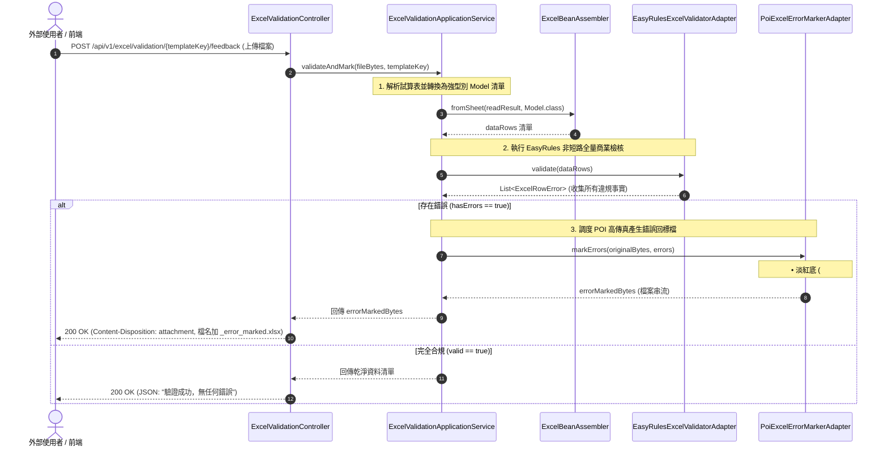

# 維度二：宣告式資料校驗與錯誤回標架構總覽 (Dimension 2: Custom Validation & Error Feedback Hub)

> 📌 本文件座落於 [`doc/design/custom-validation-and-error-feedback.md`](file:///d:/桌面/ModuleWorkSpace/excel-module/doc/design/custom-validation-and-error-feedback.md)，作為 `excel-module` 企業級擴充藍圖 **「維度二：宣告式資料校驗與錯誤回標」** 的核心入口與子模組總覽導讀。  
> 總體架構請參閱：👉 [Excel 模組架構設計與演進藍圖 (architecture-design.md)](file:///d:/桌面/ModuleWorkSpace/excel-module/doc/design/architecture-design.md)。

---

## 1. 子模組定位與設計哲學 (Sub-Module Vision & Architecture)

在大量資料批次匯入時，傳統系統常因單一格式錯誤中斷流程（Fail-Fast），導致使用者必須反覆重傳。

維度二結合 **Clean Architecture 六角形架構**、**Java 21 Record**、**輕量級規則引擎 (EasyRules)** 與 **樣式標註引擎 (POI Error-Marking)**，實現：
1. **全量錯誤累積 (Accumulate All Errors)**：一次性完整掃描整份試算表，收集所有行與儲存格的違規細節。
2. **多層次檢核管線 (Multi-Tier Pipeline)**：涵蓋基礎格式、強型別轉換、行級商業規則（EasyRules）、整表跨列統計（防重複對帳）。
3. **視覺化「錯誤回標檔」生成**：出錯儲存格套用**淡紅色背景（`#FFC7CE`）＋深紅色文字（`#9C0006`）**，最右側追加錯誤原因欄位與批註。
4. **宣告式前置守衛 (`@ValidateExcel`)**：透過 AOP 切面攔截無效檔案，自動短路回傳回標檔或轉譯為 HTTP 422 結構化報告。
5. **開放封閉範本註冊中心 (`ExcelTemplateRegistry`)**：支援動態註冊多業務單據元數據，擴充零修改。

```mermaid
flowchart TD
    subgraph Configuration_Layer ["Configuration Layer (全域配置層 - Composition Root)"]
        TemplateConfig["ExcelTemplateConfiguration<br/>(集中裝配核心範本 orders, products, materials, boms<br/>& 自訂擴充 ExcelTemplateCustomizer SPI)"]
    end

    subgraph Presentation_Layer ["Presentation Layer (表現層 - Inbound Adapters)"]
        direction TB
        Ctrl["ExcelValidationController<br/>GET /templates (範本探索)<br/>POST /{templateKey}/feedback (回標檔)<br/>POST /{templateKey} (JSON 診斷報告)"]
        Aspect["ExcelValidationAspect (@ValidateExcel 請求前置守衛)"]
    end

    subgraph Application_Layer ["Application Layer (應用層 - CQRS & 業務合約)"]
        direction TB
        InPort["ValidateExcelUseCase (Inbound Port)"]
        AppService["ExcelValidationApplicationService (協調中樞)"]
        
        subgraph Contracts ["共享不可變模型 (Java 21 Records)"]
            RowError["ExcelRowError (錯誤事實)"]
            ValResult["ExcelValidationGottenResult (檢核報告)"]
        end

        subgraph Outbound_Ports ["Outbound Ports (業務合約 SPI)"]
            RowValPort["ExcelRowValidatorPort (行級驗證)"]
            SheetValPort["ExcelSheetValidatorPort (整表約束)"]
            MarkerPort["ExcelErrorMarkerPort (錯誤標註回標)"]
        end
    end

    subgraph Infrastructure_Layer ["Infrastructure Layer (基礎設施層 - 技術容器 & 適配器)"]
        Registry["ExcelTemplateRegistry<br/>(純粹技術元數據容器，零業務模型依賴)"]
        EasyRulesAdapter["EasyRulesExcelValidatorAdapter<br/>(EasyRules 4.1.0 複合商業規則)"]
        PoiFeedback["PoiExcelErrorMarkerAdapter<br/>(POI 5.5.1 淡紅底深紅字錯誤回標)"]
    end

    TemplateConfig -. 裝配預載範本 .-> Registry
    Ctrl --> Registry
    Ctrl --> InPort
    Aspect -. 前置攔截防衛 .-> Ctrl
    InPort --> AppService
    AppService --> RowValPort
    AppService --> SheetValPort
    AppService --> MarkerPort
    RowValPort -.-> EasyRulesAdapter
    MarkerPort -.-> PoiFeedback
```



---

## 2. 專題子文件導讀與跳轉索引 (Specialized Documentation Navigation)

本子模組之詳細技術規格已依職責切分收納於專屬目錄 [`doc/design/custom-validation-and-error-feedback/`](file:///d:/桌面/ModuleWorkSpace/excel-module/doc/design/custom-validation-and-error-feedback/) 中：

| 專題技術文件 | 核心關注點 | 適合閱讀對象 | 涵蓋核心元件 |
| :--- | :--- | :--- | :--- |
| 👉 **[Part 1：EasyRules 檢核管線與全量錯誤診斷模型 (01-easyrules-validation-pipeline.md)](file:///d:/桌面/ModuleWorkSpace/excel-module/doc/design/custom-validation-and-error-feedback/01-easyrules-validation-pipeline.md)** | **檢核管線與規則引擎**<br/>• 5 層多維檢核架構全貌<br/>• EasyRules 4.1.0 規則組件庫<br/>• 非短路全量錯誤收集<br/>• `ExcelRowError` 純模型 | 規則開發者、領域業務工程師、後端架構師 | `ExcelRowValidationRule`<br/>`EasyRulesExcelValidatorAdapter`<br/>`ExcelRowValidatorPort`<br/>`ExcelRowError`<br/>`ExcelValidationGottenResult` |
| 👉 **[Part 2：高傳真錯誤回標檔、前置切面守衛與 OCP 範本註冊 (02-error-marked-excel-and-guard-aspect.md)](file:///d:/桌面/ModuleWorkSpace/excel-module/doc/design/custom-validation-and-error-feedback/02-error-marked-excel-and-guard-aspect.md)** | **錯誤回標檔與切面防護**<br/>• 淡紅底深紅字高傳真生成<br/>• 最右側動態追加錯誤原因<br/>• `@ValidateExcel` AOP 前置守衛<br/>• `ExcelTemplateRegistry` OCP 擴充 | 表現層開發者、前端整合工程師、測試工程師 | `PoiExcelErrorMarkerAdapter`<br/>`ExcelErrorMarkerPort`<br/>`ExcelValidationAspect`<br/>`@ValidateExcel`<br/>`ExcelTemplateRegistry`<br/>`ExcelValidationController` |

---

## 3. 六角形架構端到端元件矩陣 (Component & Port Matrix)

| 分層 (Layer) | 元件名稱 / 介面 | 角色與職責 | AGENTS.md 命名規範 |
| :--- | :--- | :--- | :--- |
| **Presentation** | [`ExcelValidationController`](file:///d:/桌面/ModuleWorkSpace/excel-module/src/main/java/com/example/demo/presentation/controller/validation/ExcelValidationController.java) | 提供範本探索、動態回標、JSON 診斷報告與智慧探測端點 | Controller |
| **Presentation** | [`ExcelValidationResourceAssembler`](file:///d:/桌面/ModuleWorkSpace/excel-module/src/main/java/com/example/demo/presentation/assembler/ExcelValidationResourceAssembler.java) | ACL 防腐層，負責檢核結果 DTO 轉 Resource | Assembler |
| **Presentation** | [`ExcelValidationAspect`](file:///d:/桌面/ModuleWorkSpace/excel-module/src/main/java/com/example/demo/presentation/aspect/ExcelValidationAspect.java) | `@ValidateExcel` 切面前置守衛，攔截無效上傳並短路回標 | Inbound Guard Aspect |
| **Application (Port In)** | [`ValidateExcelUseCase`](file:///d:/桌面/ModuleWorkSpace/excel-module/src/main/java/com/example/demo/application/port/in/validation/ValidateExcelUseCase.java) | 應用層資料驗證與回標核心 UseCase 契約 | `*UseCase` (Rule 3-8) |
| **Application (Service)** | [`ExcelValidationApplicationService`](file:///d:/桌面/ModuleWorkSpace/excel-module/src/main/java/com/example/demo/application/service/validation/ExcelValidationApplicationService.java) | 應用流程調度中心，協調讀取、校驗與標註輸出 | `*ApplicationService` (Rule 3-9) |
| **Application (Port Out)**| [`ExcelRowValidatorPort`](file:///d:/桌面/ModuleWorkSpace/excel-module/src/main/java/com/example/demo/application/port/out/validation/ExcelRowValidatorPort.java)<br>[`ExcelSheetValidatorPort`](file:///d:/桌面/ModuleWorkSpace/excel-module/src/main/java/com/example/demo/application/port/out/validation/ExcelSheetValidatorPort.java) | 行級業務校驗與整表統計約束 Outbound Port 契約 | `*Port` (Rule 3-8) |
| **Application (Port Out)**| [`ExcelErrorMarkerPort`](file:///d:/桌面/ModuleWorkSpace/excel-module/src/main/java/com/example/demo/application/port/out/validation/ExcelErrorMarkerPort.java) | 錯誤回標檔案二進位生成 Outbound Port 契約 | `*Port` (Rule 3-8) |
| **Application (Model)**   | [`ExcelRowError`](file:///d:/桌面/ModuleWorkSpace/excel-module/src/main/java/com/example/demo/application/shared/model/ExcelRowError.java)<br>[`ExcelValidationGottenResult`](file:///d:/桌面/ModuleWorkSpace/excel-module/src/main/java/com/example/demo/application/shared/dto/ExcelValidationGottenResult.java) | 單一儲存格違規事實與檢核匯總純資料載體 | Java 21 Record |
| **Infrastructure (Template)**| [`ExcelTemplateRegistry`](file:///d:/桌面/ModuleWorkSpace/excel-module/src/main/java/com/example/demo/infrastructure/template/ExcelTemplateRegistry.java) | 集中管理各單據範本之元數據與驗證模型 (OCP 技術容器) | Registry |
| **Configuration** | [`ExcelTemplateConfiguration`](file:///d:/桌面/ModuleWorkSpace/excel-module/src/main/java/com/example/demo/config/ExcelTemplateConfiguration.java) | 集中預載業務範本元數據並支援 `ExcelTemplateCustomizer` SPI 擴充 | Configuration |
| **Infrastructure (Adapter)** | [`EasyRulesExcelValidatorAdapter`](file:///d:/桌面/ModuleWorkSpace/excel-module/src/main/java/com/example/demo/infrastructure/adapter/validation/EasyRulesExcelValidatorAdapter.java) | 基於 EasyRules 4.1.0 實作 `ExcelRowValidatorPort` | `*Adapter` (Rule 3-9) |
| **Infrastructure (Adapter)** | [`PoiExcelErrorMarkerAdapter`](file:///d:/桌面/ModuleWorkSpace/excel-module/src/main/java/com/example/demo/infrastructure/adapter/validation/PoiExcelErrorMarkerAdapter.java) | 基於 POI 5.5.1 實作 `ExcelErrorMarkerPort` | `*Adapter` (Rule 3-9) |

---

## 4. 端到端調用執行流程 (End-to-End Sequence)



---

## 5. 測試驗證全景 (Testing & Verification Status)

* [`EasyRulesExcelValidatorAdapterTest`](file:///d:/桌面/ModuleWorkSpace/excel-module/src/test/java/com/example/demo/infrastructure/adapter/validation/EasyRulesExcelValidatorAdapterTest.java)：驗證行級規則評估、非短路錯誤累積與跨欄位連動。
* [`PoiExcelErrorMarkerAdapterTest`](file:///d:/桌面/ModuleWorkSpace/excel-module/src/test/java/com/example/demo/infrastructure/adapter/validation/PoiExcelErrorMarkerAdapterTest.java)：驗證 POI 原始格式保留、出錯儲存格淡紅底深紅字套用與錯誤原因追加。
* [`ExcelValidationControllerTest`](file:///d:/桌面/ModuleWorkSpace/excel-module/src/test/java/com/example/demo/presentation/controller/validation/ExcelValidationControllerTest.java)：驗證 5 隻端點的檔案上傳、HTTP 422 錯誤報告、檔案下載與 AOP 切面攔截。

---

## 6. 子模組 Package 套件結構與分層對照 (Package Structure & Layer Mapping)

資料校驗與錯誤回標子模組遵循 Clean Architecture 六角形架構，其 Package 套件結構如下：

### 6.1 主程式 Package 結構 (`src/main/java`)

```
com.example.demo
├── presentation/                                    # 表現層 (Inbound Adapters)
│   ├── controller/validation/                       # 校驗 REST 控制器
│   │   └── ExcelValidationController.java           # 範本探索、錯誤回標檔匯出、JSON 診斷端點
│   ├── aspect/                                      # 請求前置守衛切面
│   │   └── ExcelValidationAspect.java               # @ValidateExcel 攔截器，自動短路回傳
│   ├── assembler/                                   # 防腐層 Resource 組裝器
│   │   └── ExcelValidationResourceAssembler.java    # 檢核報告轉 Response 載體
│   └── resource/                                    # 表現層資料載體 (Rule 3-1 & 3-2)
│       ├── in/ (ValidateExcelResource.java)
│       └── out/ (ExcelValidationReportResource.java)
│
├── application/                                     # 應用層 (Application Core)
│   ├── annotation/validation/                       # 宣告式驗證標註
│   │   ├── ValidateExcel.java                       # 控制器方法攔截守衛註解
│   │   └── ValidationRules.java                     # 規則標註容器
│   ├── port/in/validation/                          # Inbound Ports (UseCases - Rule 3-8)
│   │   └── ValidateExcelUseCase.java                # 驗證與錯誤回標業務合約
│   ├── port/out/validation/                         # Outbound Ports (業務輸出埠 - Rule 3-8)
│   │   ├── ExcelRowValidatorPort.java               # 行級規則校驗合約
│   │   ├── ExcelSheetValidatorPort.java             # 整表跨列校驗合約
│   │   └── ExcelErrorMarkerPort.java                # 錯誤標註回標檔生成合約
│   ├── service/validation/                          # 應用服務 (Rule 3-9)
│   │   └── ExcelValidationApplicationService.java   # 協調驗證管線與回標生成
│   └── shared/
│       ├── model/                                   # 領域無關共享模型
│       │   └── ExcelRowError.java                   # 違規列/儲存格錯誤事實
│       └── dto/                                     # DTO 純資料載體
│           └── ExcelValidationGottenResult.java     # 檢核結果完整報告
│
└── infrastructure/                                  # 基礎設施層 (Outbound Adapters & Rules)
    ├── adapter/validation/                          # 輸出適配器 (Rule 3-9)
    │   ├── EasyRulesExcelValidatorAdapter.java      # EasyRules 4.1.0 複合規則驗證適配器
    │   └── PoiExcelErrorMarkerAdapter.java          # Apache POI 錯誤樣式標註適配器
    └── validator/rules/                             # 具體業務檢核規則 (EasyRules Implementation)
        ├── AbstractExcelRowValidationRule.java      # 規則抽象基底類別
        ├── ExcelRowValidationRule.java              # 規則介面
        ├── OrderAmountValidationRule.java           # 訂單金額正數檢核
        ├── OrderQuantityValidationRule.java         # 訂單數量門檻檢核
        └── ProductPriceValidationRule.java          # 商品價格範圍檢核

### 6.2 測試套件 Package 結構 (`src/test/java`)

```
com.example.demo
├── presentation/controller/validation/
│   ├── ExcelValidationControllerTest.java           # 校驗 REST 控制器測試
│   └── ExcelValidationIntegrationTest.java          # 實體 Excel 上傳完整驗證整合測試
├── application/service/validation/
│   └── ExcelValidationApplicationServiceTest.java   # 驗證應用服務流程測試
└── infrastructure/adapter/validation/
    ├── EasyRulesExcelValidatorAdapterTest.java      # EasyRules 適配器測試
    └── PoiExcelErrorMarkerAdapterTest.java          # POI 錯誤標註適配器測試
```
