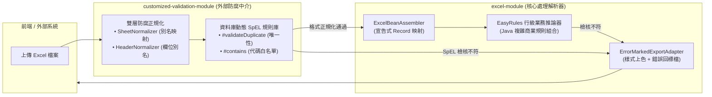

# Excel 客製驗證引擎與「錯誤回標檔」架構設計指南 (Custom Validation & Error Feedback Guide)

> 📌 本文件座落於 `doc/design/custom-validation-and-error-feedback.md`，詳述 `excel-module` 中基於 **Clean Architecture 六角形架構**、**Java 21 Record**、**輕量級規則引擎 (EasyRules)** 與 **樣式標註引擎 (Error-Marked Export)** 所打造之企業級 Excel 匯入驗證與錯誤回標解決方案。

---

## 1. 背景與設計挑戰 (Background & Challenges)

### 1.1 傳統 Excel 批次匯入的典型痛點
在製造業、供應鏈與企業管理系統中，Excel 批次上傳是使用者最常使用的作業途徑。然而，傳統架構通常存在以下嚴重缺失：
1. **「改一筆、傳一次、爆一次」的極差體驗**：
   * 傳統後端遇到格式錯誤即中斷流程並丟出例外（Fail-Fast），使用者無法一次性獲知全量錯誤，上傳千筆資料往往需要反覆重傳十幾次。
2. **單一靜態檢核局限 (JSR-380 Limitations)**：
   * 標準 Bean Validation（如 `@NotBlank`, `@Min`, `@Pattern`）僅適用於欄位靜態格式，無法處理「跨欄位聯動」（如：VIP 客戶折扣率不能為 0）、「業務資料庫比對」（如：物料代碼須存在且為啟用狀態）或「全表統計約束」（如：工作表內項目編號嚴禁重複）。
3. **錯誤定位困難與溝通成本高昂**：
   * 回傳文字訊息如 `第 38 列單價有誤`，使用者需要自行開啟 Excel、尋找第 38 列、核對是哪個欄位出錯，排查費時且易改錯。
4. **架構耦合度高**：
   * 許多專案將驗證規則散落於 Controller、Service 甚至 ORM Entity 內部，缺乏統一的驗證 SPI，更無法靈活替換規則引擎。

### 1.2 本設計核心目標
* 🎯 **全量錯誤收集 (Accumulate All Errors)**：一次性完整掃描整份試算表，收集所有資料列與儲存格的違規細節，杜絕中斷報錯。
* 🎯 **多層次客製驗證管線 (Multi-Tier Validation Pipeline)**：
  * **Level 1**：JSR-380 基礎格式約束。
  * **Level 2**：純 Java 函數式業務驗證 SPI（可注入 Spring Service 查庫）。
  * **Level 3**：輕量級規則引擎 **EasyRules**（支援條件與動作解耦、優先級排程）。
  * **Level 4**：整表與跨列統計約束（防重複檢核、表頭表身彙總對帳）。
  * **Level 5**：工作區 `customized-validation-module` 橋接（支援資料庫 SpEL 規則熱插拔）。
* 🎯 **視覺化「錯誤回標檔」生成 (Error-Marked Excel Generation)**：
  * 保留使用者上傳之原始資料排版。
  * 出錯儲存格自動套用**淡紅色背景（`#FFC7CE`）＋深紅色文字（`#9C0006`）**。
  * 於最右側動態追加「**檢核結果與錯誤原因**」說明欄，使用者直接在標紅處修改完即可重新上傳。
* 🎯 **嚴守 Clean Architecture 與工作區規範 ([AGENTS.md](file:///d:/桌面/ModuleWorkSpace/excel-module/.agents/AGENTS.md))**：
  * 領域層（Domain Layer）維持 Pure Java，嚴禁 Lombok 與框架侵入。
  * 應用層（Application Layer）定義純粹 Java Record 與 Port 介面。
  * 基礎設施層（Infrastructure Layer）隔離 EasyRules 與 POI 樣式繪製技術。

### 1.3 五層多維檢核管線 (Multi-Tier Validation Pipeline) 全貌
整個檢核過程採用**全量錯誤累積模式（Accumulate All Errors）**，不會在遇到第一個錯誤時中斷拋出例外（Fail-Fast），而是完整掃描整份試算表：

| 層級 | 檢核管線 | 負責技術 / 組件 | 說明與檢核重點 |
| :--- | :--- | :--- | :--- |
| **Level 1** | **檔案結構檢核** | Controller / Spring Validation | 驗證副檔名（`.xlsx`/`.xls`）、檔案不可為空、工作表是否存在。 |
| **Level 2** | **表頭與型別映射** | `ExcelBeanAssembler` | 檢查 Excel 必要欄位表頭是否存在，並將儲存格二維資料自動對齊轉型為強型別 Java 模型（支援 JavaBean 與 Java 21 Record）。 |
| **Level 3** | **行級客製業務檢核** | `EasyRulesExcelValidatorAdapter`<br/>+ EasyRules POJO Rules | **核心業務檢核**：逐列評估金額是否大於 0、數量區間、折扣率聯動、狀態值是否合法等。透過非短路模式收集全量違規事實。 |
| **Level 4** | **整表跨列約束檢核** | `ExcelSheetValidatorPort` | **集合級約束**：如「整張工作表內項目編號嚴禁重複」、「明細總金額與表頭加總對帳」等跨列比對。 |
| **Level 5** | **視覺化錯誤回標檔** | `PoiExcelErrorMarkerAdapter` | 若檢核存在錯誤，在原始試算表上**原樣保留格式**，將出錯儲存格標記為**淡紅底深紅字**，並在最右側追加**錯誤原因說明欄**。 |

---

## 2. 總體架構與分層職責 (Architecture & Ports)

```mermaid
flowchart TD
    subgraph Presentation_Layer ["Presentation Layer (表現層 - Inbound Adapters)"]
        direction TB
        Ctrl["ExcelValidationController<br/>GET /templates (範本探索)<br/>POST /{templateKey}/feedback (OCP 動態回標)<br/>POST /{templateKey} (OCP 動態 JSON)<br/>POST /feedback (Zero-Config 自動探測)<br/>POST /declarative/orders (AOP 宣告式示範)"]
        ResOut["ExcelValidatedResource<br/>(通過筆數 + 全量錯誤清單)"]
        PresAssembler["ExcelValidationResourceAssembler<br/>(防腐層 ACL 轉換)"]
        Registry["ExcelTemplateRegistry<br/>(集中模型元數據管理，支援 OCP 擴充)"]
    end

    subgraph Application_Layer ["Application Layer (應用層 - CQRS & 核心流程)"]
        direction TB
        InPort["ValidateExcelUseCase<br/>(Inbound Port 契約)"]
        AppService["ExcelValidationApplicationService<br/>(流程協調中樞)"]
        
        subgraph Contracts ["共享不可變模型 (Java 21 Records)"]
            RowError["ExcelRowError<br/>(錯誤座標/欄位/原始值/錯誤原因)"]
            ValContext["ExcelValidationContext&lt;T&gt;<br/>(工作表名稱/整表唯讀快照)"]
            ValResult["ExcelValidationGottenResult&lt;T&gt;<br/>(validItems + errors + totalCount)"]
        end

        subgraph Outbound_Ports ["Outbound Ports (業務合約 SPI)"]
            ReaderPort["ExcelReaderPort<br/>(二進位試算表讀取合約)"]
            RowValPort["ExcelRowValidatorPort&lt;T&gt;<br/>(行級客製驗證合約)"]
            SheetValPort["ExcelSheetValidatorPort&lt;T&gt;<br/>(整表防重複/統計合約)"]
            MarkerPort["ExcelErrorMarkerPort<br/>(錯誤標註檔生成合約)"]
        end
    end

    subgraph Infrastructure_Layer ["Infrastructure Layer (基礎設施層 - Outbound Adapters)"]
        direction TB
        subgraph Outbound_Adapters ["adapter/ (Outbound Adapters 匯聚點)"]
            EasyRulesAdapter["EasyRulesExcelValidatorAdapter<br/>(實作 ExcelRowValidatorPort，非短路排程)"]
            PoiFeedback["PoiExcelErrorMarkerAdapter<br/>(實作 ExcelErrorMarkerPort，淡紅底深紅字)"]
        end
        
        subgraph Rules_Subsystem ["validator/rules/ (規則引擎組件庫)"]
            RuleContract["ExcelRowValidationRule&lt;T&gt;<br/>(規則介面契約)"]
            BaseRule["AbstractExcelRowValidationRule&lt;T&gt;<br/>(EasyRules 抽象基類，封裝 when/then)"]
            ConcreteRules["具體業務規則<br/>OrderAmountValidationRule<br/>OrderQuantityValidationRule<br/>ProductPriceValidationRule"]
        end
    end

    Ctrl --> PresAssembler
    PresAssembler --> InPort
    InPort --> AppService
    AppService --> ReaderPort
    AppService --> RowValPort
    AppService --> SheetValPort
    AppService --> MarkerPort
    
    RowValPort -.-> EasyRulesAdapter
    EasyRulesAdapter --> RuleContract
    RuleContract --> BaseRule
    BaseRule --> ConcreteRules
    MarkerPort -.-> PoiFeedback
```



### 分層職責詳細說明

| 分層模組 | 職責邊界 | 遵循規範與特色 |
| :--- | :--- | :--- |
| **表現層 (`presentation`)** | 接收上傳之二進位試算表與驗證參數，依據驗證結果回傳 JSON 統計結果或直接串流下載回標 Excel 檔。 | 嚴格維持 Resource 為純資料載體，由 `assembler/` 負責 ACL 轉換。 |
| **應用層 (`application`)** | 協調反序列化、調度驗證管線、收集 `List<ExcelRowError>`、決定後續業務流向（成功則入庫，失敗則產出回標檔）。 | 純 Java 21 Record 模型，零框架技術侵入。 |
| **基礎設施層 (`infrastructure`)** | 1. 封裝 EasyRules、Hibernate Validator、工作區 SpEL 模組。<br>2. 實作 POI/FastExcel 錯誤儲存格上色與錯誤說明欄產製。 | 將所有第三方框架技術隔離在 Adapter 內部，保護核心應用層。 |

---

## 3. 核心合約與模型規格 (Shared Models & SPI Ports)

### 3.1 錯誤事實模型 (`ExcelRowError`)
以不可變 Java 21 `record` 實作，封裝儲存格物理座標與業務錯誤語意：

```java
package com.example.demo.application.shared.model;

import java.io.Serializable;

/**
 * Excel 資料列檢核錯誤事實模型 (Excel Row Validation Error)
 * <p>
 * 位於應用層共享模型，以 Java 21 {@code record} 實作不可變之錯誤快照。
 * 封裝錯誤發生之儲存格座標、欄位名稱、無效輸入值與業務錯誤原因，
 * 供錯誤回標適配器精準定位並渲染樣式。
 * </p>
 *
 * @param rowIndex     發生錯誤的資料列索引 (1-based，與 Excel 介面列號完全一致)
 * @param columnIndex  發生錯誤的欄位索引 (0-based，-1 代表整列層級錯誤)
 * @param columnName   發生錯誤的欄位名稱 (例如："採購單價")
 * @param invalidValue 使用者輸入之原始無效值 (例如："-50" 或 "ABC")
 * @param errorMessage 詳細檢核錯誤原因 (例如："單價不可小於合約底價 10.00")
 * @param ruleCode     觸發之規則唯一識別碼 (例如："PRICE_BELOW_CONTRACT_MIN")
 */
public record ExcelRowError(
    int rowIndex,
    int columnIndex,
    String columnName,
    Object invalidValue,
    String errorMessage,
    String ruleCode
) implements Serializable {

    /**
     * 便捷工廠方法：建立整列級別錯誤 (無特定單一欄位)
     */
    public static ExcelRowError ofRow(int rowIndex, String errorMessage, String ruleCode) {
        return new ExcelRowError(rowIndex, -1, "整列", null, errorMessage, ruleCode);
    }

    /**
     * 便捷工廠方法：建立特定儲存格錯誤
     */
    public static ExcelRowError ofCell(int rowIndex, int columnIndex, String columnName, 
                                      Object invalidValue, String errorMessage, String ruleCode) {
        return new ExcelRowError(rowIndex, columnIndex, columnName, invalidValue, errorMessage, ruleCode);
    }
}
```

### 3.2 驗證上下文模型 (`ExcelValidationContext<T>`)
```java
package com.example.demo.application.shared.model;

import java.util.Collections;
import java.util.List;
import java.util.Map;

/**
 * 試算表檢核執行上下文 (Excel Validation Context)
 *
 * @param <T> 資料模型型別
 */
public record ExcelValidationContext<T>(
    String sheetName,
    List<T> allRows,
    Map<String, Object> sharedAttributes
) {
    public ExcelValidationContext(String sheetName, List<T> allRows) {
        this(sheetName, allRows, Collections.emptyMap());
    }
}
```

### 3.3 驗證器 Outbound Port (SPI 合約)
```java
package com.example.demo.application.port.out;

import java.util.List;
import com.example.demo.application.shared.model.ExcelRowError;
import com.example.demo.application.shared.model.ExcelValidationContext;

/**
 * Excel 行級客製業務驗證輸出埠 (Excel Row Validator Port)
 */
@FunctionalInterface
public interface ExcelRowValidatorPort<T> {
    /**
     * 針對單一資料列執行客製業務規則檢核
     *
     * @param context 包含整表快照與共享屬性之驗證上下文
     * @param rowIndex 目前資料列索引 (1-based)
     * @param item    反序列化後的資料實體物件
     * @return 檢核錯誤清單 (若檢核完全合格則回傳空 List)
     */
    List<ExcelRowError> validateRow(ExcelValidationContext<T> context, int rowIndex, T item);
}
```

```java
package com.example.demo.application.port.out;

import java.util.List;
import com.example.demo.application.shared.model.ExcelRowError;
import com.example.demo.application.shared.model.ExcelValidationContext;

/**
 * Excel 整表級別約束驗證輸出埠 (Excel Sheet Validator Port)
 * 專門處理跨列唯一性 (防重複)、表頭表身彙總對帳等集合型約束
 */
@FunctionalInterface
public interface ExcelSheetValidatorPort<T> {
    /**
     * 針對整張工作表執行統計與集合層級檢核
     *
     * @param context 驗證上下文 (包含全量資料列清單)
     * @return 檢核錯誤清單
     */
    List<ExcelRowError> validateSheet(ExcelValidationContext<T> context);
}
```

### 3.4 錯誤回標檔生成 Outbound Port
```java
package com.example.demo.application.port.out;

import java.io.InputStream;
import java.io.OutputStream;
import java.util.List;
import com.example.demo.application.shared.model.ExcelRowError;

/**
 * 錯誤標註試算表生成輸出埠 (Excel Error Marker Port)
 */
public interface ExcelErrorMarkerPort {
    /**
     * 讀取原始試算表串流，根據錯誤清單標註錯誤儲存格樣式並追加錯誤原因欄位
     *
     * @param originalExcelStream 使用者上傳之原始 Excel 輸入串流
     * @param errors              全量檢核錯誤清單
     * @param targetOutputStream 標註完成後之目標輸出串流
     */
    void writeErrorMarkedWorkbook(InputStream originalExcelStream, 
                                  List<ExcelRowError> errors, 
                                  OutputStream targetOutputStream);
}
```

---

## 4. 輕量級規則引擎 EasyRules 深度整合設計

### 4.1 為什麼選擇 EasyRules？
相較於 Drools 等重量級規則引擎，EasyRules 具備以下優勢：
1. **極度精簡，零維護負擔**：核心僅數十 KB，純 Java 實現，學習成本趨近於零。
2. **條件 (When) 與動作 (Then) 清晰解耦**：單一規則即為獨立 POJO 或 Fluent API，業務邏輯單元測試極其簡便。
3. **優先級排程 (Priority Ordering)**：
   * 支援高優先級規則（如：數值格式檢查）先執行；若未通過，低優先級規則（如：遠端資料庫查詢）不被觸發。
4. **全量錯誤累積模式 (Accumulate Mode)**：
   * 透過設定 `RulesEngineParameters.skipOnFirstAppliedRule(false)`，確保引擎走訪所有符合條件之規則，收集完整錯誤事實。

### 4.2 EasyRules 規則適配器實作架構 (`EasyRulesExcelValidatorAdapter`)

位於 `infrastructure/adapter/`，作為應用層 Outbound Port `ExcelRowValidatorPort` 的實作適配器：

```java
package com.example.demo.infrastructure.adapter;

import java.util.ArrayList;
import java.util.Collections;
import java.util.List;
import java.util.Map;
import org.jeasy.rules.annotation.Rule;
import org.jeasy.rules.api.Facts;
import org.jeasy.rules.api.Rules;
import org.jeasy.rules.api.RulesEngine;
import org.jeasy.rules.api.RulesEngineParameters;
import org.jeasy.rules.core.DefaultRulesEngine;
import org.springframework.beans.factory.annotation.Autowired;
import org.springframework.context.ApplicationContext;
import org.springframework.stereotype.Component;

import com.example.demo.application.port.out.ExcelRowValidatorPort;
import com.example.demo.application.shared.model.ExcelRowError;
import com.example.demo.application.shared.model.ExcelValidationContext;

/**
 * 基於 EasyRules 之行級客製驗證適配器 (EasyRules Excel Validator Adapter - Outbound Adapter)
 */
@Component
public class EasyRulesExcelValidatorAdapter<T> implements ExcelRowValidatorPort<T> {

    private final Rules rules;
    private final RulesEngine rulesEngine;

    @Autowired
    public EasyRulesExcelValidatorAdapter(ApplicationContext applicationContext) {
        this.rules = new Rules();
        if (applicationContext != null) {
            Map<String, Object> ruleBeans = applicationContext.getBeansWithAnnotation(Rule.class);
            ruleBeans.values().forEach(this.rules::register);
        }
        this.rulesEngine = createConfiguredEngine();
    }

    public EasyRulesExcelValidatorAdapter(List<Object> customRules) {
        this.rules = new Rules();
        if (customRules != null) {
            customRules.forEach(this.rules::register);
        }
        this.rulesEngine = createConfiguredEngine();
    }

    @Override
    public List<ExcelRowError> validateRow(ExcelValidationContext<T> context, int rowIndex, T item) {
        if (item == null || rules.isEmpty()) {
            return Collections.emptyList();
        }

        List<ExcelRowError> collectedErrors = new ArrayList<>();

        Facts facts = new Facts();
        facts.put("context", context);
        facts.put("rowIndex", rowIndex);
        facts.put("row", item);
        facts.put("errors", collectedErrors);

        // 觸發規則推論 (依優先級走訪所有規則，累積所有錯誤)
        rulesEngine.fire(rules, facts);

        return collectedErrors;
    }

    private RulesEngine createConfiguredEngine() {
        RulesEngineParameters parameters = new RulesEngineParameters()
                .skipOnFirstAppliedRule(false)      // 不短路：套用成功後繼續評估其他規則
                .skipOnFirstFailedRule(false)       // 不短路：執行失敗後繼續評估
                .skipOnFirstNonTriggeredRule(false); // 不短路：未觸發時繼續執行

        return new DefaultRulesEngine(parameters);
    }
}
```

### 4.3 規則基類與介面抽取架構 (`ExcelRowValidationRule` & `AbstractExcelRowValidationRule`)

為避免各客製規則中充斥重複的 `instanceof` 型別檢查、EasyRules `@Fact` 拆包以及樣板代碼，模組於 `infrastructure/validator/rules/` 抽取了泛型基類與介面供業務團隊無痛擴充：

1. **`ExcelRowValidationRule<T>` 介面**：
   定義規則支援之目標模型類別（`getTargetClass()`）、違規判斷邏輯（`isInvalid(...)`）與錯誤建構邏輯（`createError(...)`）。

2. **`AbstractExcelRowValidationRule<T>` 抽象基類**：
   封裝 EasyRules 的 `@Condition when(...)` 與 `@Action then(...)` 註解管線，自動處理型別過濾與全域錯誤收集，並提供 `errorOfCell` 與 `errorOfRow` 語意化工廠方法。

### 4.4 開發者自定義業務規則擴充指南 (4 步驟落地)

當系統需要為新業務模型新增校驗規則時，開發者僅需依照以下 **4 個極簡步驟**：

#### 步驟 1：建立規則類別並繼承 `AbstractExcelRowValidationRule<T>`
指定目標強型別模型 Class（支援 POJO 與 Java 21 Record）：

```java
package com.example.demo.infrastructure.validator.rules;

import java.math.BigDecimal;
import org.jeasy.rules.annotation.Rule;
import org.springframework.stereotype.Component;
import com.example.demo.application.shared.model.ExcelRowError;
import com.example.demo.application.shared.model.OrderModel;

/**
 * 訂單金額合法性檢核規則範例
 */
@Component
@Rule(name = "OrderAmountValidationRule", description = "驗證訂單購買金額必須大於零", priority = 1)
public class OrderAmountValidationRule extends AbstractExcelRowValidationRule<OrderModel> {

    public OrderAmountValidationRule() {
        super(OrderModel.class);
    }
```

#### 步驟 2：加上 Spring `@Component` 與 EasyRules `@Rule` 註解
* 標註 `@Component`：允許 Spring 容器自動探測並注入至 `EasyRulesExcelValidatorAdapter`。
* 標註 `@Rule(name = "...", priority = n)`：設定規則名稱與執行優先級（數字越小越先執行）。

#### 步驟 3：覆寫 `isInvalid(...)` 判定違規條件
只需編寫最純粹的業務邏輯，回傳 `true` 即代表不合格：
```java
    @Override
    public boolean isInvalid(OrderModel order) {
        BigDecimal amount = order.getAmount();
        return amount == null || amount.compareTo(BigDecimal.ZERO) <= 0;
    }
```

#### 步驟 4：覆寫 `createError(...)` 組裝錯誤事實
利用基類內建的 `errorOfCell` 或 `errorOfRow` 輔助方法快速回報：
```java
    @Override
    public ExcelRowError createError(OrderModel order, int rowIndex) {
        return errorOfCell(
                rowIndex,
                2,                      // C 欄 (購買金額)
                "購買金額",              // 欄位標題
                order.getAmount(),      // 原始違規值
                "購買金額必須大於 0.00",  // 錯誤提示訊息
                "INVALID_ORDER_AMOUNT"  // 規則代碼
        );
    }
}
```

#### 核心優勢總結：
* **零侵入與熱插拔**：規則撰寫完成後立即生效，完全不用修改任何 Service、Controller 或既有驗證適配器。
* **強型別安全**：底層抽象基類會自動檢查 `targetClass.isInstance(row)`，非該模型資料列自動略過，永不發生 `ClassCastException`。
* **多層次掛鉤**：若需要單列生成多筆錯誤，可進一步覆寫 `createErrors(item, context, rowIndex)`。

---

## 5. 「錯誤回標檔」生成引擎技術實作 (Error Feedback Engine)

### 5.1 樣式規範與視覺化標準
為確保使用者排查體驗直觀且無歧義，回標引擎採用國際通用的試算表錯誤標註規範：
* **錯誤儲存格背景**：淡紅色（RGB: `#FFC7CE` / Apache POI `IndexedColors.ROSE`）。
* **錯誤儲存格文字**：深紅色（RGB: `#9C0006` / Apache POI `IndexedColors.DARK_RED`）。
* **儲存格邊框**：細實線淡紅框。
* **追加說明欄位**：於工作表所有現存資料欄的最右側追加一欄「**檢核結果與錯誤原因**」，寬度自動調整為 30 字元。

### 5.2 POI SXSSF 串流與樣式適配器實作

位於 `infrastructure/adapter/`，作為應用層 Outbound Port `ExcelErrorMarkerPort` 的實作適配器：

```java
package com.example.demo.infrastructure.adapter;

import java.io.InputStream;
import java.io.OutputStream;
import java.util.List;
import java.util.Map;
import java.util.stream.Collectors;

import org.apache.poi.ss.usermodel.*;
import org.apache.poi.xssf.usermodel.XSSFWorkbook;
import org.springframework.stereotype.Component;

import com.example.demo.application.port.out.ExcelErrorMarkerPort;
import com.example.demo.application.shared.model.ExcelRowError;

/**
 * Apache POI Excel 錯誤標註適配器 (Poi Excel Error Marker Adapter - Outbound Adapter)
 */
@Component
public class PoiExcelErrorMarkerAdapter implements ExcelErrorMarkerPort {

    @Override
    public void writeErrorMarkedWorkbook(InputStream originalExcelStream, 
                                         List<ExcelRowError> errors, 
                                         OutputStream targetOutputStream) {
        try (Workbook workbook = new XSSFWorkbook(originalExcelStream)) {
            Sheet sheet = workbook.getSheetAt(0);

            // 1. 建立錯誤儲存格高亮樣式 (淡紅底 + 深紅字)
            CellStyle errorCellStyle = workbook.createCellStyle();
            errorCellStyle.setFillForegroundColor(IndexedColors.ROSE.getIndex());
            errorCellStyle.setFillPattern(FillPatternType.SOLID_FOREGROUND);
            
            Font errorFont = workbook.createFont();
            errorFont.setColor(IndexedColors.DARK_RED.getIndex());
            errorFont.setBold(true);
            errorCellStyle.setFont(errorFont);

            // 建立錯誤原因欄位表頭樣式 (深灰底白字)
            CellStyle headerCellStyle = workbook.createCellStyle();
            headerCellStyle.setFillForegroundColor(IndexedColors.GREY_50_PERCENT.getIndex());
            headerCellStyle.setFillPattern(FillPatternType.SOLID_FOREGROUND);
            Font headerFont = workbook.createFont();
            headerFont.setColor(IndexedColors.WHITE.getIndex());
            headerFont.setBold(true);
            headerCellStyle.setFont(headerFont);

            // 2. 依列號將錯誤分組 (Group by rowIndex)
            Map<Integer, List<ExcelRowError>> rowErrorMap = errors.stream()
                .collect(Collectors.groupingBy(ExcelRowError::rowIndex));

            // 3. 取得表頭行，並在最右側建立「錯誤原因」標題
            Row headerRow = sheet.getRow(0);
            int lastColNum = headerRow.getLastCellNum();
            Cell errorHeaderCell = headerRow.createCell(lastColNum);
            errorHeaderCell.setCellValue("檢核結果與錯誤原因 (Validation Errors)");
            errorHeaderCell.setCellStyle(headerCellStyle);

            // 4. 走訪錯誤列，高亮出錯儲存格並追加原因文字
            for (Map.Entry<Integer, List<ExcelRowError>> entry : rowErrorMap.entrySet()) {
                int rowIndex = entry.getKey(); // 1-based (Excel 列號)
                List<ExcelRowError> rowErrors = entry.getValue();

                Row row = sheet.getRow(rowIndex - 1); // POI 為 0-based
                if (row == null) {
                    row = sheet.createRow(rowIndex - 1);
                }

                // (A) 高亮各個出錯儲存格
                for (ExcelRowError error : rowErrors) {
                    if (error.columnIndex() >= 0) {
                        Cell cell = row.getCell(error.columnIndex());
                        if (cell == null) {
                            cell = row.createCell(error.columnIndex());
                        }
                        cell.setCellStyle(errorCellStyle);
                    }
                }

                // (B) 串接該列之所有錯誤原因，填入最右側欄位
                String combinedReason = rowErrors.stream()
                    .map(e -> (e.columnName() != null ? "[" + e.columnName() + "] " : "") + e.errorMessage())
                    .collect(Collectors.joining("; \n"));

                Cell errorReasonCell = row.createCell(lastColNum);
                errorReasonCell.setCellValue(combinedReason);
                errorReasonCell.setCellStyle(errorCellStyle);
            }

            // 5. 設定欄寬並寫入輸出串流
            sheet.setColumnWidth(lastColNum, 35 * 256);
            workbook.write(targetOutputStream);
        } catch (Exception ex) {
            throw new RuntimeException("產製錯誤回標 Excel 檔失敗: " + ex.getMessage(), ex);
        }
    }
}
```

---

## 6. 與工作區 `customized-validation-module` 的協同策略

工作區中已存在成熟的 [`customized-validation-module`](file:///d:/桌面/ModuleWorkSpace/customized-validation-module/README.md)，兩者在企業級整體架構中的分工與協同如下：



* **職責劃分**：
  * **`customized-validation-module`**：負責「**前端入口防腐**」——消除工作表與欄位別名差異，並執行資料庫動態設定之 SpEL 規則（如跨工作表外鍵）。
  * **`excel-module`**：負責「**核心業務與串流產製**」——提供高性能 Java 21 Record 映射、EasyRules 複雜業務邏輯編排，以及最終的「錯誤回標 Excel 檔」渲染與二進位串流回傳。

---

## 7. 端到端 REST API 設計與測試規格 (API Specification & BDD)

### 7.1 REST 端點定義與使用情境 (OCP 統一接口與精簡架構)

表現層 [`ExcelValidationController`](file:///d:/桌面/ModuleWorkSpace/excel-module/src/main/java/com/example/demo/presentation/controller/ExcelValidationController.java) 全面委託 [`ExcelTemplateRegistry`](file:///d:/桌面/ModuleWorkSpace/excel-module/src/main/java/com/example/demo/application/shared/registry/ExcelTemplateRegistry.java) 進行模型動態路由，遵循**開放封閉原則 (OCP)**，介面精簡收斂為 **5 隻高內聚核心 API**：

#### 核心端點 1：統一動態範本校驗並生成「錯誤回標檔」(OCP 核心統一接口)

```http
POST /api/v1/excel/validation/{templateKey}/feedback
Content-Type: multipart/form-data
```
* **路徑參數**：`templateKey`（如 `orders`, `products`, `materials`, `boms` 或自訂模型鍵值）
* **請求參數**：`file`: `MultipartFile`（待檢核之 Excel 檔案）
* **回應狀態與行為**：
  * **完全合格**：智能降級回傳 `HTTP 200 OK` JSON 統計資訊。
  * **檢核失敗**：直接以二進位串流回傳原樣保留排版、出錯儲存格套用**淡紅底（`#FFC7CE`）深紅字（`#9C0006`）**，且最右側追加**錯誤原因說明欄**之 Excel 檔：
    * 響應標頭：`Content-Type: application/vnd.openxmlformats-officedocument.spreadsheetml.sheet`
    * 響應標頭：`Content-Disposition: attachment; filename="{feedbackFilename}"; filename*=UTF-8''...`

#### 核心端點 2：統一動態範本校驗 (回傳 JSON 統計結果 - OCP 核心統一接口)

```http
POST /api/v1/excel/validation/{templateKey}
Content-Type: multipart/form-data
```
* **路徑參數**：`templateKey`（如 `orders`, `products` 等）
* **請求參數**：`file`: `MultipartFile`
* **回應狀態**：
  * **全數合格**：`HTTP 200 OK`
  * **包含錯誤**：`HTTP 422 Unprocessable Entity`
* **JSON 回應範例 (`ExcelValidatedResource`)**：
```json
{
  "valid": false,
  "totalRows": 10,
  "validRowCount": 8,
  "errorCount": 2,
  "errors": [
    {
      "rowIndex": 2,
      "columnIndex": 2,
      "columnName": "購買金額",
      "invalidValue": -100.0,
      "errorMessage": "購買金額必須大於 0.00",
      "ruleCode": "INVALID_ORDER_AMOUNT"
    },
    {
      "rowIndex": 5,
      "columnIndex": 3,
      "columnName": "數量",
      "invalidValue": 15000,
      "errorMessage": "購買數量必須為正整數且不可超過 9,999",
      "ruleCode": "INVALID_ORDER_QUANTITY"
    }
  ]
}
```

#### 核心端點 3：智慧自動偵測範本並生成「錯誤回標檔」(Zero-Config 自動路由接口)

```http
POST /api/v1/excel/validation/feedback
Content-Type: multipart/form-data
```
* **特點**：呼叫端無須指定 `templateKey`，後端自動解析試算表首個工作表名稱 (Sheet Name) 自動匹配模型並檢核回標。

#### 核心端點 4：範本探索 (Template Discovery)

```http
GET /api/v1/excel/validation/templates
```
* 回傳系統目前已註冊之所有可用範本清單、對應工作表名稱與預設回標檔名。

#### 核心端點 5：宣告式訂單匯入 (AOP 自動回標攔截最佳實踐示範)

```http
POST /api/v1/excel/validation/declarative/orders
Content-Type: multipart/form-data
```
* 標註 `@ValidateExcel`，違規時 AOP 直接短路阻斷並下載回標檔；合格時自動注入合規清單至方法參數。

### 7.2 BDD / Gherkin 測試規格範例

```java
/**
 * Feature: 宣告式 Excel 客製檢核與錯誤回標檔產製
 * 
 * Scenario: 上傳含有折扣超限與負數單價之訂單 Excel，系統應全量收集錯誤並生成錯誤回標檔
 *   Given 使用者上傳一份含有 5 列資料的訂單 Excel 檔案
 *     And 第 2 列之單價為 -50 (違反非負數規則)
 *     And 第 4 列普通客戶之折扣率為 25% (違反折扣上限 10% 規則)
 *    When 呼叫 ExcelValidationApplicationService 執行批次檢核
 *    Then 檢核管線不應中斷拋出例外
 *     And 應累積回傳 2 筆 ExcelRowError 錯誤事實
 *     And 錯誤回標引擎應產出修正引導檔，第 2 列與第 4 列出錯儲存格應渲染為淡紅底深紅字
 *     And 最右側錯誤原因欄位應正確列出 "[單價] 物料採購單價必須大於零" 與 "[折扣] 普通客戶折扣上限為 10%"
 */
@Test
void shouldCollectAllErrorsAndGenerateErrorMarkedExcel() {
    // 實作 BDD 斷言驗證
}
```

---

## 8. 設計總結與後續落地步驟

本指南完整定義了 **客製驗證與錯誤回標檔** 的端到端架構：
1. **SPI 合約化**：藉由 `ExcelRowValidatorPort` 與 `ExcelSheetValidatorPort`，徹底解耦業務規則與底層 Excel 解析框架。
2. **EasyRules 引擎化**：將複雜條件與動作清晰拆分為獨立 POJO 規則，支援動態優先級與全量錯誤事實累積。
3. **錯誤視覺化**：透過 `PoiExcelErrorMarkerAdapter` 提供使用者極致友善的「淡紅底＋深紅字＋錯誤說明欄」修正引導，形成完整的上傳、校驗、回標與重新匯入閉環。

