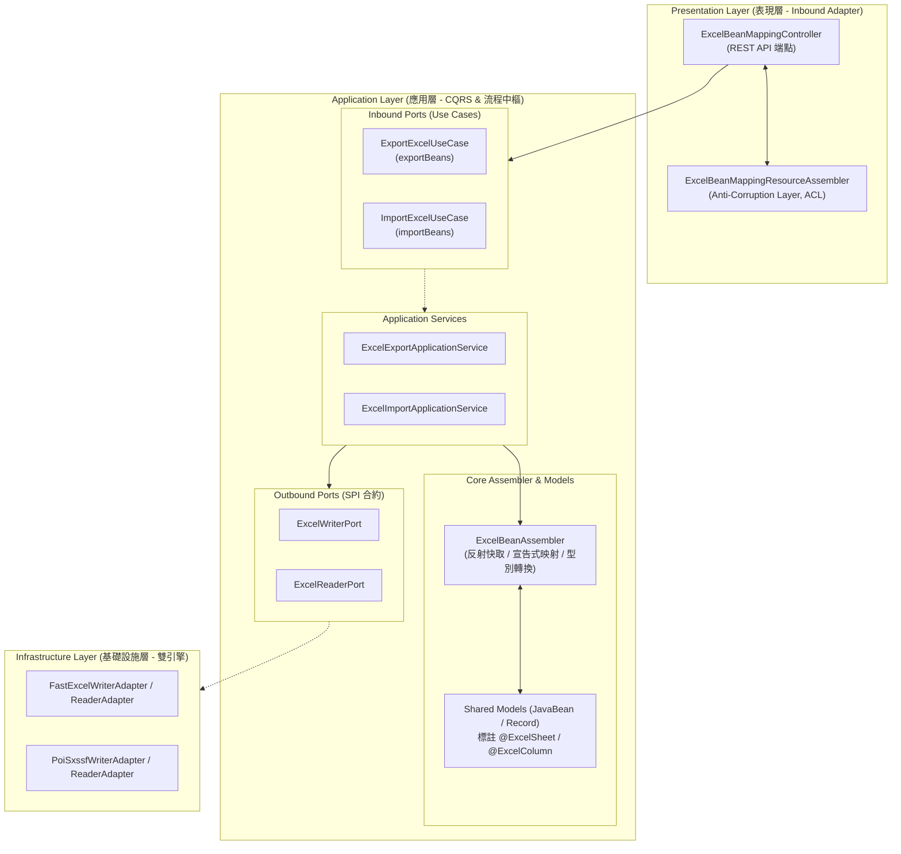
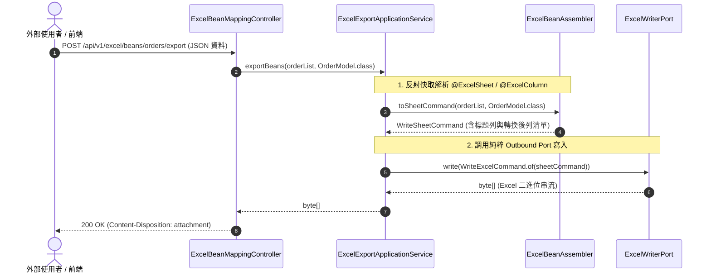

# 維度一：宣告式物件映射架構總覽 (Dimension 1: Declarative Bean Mapping Hub)

> 📌 本文件座落於 [`doc/design/declarative-bean-mapping.md`](file:///d:/桌面/ModuleWorkSpace/excel-module/doc/design/declarative-bean-mapping.md)，作為 `excel-module` 企業級擴充藍圖 **「維度一：宣告式物件映射」** 的核心入口與子模組總覽導讀。  
> 總體架構請參閱：👉 [Excel 模組架構設計與演進藍圖 (architecture-design.md)](file:///d:/桌面/ModuleWorkSpace/excel-module/doc/design/architecture-design.md)。

---

## 1. 子模組定位與設計哲學 (Sub-Module Vision & Architecture)

在傳統後端開發中，Excel 匯入匯出過度依賴動態集合（二維矩陣 `List<List<Object>>` 或字典 `List<Map<String, Object>>`），存在型別不安全、繁複手動 Mapping 以及格式化解析脆弱等痛點。

維度一基於 **Clean Architecture 六角形架構** 與 **高效能反射快取**，實現：
1. **宣告式註解標註**：透過 `@ExcelSheet` 與 `@ExcelColumn`，宣告式設定工作表名稱、欄位索引、千分位格式化與預設值。
2. **POJO 與 Java 21 Record 雙軌相容**：原生支援無參建構子 JavaBean 與規範建構子 (Canonical Constructor) Record。
3. **高效能雙層反射快取**：以 `ConcurrentHashMap` 消除重複反射開銷，逼近原生取值效能。
4. **雙向相容雙軌流轉**：保留 Map 方法並提供 `toMaps` 與 `fromMaps` 雙向橋接。
5. **嚴守 Clean Architecture 防腐隔離**：Outbound Port 保持純粹技術 SPI，完全隔離 Assembler 業務組裝邏輯。



---

## 2. 專題子文件導讀與跳轉索引 (Specialized Documentation Navigation)

本子模組之詳細技術規格已依職責切分收納於專屬目錄 [`doc/design/declarative-bean-mapping/`](file:///d:/桌面/ModuleWorkSpace/excel-module/doc/design/declarative-bean-mapping/) 中：

| 專題技術文件 | 核心關注點 | 適合閱讀對象 | 涵蓋核心元件 |
| :--- | :--- | :--- | :--- |
| 👉 **[Part 1：宣告式註解、雙層反射快取與型別容錯轉換 (01-reflection-cache-and-converters.md)](file:///d:/桌面/ModuleWorkSpace/excel-module/doc/design/declarative-bean-mapping/01-reflection-cache-and-converters.md)** | **註解與組裝核心引擎**<br/>• `@ExcelSheet` / `@ExcelColumn` 參數<br/>• JavaBean 與 Record 雙軌建構<br/>• `ConcurrentHashMap` 反射快取<br/>• 容錯千分位逗號與日期轉換 | 架構師、底層工具庫開發者、效能調優人員 | `@ExcelSheet`<br/>`@ExcelColumn`<br/>`ExcelBeanAssembler`<br/>`OrderImportModel`<br/>`ProductRecordModel` |
| 👉 **[Part 2：應用層 UseCase、CQRS 服務調度與 REST 端點 (02-ports-usecases-and-rest-binding.md)](file:///d:/桌面/ModuleWorkSpace/excel-module/doc/design/declarative-bean-mapping/02-ports-usecases-and-rest-binding.md)** | **分層架構與 REST 整合**<br/>• Inbound UseCases 強型別泛型合約<br/>• CQRS Application Services 協調<br/>• Outbound Ports 純淨抽象隔離<br/>• REST 端點與 ResourceAssembler | 應用開發者、API 設計師、前後端串接者 | `ExportExcelUseCase`<br/>`ImportExcelUseCase`<br/>`ExcelExportApplicationService`<br/>`ExcelBeanMappingController`<br/>`ExcelWriterPort` |

---

## 3. 六角形架構端到端元件矩陣 (Component & Port Matrix)

| 分層 (Layer) | 元件名稱 / 介面 | 角色與職責 | AGENTS.md 命名規範 |
| :--- | :--- | :--- | :--- |
| **Presentation** | [`ExcelBeanMappingController`](file:///d:/桌面/ModuleWorkSpace/excel-module/src/main/java/com/example/demo/presentation/controller/core/ExcelBeanMappingController.java) | 提供 JavaBean 與 Record 匯入匯出 REST API | Controller |
| **Presentation** | [`ExcelBeanMappingResourceAssembler`](file:///d:/桌面/ModuleWorkSpace/excel-module/src/main/java/com/example/demo/presentation/assembler/ExcelBeanMappingResourceAssembler.java) | ACL 防腐層，負責 Request/Response 與 Model 間轉換 | Assembler |
| **Application (Port In)** | [`ExportExcelUseCase`](file:///d:/桌面/ModuleWorkSpace/excel-module/src/main/java/com/example/demo/application/port/in/core/ExportExcelUseCase.java)<br>[`ImportExcelUseCase`](file:///d:/桌面/ModuleWorkSpace/excel-module/src/main/java/com/example/demo/application/port/in/core/ImportExcelUseCase.java) | 應用層強型別泛型匯出與匯入 UseCase 契約 | `*UseCase` (Rule 3-8) |
| **Application (Service)** | [`ExcelExportApplicationService`](file:///d:/桌面/ModuleWorkSpace/excel-module/src/main/java/com/example/demo/application/service/ExcelExportApplicationService.java)<br>[`ExcelImportApplicationService`](file:///d:/桌面/ModuleWorkSpace/excel-module/src/main/java/com/example/demo/application/service/ExcelImportApplicationService.java) | 協調調度業務流程，委派組裝器與底層 Port | `*ApplicationService` (Rule 3-9) |
| **Application (Assembler)**| [`ExcelBeanAssembler`](file:///d:/桌面/ModuleWorkSpace/excel-module/src/main/java/com/example/demo/application/assembler/ExcelBeanAssembler.java) | 核心組裝器，負責雙層反射快取、註解解析與雙軌實例建構 | Assembler |
| **Application (Annotation)**| [`@ExcelSheet`](file:///d:/桌面/ModuleWorkSpace/excel-module/src/main/java/com/example/demo/application/annotation/mapping/ExcelSheet.java)<br>[`@ExcelColumn`](file:///d:/桌面/ModuleWorkSpace/excel-module/src/main/java/com/example/demo/application/annotation/mapping/ExcelColumn.java) | 工作表名稱、欄位索引、千分位格式化與公式宣告 | Annotation |
| **Application (Port Out)**| [`ExcelWriterPort`](file:///d:/桌面/ModuleWorkSpace/excel-module/src/main/java/com/example/demo/application/port/out/core/ExcelWriterPort.java)<br>[`ExcelReaderPort`](file:///d:/桌面/ModuleWorkSpace/excel-module/src/main/java/com/example/demo/application/port/out/core/ExcelReaderPort.java) | 純粹向外 SPI 技術契約，嚴禁依賴任何 Assembler 實作 | `*Port` (Rule 3-8) |
| **Infrastructure (Adapter)** | [`FastExcelWriterAdapter`](file:///d:/桌面/ModuleWorkSpace/excel-module/src/main/java/com/example/demo/infrastructure/adapter/core/FastExcelWriterAdapter.java)<br>[`PoiSxssfWriterAdapter`](file:///d:/桌面/ModuleWorkSpace/excel-module/src/main/java/com/example/demo/infrastructure/adapter/core/PoiSxssfWriterAdapter.java) | FastExcel 與 Apache POI 實體檔案寫入與解析適配器 | `*Adapter` (Rule 3-9) |

---

## 4. 端到端調用執行時序 (End-to-End Sequence)



---

## 5. 測試驗證全景 (Testing & Verification Status)

* [`ExcelBeanAssemblerTest`](file:///d:/桌面/ModuleWorkSpace/excel-module/src/test/java/com/example/demo/application/assembler/ExcelBeanAssemblerTest.java)：驗證反射快取、POJO 與 Record 雙軌轉換、千分位容錯、公式與標題解析。
* [`ExcelBeanMappingControllerTest`](file:///d:/桌面/ModuleWorkSpace/excel-module/src/test/java/com/example/demo/presentation/controller/core/ExcelBeanMappingControllerTest.java)：驗證 5 隻端點之 JSON 匯出、串流產製與 Multipart 上傳反序列化。

---

## 6. 子模組 Package 套件結構與分層對照 (Package Structure & Layer Mapping)

宣告式物件映射機制依附於 `core` 核心讀寫子模組，其 Package 套件結構如下：

### 6.1 主程式 Package 結構 (`src/main/java`)

```
com.example.demo
├── presentation/                                    # 表現層 (Inbound Adapters)
│   ├── controller/core/                             # 核心控制器
│   │   └── ExcelBeanMappingController.java          # 宣告式 Bean 匯入/匯出 REST API
│   ├── assembler/                                   # 防腐層 Resource 組裝器
│   │   └── ExcelResourceAssembler.java              # Request 轉 Command 組裝器
│   └── resource/                                    # 表現層資料載體 (Rule 3-1 & 3-2)
│       ├── in/ (ExportOrderResource.java, ExportProductResource.java)
│       └── out/ (ExcelExportedResource.java, ExcelImportedResource.java)
│
├── application/                                     # 應用層 (Application Core)
│   ├── annotation/mapping/                          # 宣告式註解
│   │   ├── ExcelSheet.java                          # 工作表元數據標註
│   │   └── ExcelColumn.java                         # 儲存格欄位映射標註
│   ├── assembler/                                   # 雙向組裝器
│   │   └── ExcelBeanAssembler.java                  # 反射快取、JavaBean/Record 與 Map 雙向轉換
│   ├── port/in/core/                                # Inbound Ports (UseCases - Rule 3-8)
│   │   ├── ExportExcelUseCase.java                  # exportBeans(...)
│   │   ├── StreamExportExcelUseCase.java            # streamExportBeans(...)
│   │   ├── ImportExcelUseCase.java                  # importBeans(...)
│   │   └── StreamImportExcelUseCase.java            # streamImportBeans(...)
│   ├── service/core/                                # 應用服務 (Rule 3-9)
│   │   ├── ExcelCommandService.java                 # 呼叫 ExcelBeanAssembler 轉換後寫出
│   │   └── ExcelQueryService.java                   # 讀取結構化字典後反序列化為 Bean
│   └── shared/model/                                # 展示用模型 (JavaBean & Record)
│       ├── OrderImportModel.java                    # 標準 JavaBean 範例
│       └── ProductRecordModel.java                  # Java 21 Record 範例
│
└── infrastructure/adapter/core/                     # 基礎設施層 (Outbound Adapters)
    ├── FastExcelWriterAdapter.java                  # 核心寫入適配器
    ├── FastExcelReaderAdapter.java                  # 核心讀取適配器
    ├── PoiSxssfWriterAdapter.java                   # POI 寫入適配器
    └── PoiSaxReaderAdapter.java                     # POI 讀取適配器

### 6.2 測試套件 Package 結構 (`src/test/java`)

```
com.example.demo
├── presentation/controller/core/
│   └── ExcelBeanMappingControllerTest.java          # 宣告式控制器端點整合測試
├── application/assembler/
│   └── ExcelBeanAssemblerTest.java                  # 組裝器單元測試 (反射快取/型別轉換)
└── infrastructure/adapter/core/
    └── FastExcelWriterAdapterTest.java              # 底層適配器驗證
```
