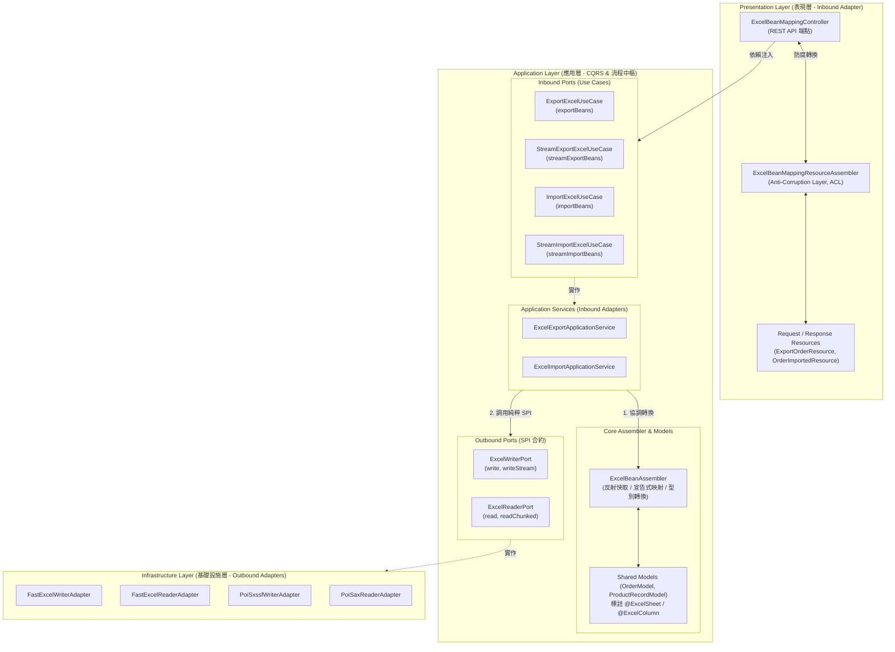

# Excel 宣告式物件映射架構與設計指南 (Declarative Bean Mapping Architecture & Design Guide)

> 📌 本文件詳述 `excel-module` 中基於 **Clean Architecture 六角形架構** 與 **Java 反射快取** 打造之「宣告式物件映射 (Declarative Bean Mapping)」機制。
> 涵蓋設計哲學、註解系統、POJO 與 Java 21 Record 雙軌支援、智慧型別容錯轉換、Hexagonal 分層職責、REST 表現層設計以及完整程式碼範例。

---

## 1. 背景與設計挑戰

### 1.1 傳統資料流動的痛點
在傳統後端開發中，Excel 匯入與匯出經常採用動態集合結構（如二維矩陣 `List<List<Object>>` 或鍵值字典 `List<Map<String, Object>>`）。雖然具備靈活性，但在大型企業專案中暴露了顯著痛點：
1. **型別不安全 (Type-Safety Void)**：依賴字串鍵值或索引提取欄位，拼寫錯誤在編譯期無法被察覺，通常延遲至執行期引發 `NullPointerException` 或 `ClassCastException`。
2. **重複性手動 Mapping 負擔**：每個業務 Controller 或 Service 都要手動編寫「儲存格 $\to$ 業務實體」的解析邏輯（如字串轉日期、數值型別轉換），造成程式碼冗長且標準不一。
3. **格式化與千分位解析脆弱**：會計與商務報表常帶有千分位逗號（如 `"12,500.50"`）或特殊日期格式（如 `"2026-11-01"`），原生 `BigDecimal(str)` 解析易直接崩潰拋出 `NumberFormatException`。

### 1.2 設計目標
1. **宣告式註解標註 (Declarative Annotations)**：開發者僅需在 Java 類別或 Record 屬性上標註 `@ExcelSheet` 與 `@ExcelColumn`，即可自動完成工作表標題、欄位索引、日期/數值格式化與預設值綁定。
2. **雙軌相容 (POJO & Java 21 Record)**：
   * 原生支援傳統 JavaBean（無參建構子 + Getter/Setter）。
   * 原生支援 Java 21 不可變 Record（透過規範建構子 Canonical Constructor 自動依序注入）。
3. **高效能反射快取 (Cached Reflection)**：以靜態 `ConcurrentHashMap` 快取屬性元數據、存取器與建構子，消除重複反射開銷，逼近原生取值效能。
4. **Map 與 Bean 雙向流轉相容**：100% 保留原有 Map 方法，並提供 `toMaps` 與 `fromMaps` 雙向橋接能力。
5. **嚴格遵守 Clean Architecture 與工作區規範 ([AGENTS.md](file:///d:/桌面/ModuleWorkSpace/excel-module/.agents/AGENTS.md))**：
   * Domain 層維持純 Java，零技術與零註解侵入。
   * Outbound Port 保持純粹 SPI 契約，不被 Assembler 污染。
   * DTO 與 Resource 維持純資料載體，轉換邏輯統一收斂於 `assembler/`。

---

## 2. 總體架構與分層職責

宣告式物件映射在系統中的流動遵循嚴格的六角形分層調度：



### 各層職責劃分表

| 架構分層 | 元件名稱 | 職責與遵守之 [AGENTS.md](file:///d:/桌面/ModuleWorkSpace/excel-module/.agents/AGENTS.md) 規範 |
| :--- | :--- | :--- |
| **Presentation** | [`ExcelBeanMappingController`](file:///d:/桌面/ModuleWorkSpace/excel-module/src/main/java/com/example/demo/presentation/controller/ExcelBeanMappingController.java) | 接收 HTTP 請求，提供展示與測試維度一的 REST API，調用 UseCase 並回傳結果。 |
| | [`ExcelBeanMappingResourceAssembler`](file:///d:/桌面/ModuleWorkSpace/excel-module/src/main/java/com/example/demo/presentation/assembler/ExcelBeanMappingResourceAssembler.java) | 表現層防腐層 (ACL)，負責 Request/Response 與 Model 間轉換，保證 Resource 為純資料載體。 |
| **Application** | [`ExportExcelUseCase`](file:///d:/桌面/ModuleWorkSpace/excel-module/src/main/java/com/example/demo/application/port/in/ExportExcelUseCase.java) 等 | Inbound Port，以 `UseCase` 結尾，向外開放強型別 Model 的匯出與匯入合約。 |
| | [`ExcelExportApplicationService`](file:///d:/桌面/ModuleWorkSpace/excel-module/src/main/java/com/example/demo/application/service/ExcelExportApplicationService.java) | 協調調度業務流程：呼叫 `ExcelBeanAssembler` 將 Model 轉為 Command，再呼叫 Outbound Port。 |
| | [`ExcelBeanAssembler`](file:///d:/桌面/ModuleWorkSpace/excel-module/src/main/java/com/example/demo/application/assembler/ExcelBeanAssembler.java) | 核心組裝器，負責雙層反射快取、註解解析、智慧數值轉換與 POJO/Record 實例建構。 |
| | [`ExcelWriterPort`](file:///d:/桌面/ModuleWorkSpace/excel-module/src/main/java/com/example/demo/application/port/out/ExcelWriterPort.java) / [`ExcelReaderPort`](file:///d:/桌面/ModuleWorkSpace/excel-module/src/main/java/com/example/demo/application/port/out/ExcelReaderPort.java) | 純粹向外 SPI 合約，以 `Port` 結尾，**嚴禁依賴任何 Assembler 實作**，維持乾淨抽象。 |
| **Infrastructure** | FastExcel / Apache POI Adapters | 負責將 `WriteExcelCommand` 轉為二進位檔案，或將 Excel 解析為 `ExcelGottenResult` DTO。 |

---

## 3. 宣告式註解系統

位於套件 [`com.example.demo.application.annotation`](file:///d:/桌面/ModuleWorkSpace/excel-module/src/main/java/com/example/demo/application/annotation/)：

### 3.1 `@ExcelSheet`
宣告在 Model Class 或 Record 上，定義對應之工作表基本資訊：
* `name` / `value`：指定 Excel 工作表名稱（預設為 `"Sheet1"`）。
* `headerRowIndex`：標題列索引行號（預設為 `0`，0-based）。
* `dataRowStartIndex`：資料列起始行號（預設為 `1`，0-based）。

### 3.2 `@ExcelColumn`
宣告在欄位 (Field) 或 Record 元件 (Record Component) 上：
* `name` / `value`：Excel 欄位標題文字（比對與產製時使用）。
* `index`：顯式指定欄位索引位置（預設為 `-1`，若未指定則依照類別宣告順序）。
* `format`：格式化表示式（如金額 `#,##0.00`、日期時間 `yyyy-MM-dd HH:mm:ss`）。
* `defaultValue`：預設文字值（當儲存格為空或無效時套用）。
* `ignore`：是否略過該欄位（預設為 `false`）。

---

## 4. 高效能核心組裝器：[`ExcelBeanAssembler`](file:///d:/桌面/ModuleWorkSpace/excel-module/src/main/java/com/example/demo/application/assembler/ExcelBeanAssembler.java)

組裝器內部封裝三大關鍵技術：

### 4.1 雙層反射快取架構 (Two-Level Reflection Caching)
原生 Java 反射（`Class.getDeclaredFields()`, `Method.invoke()`）具有明顯效能負擔。組裝器採用靜態安全快取：
* `MODEL_METADATA_CACHE`：快取每個 Model 類別解析出的工作表名稱、標題順序與欄位元資料清單（`List<ColumnMeta>`）。
* `CLASS_ACCESSOR_CACHE`：針對 POJO 快取 Getter/Setter `Method` 物件；針對 Record 快取對應之 `RecordComponent` 取值存取器。
* `RECORD_CONSTRUCTOR_CACHE`：針對 Java 21 Record 快取規範建構子 `Constructor<T>`。
> **效能優勢**：在單次解析 10 萬筆資料時，反射元數據解析僅需執行一次，後續存取時間複雜度降為 $O(1)$。

### 4.2 雙軌物件建構策略 (POJO vs Record)
在 `toBean(dataMap, modelClass)` 內部，具備智慧多態分支：
1. **Java 21 Record 分支**：
   * 透過 `modelClass.isRecord()` 識別。
   * 取得 `RecordComponent[]` 與規範建構子，將已解析並轉型之參數陣列 `Object[] args` 直接傳入 `constructor.newInstance(args)`，產出不可變實體。
2. **標準 JavaBean (POJO) 分支**：
   * 透過 `modelClass.getDeclaredConstructor().newInstance()` 建立實例。
   * 呼叫快取的 Setter 方法或直接透過 `field.set(instance, convertedValue)` 注入值。

### 4.3 智慧型別容錯轉換器 (`parseStringToType`)
針對常見格式問題進行容錯與自動修復：
* **數值型別容錯**：
  * 當傳入包含逗號或貨幣符號的字串（如 `"$12,500.50"` 或 `"¥1,000"`）時，自動執行 `.replace(",", "").replace("$", "").replace("¥", "").trim()` 淨化後再進行解析。
  * 自動轉換 `BigDecimal`, `Double`, `Float`, `Integer`, `Long`, `Short`。
* **日期時間解析**：
  * 支援傳入 `LocalDate`、`LocalDateTime`、`Date`，依據 `@ExcelColumn(format = "...")` 進行雙向格式化或字串解析。
* **布林與列舉**：
  * 支援 `"true" / "false"`, `"Y" / "N"`, `"1" / "0"` 等常見布林文字。
  * 支援 `Enum.valueOf()` 宣告式映射。

### 4.4 雙向 Map 橋接器
* `toMaps(List<T> beans, Class<T> modelClass)`：將 Bean 清單轉換為以標題為 Key 之 `List<Map<String, Object>>`。
* `fromMaps(List<Map<String, Object>> mapList, Class<T> modelClass)`：將動態 Map 清單反射轉換為強型別 Bean 清單。

---

## 5. 模型定義範例

### 5.1 範例一：標準 JavaBean 模型 ([`OrderModel.java`](file:///d:/桌面/ModuleWorkSpace/excel-module/src/main/java/com/example/demo/application/shared/model/OrderModel.java))
```java
package com.example.demo.application.shared.model;

import java.math.BigDecimal;
import java.time.LocalDate;
import com.example.demo.application.annotation.ExcelColumn;
import com.example.demo.application.annotation.ExcelSheet;

@ExcelSheet(name = "訂單匯入清單")
public class OrderModel {

    @ExcelColumn(name = "訂單編號", index = 0)
    private String orderNo;

    @ExcelColumn(name = "訂購人", index = 1, defaultValue = "匿名訪客")
    private String customerName;

    @ExcelColumn(name = "購買金額", index = 2, format = "#,##0.00")
    private BigDecimal amount;

    @ExcelColumn(name = "數量", index = 3)
    private Integer quantity;

    @ExcelColumn(name = "下單日期", index = 4, format = "yyyy-MM-dd")
    private LocalDate orderDate;

    @ExcelColumn(name = "訂單狀態", index = 5)
    private String status;

    public OrderModel() {} // 必須具備無參建構子

    // Getter & Setter 略...
}
```

### 5.2 範例二：Java 21 原生 Record 模型 ([`ProductRecordModel.java`](file:///d:/桌面/ModuleWorkSpace/excel-module/src/main/java/com/example/demo/application/shared/model/ProductRecordModel.java))
```java
package com.example.demo.application.shared.model;

import java.math.BigDecimal;
import com.example.demo.application.annotation.ExcelColumn;
import com.example.demo.application.annotation.ExcelSheet;

@ExcelSheet(name = "商品主檔清單")
public record ProductRecordModel(
    @ExcelColumn(name = "商品代碼", index = 0)
    String productCode,

    @ExcelColumn(name = "商品名稱", index = 1)
    String productName,

    @ExcelColumn(name = "商品售價", index = 2, format = "#,##0.00")
    BigDecimal price,

    @ExcelColumn(name = "在售狀態", index = 3)
    Boolean onSale
) {}
```

---

## 6. 表現層測試控制器設計

為了便於驗證與測試宣告式映射的完整生命週期，專案內建了 [`ExcelBeanMappingController`](file:///d:/桌面/ModuleWorkSpace/excel-module/src/main/java/com/example/demo/presentation/controller/ExcelBeanMappingController.java)，開放以下 REST 端點：

* **基礎路徑**：`/api/v1/excel/bean-mapping`
1. `GET /orders/export`：快速下載內建展示資料之訂單 Excel。
2. `POST /orders/export`：傳入自訂 JSON 匯出訂單 Excel。
3. `POST /orders/stream-export`：大數據串流直接沖刷至 HTTP 輸出流。
4. `POST /orders/import`：Multipart 上傳 Excel 並宣告式解析為 `List<OrderModel>` JSON。
5. `GET /products/export`：快速下載不可變 Record 範例 Excel。
6. `POST /products/export`：傳入自訂 JSON 匯出 Record 商品主檔。
7. `POST /products/import`：Multipart 上傳 Excel 並解析為 `List<ProductRecordModel>` JSON。

> **防腐機制**：控制器不直接接觸業務模型轉換，而是委託獨立的 [`ExcelBeanMappingResourceAssembler`](file:///d:/桌面/ModuleWorkSpace/excel-module/src/main/java/com/example/demo/presentation/assembler/ExcelBeanMappingResourceAssembler.java) 進行參數組裝，完全符合 [AGENTS.md](file:///d:/桌面/ModuleWorkSpace/excel-module/.agents/AGENTS.md) 規範第 33-35 條。

---

## 7. 驗證與測試策略

專案遵循 [AGENTS.md](file:///d:/桌面/ModuleWorkSpace/excel-module/.agents/AGENTS.md) 測試規範，提供層層防護：
1. **Assembler 單元測試 ([`ExcelBeanAssemblerTest.java`](file:///d:/桌面/ModuleWorkSpace/excel-module/src/test/java/com/example/demo/application/assembler/ExcelBeanAssemblerTest.java))**：
   * 驗證 POJO 雙向轉換與 Record 雙向流轉。
   * 驗證千分位逗號解析與日期格式化。
   * 驗證 Map 雙向流轉相容性。
2. **UseCase / Service 單元測試 ([`ExcelExportApplicationServiceTest.java`](file:///d:/桌面/ModuleWorkSpace/excel-module/src/test/java/com/example/demo/application/service/ExcelExportApplicationServiceTest.java) / [`ExcelImportApplicationServiceTest.java`](file:///d:/桌面/ModuleWorkSpace/excel-module/src/test/java/com/example/demo/application/service/ExcelImportApplicationServiceTest.java))**：
   * 採用 BDD 與 Gherkin 語法標註每個測試情境。
   * 驗證 Application Service 調用 Assembler 並轉發至 Outbound Port。
3. **Controller 整合測試 ([`ExcelBeanMappingControllerTest.java`](file:///d:/桌面/ModuleWorkSpace/excel-module/src/test/java/com/example/demo/presentation/controller/ExcelBeanMappingControllerTest.java))**：
   * 透過 MockMvc 覆蓋全部 7 個 REST 端點的狀態碼、二進位標頭與 JSON 內容。

