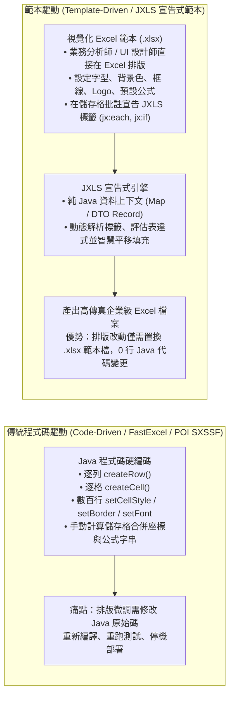
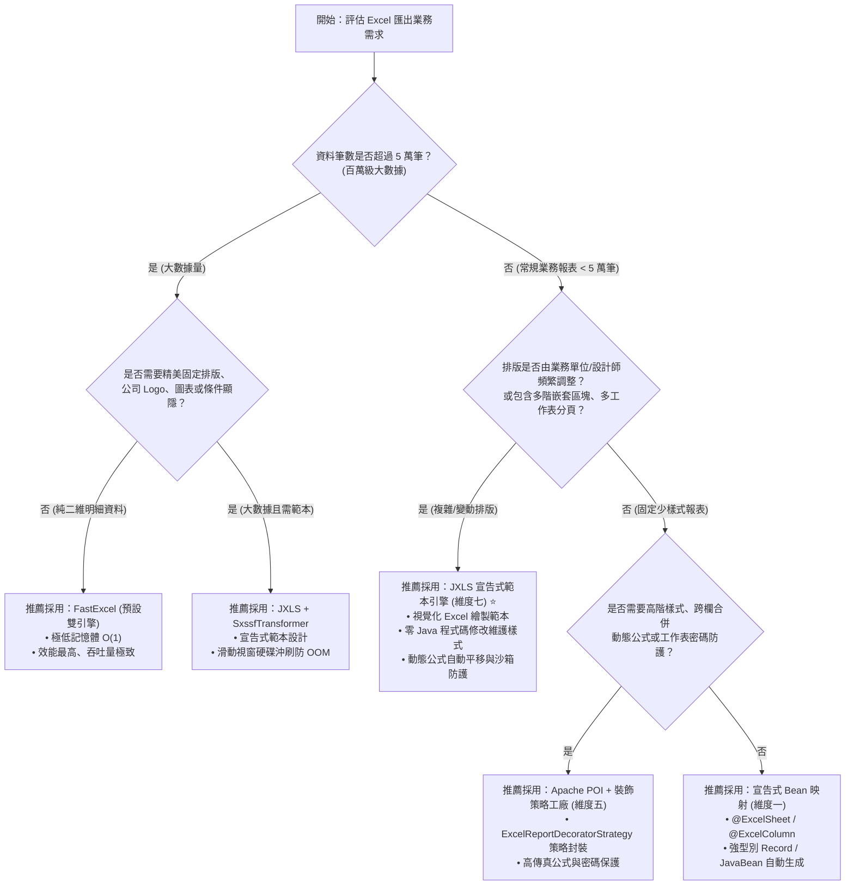

# 維度七：JXLS 宣告式範本定義與安全填充架構總覽 (Dimension 7: JXLS Template Definition & Export Hub)

> 📌 本文件座落於 [`doc/design/jxls-template-export.md`](file:///d:/桌面/ModuleWorkSpace/excel-module/doc/design/jxls-template-export.md)，作為 `excel-module` 企業級擴充藍圖 **「維度七：JXLS 宣告式範本定義模組」** 的核心入口與總體架構導讀。  
> 總體架構請參閱：👉 [Excel 模組架構設計與演進藍圖 (architecture-design.md)](file:///d:/桌面/ModuleWorkSpace/excel-module/doc/design/architecture-design.md)。

---

## 1. 子模組定位與設計哲學 (Sub-Module Vision & Architecture)

在企業級 ERP、供應鏈管理 (SCM)、財務核算與製造執行 (MES) 等核心系統中，匯出報表往往具備極為複雜的排版與視覺需求：
* **多階複合表頭與精緻視覺排版**：包含公司企業識別標誌 (CI/CD Logo)、多重嵌套表頭、指定字型（如思源黑體）、雙線框線、特定財務色彩。
* **動態區塊與嵌套循環**：例如「採購單主檔 $\to$ 採購項次明細 $\to$ 供應商報價比價明細」的多階一對多嵌套展開。
* **自適應公式與動態總計**：當資料列自 1 列擴展為 $N$ 列時，加總公式（如 `=SUM(...)`）需智慧擴展參照範圍。
* **跨部門動態多工作表 (Multi-Sheet)**：依據組織、事業處或月份將資料動態分流至獨立的工作表。

### 1.1 傳統「程式碼驅動 (Code-Driven)」之痛 vs「範本驅動 (Template-Driven)」之優



### 1.2 三大 Excel 寫入引擎技術選型矩陣 (Engine Selection Matrix)

本模組目前已內建兩大程式碼驅動引擎（FastExcel 與 Apache POI SXSSF），引進 **JXLS 宣告式範本引擎** 後，構成涵蓋大數據吞吐量與精緻報表排版的完整三維技術矩陣：

| 評估維度 | FastExcel (v0.20.2) | Apache POI SXSSF (v5.5.1) | JXLS 範本引擎 (v3.x / POI) |
| :--- | :--- | :--- | :--- |
| **主要定位** | 百萬級大數據極速串流寫出 | 企業級高相容性自訂樣式寫出 | **所見即所得 (WYSIWYG) 複雜排版範本填充** |
| **排版定義方式** | Java 程式碼命令式呼叫 | Java 程式碼命令式呼叫 / 裝飾策略 | **Microsoft Excel 視覺化繪製 + JXLS 批註宣告** |
| **記憶體佔用** | 極低（$O(1)$ 常數級，純字串串流） | 極低（滑動視窗 + 暫存檔沖刷） | **中等至可控（支援 SXSSFTransformer 串流沖刷）** |
| **樣式與合併支援** | 基本合併、數值格式、列印防護 | 完整樣式、多階合併、條件式格式 | **100% 保留 Excel 範本原生樣式、圖表、Logo、字型** |
| **動態公式處理** | 手動計算公式字串座標 | 手動計算公式字串座標 | **自動座標平移擴展 (`${=SUM(F4)}`)** |
| **排版變更成本** | 高（需修改 Java 代碼並發版） | 高（需實作 Decorator 策略並發版） | **極低（替換 `.xlsx` 範本即可熱生效，0 程式碼變更）** |
| **典型適用場景** | 百萬筆明細清單、冷資料日誌匯出 | 數十萬筆包含動態公式與密碼保護之報表 | **財務月報、核決簽呈單、採購比價單、BOM 樹狀階層報表** |

---

## 2. 專題子文件導讀與跳轉索引 (Specialized Documentation Navigation)

為確保模組架構具備極高深度與企業級落地標準，維度七已依職責切分收納於專屬目錄 [`doc/design/jxls-template-export/`](file:///d:/桌面/ModuleWorkSpace/excel-module/doc/design/jxls-template-export/) 中：

| 專題技術文件 | 核心關注點 | 適合閱讀對象 | 涵蓋核心元件與規範 |
| :--- | :--- | :--- | :--- |
| 👉 **[Part 1：JXLS 範本指令語法、動態公式與 JEXL 安全沙箱規範 (01-jxls-template-syntax-and-engine.md)](file:///d:/桌面/ModuleWorkSpace/excel-module/doc/design/jxls-template-export/01-jxls-template-syntax-and-engine.md)** | **底層引擎原理與安全防護**<br/>• JXLS 批註標籤指令語法 (`jx:area`, `jx:each`, `jx:if`, `jx:image`)<br/>• 公式自動座標平移機制 (`$[SUM(E4)]`)<br/>• **JEXL 表達式沙箱防護 (CVE-2020-13973 / CVE-2022-26136 RCE 阻斷)**<br/>• 範本字節快取與 SXSSFTransformer 串流優化 | 系統架構師、資訊安全主管、底層框架工程師 | `JexlPermissions`<br/>`JxlsEngine`<br/>`PoiTransformer`<br/>`SxssfTransformer`<br/>`XlsArea` |
| 👉 **[Part 2：六角形架構合約、範本註冊中心與 REST 表現層整合 (02-hexagonal-architecture-and-ports.md)](file:///d:/桌面/ModuleWorkSpace/excel-module/doc/design/jxls-template-export/02-hexagonal-architecture-and-ports.md)** | **六角形分層與業務整合**<br/>• 應用層純契約設計 (`ExcelTemplateWriterPort`)<br/>• Java 21 Record 純資料命令 (`ExportTemplateExcelCommand`)<br/>• Classpath 與動態範本註冊表 (`ExcelTemplateRegistryPort`)<br/>• REST 端點、ACL 防腐層與 Spring Boot 自動裝配 | 業務應用開發者、API 設計師、中台模組開發者 | `ExportTemplateExcelUseCase`<br/>`ExcelTemplateWriterPort`<br/>`ExportTemplateExcelCommand`<br/>`JxlsTemplateWriterAdapter`<br/>`ExcelTemplateExportController` |
| 👉 **[Part 3：Domain Aggregate JXLS 範本規格與實作說明 (03-domain-aggregate-jxls-templates.md)](file:///d:/桌面/ModuleWorkSpace/excel-module/doc/design/jxls-template-export/03-domain-aggregate-jxls-templates.md)** | **領域聚合根實體範本落地**<br/>• Material 物料主檔範本 (`material_master.xlsx`)<br/>• Bom 配方與成本卷算分析範本 (`bom_cost_analysis.xlsx`)<br/>• 採購詢價比價單範本 (`procurement_comparison.xlsx`)<br/>• JXLS 3.x `varIndex="idx"` 與動態公式 `$[...]` 規範 | 報表設計師、領域專家、測試工程師 | `Material`<br/>`Bom`<br/>`BomItem`<br/>`JxlsAggregateTemplateGeneratorTest` |
| 👉 **[Part 4：JXLS 欄位動態映射與資料轉換引擎架構 (04-dynamic-field-mapping-engine.md)](file:///d:/桌面/ModuleWorkSpace/excel-module/doc/design/jxls-template-export/04-dynamic-field-mapping-engine.md)** | **【模組一：資料維度】使用者自訂欄位對齊與開箱**<br/>• 應用層輸出埠 `ExcelTemplateFieldMapperPort`<br/>• 基礎設施層專屬映射引擎 `JxlsFieldMappingEngine`<br/>• Value Object 智慧自動開箱與屬性導航快取<br/>• 插件式格式轉換策略 SPI (`FieldConverter`)<br/>• 虛擬跨欄位動態計算 (Virtual Expressions)<br/>• Fluent Java DSL 與 JSON 動態設定檔規範 | 系統架構師、多租戶平台開發者、後端工程師 | `ExcelTemplateFieldMapperPort`<br/>`JxlsFieldMappingEngine`<br/>`FieldConverter`<br/>`TemplateMappingDefinition`<br/>`FieldMappingRule` |
| 👉 **[Part 5：動態範本裝飾與 JXLS 批註指令注入引擎架構 (05-dynamic-template-decorator.md)](file:///d:/桌面/ModuleWorkSpace/excel-module/doc/design/jxls-template-export/05-dynamic-template-decorator.md)** | **【模組二：範本維度】零範本動態標註與產生器**<br/>• 應用層輸出埠 `ExcelTemplateDecoratorPort`<br/>• 基礎設施層裝飾核心 `DynamicJxlsTemplateDecorator`<br/>• POI 儲存格批註注入器 (`CellCommentInjector`)<br/>• 動態座標換算 (`DirectiveAnchorCalculator`)<br/>• 純空白生成模式 vs 企業底稿修飾模式<br/>• 自選欄位即時組裝 JXLS 批註與表頭樣式 | 報表引擎開發者、前端架構師、平台工程師 | `ExcelTemplateDecoratorPort`<br/>`DynamicJxlsTemplateDecorator`<br/>`DynamicTemplateDefinition`<br/>`DynamicColumnSpec`<br/>`CellCommentInjector` |
| 👉 **[Part 6：JXLS 範本資料庫維護管理與六角形架構 CRUD 規範 (06-excel-template-management-crud.md)](file:///d:/桌面/ModuleWorkSpace/excel-module/doc/design/jxls-template-export/06-excel-template-management-crud.md)** | **【模組三：生命週期維護】DB-First 範本資料庫維護與 CRUD**<br/>• 六角形架構輸入埠 (`CreateExcelTemplateUseCase`, `UpdateExcelTemplateUseCase`, `DeleteExcelTemplateUseCase`)<br/>• 應用層持久化輸出埠 `ExcelTemplateRepositoryPort` 與適配器 `ExcelTemplateRepositoryAdapter`<br/>• 資料庫表 `t_excel_template` 與 JPA 實體映射<br/>• 零停機快取熱刷新機制 (Cache Invalidation)<br/>• 統一 REST API 端點 (POST/PUT/DELETE/GET) | 系統維運人員、後台管理開發者、API 設計師 | `ExcelTemplateRepositoryPort`<br/>`ExcelTemplateRepositoryAdapter`<br/>`CreateExcelTemplateUseCase`<br/>`UpdateExcelTemplateUseCase`<br/>`DeleteExcelTemplateUseCase` |

---

## 3. 六角形架構端到端元件矩陣 (Component & Port Matrix)

本子模組的所有實體元件嚴格依照 Clean Architecture 分層與 `AGENTS.md` 命名規則進行隔離，**嚴禁任何 JXLS 或 POI 技術類物件侵入應用層與領域層**：

| 分層 (Layer) | 元件名稱 / 介面 | 角色與業務職責 | AGENTS.md 命名規範 |
| :--- | :--- | :--- | :--- |
| **Presentation** | [`ExcelTemplateExportController`](file:///d:/桌面/ModuleWorkSpace/excel-module/src/main/java/com/example/demo/presentation/controller/template/ExcelTemplateExportController.java) | REST API 進入點，提供範本清單查詢與動態匯出下載端點 | Controller |
| **Presentation** | [`ExportTemplateExcelResource`](file:///d:/桌面/ModuleWorkSpace/excel-module/src/main/java/com/example/demo/presentation/resource/in/ExportTemplateExcelResource.java) | 對外接收的請求載體（包含 `templateKey`, `dataModel`, `outputFileName`） | `V + N + Resource` (Rule 3-1) |
| **Presentation** | [`ExcelTemplateResourceAssembler`](file:///d:/桌面/ModuleWorkSpace/excel-module/src/main/java/com/example/demo/presentation/assembler/ExcelTemplateResourceAssembler.java) | ACL 防腐層，負責將 Request Resource 轉換為應用層 Command | Assembler (Rule 2) |
| **Application (Port In)** | [`ExportTemplateExcelUseCase`](file:///d:/桌面/ModuleWorkSpace/excel-module/src/main/java/com/example/demo/application/port/in/template/ExportTemplateExcelUseCase.java) | 範本 Excel 匯出業務合約（回傳二進位 byte[] 或寫入 OutputStream） | `*UseCase` (Rule 3-8) |
| **Application (Port In)** | [`StreamExportTemplateExcelUseCase`](file:///d:/桌面/ModuleWorkSpace/excel-module/src/main/java/com/example/demo/application/port/in/template/StreamExportTemplateExcelUseCase.java) | 範本 Excel 串流匯出業務合約，直接將二進位資料串流寫入 Response | `*UseCase` (Rule 3-8) |
| **Application (Service)** | [`ExcelTemplateCommandService`](file:///d:/桌面/ModuleWorkSpace/excel-module/src/main/java/com/example/demo/application/service/template/ExcelTemplateCommandService.java) | 流程協調者，調用範本載入埠、模型前處理工廠與範本寫入埠，協調業務上下文 | `*CommandService` (Rule 3-9) |
| **Application (Port Out)**| [`ExcelTemplateWriterPort`](file:///d:/桌面/ModuleWorkSpace/excel-module/src/main/java/com/example/demo/application/port/out/template/ExcelTemplateWriterPort.java) | 範本 Excel 二進位填充寫入技術契約，接收 Command 與資料模型 | `*Port` (Rule 3-8) |
| **Application (Port Out)**| [`ExcelTemplateRegistryPort`](file:///d:/桌面/ModuleWorkSpace/excel-module/src/main/java/com/example/demo/application/port/out/template/ExcelTemplateRegistryPort.java) | 範本中繼資料查詢與二進位串流載入抽象契約 | `*Port` (Rule 3-8) |
| **Application (Port Out)**| [`ExcelTemplateModelCustomizerFactoryPort`](file:///d:/桌面/ModuleWorkSpace/excel-module/src/main/java/com/example/demo/application/port/out/template/ExcelTemplateModelCustomizerFactoryPort.java) | 範本資料模型自定義工廠輸出埠，動態取得特定範本之 Model Customizer | `*Port` (Rule 3-8) |
| **Application (SPI)**     | [`ExcelTemplateModelCustomizer`](file:///d:/桌面/ModuleWorkSpace/excel-module/src/main/java/com/example/demo/application/shared/template/ExcelTemplateModelCustomizer.java) | 範本資料模型自定義策略契約，定義特定範本資料上下文之擴充與轉換 | SPI Strategy Interface |
| **Application (Command)** | [`ExportTemplateExcelCommand`](file:///d:/桌面/ModuleWorkSpace/excel-module/src/main/java/com/example/demo/application/shared/command/ExportTemplateExcelCommand.java) | 不可變 Java 21 Record，封裝 `templateKey`, `dataModel`, `outputFileName` | `V + N + Command` (Rule 3-4) |
| **Application (DTO)**     | [`ExcelTemplateGottenResult`](file:///d:/桌面/ModuleWorkSpace/excel-module/src/main/java/com/example/demo/application/shared/dto/ExcelTemplateGottenResult.java) | 封裝範本中繼資訊（鍵值、名稱、分類、描述、必填變數清單） | `N + Gotten + Result` (Rule 3-6) |
| **Infrastructure (Adapter)**| [`JxlsTemplateWriterAdapter`](file:///d:/桌面/ModuleWorkSpace/excel-module/src/main/java/com/example/demo/infrastructure/adapter/template/JxlsTemplateWriterAdapter.java) | 實作 `ExcelTemplateWriterPort`，封裝 JXLS 3.x 引擎、JEXL 沙箱與 POI 轉換 | `*Adapter` (Rule 3-9) |
| **Infrastructure (Adapter)**| [`ClasspathExcelTemplateRegistryAdapter`](file:///d:/桌面/ModuleWorkSpace/excel-module/src/main/java/com/example/demo/infrastructure/adapter/template/ClasspathExcelTemplateRegistryAdapter.java) | 實作 `ExcelTemplateRegistryPort`，管理 `templates/excel/` 目錄之範本快取 | `*Adapter` (Rule 3-9) |
| **Infrastructure (Adapter)**| [`ExcelTemplateModelCustomizerFactoryAdapter`](file:///d:/桌面/ModuleWorkSpace/excel-module/src/main/java/com/example/demo/infrastructure/adapter/template/ExcelTemplateModelCustomizerFactoryAdapter.java) | 實作 `ExcelTemplateModelCustomizerFactoryPort`，管理與路由所有模型自定義策略 | `*Adapter` (Rule 3-9) |
| **Infrastructure (Strategy)**| [`ProcurementComparisonTemplateModelCustomizer`](file:///d:/桌面/ModuleWorkSpace/excel-module/src/main/java/com/example/demo/infrastructure/template/customizer/ProcurementComparisonTemplateModelCustomizer.java) | 實作 `ExcelTemplateModelCustomizer`，專門處理採購比價明細與供應商解析 | Strategy Class |
| **Infrastructure (Strategy)**| [`BomCostAnalysisTemplateModelCustomizer`](file:///d:/桌面/ModuleWorkSpace/excel-module/src/main/java/com/example/demo/infrastructure/template/customizer/BomCostAnalysisTemplateModelCustomizer.java) | 實作 `ExcelTemplateModelCustomizer`，專門處理 BOM 成本卷算與子件別名對齊 | Strategy Class |
| **Infrastructure (Strategy)**| [`SmartAliasTemplateModelCustomizer`](file:///d:/桌面/ModuleWorkSpace/excel-module/src/main/java/com/example/demo/infrastructure/template/customizer/SmartAliasTemplateModelCustomizer.java) | 實作 `ExcelTemplateModelCustomizer`，通用保底別名補全策略 (`*`) | Strategy Class |
| **Configuration**         | [`ExcelJxlsConfiguration`](file:///d:/桌面/ModuleWorkSpace/excel-module/src/main/java/com/example/demo/config/ExcelJxlsConfiguration.java) | 配置層 (Dirtiest Layer)，裝配 JXLS Writer、Registry、FieldMapper 與 ModelCustomizerFactory | `@Configuration` |

---

## 4. 端到端調用執行流程 (End-to-End Sequence)

```mermaid
sequenceDiagram
    autonumber
    actor Client as 外部前端 / HTTP Client
    participant Ctrl as ExcelTemplateExportController
    participant ACL as ExcelTemplateResourceAssembler
    participant Svc as ExcelTemplateCommandService
    participant RegPort as ExcelTemplateRegistryPort
    participant RegAdapter as ClasspathExcelTemplateRegistryAdapter
    participant WriterPort as ExcelTemplateWriterPort
    participant JxlsAdapter as JxlsTemplateWriterAdapter
    participant Engine as JxlsTemplateEngine (Sandboxed)

    Client->>Ctrl: POST /api/v1/excel/templates/PROCUREMENT_COMPARISON/export
    Ctrl->>ACL: toCommand("PROCUREMENT_COMPARISON", resource)
    ACL-->>Ctrl: ExportTemplateExcelCommand (Java 21 Record)
    Ctrl->>Svc: exportFromTemplate(command)

    Note over Svc,RegPort: 1. 檢驗範本是否存在並讀取範本檔案串流
    Svc->>RegPort: openTemplateStream("PROCUREMENT_COMPARISON")
    RegPort->>RegAdapter: 讀取 classpath:/templates/excel/PROCUREMENT_COMPARISON.xlsx
    RegAdapter-->>RegPort: InputStream (或快取之 byte[])
    RegPort-->>Svc: InputStream

    Note over Svc,WriterPort: 2. 委派範本寫入輸出埠執行填充
    Svc->>WriterPort: writeFromTemplate(templateStream, command.dataModel())
    WriterPort->>JxlsAdapter: 轉發至 JXLS 適配器
    JxlsAdapter->>Engine: processTemplate(is, os, context)

    Note over Engine: 3. JXLS 核心生命週期與沙箱防衛<br/>• 初始化 XlsArea 區域<br/>• JEXL 安全沙箱過濾變數與表達式 (CVE 防禦)<br/>• 展開 jx:each 迴圈並智慧平移儲存格<br/>• 計算動態公式 ${=SUM(E4)} 自動對齊座標<br/>• 評估 jx:if 條件並動態顯隱區塊
    Engine-->>JxlsAdapter: 寫入完成 (OutputStream / byte[])
    JxlsAdapter-->>WriterPort: byte[] (Excel 二進位資料)
    WriterPort-->>Svc: byte[]

    Svc-->>Ctrl: byte[] (產物檔案位元組)
    Ctrl-->>Client: 200 OK (Content-Disposition: attachment; filename="procurement_comparison.xlsx")
```

---

## 5. 架構選型決策樹 (Engine Decision Tree)

為利開發團隊在面對新業務需求時能迅速選擇正確的 Excel 引擎，請遵循以下架構選型決策樹：



---

## 6. 核心設計原則與安全承諾 (Core Principles)

1. **DDD 零侵入原則**：領域層（Domain Layer）維持純純 Java，絕不出現任何 JXLS、POI、JEXL 或 Spring 相關依賴。
2. **六角形架構隔離**：應用層僅定義 `ExcelTemplateWriterPort` 與純 Java 21 Record 命令，所有 JXLS 引擎核心、Transformer、Context 皆封閉於 `infrastructure/adapter/template/` 與 `infrastructure/engine/jxls/` 內部。
3. **安全第一 (Security-First Sandbox)**：預設啟用限制級 JEXL 沙箱 (`JexlPermissions.RESTRICTED`)，嚴格杜絕透過範本表達式注入發動遠端代碼執行 (RCE) 的各類 CVE 攻擊漏洞。
4. **效能可預期 (Cache & Zero-Copy Streaming)**：支援範本檔案二進位記憶體快取與 HTTP 輸出串流直通（Zero-Copy Streaming），避免不必要的伺服器記憶體堆疊。

---

## 7. 子模組 Package 套件結構與分層對照 (Package Structure & Layer Mapping)

JXLS 宣告式範本匯出與動態欄位映射子模組遵循 Clean Architecture 六角形架構，其 Package 套件結構如下：

### 7.1 主程式 Package 結構 (`src/main/java`)

```text
com.example.demo
├── presentation/                                    # 表現層 (Inbound Adapters)
│   ├── controller/template/                         # 範本 REST API 控制器
│   │   └── ExcelTemplateExportController.java       # 範本探索、Buffered 匯出、Streaming 匯出與 Preview 端點
│   ├── assembler/                                   # 防腐層 Resource 組裝器
│   │   └── ExcelTemplateResourceAssembler.java      # Request 轉 Command 組裝器
│   └── resource/                                    # 表現層資料載體 (Rule 3-1 & 3-2)
│       ├── in/
│       │   ├── ExportTemplateExcelResource.java     # 範本匯出請求載體
│       │   └── ExportTemplateWithMappingResource.java # 附帶自訂欄位映射之匯出請求載體
│       └── out/
│           └── ExcelTemplateRetrievedResource.java  # 範本規格檢索回應載體
│
├── application/                                     # 應用層 (Application Core)
│   ├── port/in/template/                            # Inbound Ports (UseCases - Rule 3-8)
│   │   ├── ExportTemplateExcelUseCase.java          # 標準資料模型 Buffered 匯出合約
│   │   ├── StreamExportTemplateExcelUseCase.java    # 標準資料模型 Streaming 串流匯出合約
│   │   ├── ExportTemplateWithMappingUseCase.java    # 動態映射 Buffered 匯出合約
│   │   ├── StreamExportTemplateWithMappingUseCase.java # 動態映射 Streaming 串流匯出合約
│   │   ├── GetExcelTemplateUseCase.java             # 查詢單一範本中繼資訊合約
│   │   └── PreviewTemplateMappingUseCase.java       # 預覽映射結果 Context 合約
│   ├── port/out/template/                           # Outbound Ports (業務輸出埠 - Rule 3-8)
│   │   ├── ExcelTemplateWriterPort.java             # JXLS 範本寫入合約
│   │   ├── ExcelTemplateRegistryPort.java           # 範本註冊表查詢合約
│   │   ├── ExcelTemplateFieldMappingPort.java       # 欄位映射與型別轉換合約
│   │   ├── ExcelTemplateModelCustomizerFactoryPort.java # 範本資料模型自定義工廠合約
│   │   └── ExcelTemplateRepositoryPort.java         # 範本資料庫維護合約
│   ├── service/template/                            # CQRS 應用服務 (Rule 3-9)
│   │   ├── ExcelTemplateCommandService.java         # 範本匯出與串流命令服務
│   │   └── ExcelTemplateQueryService.java           # 範本查詢與映射預覽查詢服務
│   └── shared/
│       ├── command/                                 # ExportTemplateExcelCommand, ExportTemplateWithMappingCommand...
│       ├── dto/                                     # ExcelTemplateGottenResult.java
│       ├── template/                                # 範本資料模型自定義策略 SPI
│       │   └── ExcelTemplateModelCustomizer.java    # 匯出資料模型前處理與別名策略契約
│       ├── mapping/                                 # TemplateFieldMappingDefinition, FieldRuleDefinition, TransformRuleDefinition...
│       └── exception/                               # ExcelTemplateNotFoundException.java
│
├── infrastructure/                                  # 基礎設施層 (Outbound Adapters & Engines)
│   ├── adapter/template/                            # 輸出適配器 (Rule 3-9)
│   │   ├── ClasspathExcelTemplateRegistryAdapter.java # Classpath/DB 雙軌範本註冊表適配器
│   │   ├── JxlsTemplateWriterAdapter.java           # JXLS 3.x 實體寫入適配器
│   │   ├── JxlsFieldMappingAdapter.java             # 動態欄位映射引擎適配器
│   │   └── ExcelTemplateModelCustomizerFactoryAdapter.java # 範本模型自定義工廠適配器
│   ├── template/                                    # 範本底層技術元件 (Internal SPI)
│   │   ├── ExcelTemplateRegistry.java               # 記憶體範本註冊中心
│   │   ├── ExcelTemplateRegistryCustomizer.java     # 範本註冊表自定義擴充 SPI (註冊中繼資料)
│   │   ├── customizer/                              # 範本模型自定義具體策略 (Procurement, BOM, SmartAlias...)
│   │   │   ├── ProcurementComparisonTemplateModelCustomizer.java
│   │   │   ├── BomCostAnalysisTemplateModelCustomizer.java
│   │   │   ├── SmartAliasTemplateModelCustomizer.java
│   │   │   └── TemplateModelCustomizerHelper.java
│   │   └── mapping/                                 # 欄位動態映射引擎與轉換器
│   │       ├── converter/ (CurrencyFieldConverter, DateFormatFieldConverter, MaskingFieldConverter...)
│   │       ├── engine/ (JxlsFieldMappingEngine, ValueObjectSmartUnboxer)
│   │       └── registry/ (TemplateMappingRegistry, JsonTemplateMappingLoader)
│   └── persistence/template/                        # JPA 技術持久化聚合切片 (Rule 2)
│       ├── entity/ (ExcelTemplateJpaEntity.java)
│       └── repository/ (ExcelTemplateJpaRepository.java)
│
└── config/                                          # 配置層 (The Dirtiest Layer)
    └── ExcelJxlsConfiguration.java                  # JXLS 3.2.0 Transformer 與 JEXL 安全沙箱裝配
```

### 7.2 測試套件 Package 結構 (`src/test/java`)

```text
com.example.demo
├── presentation/controller/template/
│   └── ExcelTemplateExportControllerTest.java       # 範本匯出 REST 控制器完整情境測試
├── application/service/template/
│   ├── ExcelTemplateCommandServiceTest.java         # 範本匯出命令服務單元測試
│   └── ExcelTemplateQueryServiceTest.java           # 範本查詢服務單元測試
└── infrastructure/
    ├── adapter/template/
    │   ├── ClasspathExcelTemplateRegistryAdapterTest.java
    │   ├── ExcelTemplateRepositoryAdapterTest.java  # 範本持久化適配器單元測試
    │   ├── ExcelTemplateModelCustomizerFactoryAdapterTest.java # 模型自定義工廠單元測試
    │   ├── JxlsTemplateWriterAdapterTest.java
    │   ├── JxlsFieldMappingAdapterTest.java
    │   ├── JxlsFieldMappingIntegrationTest.java
    │   └── JxlsAggregateTemplateGeneratorTest.java
    ├── persistence/template/repository/
    │   └── ExcelTemplateJpaRepositoryTest.java      # 範本 JPA Repository 整合測試
    ├── template/
    │   ├── ExcelTemplateRegistryTest.java           # 範本註冊表與 RegistryCustomizer 測試
    │   ├── customizer/                              # 範本資料模型自定義策略單元測試
    │   │   ├── ProcurementComparisonTemplateModelCustomizerTest.java
    │   │   ├── BomCostAnalysisTemplateModelCustomizerTest.java
    │   │   └── SmartAliasTemplateModelCustomizerTest.java
    │   └── mapping/
    │       ├── converter/FieldConverterTest.java
    │       ├── engine/JxlsFieldMappingEngineTest.java
    │       ├── engine/ValueObjectSmartUnboxerTest.java
    │       └── registry/JsonTemplateMappingLoaderTest.java
```

