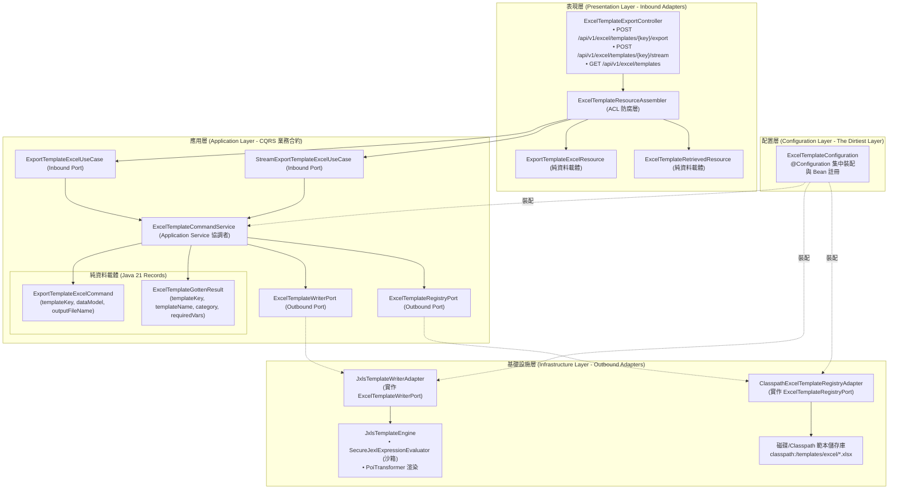

# 維度七 Part 2：六角形架構合約、範本註冊中心與 REST 表現層整合 (Hexagonal Ports, Template Registry & REST Presentation Guide)

> 📌 本文件座落於 [`doc/design/jxls-template-export/02-hexagonal-architecture-and-ports.md`](file:///d:/桌面/ModuleWorkSpace/excel-module/doc/design/jxls-template-export/02-hexagonal-architecture-and-ports.md)，屬於「維度七：JXLS 宣告式範本定義模組」之【Part 2：六角形架構合約、範本註冊中心與 REST 表現層整合】。  
> 詳述如何嚴格遵循 **Clean Architecture 六角形架構 (Ports & Adapters)**、**領域驅動設計 (DDD)** 與 **`AGENTS.md` 命名規則**，將 JXLS 範本渲染能力純粹封裝為應用層合約與基礎設施適配器，並提供企業級 REST API 與安全防禦閉環。  
> 
> 🔗 **模組導讀與關聯文件**：  
> • 模組入口主文件：👉 [維度七：JXLS 宣告式範本定義與安全填充架構總覽 (jxls-template-export.md)](file:///d:/桌面/ModuleWorkSpace/excel-module/doc/design/jxls-template-export.md)  
> • 範本語法與沙箱：👉 [維度七 Part 1：JXLS 範本指令語法、動態公式與 JEXL 安全沙箱規範 (01-jxls-template-syntax-and-engine.md)](file:///d:/桌面/ModuleWorkSpace/excel-module/doc/design/jxls-template-export/01-jxls-template-syntax-and-engine.md)

---

## 1. 六角形架構職責邊界與分層設計 (Hexagonal Boundaries)

依據專案核心架構準則，第三方框架（包含 JXLS、Apache POI、JEXL）皆屬於技術細節，**嚴禁侵入應用層 (Application Layer) 與領域層 (Domain Layer)**。



---

## 2. 應用層契約設計 (Application Layer Ports & Models)

應用層負責 CQRS 流程調度，所有 Port 介面方法**嚴格杜絕傳遞任何技術類物件**（如 `Workbook`、`OutputStream`、`HttpServletRequest` 等技術環境相依型別）。

### 2.1 輸入埠 (Inbound Ports / Use Cases)

```java
package com.example.demo.application.port.in;

import com.example.demo.application.shared.command.ExportTemplateExcelCommand;
import java.io.OutputStream;

/**
 * 宣告式範本 Excel 匯出案例合約 (Inbound Port)。
 * <p>
 * 定義以已註冊之 Excel 範本為基底，結合資料模型產製二進位 Excel 檔案之業務合約。
 * 遵循 AGENTS.md 規則 3-8，Inbound Port 一律以 UseCase 結尾。
 * </p>
 */
public interface ExportTemplateExcelUseCase {

    /**
     * 依據範本匯出 Excel 二進位位元組陣列。
     *
     * @param command 範本匯出命令 (Java 21 Record)
     * @return 產生之 Excel 二進位檔案位元組陣列
     */
    byte[] exportFromTemplate(ExportTemplateExcelCommand command);
}
```

```java
package com.example.demo.application.port.in;

import com.example.demo.application.shared.command.ExportTemplateExcelCommand;
import java.io.OutputStream;

/**
 * 宣告式範本 Excel 串流匯出案例合約 (Inbound Port)。
 * <p>
 * 提供直通輸出串流 (Zero-Copy Streaming) 之匯出能力，產物直接寫入目標串流，避免堆疊於記憶體中。
 * </p>
 */
public interface StreamExportTemplateExcelUseCase {

    /**
     * 依據範本直接串流寫出 Excel 檔案至目標輸出串流。
     *
     * @param outputStream 目標二進位輸出串流 (例如 HTTP 回應串流)
     * @param command      範本匯出命令 (Java 21 Record)
     */
    void streamExportFromTemplate(OutputStream outputStream, ExportTemplateExcelCommand command);
}
```

---

### 2.2 輸出埠 (Outbound Ports)

```java
package com.example.demo.application.port.out;

import java.io.InputStream;
import java.io.OutputStream;
import java.util.Map;

/**
 * 範本 Excel 寫入輸出埠 (Outbound Port)。
 * <p>
 * 由應用層定義、基礎設施層實作之純技術合約。
 * 負責將輸入之範本串流與業務資料字典結合，透過宣告式範本引擎產出目標 Excel 檔案。
 * 遵循 AGENTS.md 規則 3-8，Outbound Port 一律以 Port 結尾。
 * </p>
 */
public interface ExcelTemplateWriterPort {

    /**
     * 結合範本與資料模型，輸出 Excel 二進位位元組陣列。
     *
     * @param templateStream 範本二進位輸入串流
     * @param dataModel      資料模型字典 (鍵值對或 DTO)
     * @return 渲染完成之 Excel 二進位位元組陣列
     */
    byte[] writeFromTemplate(InputStream templateStream, Map<String, Object> dataModel);

    /**
     * 結合範本與資料模型，將結果直接串流寫入目標輸出串流。
     *
     * @param templateStream 範本二進位輸入串流
     * @param targetStream   目標二進位輸出串流
     * @param dataModel      資料模型字典 (鍵值對或 DTO)
     */
    void streamWriteFromTemplate(InputStream templateStream, OutputStream targetStream, Map<String, Object> dataModel);
}
```

```java
package com.example.demo.application.port.out;

import com.example.demo.application.shared.dto.ExcelTemplateGottenResult;
import java.io.InputStream;
import java.util.List;
import java.util.Optional;

/**
 * 範本儲存庫管理與中繼資料查詢輸出埠 (Outbound Port)。
 * <p>
 * 負責範本檔案的查找、二進位串流載入與中繼規格驗證。
 * </p>
 */
public interface ExcelTemplateRegistryPort {

    /**
     * 依據範本鍵值開啟範本二進位輸入串流。
     *
     * @param templateKey 範本唯一識別鍵 (例如 "PROCUREMENT_COMPARISON")
     * @return 範本二進位輸入串流
     */
    InputStream openTemplateStream(String templateKey);

    /**
     * 查詢指定範本之中繼規格資訊。
     *
     * @param templateKey 範本唯一識別鍵
     * @return 範本中繼資訊 (若不存在則回傳 empty)
     */
    Optional<ExcelTemplateGottenResult> findTemplateInfo(String templateKey);

    /**
     * 列出系統內所有已註冊之範本規格清單。
     *
     * @return 範本規格清單
     */
    List<ExcelTemplateGottenResult> listTemplates();

    /**
     * 檢查指定範本鍵值是否存在。
     *
     * @param templateKey 範本唯一識別鍵
     * @return true 若範本已註冊且實體檔案存在
     */
    boolean exists(String templateKey);
}
```

---

### 2.3 命令與 DTO (Java 21 Record 純資料載體)

遵循 `AGENTS.md` 規則 2 與規則 3，命令與 DTO 純粹作為資料結構載體，**嚴禁於其內部編寫轉換邏輯**：

```java
package com.example.demo.application.shared.command;

import java.util.Map;
import java.util.Objects;

/**
 * 範本 Excel 匯出命令物件 (Command)。
 * <p>
 * 遵循 AGENTS.md 規則 3-4，命令以 V + N + Command 命名。
 * 以 Java 21 Record 實作，確保不可變性與純資料載體特性。
 * </p>
 *
 * @param templateKey    範本唯一識別鍵 (必填，例如 "PROCUREMENT_ANALYSIS")
 * @param dataModel      注入範本之業務資料上下文 (必填，支援 Map 或 POJO)
 * @param outputFileName 建議之輸出檔案名稱 (可選，預設自動結合 timestamp)
 */
public record ExportTemplateExcelCommand(
    String templateKey,
    Map<String, Object> dataModel,
    String outputFileName
) {
    public ExportTemplateExcelCommand {
        Objects.requireNonNull(templateKey, "範本識別鍵 (templateKey) 不得為空");
        Objects.requireNonNull(dataModel, "資料模型 (dataModel) 不得為空");
        if (outputFileName == null || outputFileName.isBlank()) {
            outputFileName = templateKey.toLowerCase() + "_" + System.currentTimeMillis() + ".xlsx";
        }
    }
}
```

```java
package com.example.demo.application.shared.dto;

import java.time.Instant;
import java.util.List;

/**
 * 範本中繼規格查詢結果 DTO。
 * <p>
 * 遵循 AGENTS.md 規則 3-6，DTO 以 N + Gotten + Result 命名。
 * 作為純資料載體，不包含任何業務或組裝轉換邏輯。
 * </p>
 *
 * @param templateKey       範本唯一識別鍵
 * @param templateName      範本顯示名稱
 * @param category          範本業務分類 (例如 "PROCUREMENT", "FINANCE", "BOM")
 * @param description       範本業務說明
 * @param requiredVariables 必備上下文變數清單 (例如 ["orders", "companyName"])
 * @param lastModifiedAt    最後修改時間戳記
 */
public record ExcelTemplateGottenResult(
    String templateKey,
    String templateName,
    String category,
    String description,
    List<String> requiredVariables,
    Instant lastModifiedAt
) {}
```

---

### 2.4 應用層服務實作 (Application Service)

遵循 `AGENTS.md` 規則 3-9，以 `*CommandService` 命名：

```java
package com.example.demo.application.service;

import com.example.demo.application.port.in.ExportTemplateExcelUseCase;
import com.example.demo.application.port.in.StreamExportTemplateExcelUseCase;
import com.example.demo.application.port.out.ExcelTemplateRegistryPort;
import com.example.demo.application.port.out.ExcelTemplateWriterPort;
import com.example.demo.application.shared.command.ExportTemplateExcelCommand;
import com.example.demo.domain.shared.exception.ExcelTemplateNotFoundException;
import org.springframework.stereotype.Service;

import java.io.InputStream;
import java.io.OutputStream;
import java.util.Objects;

/**
 * 範本 Excel 匯出應用層服務 (Application Service)。
 * <p>
 * 負責協調範本儲存庫輸出埠 (ExcelTemplateRegistryPort) 與寫入輸出埠 (ExcelTemplateWriterPort)，
 * 嚴守單一職責，不依賴任何外部框架或 HTTP 協定物件。
 * </p>
 */
@Service
public class ExcelTemplateCommandService implements ExportTemplateExcelUseCase, StreamExportTemplateExcelUseCase {

    private final ExcelTemplateRegistryPort templateRegistryPort;
    private final ExcelTemplateWriterPort templateWriterPort;

    public ExcelTemplateCommandService(ExcelTemplateRegistryPort templateRegistryPort,
                                       ExcelTemplateWriterPort templateWriterPort) {
        this.templateRegistryPort = Objects.requireNonNull(templateRegistryPort, "templateRegistryPort 不得為空");
        this.templateWriterPort = Objects.requireNonNull(templateWriterPort, "templateWriterPort 不得為空");
    }

    @Override
    public byte[] exportFromTemplate(ExportTemplateExcelCommand command) {
        validateTemplateExistence(command.templateKey());
        try (InputStream templateStream = templateRegistryPort.openTemplateStream(command.templateKey())) {
            return templateWriterPort.writeFromTemplate(templateStream, command.dataModel());
        } catch (Exception e) {
            throw new RuntimeException("範本 Excel 匯出執行失敗: " + command.templateKey(), e);
        }
    }

    @Override
    public void streamExportFromTemplate(OutputStream outputStream, ExportTemplateExcelCommand command) {
        validateTemplateExistence(command.templateKey());
        try (InputStream templateStream = templateRegistryPort.openTemplateStream(command.templateKey())) {
            templateWriterPort.streamWriteFromTemplate(templateStream, outputStream, command.dataModel());
        } catch (Exception e) {
            throw new RuntimeException("範本 Excel 串流匯出執行失敗: " + command.templateKey(), e);
        }
    }

    private void validateTemplateExistence(String templateKey) {
        if (!templateRegistryPort.exists(templateKey)) {
            throw new ExcelTemplateNotFoundException("指定的 Excel 範本不存在或未註冊: " + templateKey);
        }
    }
}
```

---

## 3. 基礎設施層適配器落地 (Infrastructure Adapters)

### 3.1 `JxlsTemplateWriterAdapter` (Outbound Adapter)

負責與 JXLS 引擎互動，將純資料與範本串流轉換為 Excel 二進位產物：

```java
package com.example.demo.infrastructure.adapter.template;

import com.example.demo.application.port.out.ExcelTemplateWriterPort;
import com.example.demo.infrastructure.engine.jxls.SecureJexlExpressionEvaluator;
import org.jxls.common.Context;
import org.jxls.util.JxlsHelper;
import org.springframework.stereotype.Component;

import java.io.ByteArrayOutputStream;
import java.io.InputStream;
import java.io.OutputStream;
import java.util.Map;

/**
 * JXLS 範本寫入適配器 (Outbound Adapter)。
 * <p>
 * 實作應用層 ExcelTemplateWriterPort，封裝 JXLS 引擎初始化、沙箱表達式評估器與串流輸出。
 * </p>
 */
@Component
public class JxlsTemplateWriterAdapter implements ExcelTemplateWriterPort {

    @Override
    public byte[] writeFromTemplate(InputStream templateStream, Map<String, Object> dataModel) {
        ByteArrayOutputStream baos = new ByteArrayOutputStream(16384);
        streamWriteFromTemplate(templateStream, baos, dataModel);
        return baos.toByteArray();
    }

    @Override
    public void streamWriteFromTemplate(InputStream templateStream, OutputStream targetStream, Map<String, Object> dataModel) {
        try {
            Context context = new Context();
            if (dataModel != null) {
                dataModel.forEach(context::putVar);
            }

            JxlsHelper jxlsHelper = JxlsHelper.getInstance();
            // 關鍵安全防衛：強制覆寫表達式評估器為安全沙箱評估器 (CVE-2020-13973 / CVE-2022-26136 防禦)
            jxlsHelper.setExpressionEvaluator(new SecureJexlExpressionEvaluator());
            // 啟用動態公式平移計算
            jxlsHelper.setUseFastFormulaProcessor(false); // 使用精確公式處理器確保複雜跨列公式座標正確

            jxlsHelper.processTemplate(templateStream, targetStream, context);
        } catch (Exception e) {
            throw new RuntimeException("JXLS 範本處理遭遇異常", e);
        }
    }
}
```

---

### 3.2 `ClasspathExcelTemplateRegistryAdapter` (Outbound Adapter)

管理置於 `classpath:/templates/excel/` 下的範本檔案，並提供記憶體字節快取：

```java
package com.example.demo.infrastructure.adapter.template;

import com.example.demo.application.port.out.ExcelTemplateRegistryPort;
import com.example.demo.application.shared.dto.ExcelTemplateGottenResult;
import org.springframework.core.io.ClassPathResource;
import org.springframework.core.io.Resource;
import org.springframework.stereotype.Component;

import java.io.ByteArrayInputStream;
import java.io.InputStream;
import java.time.Instant;
import java.util.*;
import java.util.concurrent.ConcurrentHashMap;

/**
 * Classpath 範本儲存庫適配器 (Outbound Adapter)。
 * <p>
 * 實作 ExcelTemplateRegistryPort，自 Classpath 載入範本並支援 ConcurrentHashMap 記憶體快取。
 * </p>
 */
@Component
public class ClasspathExcelTemplateRegistryAdapter implements ExcelTemplateRegistryPort {

    private static final String TEMPLATE_DIR = "templates/excel/";
    private final Map<String, byte[]> templateCache = new ConcurrentHashMap<>();
    private final Map<String, ExcelTemplateGottenResult> metadataRegistry = new ConcurrentHashMap<>();

    public ClasspathExcelTemplateRegistryAdapter() {
        registerBuiltInTemplates();
    }

    private void registerBuiltInTemplates() {
        // 預先註冊內建企業核心範本中繼規格
        registerMetadata(new ExcelTemplateGottenResult(
            "PROCUREMENT_COMPARISON",
            "採購詢價比價單",
            "PROCUREMENT",
            "包含多供應商比價明細、最佳報價推薦與自適應加總公式",
            List.of("inquiryNo", "inquiryDate", "quotationItems", "vendorNames"),
            Instant.now()
        ));
        registerMetadata(new ExcelTemplateGottenResult(
            "BOM_COST_ANALYSIS",
            "多階 BOM 成本分析展開表",
            "BOM",
            "多階層樹狀縮排、用量展開、動態 SUM 公式與工作表鎖定防篡改",
            List.of("bomCode", "bomVersion", "materialTree", "currency"),
            Instant.now()
        ));
    }

    public void registerMetadata(ExcelTemplateGottenResult metadata) {
        metadataRegistry.put(metadata.templateKey().toUpperCase(), metadata);
    }

    @Override
    public InputStream openTemplateStream(String templateKey) {
        String key = templateKey.toUpperCase();
        byte[] cachedBytes = templateCache.computeIfAbsent(key, this::loadFromClasspath);
        return new ByteArrayInputStream(cachedBytes);
    }

    @Override
    public Optional<ExcelTemplateGottenResult> findTemplateInfo(String templateKey) {
        return Optional.ofNullable(metadataRegistry.get(templateKey.toUpperCase()));
    }

    @Override
    public List<ExcelTemplateGottenResult> listTemplates() {
        return new ArrayList<>(metadataRegistry.values());
    }

    @Override
    public boolean exists(String templateKey) {
        String key = templateKey.toUpperCase();
        if (templateCache.containsKey(key)) {
            return true;
        }
        Resource resource = new ClassPathResource(TEMPLATE_DIR + key.toLowerCase() + ".xlsx");
        return resource.exists();
    }

    private byte[] loadFromClasspath(String key) {
        try {
            Resource resource = new ClassPathResource(TEMPLATE_DIR + key.toLowerCase() + ".xlsx");
            if (!resource.exists()) {
                throw new NoSuchElementException("找不到 Classpath 範本檔案: " + resource.getPath());
            }
            return resource.getInputStream().readAllBytes();
        } catch (Exception e) {
            throw new RuntimeException("載入範本二進位檔案失敗: " + key, e);
        }
    }
}
```

---

## 4. 表現層 REST API 與防腐層 (Presentation Layer)

### 4.1 Request / Response 資源物件 (純資料載體)

```java
package com.example.demo.presentation.resource.in;

import jakarta.validation.constraints.NotBlank;
import jakarta.validation.constraints.NotNull;
import java.util.Map;

/**
 * 範本 Excel 匯出請求資源 (Request Resource)。
 * <p>
 * 遵循 AGENTS.md 規則 3-1，以 V + N + Resource 命名。
 * 純資料載體，不包含任何 toCommand 業務轉換邏輯。
 * </p>
 */
public record ExportTemplateExcelResource(
    @NotNull(message = "資料模型不得為空")
    Map<String, Object> dataModel,

    String outputFileName
) {}
```

```java
package com.example.demo.presentation.resource.out;

import java.time.Instant;
import java.util.List;

/**
 * 範本中繼資訊回應資源 (Response Resource)。
 * <p>
 * 遵循 AGENTS.md 規則 3-2，以 N + Ved + Resource 命名。
 * </p>
 */
public record ExcelTemplateRetrievedResource(
    String templateKey,
    String templateName,
    String category,
    String description,
    List<String> requiredVariables,
    Instant lastModifiedAt
) {}
```

---

### 4.2 表現層組裝器 (ACL 防腐層)

遵循 `AGENTS.md` 規則 2，所有層間轉換由獨立於 `resource/` 之外的 `assembler/` 套件負責：

```java
package com.example.demo.presentation.assembler;

import com.example.demo.application.shared.command.ExportTemplateExcelCommand;
import com.example.demo.application.shared.dto.ExcelTemplateGottenResult;
import com.example.demo.presentation.resource.in.ExportTemplateExcelResource;
import com.example.demo.presentation.resource.out.ExcelTemplateRetrievedResource;
import org.springframework.stereotype.Component;

/**
 * 範本 Excel 表現層防腐組裝器 (ACL Assembler)。
 */
@Component
public class ExcelTemplateResourceAssembler {

    public ExportTemplateExcelCommand toCommand(String templateKey, ExportTemplateExcelResource resource) {
        return new ExportTemplateExcelCommand(
            templateKey,
            resource.dataModel(),
            resource.outputFileName()
        );
    }

    public ExcelTemplateRetrievedResource toResource(ExcelTemplateGottenResult dto) {
        return new ExcelTemplateRetrievedResource(
            dto.templateKey(),
            dto.templateName(),
            dto.category(),
            dto.description(),
            dto.requiredVariables(),
            dto.lastModifiedAt()
        );
    }
}
```

---

### 4.3 REST 控制器實作 (Controller)

```java
package com.example.demo.presentation.controller;

import com.example.demo.application.port.in.ExportTemplateExcelUseCase;
import com.example.demo.application.port.in.StreamExportTemplateExcelUseCase;
import com.example.demo.application.port.out.ExcelTemplateRegistryPort;
import com.example.demo.application.shared.command.ExportTemplateExcelCommand;
import com.example.demo.presentation.assembler.ExcelTemplateResourceAssembler;
import com.example.demo.presentation.resource.in.ExportTemplateExcelResource;
import com.example.demo.presentation.resource.out.ExcelTemplateRetrievedResource;
import jakarta.servlet.http.HttpServletResponse;
import jakarta.validation.Valid;
import org.springframework.http.HttpHeaders;
import org.springframework.http.MediaType;
import org.springframework.http.ResponseEntity;
import org.springframework.web.bind.annotation.*;

import java.io.IOException;
import java.net.URLEncoder;
import java.nio.charset.StandardCharsets;
import java.util.List;

/**
 * 宣告式範本 Excel 匯出表現層 REST API 控制器。
 */
@RestController
@RequestMapping("/api/v1/excel/templates")
public class ExcelTemplateExportController {

    private final ExportTemplateExcelUseCase exportTemplateExcelUseCase;
    private final StreamExportTemplateExcelUseCase streamExportTemplateExcelUseCase;
    private final ExcelTemplateRegistryPort templateRegistryPort;
    private final ExcelTemplateResourceAssembler resourceAssembler;

    public ExcelTemplateExportController(ExportTemplateExcelUseCase exportTemplateExcelUseCase,
                                         StreamExportTemplateExcelUseCase streamExportTemplateExcelUseCase,
                                         ExcelTemplateRegistryPort templateRegistryPort,
                                         ExcelTemplateResourceAssembler resourceAssembler) {
        this.exportTemplateExcelUseCase = exportTemplateExcelUseCase;
        this.streamExportTemplateExcelUseCase = streamExportTemplateExcelUseCase;
        this.templateRegistryPort = templateRegistryPort;
        this.resourceAssembler = resourceAssembler;
    }

    /**
     * 查詢所有可用之 Excel 範本清單與必填變數規範。
     */
    @GetMapping
    public ResponseEntity<List<ExcelTemplateRetrievedResource>> listTemplates() {
        List<ExcelTemplateRetrievedResource> list = templateRegistryPort.listTemplates()
            .stream()
            .map(resourceAssembler::toResource)
            .toList();
        return ResponseEntity.ok(list);
    }

    /**
     * 依據範本與動態資料模型，匯出並下載 Excel 檔案 (Buffered 模式)。
     */
    @PostMapping("/{templateKey}/export")
    public ResponseEntity<byte[]> exportFromTemplate(
            @PathVariable String templateKey,
            @Valid @RequestBody ExportTemplateExcelResource resource) {

        ExportTemplateExcelCommand command = resourceAssembler.toCommand(templateKey, resource);
        byte[] excelBytes = exportTemplateExcelUseCase.exportFromTemplate(command);

        String encodedFileName = URLEncoder.encode(command.outputFileName(), StandardCharsets.UTF_8).replace("+", "%20");
        return ResponseEntity.ok()
            .header(HttpHeaders.CONTENT_DISPOSITION, "attachment; filename*=UTF-8''" + encodedFileName)
            .contentType(MediaType.parseMediaType("application/vnd.openxmlformats-officedocument.spreadsheetml.sheet"))
            .body(excelBytes);
    }

    /**
     * 依據範本與動態資料模型，以 HTTP 串流直通下載 Excel (Streaming 模式，適合較大資料量)。
     */
    @PostMapping("/{templateKey}/stream")
    public void streamExportFromTemplate(
            @PathVariable String templateKey,
            @Valid @RequestBody ExportTemplateExcelResource resource,
            HttpServletResponse response) throws IOException {

        ExportTemplateExcelCommand command = resourceAssembler.toCommand(templateKey, resource);
        String encodedFileName = URLEncoder.encode(command.outputFileName(), StandardCharsets.UTF_8).replace("+", "%20");

        response.setContentType("application/vnd.openxmlformats-officedocument.spreadsheetml.sheet");
        response.setHeader(HttpHeaders.CONTENT_DISPOSITION, "attachment; filename*=UTF-8''" + encodedFileName);

        streamExportTemplateExcelUseCase.streamExportFromTemplate(response.getOutputStream(), command);
        response.flushBuffer();
    }
}
```

---

## 5. 配置層集中裝配 (Configuration Layer - The Dirtiest Layer)

遵循 `AGENTS.md` 規則 2，所有技術框架依賴與 Bean 註冊統一收納於 `config/` 套件中：

```java
package com.example.demo.config;

import com.example.demo.application.port.out.ExcelTemplateRegistryPort;
import com.example.demo.application.port.out.ExcelTemplateWriterPort;
import com.example.demo.infrastructure.adapter.template.ClasspathExcelTemplateRegistryAdapter;
import com.example.demo.infrastructure.adapter.template.JxlsTemplateWriterAdapter;
import org.springframework.boot.autoconfigure.condition.ConditionalOnMissingBean;
import org.springframework.context.annotation.Bean;
import org.springframework.context.annotation.Configuration;

/**
 * JXLS 宣告式範本引擎配置類別 (Configuration Layer)。
 * <p>
 * 集中裝配範本寫入適配器與範本儲存庫，維持其他各層之純潔性。
 * </p>
 */
@Configuration
public class ExcelTemplateConfiguration {

    @Bean
    @ConditionalOnMissingBean(ExcelTemplateWriterPort.class)
    public ExcelTemplateWriterPort excelTemplateWriterPort() {
        return new JxlsTemplateWriterAdapter();
    }

    @Bean
    @ConditionalOnMissingBean(ExcelTemplateRegistryPort.class)
    public ExcelTemplateRegistryPort excelTemplateRegistryPort() {
        return new ClasspathExcelTemplateRegistryAdapter();
    }
}
```

---

## 6. BDD 測試驗證矩陣 (Testing & Verification Strategy)

遵循 `AGENTS.md` 規則 5，所有 UseCase 與核心引擎皆需具備以 Gherkin 語法標註之測試用例：

```java
package com.example.demo.application.service;

import com.example.demo.application.port.out.ExcelTemplateRegistryPort;
import com.example.demo.application.port.out.ExcelTemplateWriterPort;
import com.example.demo.application.shared.command.ExportTemplateExcelCommand;
import com.example.demo.domain.shared.exception.ExcelTemplateNotFoundException;
import org.junit.jupiter.api.BeforeEach;
import org.junit.jupiter.api.DisplayName;
import org.junit.jupiter.api.Test;
import org.junit.jupiter.api.extension.ExtendWith;
import org.mockito.Mock;
import org.mockito.junit.jupiter.MockitoExtension;

import java.io.ByteArrayInputStream;
import java.io.InputStream;
import java.util.Map;

import static org.assertj.core.api.Assertions.assertThat;
import static org.assertj.core.api.Assertions.assertThatThrownBy;
import static org.mockito.ArgumentMatchers.any;
import static org.mockito.ArgumentMatchers.eq;
import static org.mockito.Mockito.*;

@ExtendWith(MockitoExtension.class)
class ExcelTemplateCommandServiceTest {

    @Mock
    private ExcelTemplateRegistryPort templateRegistryPort;

    @Mock
    private ExcelTemplateWriterPort templateWriterPort;

    private ExcelTemplateCommandService service;

    @BeforeEach
    void setUp() {
        service = new ExcelTemplateCommandService(templateRegistryPort, templateWriterPort);
    }

    /**
     * Feature: 範本 Excel 正常匯出
     * Scenario: 傳入合法之範本識別鍵與資料模型，成功協調儲存庫與寫入埠回傳檔案位元組
     *   Given 範本 "PROCUREMENT_COMPARISON" 存在於儲存庫中
     *   And 模擬寫入埠回傳非空之 byte[]
     *   When 執行 exportFromTemplate 業務方法
     *   Then 應回傳正確之 Excel 位元組資料
     *   And 應調用 registryPort 開啟串流並由 writerPort 進行渲染
     */
    @Test
    @DisplayName("Gherkin: 合法範本匯出成功情境")
    void shouldExportFromTemplateSuccessfully() {
        String templateKey = "PROCUREMENT_COMPARISON";
        byte[] expectedBytes = new byte[]{1, 2, 3, 4};
        ExportTemplateExcelCommand command = new ExportTemplateExcelCommand(
            templateKey,
            Map.of("inquiryNo", "RFQ-20261109-001"),
            "rfq.xlsx"
        );

        when(templateRegistryPort.exists(templateKey)).thenReturn(true);
        when(templateRegistryPort.openTemplateStream(templateKey)).thenReturn(new ByteArrayInputStream(new byte[]{9, 9}));
        when(templateWriterPort.writeFromTemplate(any(InputStream.class), eq(command.dataModel()))).thenReturn(expectedBytes);

        byte[] actual = service.exportFromTemplate(command);

        assertThat(actual).isEqualTo(expectedBytes);
        verify(templateRegistryPort).openTemplateStream(templateKey);
        verify(templateWriterPort).writeFromTemplate(any(InputStream.class), eq(command.dataModel()));
    }

    /**
     * Feature: 範本不存在時拋出領域例外
     * Scenario: 傳入未註冊之範本鍵值，系統應阻斷執行並拋出 ExcelTemplateNotFoundException
     *   Given 範本 "UNKNOWN_KEY" 不存在於儲存庫
     *   When 執行 exportFromTemplate 業務方法
     *   Then 應拋出 ExcelTemplateNotFoundException 例外
     *   And 不應觸發底層寫入埠
     */
    @Test
    @DisplayName("Gherkin: 範本不存在拋出例外情境")
    void shouldThrowExceptionWhenTemplateNotFound() {
        String templateKey = "UNKNOWN_KEY";
        ExportTemplateExcelCommand command = new ExportTemplateExcelCommand(
            templateKey,
            Map.of(),
            "unknown.xlsx"
        );

        when(templateRegistryPort.exists(templateKey)).thenReturn(false);

        assertThatThrownBy(() -> service.exportFromTemplate(command))
            .isInstanceOf(ExcelTemplateNotFoundException.class)
            .hasMessageContaining("未註冊: " + templateKey);

        verify(templateWriterPort, never()).writeFromTemplate(any(), any());
    }
}
```

---

## 7. 總結

本文件建立了符合企業級標準的 JXLS 範本匯出架構：
1. **分層與隔離**：嚴格依循六角形架構，表現層、應用層完全無 JXLS/POI 技術侵入。
2. **命令不可變**：透過 Java 21 Record 建立線程安全且強型別的資料載體。
3. **靈活儲存與快取**：藉由 `ExcelTemplateRegistryPort` 解耦範本來源，支援 Classpath、資料庫或 S3/MinIO 動態擴充與記憶體快取。
4. **雙軌輸出**：同時具備二進位位元組返回與 HTTP 直通串流模式，兼顧中小報表便捷性與大數據串流效能。

