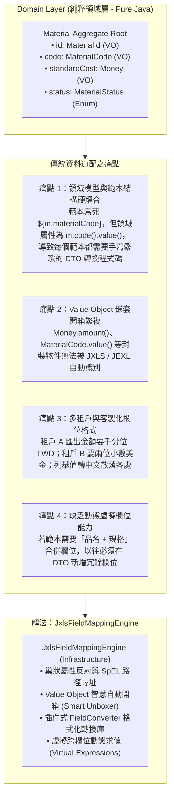
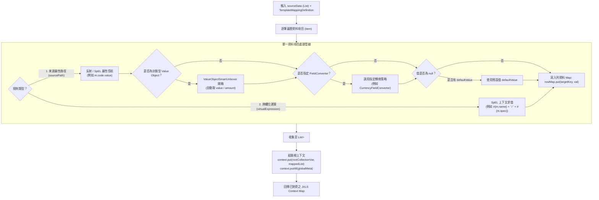
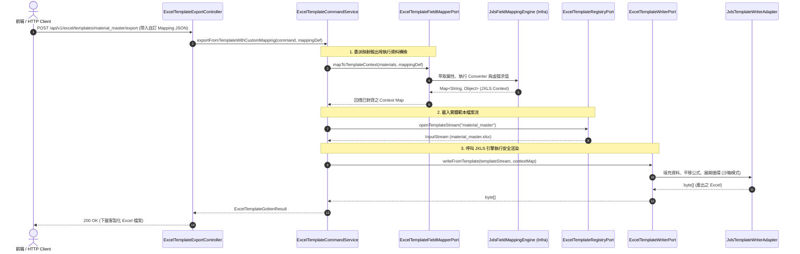

# JXLS 欄位動態映射與資料轉換引擎架構設計 (04-dynamic-field-mapping-engine.md)

本文件詳盡規範座落於 `infrastructure/template/mapping/` 之 **JXLS 欄位動態映射與資料轉換引擎（Field Mapping Engine）** 架構設計。  
本模組專注於 **「資料維度 (Data Model Mapping)」**，負責在不破壞 DDD 領域封裝的前提下，將領域聚合根（Domain Aggregates）、實體與 Value Objects 自動解構、格式化並對齊至 JXLS 範本變數結構中。

---

## 一、 模組定位與業務痛點

在搭配既有實體 Excel 範本（如已有美工排版、字型、雙線框線之 `material_master.xlsx`）進行匯出時，傳統做法面臨以下架構摩擦：



### 設計核心原則：
1. **零領域侵入 (Zero Domain Pollution)**：Domain Aggregate 保持 100% 純粹（`AGENTS.md` Rule 1，禁止為報表添加 DTO 轉換邏輯或 `@JsonProperty` 等技術標籤）。
2. **六角形架構解耦 (Hexagonal Architecture)**：應用層僅定義標準輸出埠 [`ExcelTemplateFieldMapperPort`](file:///d:/桌面/ModuleWorkSpace/excel-module/src/main/java/com/example/demo/application/port/out/template/ExcelTemplateFieldMapperPort.java) 與不可變規格模型，底層屬性萃取與反射快取隔離於基礎設施層。
3. **無痛維護與熱生效**：支援程式碼端 **Fluent Java DSL** 與外部 **動態 JSON/YAML 設定檔**，當使用者或多租戶需要調整對應欄位時，0 行程式碼改動即可完成適配。

---

## 二、 六角形架構分層與元件配置

```text
excel-module/
├── application/
│   ├── port/
│   │   └── out/
│   │       └── ExcelTemplateFieldMapperPort.java    # 【Outbound Port】欄位映射契約
│   └── shared/
│       └── mapping/                                 # 【共享不可變模型 (Java 21 Records)】
│           ├── TemplateMappingDefinition.java       # 範本整體映射規格定義 (Record)
│           ├── FieldMappingRule.java                # 單一欄位映射規則 (Record)
│           └── FieldConverterType.java              # 預設轉換器類型常數
│
└── infrastructure/
    ├── adapter/
    │   └── template/
    │       └── JxlsFieldMappingAdapter.java         # 【Outbound Adapter】實作 Port
    └── template/
        └── mapping/                                 # 【基礎設施層專屬映射引擎】
            ├── engine/
            │   ├── JxlsFieldMappingEngine.java      # 核心反射路徑求值與 Context 組裝引擎
            │   └── ValueObjectSmartUnboxer.java     # Value Object 智慧自動開箱器
            ├── converter/
            │   ├── FieldConverter.java              # 格式轉換策略 SPI 介面
            │   ├── CurrencyFieldConverter.java      # 貨幣與小數位轉換策略
            │   ├── DateFormatFieldConverter.java    # 日期時間格式化策略
            │   ├── EnumDictionaryConverter.java     # 列舉值轉字典多國語系策略
            │   └── MaskingFieldConverter.java       # 敏感資料遮罩安全策略
            ├── registry/
            │   ├── TemplateMappingRegistry.java     # 映射定義註冊表 (支援 ConcurrentHashMap 快取)
            │   └── JsonTemplateMappingLoader.java   # JSON/YAML 外部設定檔載入器
            └── dsl/
                └── TemplateMappingDefinitionBuilder.java # 流暢建構器 (Fluent Java DSL)
```

---

## 三、 應用層合約與資料模型規格 (Application Layer)

### 3.1 應用層輸出埠：`ExcelTemplateFieldMapperPort`

```java
package com.example.demo.application.port.out;

import com.example.demo.application.shared.mapping.TemplateMappingDefinition;
import java.util.Map;

/**
 * JXLS 範本欄位動態映射輸出埠 (Outbound Port)。
 * <p>
 * 遵循 AGENTS.md 規則 3-8，Outbound Port 一律以 {@code Port} 結尾。
 * 負責將純領域業務資料（如 Material/Bom Aggregate）依據自訂映射規格轉換為 JXLS 渲染上下文。
 * </p>
 */
public interface ExcelTemplateFieldMapperPort {

    /**
     * 將業務資料來源動態映射為 JXLS 範本渲染上下文 Map。
     *
     * @param sourceData 業務實體、聚合根或其集合物件 (如 {@code List<Material>})
     * @param mappingDefinition 範本欄位映射規格定義
     * @return 供 JXLS 渲染消費之資料模型 Map (包含根集合清單與全域變數)
     */
    Map<String, Object> mapToTemplateContext(Object sourceData, TemplateMappingDefinition mappingDefinition);
}
```

### 3.2 共享不可變規格模型：`TemplateMappingDefinition` & `FieldMappingRule`

```java
package com.example.demo.application.shared.mapping;

import java.util.List;
import java.util.Map;
import java.util.Objects;

/**
 * 範本欄位映射規格定義 (Java 21 Record)。
 *
 * @param templateKey 範本唯一識別鍵 (例如 "material_master")
 * @param rootCollectionVar JXLS jx:each 迭代的集合變數名 (例如 "materials")
 * @param itemAlias 迭代集合內單一元素之別名 (例如 "m")
 * @param rules 欄位映射規則清單
 * @param globalMeta 全域靜態元數據 (例如 companyName, exportDate)
 */
public record TemplateMappingDefinition(
    String templateKey,
    String rootCollectionVar,
    String itemAlias,
    List<FieldMappingRule> rules,
    Map<String, Object> globalMeta
) {
    public TemplateMappingDefinition {
        Objects.requireNonNull(templateKey, "templateKey 不得為空");
        Objects.requireNonNull(rootCollectionVar, "rootCollectionVar 不得為空");
        itemAlias = (itemAlias != null && !itemAlias.isBlank()) ? itemAlias : "item";
        rules = (rules != null) ? List.copyOf(rules) : List.of();
        globalMeta = (globalMeta != null) ? Map.copyOf(globalMeta) : Map.of();
    }
}
```

```java
package com.example.demo.application.shared.mapping;

import java.util.Objects;

/**
 * 單一欄位映射規則 (Java 21 Record)。
 *
 * @param sourcePath 來源屬性路徑 (支援巢狀路徑，例如 "code.value", "standardCost.amount")
 * @param targetKey 範本接收變數鍵值 (例如 "materialCode", "cost")
 * @param converterKey 轉換器識別鍵 (如 "CURRENCY", "ENUM_DICT", 可為 null)
 * @param formatPattern 格式化樣式 (如 "#,##0.00", "yyyy-MM-dd", 可為 null)
 * @param defaultValue 來源值為 null 時之預設替換值
 * @param virtualExpression 跨欄位虛擬運算表達式 (例如 "#{m.name} + ' (' + #{m.specification} + ')'")
 */
public record FieldMappingRule(
    String sourcePath,
    String targetKey,
    String converterKey,
    String formatPattern,
    Object defaultValue,
    String virtualExpression
) {
    public FieldMappingRule {
        Objects.requireNonNull(targetKey, "targetKey 不得為空");
    }
}
```

---

## 四、 基礎設施層專屬映射引擎 (Infrastructure Layer)

### 4.1 核心屬性解析與上下文組裝管線 (`JxlsFieldMappingEngine`)



#### 關鍵實作細節：
1. **屬性導航快取 (Property Accessor Cache)**：
   針對 Java Record 元組與 JavaBean getter，使用 `ConcurrentHashMap<Class<?>, Map<String, PropertyDescriptor>>` 建立反射快取，確保在百萬級資料巡迴時具備常數時間開銷。
2. **Value Object 智慧自動開箱器 (`ValueObjectSmartUnboxer`)**：
   針對領域層常見的強型別 Value Object（如 `Money`, `MaterialCode`, `Quantity`），若使用者直接指定 `sourcePath: "standardCost"` 而未寫明 `.amount`，開箱器自動偵測並調用其底層基本型別值，達成對領域物件的極致非侵入性。

---

### 4.2 欄位格式化轉換策略庫 (`FieldConverter` SPI)

採用**策略模式 (Strategy Pattern)**，支援透過 Spring 容器自動收集：

```java
package com.example.demo.infrastructure.template.mapping.converter;

/**
 * 欄位值格式轉換策略 SPI 介面。
 */
public interface FieldConverter {

    /**
     * 取得轉換器專屬識別鍵 (例如 "CURRENCY", "DATE", "ENUM_DICT", "MASKING")。
     */
    String getConverterKey();

    /**
     * 執行欄位值轉換。
     *
     * @param sourceValue 原始欄位值
     * @param formatPattern 樣式參數 (可為格式字串、字典群組代碼等)
     * @return 轉換後之值 (字串、格式化數值或遮罩字串)
     */
    Object convert(Object sourceValue, String formatPattern);
}
```

內建標準轉換策略：
| 轉換策略類別 | 識別鍵 (`converterKey`) | 參數範例 (`formatPattern`) | 輸入範例 | 輸出範例 | 說明 |
| :--- | :--- | :--- | :--- | :--- | :--- |
| `CurrencyFieldConverter` | `CURRENCY` | `#,##0.00` | `new BigDecimal("12500")` | `12,500.00` | 金額千分位與小數處理 |
| `DateFormatFieldConverter` | `DATE` | `yyyy/MM/dd HH:mm` | `Instant.now()` | `2026/11/10 00:20` | 時間日期標準化轉換 |
| `EnumDictionaryConverter` | `ENUM_DICT` | `MATERIAL_CATEGORY` | `MaterialCategory.RAW_MATERIAL` | `原物料` | 業務列舉轉多國語系文字 |
| `MaskingFieldConverter` | `MASKING` | `COST_PROTECT` | `450.00` | `***` | 敏感資料去識別化與權限遮罩 |

---

## 五、 使用者自訂 Mapping 的兩種表現型態

### 5.1 方式一：Fluent Java DSL (適合微服務內部或模組間串接)

```java
TemplateMappingDefinition mappingDef = TemplateMappingDefinition.builder("material_master")
    .rootCollection("materials", "m")
    // 1. 一般欄位對應與 Value Object 開箱
    .mapField("code.value", "materialCode")
    .mapField("name", "materialName")
    .mapField("specification", "spec")
    // 2. 格式轉換與字典轉譯
    .mapField("category", "categoryName", "ENUM_DICT", "MATERIAL_CATEGORY")
    .mapField("standardCost.amount", "standardCost", "CURRENCY", "#,##0.00")
    // 3. 虛擬跨欄位計算
    .virtualField("fullTitle", "#{m.name} + ' (' + #{m.code.value} + ')'")
    // 4. 全域報表元數據
    .addMeta("companyName", "神盾航太科技股份有限公司")
    .addMeta("exportDate", LocalDate.now().toString())
    .build();
```

---

### 5.2 方式二：外部 JSON/YAML 設定檔 (適合前端自選欄位、多租戶 DB 動態儲存)

前端 Web UI 讓使用者拖曳選擇欄位後，可將此 JSON 傳入或持久化於資料庫：

```json
{
  "templateKey": "material_master_custom",
  "rootCollectionVar": "materials",
  "itemAlias": "m",
  "globalMeta": {
    "companyName": "神盾航太科技股份有限公司",
    "reportTitle": "自訂物料清單報表"
  },
  "rules": [
    {
      "sourcePath": "code.value",
      "targetKey": "materialCode",
      "defaultValue": "N/A"
    },
    {
      "sourcePath": "name",
      "targetKey": "materialName"
    },
    {
      "sourcePath": "standardCost.amount",
      "targetKey": "standardCost",
      "converterKey": "CURRENCY",
      "formatPattern": "#,##0.00"
    },
    {
      "sourcePath": "category",
      "targetKey": "categoryText",
      "converterKey": "ENUM_DICT",
      "formatPattern": "MATERIAL_CATEGORY"
    },
    {
      "targetKey": "fullSpec",
      "virtualExpression": "#{m.name} + ' / ' + #{m.specification}"
    }
  ]
}
```

---

## 六、 端到端互動循序圖 (End-to-End Sequence)



---

## 七、 架構效益總結

1. **極致隔離**：領域模型不需要因為新增報表需求而更動任何一行代碼，防腐職責由 `JxlsFieldMappingEngine` 完整承擔。
2. **多租戶無縫支援**：不同租戶、不同部門的自訂欄位對齊規則可直接存於資料庫，透過 JSON 格式動態載入，無需重新打包與發版。
3. **高並發安全**：映射引擎為純無狀態設計，所有屬性快取皆為唯讀且執行緒安全，適用於高吞吐量報表導出場景。

---

## 八、 測試覆蓋與實作驗證 (Verification & Tests)

本模組已完成全套單元測試與端到端整合測試實作（遵循 `AGENTS.md` Rule 5 Gherkin 規範），並已全數通過測試驗證：

| 測試類別 | 測試案例數 | 驗證範疇與情境 |
| :--- | :--- | :--- |
| [`FieldConverterTest`](file:///d:/桌面/ModuleWorkSpace/excel-module/src/test/java/com/example/demo/infrastructure/template/mapping/converter/FieldConverterTest.java) | 4 | 驗證 `CurrencyFieldConverter` (千分位/小數/貨幣)、`DateFormatFieldConverter` (LocalDate/LocalDateTime/Instant)、`EnumDictionaryConverter` (MaterialCategory/MaterialStatus/BomStatus/動態字典註冊)、`MaskingFieldConverter` (機密遮罩)。 |
| [`ValueObjectSmartUnboxerTest`](file:///d:/桌面/ModuleWorkSpace/excel-module/src/test/java/com/example/demo/infrastructure/template/mapping/engine/ValueObjectSmartUnboxerTest.java) | 1 | 驗證 `MaterialCode`, `Money`, `Quantity`, `ScrapRate`, `BomVersion`, `BomId`, `UnitOfMeasure` 等 Value Object 自動智慧開箱提取基本型別。 |
| [`JxlsFieldMappingEngineTest`](file:///d:/桌面/ModuleWorkSpace/excel-module/src/test/java/com/example/demo/infrastructure/template/mapping/engine/JxlsFieldMappingEngineTest.java) | 2 | 驗證純 Java 領域聚合根 `Material` 經過 Fluent DSL 映射後的屬性導航、格式轉換、SpEL 虛擬表達式跨欄求值與預設值保底。 |
| [`JsonTemplateMappingLoaderTest`](file:///d:/桌面/ModuleWorkSpace/excel-module/src/test/java/com/example/demo/infrastructure/template/mapping/registry/JsonTemplateMappingLoaderTest.java) | 2 | 驗證外部 JSON 字串反序列化為 `TemplateMappingDefinition` Record 與雙向 Round-trip 序列化一致性。 |
| [`JxlsFieldMappingAdapterTest`](file:///d:/桌面/ModuleWorkSpace/excel-module/src/test/java/com/example/demo/infrastructure/adapter/template/JxlsFieldMappingAdapterTest.java) | 1 | 驗證應用層輸出埠 `ExcelTemplateFieldMapperPort` 與基礎設施適配器之端到端合約調用。 |
| [`JxlsFieldMappingIntegrationTest`](file:///d:/桌面/ModuleWorkSpace/excel-module/src/test/java/com/example/demo/infrastructure/adapter/template/JxlsFieldMappingIntegrationTest.java) | 1 | **端到端整合測試**：使用 3 筆純領域 Material 聚合根，透過動態 Mapping 規格產製 Context Map，結合實體 `material_master.xlsx` 範本經由 `JxlsTemplateWriterAdapter` 渲染，以 Apache POI 驗證資料列正確展開為 3 列且動態加總公式平移擴展為 `=SUM(G4:G6)`。 |

全模組總測試量已提升至 **249 項測試全數通過（`BUILD SUCCESS`）**。

