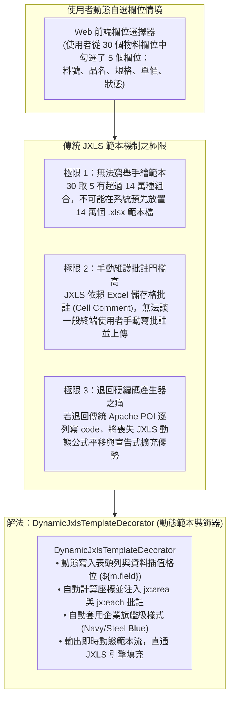
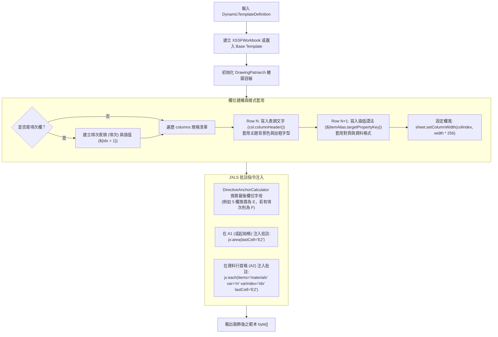
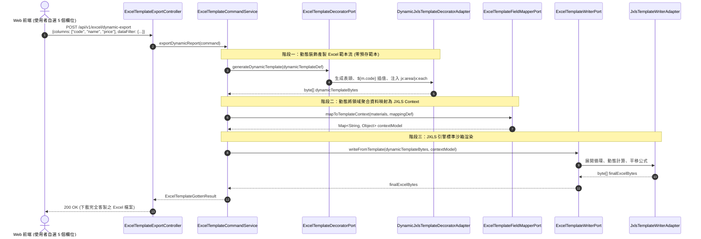

# 動態範本裝飾與 JXLS 批註指令注入引擎架構設計 (05-dynamic-template-decorator.md)

本文件詳盡規範座落於 `infrastructure/template/mapping/dynamic/` 之 **動態範本裝飾與 JXLS 批註指令注入引擎（Dynamic Template Decorator & Directive Injection Engine）** 架構設計。  
本模組專注於 **「範本維度 (Dynamic Template Tagging & Generation)」**，負責在 **「零事先繪製範本 (Zero Pre-Designed Template)」** 的情境下，依據使用者或前端動態選擇的欄位清單，自動在 Excel 活頁簿中生成表頭、資料插值格位，並動態注入 JXLS 批註指令（`jx:area`, `jx:each`），使 JXLS 引擎能無縫完成報表渲染。

---

## 一、 模組定位與業務痛點

在製造執行系統 (MES) 或 ERP 報表模組中，除固定排版的月報與標準簽呈單外，大量存在著 **使用者自選欄位（Ad-hoc Reporting / Custom Column Export）** 的業務情境：



### 設計核心目標：
1. **零實體範本負擔 (Zero Template Overhead)**：使用者無需事先繪製 `.xlsx` 範本，只要提供欄位清單，引擎即時在記憶體中動態組裝出符合 JXLS 3.x 規格的活頁簿。
2. **底稿相容性 (Base Template Compatibility)**：支援雙模式：
   * **純空白生成模式**：自空白活頁簿從無到有動態建構表頭與資料列。
   * **企業底稿修飾模式**：基於已包含公司 Logo、浮水印與列印頁首頁尾的通用底稿，自動尋找目標區域並動態注入 JXLS 批註。
3. **六角形架構隔離**：應用層透過 [`ExcelTemplateDecoratorPort`](file:///d:/桌面/ModuleWorkSpace/excel-module/src/main/java/com/example/demo/application/port/out/) 派發規格，底層 POI 的 `DrawingPatriarch`、`Comment` 與儲存格樣式組裝完全封裝在基礎設施層。

---

## 二、 六角形架構分層與元件佈局

遵循 `AGENTS.md` 規範，本模組之架構分層如下：

```text
excel-module/
├── application/
│   ├── port/
│   │   └── out/
│   │       └── ExcelTemplateDecoratorPort.java      # 【Outbound Port】範本裝飾合約
│   └── shared/
│       └── dynamic/                                 # 【共享不可變模型 (Java 21 Records)】
│           ├── DynamicTemplateDefinition.java       # 動態範本定義模型 (Record)
│           ├── DynamicColumnSpec.java               # 動態欄位顯示規格 (Record)
│           └── TableStyleTheme.java                 # 視覺主題列舉 (NAVY, EMERALD, GRAY)
│
└── infrastructure/
    ├── adapter/
    │   └── template/
    │       └── DynamicJxlsTemplateDecoratorAdapter.java # 【Outbound Adapter】實作 Port
    └── template/
        └── mapping/
            └── dynamic/                             # 【基礎設施層專屬裝飾核心】
                ├── DynamicJxlsTemplateDecorator.java# POI 儲存格與批註動態注入核心
                ├── DirectiveAnchorCalculator.java   # 儲存格座標與最後欄位字母換算器
                └── CellCommentInjector.java         # Apache POI 批註與錨點建構器
```

---

## 三、 應用層合約與資料模型規格 (Application Layer)

### 3.1 應用層輸出埠：`ExcelTemplateDecoratorPort`

```java
package com.example.demo.application.port.out;

import com.example.demo.application.shared.dynamic.DynamicTemplateDefinition;
import java.io.InputStream;

/**
 * Excel 範本動態裝飾與批註注入輸出埠 (Outbound Port)。
 * <p>
 * 遵循 AGENTS.md 規則 3-8，Outbound Port 一律以 {@code Port} 結尾。
 * 負責在空白活頁簿或企業通用底稿上，動態注入表頭、插值儲存格與 JXLS 批註指令。
 * </p>
 */
public interface ExcelTemplateDecoratorPort {

    /**
     * 從空白工作簿由無到有動態建構具備 JXLS 指令之範本。
     *
     * @param definition 動態範本欄位與樣式定義
     * @return 具備完整 jx:area 與 jx:each 批註之 Excel 範本位元組陣列
     */
    byte[] generateDynamicTemplate(DynamicTemplateDefinition definition);

    /**
     * 在既有之企業底稿串流上（含公司 Logo/頁首），動態修飾並注入 JXLS 批註指令。
     *
     * @param baseTemplateStream 基礎底稿輸入串流
     * @param definition 動態範本欄位與樣式定義
     * @return 注入批註與插值欄位後之 Excel 範本位元組陣列
     */
    byte[] decorateExistingTemplate(InputStream baseTemplateStream, DynamicTemplateDefinition definition);
}
```

### 3.2 共享不可變規格模型：`DynamicTemplateDefinition` & `DynamicColumnSpec`

```java
package com.example.demo.application.shared.dynamic;

import java.util.List;
import java.util.Objects;

/**
 * 動態範本規格定義 (Java 21 Record)。
 *
 * @param templateKey 範本識別鍵
 * @param sheetName 工作表名稱 (例如 "自訂物料報表")
 * @param rootCollectionVar JXLS 循環集合變數名 (例如 "materials")
 * @param itemAlias 迭代別名 (例如 "m")
 * @param startRow 起始行索引 (0-based，預設為 0)
 * @param columns 欲匯出之動態欄位清單
 * @param includeSequenceColumn 是否自動追加「項次 (${idx + 1})」欄位
 * @param theme 視覺主題風格
 */
public record DynamicTemplateDefinition(
    String templateKey,
    String sheetName,
    String rootCollectionVar,
    String itemAlias,
    int startRow,
    List<DynamicColumnSpec> columns,
    boolean includeSequenceColumn,
    TableStyleTheme theme
) {
    public DynamicTemplateDefinition {
        Objects.requireNonNull(templateKey, "templateKey 不得為空");
        sheetName = (sheetName != null && !sheetName.isBlank()) ? sheetName : "Sheet1";
        rootCollectionVar = (rootCollectionVar != null && !rootCollectionVar.isBlank()) ? rootCollectionVar : "items";
        itemAlias = (itemAlias != null && !itemAlias.isBlank()) ? itemAlias : "item";
        columns = (columns != null) ? List.copyOf(columns) : List.of();
        theme = (theme != null) ? theme : TableStyleTheme.NAVY;
    }
}
```

```java
package com.example.demo.application.shared.dynamic;

import java.util.Objects;

/**
 * 單一動態欄位規格 (Java 21 Record)。
 *
 * @param columnHeader 表頭顯示名稱 (例如 "物料編號", "標準單價")
 * @param targetPropertyKey JXLS 取值屬性 (對應 ${alias.<targetPropertyKey>})
 * @param columnWidthChar 預設欄寬字元數 (例如 18)
 * @param horizontalAlignment 水平對齊方式 ("LEFT", "CENTER", "RIGHT")
 * @param isCurrency 是否套用貨幣會計格式
 */
public record DynamicColumnSpec(
    String columnHeader,
    String targetPropertyKey,
    int columnWidthChar,
    String horizontalAlignment,
    boolean isCurrency
) {
    public DynamicColumnSpec {
        Objects.requireNonNull(columnHeader, "columnHeader 不得為空");
        Objects.requireNonNull(targetPropertyKey, "targetPropertyKey 不得為空");
        columnWidthChar = (columnWidthChar > 0) ? columnWidthChar : 16;
        horizontalAlignment = (horizontalAlignment != null) ? horizontalAlignment : "LEFT";
    }
}
```

---

## 四、 基礎設施層裝飾器核心實現 (Infrastructure Layer)

### 4.1 儲存格與批註動態注入管線 (`DynamicJxlsTemplateDecorator`)



---

### 4.2 座標換算與批註注入器核心演算法

#### ① 欄位索引轉 Excel 字母換算 (`DirectiveAnchorCalculator`)
支援 $0 \to \text{A}, 25 \to \text{Z}, 26 \to \text{AA}, 27 \to \text{AB}$ 的動態欄位換算，確保在極多欄位時座標不失真：

```java
public static String toColumnLetter(int zeroBasedColIndex) {
    StringBuilder sb = new StringBuilder();
    int col = zeroBasedColIndex + 1;
    while (col > 0) {
        int rem = (col - 1) % 26;
        sb.insert(0, (char) ('A' + rem));
        col = (col - 1) / 26;
    }
    return sb.toString();
}
```

#### ② POI 批註注入實現 (`CellCommentInjector`)
```java
public static void injectDirectiveComment(Drawing<?> drawing, Cell cell, String directiveText) {
    int col = cell.getColumnIndex();
    int row = cell.getRowIndex();
    // 錨定批註位置於儲存格右下方 (2欄 x 2列大小)
    ClientAnchor anchor = drawing.createAnchor(0, 0, 0, 0, col, row, col + 2, row + 2);
    Comment comment = drawing.createCellComment(anchor);
    comment.setString(new XSSFRichTextString(directiveText));
    cell.setCellComment(comment);
}
```

---

## 五、 端到端：動態範本裝飾 + 欄位映射填充管線 (The Combined Pipeline)

本模組與 **模組一（`04-dynamic-field-mapping-engine.md`）** 完美結合，形成強大的動態報表產製流水線：



---

## 六、 兩種裝飾模式對比

| 評估維度 | 模式 A：純空白生成模式 (Zero-Template Mode) | 模式 B：企業底稿修飾模式 (Base-Template Decorator Mode) |
| :--- | :--- | :--- |
| **底稿依賴** | 100% 零底稿，從空 `XSSFWorkbook` 起手 | 需載入一份公司通用底稿 (`company_base.xlsx`) |
| **視覺呈現** | 包含乾淨標準的旗艦主題表頭（Navy / Gray） | 原生包含公司企業識別 (Logo)、固定簽核欄、列印機密頁首 |
| **批註位置** | 預設從 Row 0 (表頭) 與 Row 1 (資料) 起算 | 可指定 `startRow`（例如避開 Logo，從 Row 4 開始注入） |
| **效能開銷** | 極低（記憶體純 POI 輕量物件） | 極低（僅需讀取數 KB 之通用模板） |
| **適用場景** | 開發者快速臨時除錯、微服務間資料傾倒、無 Logo 需求之清單 | 企業正規外發報表、給外部客戶之詢價單、稽核審計清單 |

---

## 七、 架構效益與亮點總結

1. **徹底解決「範本組合爆炸」難題**：系統無需儲存成百上千個僅欄位增減的冗餘 `.xlsx` 範本，所有自選欄位皆在執行期以毫秒級速度即時組裝。
2. **無縫承接 JXLS 引擎生態**：產出的範本仍為標準的 JXLS 規格，能繼續享有 JXLS 的動態公式平移、JEXL 安全沙箱與 `SxssfTransformer` 巨量大檔相容性。
3. **極致解耦與職責單一**：
   * **模組一 (`04`) 專注於「資料」**：將 Domain Model 轉為 Template Data Model。
   * **模組二 (`05`) 專注於「範本」**：將 Column Spec 轉為含 JXLS 標籤的 Excel 活頁簿。
   * 兩者既可獨立運作，亦可組裝成無懈可擊的企業級客製化匯出解決方案。

