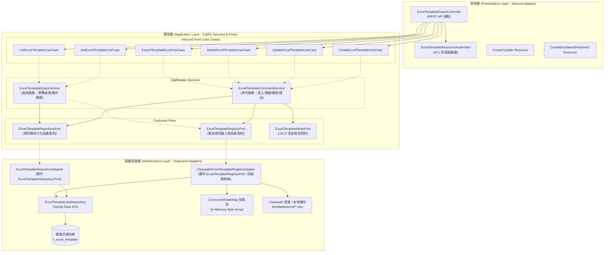

# Part 6：JXLS 範本資料庫維護管理與六角形架構 CRUD 規範 (06-excel-template-management-crud.md)

> 📌 本文件座落於 [`doc/design/jxls-template-export/06-excel-template-management-crud.md`](file:///d:/桌面/ModuleWorkSpace/excel-module/doc/design/jxls-template-export/06-excel-template-management-crud.md)，隸屬於 **「維度七：JXLS 宣告式範本定義與安全填充模組」**。  
> 總覽導讀請參閱：👉 [JXLS 範本定義與安全填充架構總覽 (jxls-template-export.md)](file:///d:/桌面/ModuleWorkSpace/excel-module/doc/design/jxls-template-export.md)。

---

## 1. 業務痛點與架構演進動機 (Evolution & Motivation)

在早期的範本管理實作中，系統雖然已引進 JXLS 宣告式範本渲染引擎，但在中繼資料管理層面仍存在顯著架構痛點：

1. **Java 程式碼硬編碼範本規格（違反 DRY / Single Source of Truth）**：
   - 範本識別鍵（如 `MATERIAL_MASTER`、`BOM_COST_ANALYSIS`、`PROCUREMENT_COMPARISON`）之名稱、業務分類、必備變數清單原先硬編碼於 `ClasspathExcelTemplateRegistryAdapter` 之私有方法中。
   - 資料庫 `t_excel_template` 亦存放相同資料，造成雙重維護與資料不一致風險。
2. **缺乏線上生命週期維護能力 (No Dynamic CRUD)**：
   - 企業新報表範本上線或停用下架時，無法透過管理後台或 REST API 動態登記，必須修改程式碼重新發版。
3. **快取與資料庫同步延遲 (Cache Invalidation)**：
   - 修改資料庫中的範本檔案路徑或變數結構時，需要重啟微服務才能重新載入範本位元組。

為徹底解決上述痛點，本模組引進 **「資料庫優先 (DB-First) + 六角形架構完整 CRUD + 零停機快取熱刷新」** 之現代化架構。

---

## 2. 六角形架構與 Ports & Adapters 設計 (Hexagonal Architecture)

遵循 `AGENTS.md` 規則 2 與規則 3，範本管理模組嚴格隔離表現層、應用層與基礎設施持久化層：



---

## 3. 資料庫結構與實體映射 (Database Schema & Entity)

持久化實體映射資料表 `t_excel_template`，支援多租戶、樂觀鎖與儲存媒介多態：

### 3.1 DDL 結構規格

```sql
CREATE TABLE IF NOT EXISTS t_excel_template (
    id VARCHAR(64) NOT NULL PRIMARY KEY,
    template_key VARCHAR(64) NOT NULL UNIQUE,
    template_name VARCHAR(128) NOT NULL,
    category VARCHAR(64) NOT NULL,
    description VARCHAR(500),
    required_variables VARCHAR(1000),
    storage_type VARCHAR(32) NOT NULL DEFAULT 'CLASSPATH',
    file_path VARCHAR(512) NOT NULL,
    default_mapping_json TEXT,
    tenant_id VARCHAR(64) NOT NULL DEFAULT 'DEFAULT',
    version INT NOT NULL DEFAULT 1,
    is_active BOOLEAN NOT NULL DEFAULT TRUE,
    created_at TIMESTAMP NOT NULL,
    updated_at TIMESTAMP NOT NULL
);

CREATE INDEX idx_excel_template_category ON t_excel_template(category);
CREATE INDEX idx_excel_template_tenant ON t_excel_template(tenant_id);
```

### 3.2 欄位詳細說明

| 欄位名稱 | 型態 | 必填 | 說明 | 範例 |
| :--- | :--- | :---: | :--- | :--- |
| `id` | VARCHAR(64) | 是 | 系統主鍵 UUID | `f81d4fae-7dec-11d0-a765-00a0c91e6bf6` |
| `template_key` | VARCHAR(64) | 是 | 業務唯一鍵值 (全大寫) | `PROCUREMENT_COMPARISON` |
| `template_name` | VARCHAR(128) | 是 | 範本顯示名稱 | `採購詢價比價單` |
| `category` | VARCHAR(64) | 是 | 業務分類代碼 | `PROCUREMENT`, `BOM`, `MATERIAL` |
| `description` | VARCHAR(500) | 否 | 報表業務用途與設計說明 | `包含多供應商比價明細與自適應加總公式` |
| `required_variables`| VARCHAR(1000)| 否 | JXLS 渲染必備變數清單 (逗號分隔) | `inquiryNo,inquiryDate,quotationItems` |
| `storage_type` | VARCHAR(32) | 是 | 檔案儲存媒介 | `CLASSPATH`, `FILE_SYSTEM`, `S3`, `MINIO` |
| `file_path` | VARCHAR(512) | 是 | 範本資源儲存路徑 | `templates/excel/procurement_comparison.xlsx` |
| `default_mapping_json` | TEXT | 否 | 預設動態欄位映射規格 JSON | `{"rules":[...]}` |
| `tenant_id` | VARCHAR(64) | 是 | 多租戶隔離識別碼 | `DEFAULT` |
| `version` | INT | 是 | 範本結構版本號 (樂觀鎖) | `1` |
| `is_active` | BOOLEAN | 是 | 是否啟用供匯出使用 | `true` (啟用), `false` (停用下架) |

---

## 4. RESTful API 規格 (API Endpoint Specifications)

統一由 [`ExcelTemplateExportController.java`](file:///d:/桌面/ModuleWorkSpace/excel-module/src/main/java/com/example/demo/presentation/controller/template/ExcelTemplateExportController.java) 對外提供標準 REST 端點：

### 4.1 範本管理與查詢端點

| HTTP 方法 | 路徑路徑 | 說明 | 成功代碼 | 參數 / 請求主體 |
| :--- | :--- | :--- | :---: | :--- |
| **POST** | `/api/v1/excel/templates` | 建立並註冊新範本規格 | 201 Created | `CreateExcelTemplateResource` |
| **PUT** | `/api/v1/excel/templates/{templateKey}` | 更新既有範本中繼資訊 | 200 OK | `UpdateExcelTemplateResource` |
| **DELETE** | `/api/v1/excel/templates/{templateKey}` | 刪除或下架指定範本 | 204 No Content | 路徑參數 `templateKey` |
| **GET** | `/api/v1/excel/templates` | 查詢可用範本清單 | 200 OK | `?category=...&activeOnly=true` |
| **GET** | `/api/v1/excel/templates/{templateKey}` | 查詢單一範本詳細中繼規格 | 200 OK | 路徑參數 `templateKey` |

### 4.2 範本匯出與除錯預覽端點

| HTTP 方法 | 路徑路徑 | 說明 | 產物型態 |
| :--- | :--- | :--- | :--- |
| **POST** | `/api/v1/excel/templates/{templateKey}/export` | 記憶體緩衝模式匯出檔案 | `application/vnd.openxmlformats-...` |
| **POST** | `/api/v1/excel/templates/{templateKey}/stream` | Zero-Copy 串流匯出檔案 | HTTP 附件串流下載 |
| **POST** | `/api/v1/excel/templates/{templateKey}/export-mapped` | 依自訂欄位映射匯出檔案 | 二進位檔案下載 |
| **POST** | `/api/v1/excel/templates/{templateKey}/stream-mapped` | 依自訂欄位映射串流匯出檔案 | HTTP 附件串流下載 |
| **POST** | `/api/v1/excel/templates/mapping/preview` | 預覽欄位動態映射上下文 JSON | `application/json` (Dry-Run) |

---

## 5. 零停機熱刷新機制 (Zero-Downtime Cache Invalidation)

為維持 $O(1)$ 的極速記憶體渲染效能，[`ClasspathExcelTemplateRegistryAdapter`](file:///d:/桌面/ModuleWorkSpace/excel-module/src/main/java/com/example/demo/infrastructure/adapter/template/ClasspathExcelTemplateRegistryAdapter.java) 維護了位元組二進位快取池 (`templateCache`)：

```mermaid
flowchart TD
    Client["客戶端 / 後台管理員"] -->|發送 PUT / DELETE| Service["ExcelTemplateCommandService"]
    Service -->|1. 寫入資料庫變更| RepoAdapter["ExcelTemplateRepositoryAdapter"]
    RepoAdapter -->|COMMIT| DB[("關聯式資料庫 t_excel_template")]
    Service -->|2. 觸發 refreshCache 呼叫| RegistryAdapter["ClasspathExcelTemplateRegistryAdapter"]
    RegistryAdapter -->|3. 移除舊 byte[] 快取| CachePool["templateCache.remove(key)"]
    RegistryAdapter -->|4. 重新自 filePath 讀入| NewBytes["重新讀取新位元組並快取"]
    NewBytes -->|生效| HotReload["零停機即時生效，無需重啟服務"]
```

---

## 6. 模組套件結構 (Package Structure)

### 6.1 主程式套件結構 (`src/main/java`)

```text
com.example.demo
├── application
│   ├── port
│   │   ├── in/template/
│   │   │   ├── CreateExcelTemplateUseCase.java          # 建立範本使用案例
│   │   │   ├── UpdateExcelTemplateUseCase.java          # 更新範本使用案例
│   │   │   ├── DeleteExcelTemplateUseCase.java          # 刪除範本使用案例
│   │   │   ├── GetExcelTemplateUseCase.java             # 單筆查詢範本使用案例
│   │   │   ├── ListExcelTemplateUseCase.java            # 清單查詢範本使用案例
│   │   │   ├── ExportTemplateExcelUseCase.java          # 範本匯出使用案例
│   │   │   ├── StreamExportTemplateExcelUseCase.java    # 串流匯出使用案例
│   │   │   ├── ExportTemplateWithMappingUseCase.java    # 映射匯出使用案例
│   │   │   └── PreviewTemplateMappingUseCase.java       # 映射預覽使用案例
│   │   └── out/template/
│   │       ├── ExcelTemplateRepositoryPort.java         # 範本持久化儲存庫輸出埠
│   │       ├── ExcelTemplateRegistryPort.java           # 範本註冊表與快取輸出埠
│   │       ├── ExcelTemplateWriterPort.java             # 範本檔案寫入輸出埠
│   │       └── ExcelTemplateFieldMapperPort.java        # 欄位動態映射輸出埠
│   ├── service/template/
│   │   ├── ExcelTemplateCommandService.java             # 範本命令應用服務 (寫入/異動/匯出)
│   │   └── ExcelTemplateQueryService.java               # 範本查詢應用服務 (檢索/條件篩選)
│   └── shared/
│       ├── command/
│       │   ├── CreateExcelTemplateCommand.java          # 建立範本命令載體
│       │   ├── UpdateExcelTemplateCommand.java          # 更新範本命令載體
│       │   └── DeleteExcelTemplateCommand.java          # 刪除範本命令載體
│       ├── query/
│       │   ├── GetExcelTemplateQuery.java               # 單筆查詢載體
│       │   └── ListExcelTemplateQuery.java              # 清單查詢載體
│       └── dto/
│           └── ExcelTemplateGottenResult.java           # 範本中繼資訊查詢結果 DTO
│
├── infrastructure
│   ├── adapter/template/
│   │   ├── ExcelTemplateRepositoryAdapter.java          # 實作 ExcelTemplateRepositoryPort
│   │   ├── ClasspathExcelTemplateRegistryAdapter.java   # 實作 ExcelTemplateRegistryPort
│   │   ├── JxlsTemplateWriterAdapter.java               # 實作 ExcelTemplateWriterPort
│   │   └── JxlsFieldMappingAdapter.java                 # 實作 ExcelTemplateFieldMapperPort
│   └── persistence/template/
│       ├── entity/
│       │   └── ExcelTemplateJpaEntity.java              # 映射 t_excel_template
│       └── repository/
│           └── ExcelTemplateJpaRepository.java          # Spring Data JPA 介面
│
└── presentation
    ├── assembler/
    │   └── ExcelTemplateResourceAssembler.java          # 防腐組裝器 (Resource <-> Command/DTO)
    ├── controller/template/
    │   └── ExcelTemplateExportController.java           # 統一 REST 控制器
    └── resource/
        ├── in/
        │   ├── CreateExcelTemplateResource.java         # 建立範本請求資源
        │   ├── UpdateExcelTemplateResource.java         # 更新範本請求資源
        │   └── ExportTemplateExcelResource.java         # 匯出請求資源
        └── out/
            ├── ExcelTemplateCreatedResource.java        # 建立成功回應資源
            ├── ExcelTemplateUpdatedResource.java        # 更新成功回應資源
            └── ExcelTemplateRetrievedResource.java      # 檢索回應資源
```

### 6.2 測試套件結構 (`src/test/java`)

```text
com.example.demo
├── application/service/template/
│   ├── ExcelTemplateCommandServiceTest.java             # 命令服務業務調度單元測試
│   └── ExcelTemplateQueryServiceTest.java               # 查詢服務單元測試
├── infrastructure/adapter/template/
│   ├── ExcelTemplateRepositoryAdapterTest.java          # 持久化適配器單元測試
│   └── ClasspathExcelTemplateRegistryAdapterTest.java   # Classpath 適配器與快取測試
└── presentation/controller/template/
    └── ExcelTemplateExportControllerTest.java           # REST API 端點整合測試 (MockMvc)
```

---

## 7. 驗證與測試執行總結 (Verification Summary)

所有單元測試與整合測試皆遵循 AGENTS.md 規則 5 標註清晰的 BDD Gherkin（Feature, Scenario, Given-When-Then）測試案例，涵蓋建立、重複鍵值防呆、更新、停用、刪除、清單檢索與快取同步，本地全量測試結果全數通過：

```text
Results:
Tests run: 278, Failures: 0, Errors: 0, Skipped: 0
BUILD SUCCESS
```
