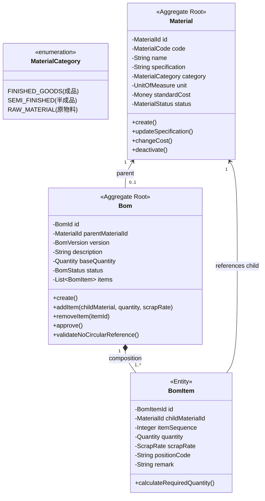

# 物料與 BOM 領域設計 Part 1：領域聚合根、實體與商業規則 (Domain Aggregates, Entities & Invariants)

> 📌 本文件座落於 [`doc/design/material-bom-aggregate/01-domain-aggregates-and-entities.md`](file:///d:/桌面/ModuleWorkSpace/excel-module/doc/design/material-bom-aggregate/01-domain-aggregates-and-entities.md)，屬於「物料與多階層 BOM 領域驅動設計」之【Part 1：領域聚合根、實體與商業規則】。  
> 詳述物料分類 (FG/SFG/RM)、多階層樹狀結構、防循環引用 (No Circular References)、`Material` 與 `Bom` 聚合根劃分、值物件設計與純 Java 業務防護邏輯。  
> 
> 🔗 **模組導讀與關聯文件**：  
> • 領域總覽主文件：👉 [物料與多階層 BOM 聚合設計總覽 (material_bom_aggregate_design.md)](file:///d:/桌面/ModuleWorkSpace/excel-module/doc/design/material_bom_aggregate_design.md)  
> • 資料庫與六角形架構：👉 [物料與 BOM 領域設計 Part 2：資料庫設計、JPA 映射與六角形適配器 (02-hexagonal-ports-and-persistence.md)](file:///d:/桌面/ModuleWorkSpace/excel-module/doc/design/material-bom-aggregate/02-hexagonal-ports-and-persistence.md)

---

## 1. 業務情境與核心需求

在製造與供應鏈系統中，**BOM (Bill of Materials, 物料清單)** 是定義產品結構的核心：
1. **物料分類 (Material Classification)**：
   - **成品 (Finished Goods, FG)**：最終出貨給客戶的產品（例如：智慧型商用無人機）。
   - **半成品 (Semi-Finished Goods, SFG)**：由零件組裝而成之模組（例如：飛控主機板總成、動力總成）。
   - **原料/零件 (Raw Material / Component, RM)**：向供應商採購的基礎料件（例如：ARM 晶片、陀螺儀、螺旋槳）。
2. **多階層樹狀結構 (Multi-Level Hierarchy)**：
   - 成品遞迴拆解為半成品與原料，具有階層深度（Level 0 $\to$ Level 1 $\to$ Level 2...）。
3. **商業防護規則 (Domain Invariants)**：
   - **防循環引用 (No Circular References)**：A 物料的子件不能包含 A 自己，亦不可間接包含 A（例如 A -> B -> C -> A）。
   - **原料不可作為母件**：只有成品與半成品允許建立 BOM 配方清單。
   - **損耗率與基數**：單機用量需考慮損耗率（Scrap Rate）與母件基數（Base Quantity）。

---

## 2. 領域聚合架構與全域領域語言 (Ubiquitous Language)

### 聚合劃分策略：為什麼將 `Material` 與 `Bom` 拆為兩個獨立聚合？
* **生命週期獨立**：物料主檔由採購/物管維護（基本規格、定價、安全庫存）；BOM 由工程/研發 (R&D) 團隊維護與版本發行。
* **高內聚性與高併發**：修改物料的規格或成本，不應鎖定整張 BOM 結構；一個物料可能存在不同版本或不同工廠的 BOM 配方。

---

## 3. 聚合根與值物件設計 (純 Java，零框架依賴)

座落於 [`com.example.demo.domain`](file:///d:/桌面/ModuleWorkSpace/excel-module/src/main/java/com/example/demo/domain)，零 Spring/JPA/Lombok 依賴：

### 3.1 `Material` 聚合根 (`domain/material/`)
* **聚合根**：[`Material`](file:///d:/桌面/ModuleWorkSpace/excel-module/src/main/java/com/example/demo/domain/material/aggregate/root/Material.java)
* **值物件 (VO)**：`MaterialId`, `MaterialCode`, `MaterialCategory`, `UnitOfMeasure`, `Money`, `MaterialStatus`
* **領域行為**：`create()`, `updateBasicInfo()`, `updateCost()`, `discontinue()`

### 3.2 `Bom` 聚合根 (`domain/bom/`)
* **聚合根**：[`Bom`](file:///d:/桌面/ModuleWorkSpace/excel-module/src/main/java/com/example/demo/domain/bom/aggregate/root/Bom.java)
* **內部實體 (Entity)**：[`BomItem`](file:///d:/桌面/ModuleWorkSpace/excel-module/src/main/java/com/example/demo/domain/bom/aggregate/entity/BomItem.java)
* **值物件 (VO)**：`BomId`, `BomVersion`, `BomStatus`, `Quantity`, `ScrapRate`
* **關鍵防護邏輯**：
  * `addItem(...)`：檢核用量 > 0。
  * `validateParentCategory(...)`：檢核母件不可為原物料。
  * `checkCircularReference(...)`：遞迴走訪祖先料號，防循環參照。
  * `approve()`：審核通過生效，發布領域事件。

