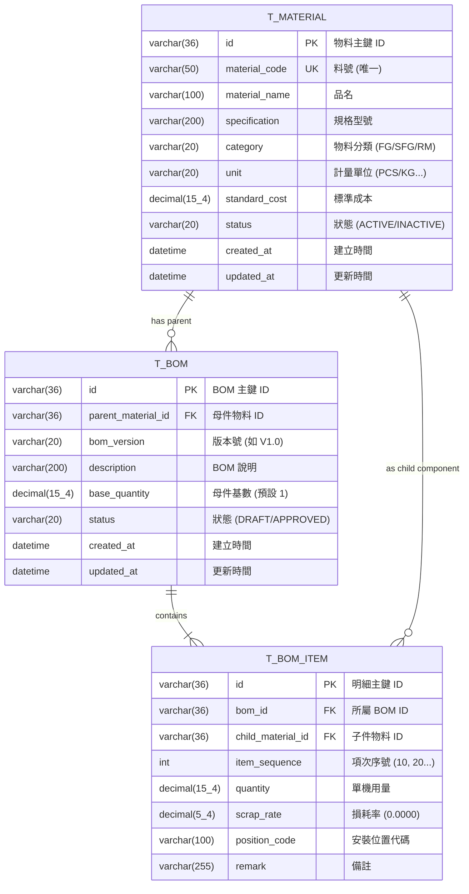

# 物料與 BOM 領域設計 Part 2：資料庫設計、JPA 映射與六角形適配器 (Database Schema, JPA & Hexagonal Adapters)

> 📌 本文件座落於 [`doc/design/material-bom-aggregate/02-hexagonal-ports-and-persistence.md`](file:///d:/桌面/ModuleWorkSpace/excel-module/doc/design/material-bom-aggregate/02-hexagonal-ports-and-persistence.md)，屬於「物料與多階層 BOM 領域驅動設計」之【Part 2：資料庫設計、JPA 映射與六角形適配器】。  
> 詳述資料庫 ERD 關聯模型、通用 SQL DDL 腳本、Spring Data JPA 技術實體、Outbound Ports 與 Adapters 隔離、以及 Excel 多階樹狀報表視圖模型投影。  
> 
> 🔗 **模組導讀與關聯文件**：  
> • 領域總覽主文件：👉 [物料與多階層 BOM 聚合設計總覽 (material_bom_aggregate_design.md)](file:///d:/桌面/ModuleWorkSpace/excel-module/doc/design/material_bom_aggregate_design.md)  
> • 聚合根與商業規則：👉 [物料與 BOM 領域設計 Part 1：領域聚合根、實體與商業規則 (01-domain-aggregates-and-entities.md)](file:///d:/桌面/ModuleWorkSpace/excel-module/doc/design/material-bom-aggregate/01-domain-aggregates-and-entities.md)

---

## 1. 資料庫實體關聯模型 (ERD)

---

## 2. 六角形架構 Outbound Ports 與 Adapters

依據 Clean Architecture 規範，資料庫技術隔離於 Infrastructure Layer：

* **應用層 Outbound Ports**：
  * [`MaterialRepositoryPort`](file:///d:/桌面/ModuleWorkSpace/excel-module/src/main/java/com/example/demo/application/port/out/bom/MaterialRepositoryPort.java)
  * [`BomRepositoryPort`](file:///d:/桌面/ModuleWorkSpace/excel-module/src/main/java/com/example/demo/application/port/out/bom/BomRepositoryPort.java)
* **基礎設施層 JPA 實體與儲存庫**：
  * [`MaterialJpaEntity`](file:///d:/桌面/ModuleWorkSpace/excel-module/src/main/java/com/example/demo/infrastructure/persistence/material/entity/MaterialJpaEntity.java)
  * [`BomJpaEntity`](file:///d:/桌面/ModuleWorkSpace/excel-module/src/main/java/com/example/demo/infrastructure/persistence/bom/entity/BomJpaEntity.java)
  * [`BomItemJpaEntity`](file:///d:/桌面/ModuleWorkSpace/excel-module/src/main/java/com/example/demo/infrastructure/persistence/bom/entity/BomItemJpaEntity.java)
* **基礎設施層適配器**：
  * [`MaterialRepositoryAdapter`](file:///d:/桌面/ModuleWorkSpace/excel-module/src/main/java/com/example/demo/infrastructure/adapter/bom/MaterialRepositoryAdapter.java)
  * [`BomRepositoryAdapter`](file:///d:/桌面/ModuleWorkSpace/excel-module/src/main/java/com/example/demo/infrastructure/adapter/bom/BomRepositoryAdapter.java)

---

## 3. Excel 多階層 BOM 樹狀報表視圖模型預覽 (Excel Projection)

在 Excel 模組產製多階 BOM 報表時，遞迴展平成以下階層結構：

| 階層 (Level) | 階層序號 | 子件料號 | 子件品名 | 規格型號 | 類別 | 單位 | 單機用量 | 損耗率 | 標準單價 | 展開總成本 | 位號 |
| :---: | :---: | :---: | :---: | :---: | :---: | :---: | :---: | :---: | :---: | :---: | :---: |
| **0** | **1** | **MAT-FG-001** | **智慧型商用無人機** | **PRO-4K-GPS** | **成品** | **SET** | **1.0** | **0%** | **-** | **$25,400** | **-** |
| 1 | 1.1 | MAT-SFG-101 | 飛控主機板總成 | REV-3.0 | 半成品 | PCS | 1.0 | 0% | - | $12,800 | MAIN-PCB |
| 2 | 1.1.1 | MAT-RM-301 | ARM 主控晶片 | 64-Bit Octa-Core | 原料 | PCS | 1.0 | 1% | $3,500 | $3,535 | U1 |
| 2 | 1.1.2 | MAT-RM-302 | 高精度陀螺儀傳感器 | 6-Axis IMU | 原料 | PCS | 2.0 | 2% | $800 | $1,632 | U2, U3 |
| 1 | 1.2 | MAT-SFG-102 | 無刷馬達動力總成 | 2212 920KV | 半成品 | SET | 4.0 | 0% | - | $4,800 | MOTOR-ASM |
| 2 | 1.2.1 | MAT-RM-401 | 高碳鋼無刷馬達本體 | 920KV | 原料 | PCS | 1.0 | 0% | $950 | $950 | M-1 |
| 2 | 1.2.2 | MAT-RM-402 | 碳纖維三葉螺旋槳 | 9450 Carbon | 原料 | PCS | 2.0 | 5% | $120 | $252 | PROP-1,2 |
| 1 | 1.3 | MAT-RM-501 | 高容量鋰聚合物電池 | 4S 5000mAh | 原料 | PCS | 1.0 | 0% | $4,200 | $4,200 | BAT-1 |

