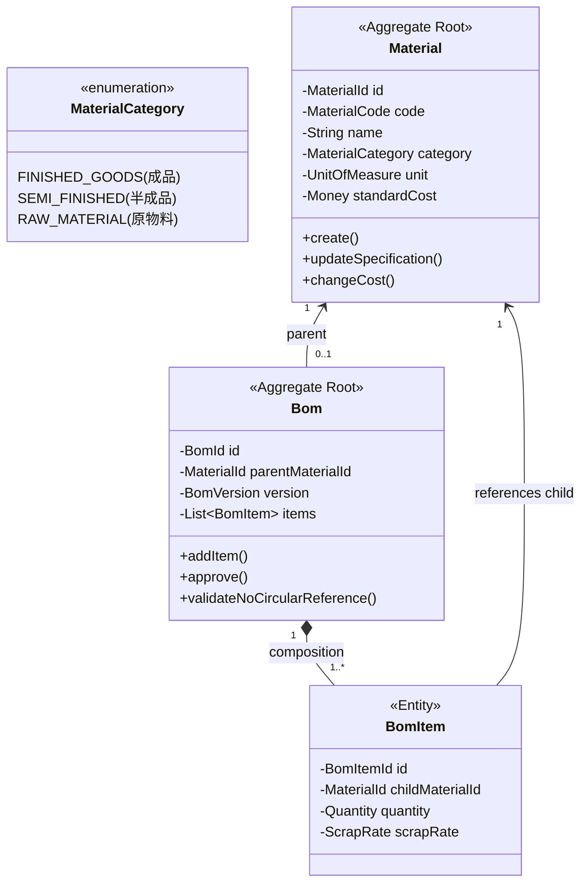

# 物料與多階層 BOM 聚合設計總覽 (Material & BOM Aggregate Design Hub)

> 📌 本文件座落於 [`doc/design/material_bom_aggregate_design.md`](file:///d:/桌面/ModuleWorkSpace/excel-module/doc/design/material_bom_aggregate_design.md)，作為 `excel-module` 核心業務領域模型 **「物料管理與多階層 BOM (Bill of Materials)」** 的核心入口與領域設計總覽導讀。  
> 總體架構請參閱：👉 [Excel 模組架構設計與演進藍圖 (architecture-design.md)](file:///d:/桌面/ModuleWorkSpace/excel-module/doc/design/architecture-design.md)。

---

## 1. 領域定位與設計哲學 (Domain Vision & Business Context)

在製造與供應鏈系統中，**BOM (Bill of Materials, 物料清單)** 是定義產品結構的核心核心：
1. **物料分類 (Material Classification)**：成品 (Finished Goods, FG)、半成品 (Semi-Finished Goods, SFG)、原物料 (Raw Material, RM)。
2. **多階層樹狀結構 (Multi-Level Hierarchy)**：成品由半成品與零件組成，支援遞迴拆解與層級縮排展示。
3. **商業防護規則 (Domain Invariants)**：
   - **防循環引用 (No Circular References)**：A 物料的子件不能包含 A 自己，亦不可間接包含 A（防死循環）。
   - **原料不可作為母件**：只有成品與半成品允許建立 BOM 配方。
   - **損耗率與基數**：單機用量需考慮損耗率（Scrap Rate）與母件基數。
4. **純 Java 領域模型**：領域層絕對零 Spring / JPA / Lombok 技術侵入，嚴格遵循 Clean Architecture。

---

## 2. 專題子文件導讀與跳轉索引 (Specialized Documentation Navigation)

本業務領域之詳細技術規格已依職責切分收納於專屬目錄 [`doc/design/material-bom-aggregate/`](file:///d:/桌面/ModuleWorkSpace/excel-module/doc/design/material-bom-aggregate/) 中：

| 專題技術文件 | 核心關注點 | 適合閱讀對象 | 涵蓋核心元件 |
| :--- | :--- | :--- | :--- |
| 👉 **[Part 1：領域聚合根、實體與商業規則 (01-domain-aggregates-and-entities.md)](file:///d:/桌面/ModuleWorkSpace/excel-module/doc/design/material-bom-aggregate/01-domain-aggregates-and-entities.md)** | **核心領域模型與業務規則** • 物料分類與多階層樹狀關係 • `Material` 與 `Bom` 獨立聚合設計 • 防循環引用與純 Java 領域行為 | 領域專家、業務分析師、核心領域工程師 | `Material` `Bom` `BomItem` `MaterialCode` `Quantity` `ScrapRate` |
| 👉 **[Part 2：資料庫設計、JPA 映射與六角形適配器 (02-hexagonal-ports-and-persistence.md)](file:///d:/桌面/ModuleWorkSpace/excel-module/doc/design/material-bom-aggregate/02-hexagonal-ports-and-persistence.md)** | **持久化儲存與報表視圖模型** • 關聯資料庫 Schema 與 DDL 腳本 • JPA 技術實體與 Outbound 適配器 • Excel 多階層樹狀報表視圖模型投影 | 資料庫管理員、後端工程師、報表開發者 | `MaterialRepositoryPort` `BomRepositoryPort` `MaterialJpaEntity` `BomJpaEntity` `BomItemJpaEntity` |

---

## 3. 六角形架構端到端元件矩陣 (Component & Port Matrix)

| 分層 (Layer) | 元件名稱 / 介面 | 角色與職責 | AGENTS.md 命名規範 |
| :--- | :--- | :--- | :--- |
| **Presentation** | [`MaterialBomExcelController`](file:///d:/桌面/ModuleWorkSpace/excel-module/src/main/java/com/example/demo/presentation/controller/MaterialBomExcelController.java) | 物料與 BOM 宣告式 Excel 匯出與匯入 REST 端點 | Controller |
| **Application (Port In)** | [`ExportBomUseCase`](file:///d:/桌面/ModuleWorkSpace/excel-module/src/main/java/com/example/demo/application/port/in/ExportBomUseCase.java) [`StreamExportBomUseCase`](file:///d:/桌面/ModuleWorkSpace/excel-module/src/main/java/com/example/demo/application/port/in/StreamExportBomUseCase.java) | BOM 匯出與串流匯出 UseCase 契約 | `*UseCase` (Rule 3-8) |
| **Application (Service)** | [`BomCommandService`](file:///d:/桌面/ModuleWorkSpace/excel-module/src/main/java/com/example/demo/application/service/BomCommandService.java) [`BomQueryService`](file:///d:/桌面/ModuleWorkSpace/excel-module/src/main/java/com/example/demo/application/service/BomQueryService.java) | CQRS 應用服務，協調 BOM 聚合與寫出寫入 | `*CommandService` / `*QueryService` |
| **Application (Port Out)**| [`MaterialRepositoryPort`](file:///d:/桌面/ModuleWorkSpace/excel-module/src/main/java/com/example/demo/application/port/out/MaterialRepositoryPort.java) [`BomRepositoryPort`](file:///d:/桌面/ModuleWorkSpace/excel-module/src/main/java/com/example/demo/application/port/out/BomRepositoryPort.java) | 物料與 BOM 應用層持久化通訊埠 | `*Port` (Rule 3-8) |
| **Domain (Aggregate)**    | [`Material`](file:///d:/桌面/ModuleWorkSpace/excel-module/src/main/java/com/example/demo/domain/material/aggregate/root/Material.java) [`Bom`](file:///d:/桌面/ModuleWorkSpace/excel-module/src/main/java/com/example/demo/domain/bom/aggregate/root/Bom.java) | 物料與 BOM 領域聚合根，純 Java 零框架依賴 | Aggregate Root |
| **Domain (Entity)**       | [`BomItem`](file:///d:/桌面/ModuleWorkSpace/excel-module/src/main/java/com/example/demo/domain/bom/aggregate/entity/BomItem.java) | BOM 內部實體，代表單項配方組件與用量 | Entity |
| **Infrastructure (JPA)**  | [`MaterialJpaEntity`](file:///d:/桌面/ModuleWorkSpace/excel-module/src/main/java/com/example/demo/infrastructure/persistence/material/entity/MaterialJpaEntity.java) [`BomJpaEntity`](file:///d:/桌面/ModuleWorkSpace/excel-module/src/main/java/com/example/demo/infrastructure/persistence/bom/entity/BomJpaEntity.java) | 關聯資料庫 ORM 實體與 Spring Data Repository | Technical Entity |
| **Infrastructure (Adapter)** | [`MaterialRepositoryAdapter`](file:///d:/桌面/ModuleWorkSpace/excel-module/src/main/java/com/example/demo/infrastructure/adapter/persistence/MaterialRepositoryAdapter.java) [`BomRepositoryAdapter`](file:///d:/桌面/ModuleWorkSpace/excel-module/src/main/java/com/example/demo/infrastructure/adapter/persistence/BomRepositoryAdapter.java) | 實作應用層 RepositoryPort 之技術適配器 | `*Adapter` (Rule 3-9) |

---

## 4. 測試驗證全景 (Testing & Verification Status)

* [`BomCommandServiceTest`](file:///d:/桌面/ModuleWorkSpace/excel-module/src/test/java/com/example/demo/application/service/BomCommandServiceTest.java)：驗證 BOM 匯出命令調度、多階層展開與資料庫資料擷取。
* [`BomQueryServiceTest`](file:///d:/桌面/ModuleWorkSpace/excel-module/src/test/java/com/example/demo/application/service/BomQueryServiceTest.java)：驗證 BOM 查詢、母件篩選與版本過濾。
* [`MaterialBomExcelControllerTest`](file:///d:/桌面/ModuleWorkSpace/excel-module/src/test/java/com/example/demo/presentation/controller/MaterialBomExcelControllerTest.java)：驗證物料主檔匯出/匯入與單階 BOM 配方 Excel 宣告式映射 REST API。
