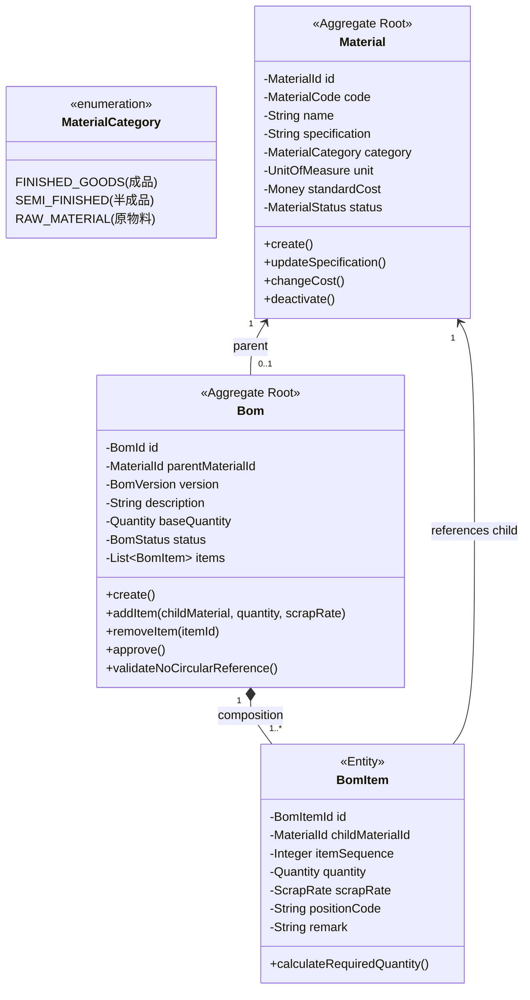
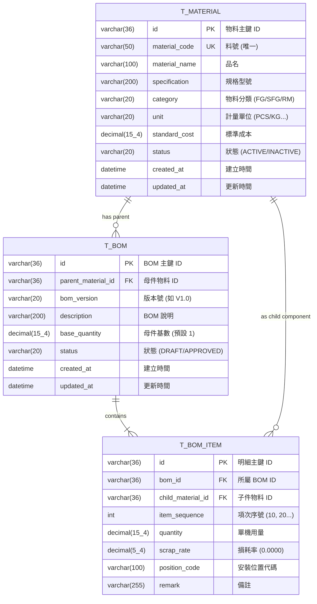

# 物料管理與多階層 BOM (Bill of Materials) 聚合設計文件

本文件遵循 **DDD (領域驅動設計)** 與 **Clean Architecture 六角形架構** 規範，針對物料主檔（Material Master）與物料清單（BOM）進行領域聚合邊界劃分與資料表設計，主要用於後續進行 Excel 多階 BOM 樹狀展開、成本卷算與資料匯入/匯出測試。

---

## 1. 業務情境與核心需求

在製造與供應鏈系統中，**BOM (Bill of Materials, 物料清單)** 是定義產品結構的核心核心：
1. **物料分類 (Material Classification)**：
   - **成品 (Finished Goods, FG)**：最終出貨給客戶的產品（例如：智慧型手機、筆記型電腦）。
   - **半成品 (Semi-Finished Goods, SFG)**：由多個零件組裝而成、可進一步組裝為成品的模組（例如：主機板、螢幕總成）。
   - **原料/零件 (Raw Material / Component, RM)**：向供應商採購的基礎料件（例如：晶片、電阻、螺絲、外殼）。
2. **多階層樹狀結構 (Multi-Level Hierarchy)**：
   - 一個成品可以由多個半成品與原料組成；半成品內部又可向下遞迴拆解為多個原料。
   - 具有階層深度（Level 0 -> Level 1 -> Level 2...）。
3. **商業防護規則 (Domain Invariants)**：
   - **防循環引用 (No Circular References)**：A 物料的子件不能包含 A 自己，亦不可間接包含 A（例如 A -> B -> C -> A），否則會導致無限遞迴與計算崩潰。
   - **原料不可作為母件**：只有成品與半成品允許建立 BOM 配方清單。
   - **損耗率與基數**：子件用量需考慮損耗率（Scrap Rate）與基數（Base Quantity）。
4. **Excel 報表展示願景**：
   - 後續將透過模組生成具備**樹狀縮排、層級編號（1, 1.1, 1.1.1）、多層級合計、動態公式與樣式**的高效能 Excel BOM 表。

---

## 2. 領域聚合架構與全域領域語言 (Ubiquitous Language)



### 聚合劃分策略：為什麼將 `Material` 與 `Bom` 拆為兩個聚合？
- **生命週期獨立**：物料主檔由採購/物管維護（基本規格、定價、安全庫存）；BOM 由工程/研發 (R&D) 團隊維護與版本發行。
- **高內聚性與高併發**：修改物料的規格或成本，不應鎖定整張 BOM 結構；一個物料可能存在不同版本或不同工廠的 BOM 配方。

---

## 3. 聚合根與值物件設計 (純 Java，零框架依賴)

### 3-1. `Material` 聚合根 (`domain/material/`)

- **聚合根**：[`Material`](file:///d:/桌面/ModuleWorkSpace/excel-module/src/main/java/com/example/demo/domain/material/aggregate/root/Material.java)
- **值物件 (Value Objects)**：
  - `MaterialId`：物料唯一識別碼（UUID 或序號）。
  - `MaterialCode`：企業料號編碼（例如：`MAT-FG-001`，具有格式約束）。
  - `MaterialCategory`：成品 (`FG`)、半成品 (`SFG`)、原物料 (`RM`)。
  - `UnitOfMeasure`：單位（`PCS`, `SET`, `KG`, `M`）。
  - `Money`：貨幣與標準成本。
  - `MaterialStatus`：狀態（`ACTIVE`, `DISCONTINUED`）。
- **關鍵領域方法 (Semantic Methods)**：
  - `create(...)`：靜態工廠方法，發布 `MaterialCreatedEvent`。
  - `updateBasicInfo(name, specification)`：異動物料規格。
  - `updateCost(newCost)`：調整成本並記錄歷程。
  - `discontinue()`：停用料號。

---

### 3-2. `Bom` 聚合根 (`domain/bom/`)

- **聚合根**：[`Bom`](file:///d:/桌面/ModuleWorkSpace/excel-module/src/main/java/com/example/demo/domain/bom/aggregate/root/Bom.java)
- **內部實體 (Entity)**：
  - `BomItem`：BOM 單項組成零件。
    - `BomItemId`：明細 ID。
    - `childMaterialId`：子件物料 ID。
    - `itemSequence`：項次序號（例如 10, 20, 30）。
    - `quantity`：單一母件所需子件數量（例如 2 PCS）。
    - `scrapRate`：損耗率百分比（例如 0.05 代表 5% 損耗）。
    - `positionCode`：電路板位號或機構安裝位置（如 `R1, R2, C10`）。
- **關鍵商業邏輯 (Invariants & Behaviors)**：
  - `addItem(childMaterial, quantity, scrapRate, positionCode)`：加入子料件，檢核數量必須 > 0。
  - `validateParentCategory(Material parentMaterial)`：檢核母件必須為成品或半成品，原料不可建立 BOM。
  - `checkCircularReference(Set<MaterialId> ancestorMaterialIds)`：遞迴檢查防循環引用。
  - `approve()`：審核通過生效，發布 `BomApprovedEvent`，生效後進入不可變（Frozen）狀態。

---

## 4. 資料庫實體設計 (Database Schema & DDL)

為了支援關聯式資料庫持久化與 JPA 映射，設計 3 張資料表：



### SQL DDL 腳本 (MySQL / H2 通用)

```sql
-- 1. 物料主檔表 (t_material)
CREATE TABLE t_material (
    id VARCHAR(36) NOT NULL PRIMARY KEY COMMENT '物料主鍵 UUID',
    material_code VARCHAR(50) NOT NULL UNIQUE COMMENT '物料料號 (唯一索引)',
    material_name VARCHAR(100) NOT NULL COMMENT '物料名稱',
    specification VARCHAR(200) COMMENT '規格/型號',
    category VARCHAR(20) NOT NULL COMMENT '分類: FG(成品), SFG(半成品), RM(原料)',
    unit VARCHAR(20) NOT NULL COMMENT '基本單位: PCS, SET, KG, M',
    standard_cost DECIMAL(15, 4) NOT NULL DEFAULT 0.0000 COMMENT '標準單價/成本',
    status VARCHAR(20) NOT NULL DEFAULT 'ACTIVE' COMMENT '狀態: ACTIVE, DISCONTINUED',
    created_at DATETIME NOT NULL DEFAULT CURRENT_TIMESTAMP COMMENT '建立時間',
    updated_at DATETIME NOT NULL DEFAULT CURRENT_TIMESTAMP ON UPDATE CURRENT_TIMESTAMP COMMENT '更新時間'
) ENGINE=InnoDB DEFAULT CHARSET=utf8mb4 COMMENT='物料主檔表';

-- 2. BOM 版本主表 (t_bom)
CREATE TABLE t_bom (
    id VARCHAR(36) NOT NULL PRIMARY KEY COMMENT 'BOM 主鍵 UUID',
    parent_material_id VARCHAR(36) NOT NULL COMMENT '母件物料主鍵 ID',
    bom_version VARCHAR(20) NOT NULL DEFAULT 'V1.0' COMMENT 'BOM 版本號',
    description VARCHAR(200) COMMENT '配方說明',
    base_quantity DECIMAL(15, 4) NOT NULL DEFAULT 1.0000 COMMENT '母件基數',
    status VARCHAR(20) NOT NULL DEFAULT 'DRAFT' COMMENT '狀態: DRAFT, APPROVED, OBSOLETE',
    created_at DATETIME NOT NULL DEFAULT CURRENT_TIMESTAMP COMMENT '建立時間',
    updated_at DATETIME NOT NULL DEFAULT CURRENT_TIMESTAMP ON UPDATE CURRENT_TIMESTAMP COMMENT '更新時間',
    CONSTRAINT fk_bom_parent_material FOREIGN KEY (parent_material_id) REFERENCES t_material(id),
    CONSTRAINT uk_bom_parent_version UNIQUE (parent_material_id, bom_version)
) ENGINE=InnoDB DEFAULT CHARSET=utf8mb4 COMMENT='BOM 清單主表';

-- 3. BOM 明細子項表 (t_bom_item)
CREATE TABLE t_bom_item (
    id VARCHAR(36) NOT NULL PRIMARY KEY COMMENT 'BOM 明細主鍵 UUID',
    bom_id VARCHAR(36) NOT NULL COMMENT '所屬 BOM 主鍵 ID',
    child_material_id VARCHAR(36) NOT NULL COMMENT '子件物料主鍵 ID',
    item_sequence INT NOT NULL DEFAULT 10 COMMENT '項次序號 (10, 20, 30)',
    quantity DECIMAL(15, 4) NOT NULL COMMENT '單機耗用數量',
    scrap_rate DECIMAL(5, 4) NOT NULL DEFAULT 0.0000 COMMENT '損耗率 (0.05 代表 5%)',
    position_code VARCHAR(100) COMMENT '位號代碼 (如 R1, R2, C1)',
    remark VARCHAR(255) COMMENT '備註說明',
    CONSTRAINT fk_bom_item_bom FOREIGN KEY (bom_id) REFERENCES t_bom(id) ON DELETE CASCADE,
    CONSTRAINT fk_bom_item_child_material FOREIGN KEY (child_material_id) REFERENCES t_material(id)
) ENGINE=InnoDB DEFAULT CHARSET=utf8mb4 COMMENT='BOM 明細子件表';

CREATE INDEX idx_bom_item_bom ON t_bom_item(bom_id);
CREATE INDEX idx_bom_item_child ON t_bom_item(child_material_id);
```

---

## 5. Excel BOM 表報表視圖模型預覽 (Excel Presentation Projection)

在後續 Excel 模組生成多階 BOM 報表時，將遞迴展平成以下階層結構：

| 階層 (Level) | 階層序號 | 子件料號 | 子件品名 | 規格型號 | 類別 | 單位 | 單機用量 | 損耗率 | 標準單價 | 展開總成本 | 位號 |
| :---: | :---: | :---: | :---: | :---: | :---: | :---: | :---: | :---: | :---: | :---: | :---: |
| **0** | **1** | **MAT-FG-001** | **智慧型商用無人機** | **PRO-4K-GPS** | **成品** | **SET** | **1.0** | **0%** | **-** | **$25,400** | **-** |
| 1 | 1.1 | MAT-SFG-101 | 飛控主機板總成 | REV-3.0 | 半成品 | PCS | 1.0 | 0% | - | $12,800 | MAIN-PCB |
| 2 | 1.1.1 | MAT-RM-301 | ARM 主控晶片 | 64-Bit Octa-Core | 原料 | PCS | 1.0 | 1% | $3,500 | $3,535 | U1 |
| 2 | 1.1.2 | MAT-RM-302 | 高精度陀螺儀傳感器 | 6-Axis IMU | 原料 | PCS | 2.0 | 2% | $800 | $1,632 | U2, U3 |
| 1 | 1.2 | MAT-SFG-102 | 無刷馬達動力總成 | 2212 920KV | 半成品 | SET | 4.0 | 0% | - | $4,800 | MOTOR-ASM |
| 2 | 1.2.1 | MAT-RM-401 | 高碳鋼無刷馬達本體 | 920KV | 原料 | PCS | 1.0 | 0% | $950 | $950 | M-1 |
| 2 | 1.2.2 | MAT-RM-402 | 碳纖維三葉螺旋槳 | 9450 Carbon | 原料 | PCS | 2.0 | 5% | $120 | $252 | PROP-1,2 |
| 1 | 1.3 | MAT-RM-501 | 高容量鋰聚合物電池 | 4S 5000mAh | 原料 | PCS | 1.0 | 0% | $4,200 | $4,200 | BAT-1 |

---

## 6. 後續開發垂直切片規劃 (Vertical Slice Architecture)

根據 `AGENTS.md`，後續實作將拆分為兩個垂直領域切片：

1. **`domain/material/`**：
   - `aggregate/root/Material.java`
   - `aggregate/vo/` (`MaterialId`, `MaterialCode`, `MaterialCategory`, `UnitOfMeasure`, `Money`)
   - `event/MaterialCreatedEvent.java`
   - `exception/MaterialNotFoundException.java`
2. **`domain/bom/`**：
   - `aggregate/root/Bom.java`
   - `aggregate/entity/BomItem.java`
   - `aggregate/vo/` (`BomId`, `BomVersion`, `BomStatus`, `Quantity`, `ScrapRate`)
   - `event/BomApprovedEvent.java`
   - `exception/CircularBomReferenceException.java`
3. **Application & Excel 導出服務**：
   - `application/port/in/GenerateBomExcelUseCase.java`
   - `application/service/BomExcelExportApplicationService.java`
   - 調用先前建立好的 `ExcelWriterPort` 與 `StreamExportExcelUseCase` 進行報表渲染。

