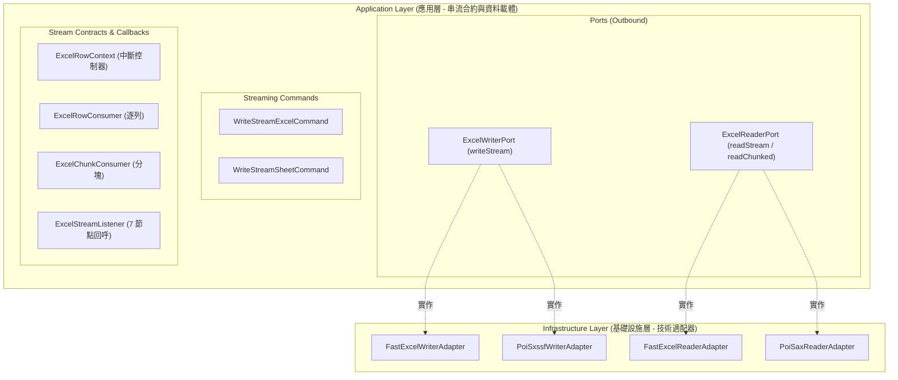
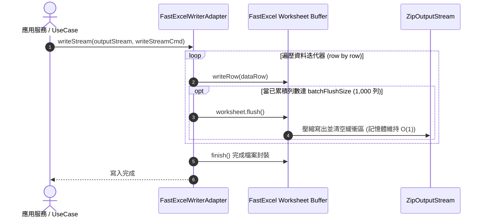

# 維度三：大數據分塊串流消費架構總覽 (Dimension 3: Streaming Processing Hub)

> 📌 本文件座落於 [`doc/design/streaming-processing.md`](file:///d:/桌面/ModuleWorkSpace/excel-module/doc/design/streaming-processing.md)，作為 `excel-module` 企業級擴充藍圖 **「維度三：大數據分塊串流消費」** 的核心入口與子模組總覽導讀。  
> 總體架構請參閱：👉 [Excel 模組架構設計與演進藍圖 (architecture-design.md)](file:///d:/桌面/ModuleWorkSpace/excel-module/doc/design/architecture-design.md)。

---

## 1. 子模組定位與設計哲學 (Sub-Module Vision & Architecture)

在處理十萬至百萬筆巨量 Excel 資料時，傳統 DOM 解析模式（`XSSFWorkbook`）會在堆積記憶體中放大數十倍物件，極易引發 Full GC 與 OOM 崩潰。

維度三基於 **Clean Architecture 六角形架構**、**常數記憶體沖刷 ($O(1)$)** 與 **事件驅動拉取式讀取**，實現：
1. **常數空間複雜度 ($O(1)$ Memory Footprint)**：無論寫入 1 萬列還是 100 萬列，JVM 堆積記憶體始終維持常數平穩。
2. **六角形防腐隔離 (Pure Port & Adapters)**：應用層嚴禁接觸 FastExcel / POI 底層技術物件，純粹依賴 Command 與 Functional SPI。
3. **多元消費模式**：同時支援「逐列即時消費 (Row-by-Row)」、「分塊批次消費 (Chunked Batch)」與「全生命週期事件監聽 (Lifecycle Listener)」。
4. **主動中斷控制 (Early Termination)**：消費端可透過 `ExcelRowContext.stop()` 即刻終止底層 I/O 解析。

---

## 2. 專題子文件導讀與跳轉索引 (Specialized Documentation Navigation)

本子模組之詳細技術規格已依職責切分收納於專屬目錄 [`doc/design/streaming-processing/`](file:///d:/桌面/ModuleWorkSpace/excel-module/doc/design/streaming-processing/) 中：

| 專題技術文件 | 核心關注點 | 適合閱讀對象 | 涵蓋核心元件 |
| :--- | :--- | :--- | :--- |
| 👉 **[Part 1：大數據串流寫出與常數記憶體沖刷 (01-streaming-write-and-memory-flush.md)](file:///d:/桌面/ModuleWorkSpace/excel-module/doc/design/streaming-processing/01-streaming-write-and-memory-flush.md)** | **串流寫出與 Flush 機制** • $O(1)$ 常數記憶體設計原理 • FastExcel / POI SXSSF 沖刷直沖 • 批次閥值 `batchFlushSize` 調優 | 效能調優架構師、報表匯出工程師、高併發後端 | `WriteStreamExcelCommand` `WriteStreamSheetCommand` `FastExcelWriterAdapter` `PoiSxssfWriterAdapter` |
| 👉 **[Part 2：StAX/SAX 惰性拉取式串流讀取與分塊消費 (02-streaming-read-and-chunk-consumer.md)](file:///d:/桌面/ModuleWorkSpace/excel-module/doc/design/streaming-processing/02-streaming-read-and-chunk-consumer.md)** | **串流讀取與回呼中斷** • StAX / SAX 惰性拉取式解析 • 逐列、分塊與監聽器三種模式 • `stop()` 提前終止機制與防 OOM | 大數據匯入開發者、批次 ETL 工程師、API 整合者 | `ExcelReaderPort` `ExcelRowConsumer` `ExcelChunkConsumer` `ExcelStreamListener` `ExcelRowContext` |

---

## 3. 六角形架構端到端元件矩陣 (Component & Port Matrix)

| 分層 (Layer) | 元件名稱 / 介面 | 角色與職責 | AGENTS.md 命名規範 |
| :--- | :--- | :--- | :--- |
| **Application (Port Out)**| [`ExcelWriterPort`](file:///d:/桌面/ModuleWorkSpace/excel-module/src/main/java/com/example/demo/application/port/out/ExcelWriterPort.java) | 串流寫出技術抽象通訊埠，定義 `writeStream` 契約 | `*Port` (Rule 3-8) |
| **Application (Port Out)**| [`ExcelReaderPort`](file:///d:/桌面/ModuleWorkSpace/excel-module/src/main/java/com/example/demo/application/port/out/ExcelReaderPort.java) | 串流讀取技術抽象通訊埠，定義 `readStream`, `readChunked` | `*Port` (Rule 3-8) |
| **Application (Command)** | [`WriteStreamExcelCommand`](file:///d:/桌面/ModuleWorkSpace/excel-module/src/main/java/com/example/demo/application/shared/command/WriteStreamExcelCommand.java) [`WriteStreamSheetCommand`](file:///d:/桌面/ModuleWorkSpace/excel-module/src/main/java/com/example/demo/application/shared/command/WriteStreamSheetCommand.java) | 串流寫出工作簿與工作表純不可變指令載體 | Java 21 Record |
| **Application (SPI)**     | [`ExcelRowConsumer`](file:///d:/桌面/ModuleWorkSpace/excel-module/src/main/java/com/example/demo/application/shared/stream/ExcelRowConsumer.java) [`ExcelChunkConsumer`](file:///d:/桌面/ModuleWorkSpace/excel-module/src/main/java/com/example/demo/application/shared/stream/ExcelChunkConsumer.java) [`ExcelStreamListener`](file:///d:/桌面/ModuleWorkSpace/excel-module/src/main/java/com/example/demo/application/shared/stream/ExcelStreamListener.java) | 逐列、分塊與全生命週期監聽純 Java 函式介面 | Functional SPI |
| **Application (Context)** | [`ExcelRowContext`](file:///d:/桌面/ModuleWorkSpace/excel-module/src/main/java/com/example/demo/application/shared/stream/ExcelRowContext.java) | 傳遞工作表名、物理列號並提供 `stop()` 終止控制器 | Context |
| **Infrastructure (Adapter)** | [`FastExcelWriterAdapter`](file:///d:/桌面/ModuleWorkSpace/excel-module/src/main/java/com/example/demo/infrastructure/adapter/engine/FastExcelWriterAdapter.java) [`FastExcelReaderAdapter`](file:///d:/桌面/ModuleWorkSpace/excel-module/src/main/java/com/example/demo/infrastructure/adapter/engine/FastExcelReaderAdapter.java) | FastExcel 0.20.2 串流寫入 (flush) 與 StAX 讀取適配器 | `*Adapter` (Rule 3-9) |
| **Infrastructure (Adapter)** | [`PoiSxssfWriterAdapter`](file:///d:/桌面/ModuleWorkSpace/excel-module/src/main/java/com/example/demo/infrastructure/adapter/engine/PoiSxssfWriterAdapter.java) [`PoiSaxReaderAdapter`](file:///d:/桌面/ModuleWorkSpace/excel-module/src/main/java/com/example/demo/infrastructure/adapter/engine/PoiSaxReaderAdapter.java) | POI 5.5.1 SXSSF 硬碟暫存沖刷與 SAX 事件讀取適配器 | `*Adapter` (Rule 3-9) |

---

## 4. 端到端調用執行時序 (End-to-End Sequence)

---

## 5. 測試驗證全景 (Testing & Verification Status)

* [`FastExcelWriterAdapterTest`](file:///d:/桌面/ModuleWorkSpace/excel-module/src/test/java/com/example/demo/infrastructure/adapter/engine/FastExcelWriterAdapterTest.java)：驗證常數記憶體串流寫入、分批沖刷與多工作表串流。
* [`FastExcelReaderAdapterTest`](file:///d:/桌面/ModuleWorkSpace/excel-module/src/test/java/com/example/demo/infrastructure/adapter/engine/FastExcelReaderAdapterTest.java)：驗證逐列串流讀取、分塊消費批次組裝與 `stop()` 提前中斷。
* [`PoiSxssfWriterAdapterTest`](file:///d:/桌面/ModuleWorkSpace/excel-module/src/test/java/com/example/demo/infrastructure/adapter/engine/PoiSxssfWriterAdapterTest.java)：驗證 POI SXSSF 硬碟暫存沖刷。
* [`PoiSaxReaderAdapterTest`](file:///d:/桌面/ModuleWorkSpace/excel-module/src/test/java/com/example/demo/infrastructure/adapter/engine/PoiSaxReaderAdapterTest.java)：驗證 POI SAX 輕量事件讀取。
