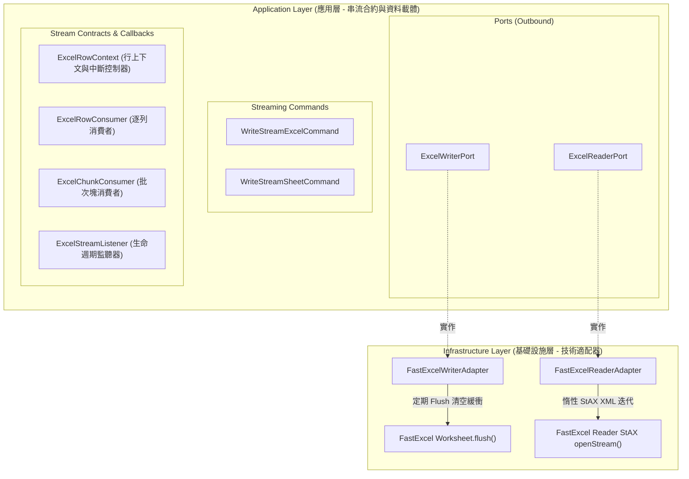

# Excel 大數據串流處理模組架構與實作指南 (Streaming Processing Guide)

> 📌 本文件詳述 `excel-module` 中基於 **Clean Architecture 六角形架構** 與 **FastExcel** 打造之大數據串流讀寫（Streaming Processing）機制。
> 涵蓋設計哲學、核心抽象合約、常數記憶體 $O(1)$ 沖刷原理、分塊批次消費、生命週期監聽以及程式碼範例。

---

## 1. 背景與設計挑戰

### 1.1 傳統 Excel 處理的痛點
在傳統 Java 企業級應用中，最常見的 Excel 解析框架為 Apache POI。然而，POI 的 DOM 模式（`XSSFWorkbook`）會在記憶體中建置完整的 XML 物件樹：
* **記憶體膨脹率極高**：每一筆 Excel 資料載入記憶體後，可能放大 10 到 100 倍。當檔案達數萬至數十萬列時，極易引發頻繁的 Full GC，甚至直接觸發 `java.lang.OutOfMemoryError: Java heap space`。
* **高併發阻塞**：多個使用者同時匯出或匯入大型報表時，伺服器堆積記憶體迅速耗盡，導致整個系統服務停擺。

### 1.2 串流架構目標
1. **常數級空間複雜度 ($O(1)$ Memory Footprint)**：無論處理 1 萬列、50 萬列還是 100 萬列，JVM 堆積記憶體佔用維持平穩。
2. **六角形防腐隔離 (Pure Port & Adapters)**：應用層與領域層嚴禁接觸 FastExcel 的技術物件（如 `Worksheet`, `ReadableWorkbook`, `Row`, `Cell`），所有互動皆經由純 Java 定義的 Command, Port 與 Functional Consumer。
3. **靈活的消費模式**：同時支援「逐列即時消費 (Row-by-Row)」、「分塊批次消費 (Chunked Batch)」與「全生命週期事件監聽 (Lifecycle Listener)」。
4. **可控的中斷機制 (Early Termination)**：支援由消費端發起主動中斷（如檢驗失敗、抽樣完成），立即終止底層 I/O 解析。

---

## 2. 總體架構與分層職責



### 分層物件對照表

| 物件名稱 | 所在分層與套件 | 職責與架構意圖 |
| :--- | :--- | :--- |
| [`ExcelWriterPort`](file:///d:/桌面/ModuleWorkSpace/excel-module/src/main/java/com/example/demo/application/port/out/ExcelWriterPort.java) | `application.port.out` | 串流寫出端口，定義輸出至 `OutputStream` 之契約 |
| [`ExcelReaderPort`](file:///d:/桌面/ModuleWorkSpace/excel-module/src/main/java/com/example/demo/application/port/out/ExcelReaderPort.java) | `application.port.out` | 串流讀取端口，提供逐列、分塊與監聽器三種解析模式 |
| [`ExcelRowContext`](file:///d:/桌面/ModuleWorkSpace/excel-module/src/main/java/com/example/demo/application/shared/stream/ExcelRowContext.java) | `application.shared.stream` | 傳遞工作表名、物理列號、資料列號，並提供 `stop()` 終止控制 |
| [`ExcelRowConsumer`](file:///d:/桌面/ModuleWorkSpace/excel-module/src/main/java/com/example/demo/application/shared/stream/ExcelRowConsumer.java) | `application.shared.stream` | 逐列消費回呼函式介面 `(Map<String, Object>, ExcelRowContext) -> void` |
| [`ExcelChunkConsumer`](file:///d:/桌面/ModuleWorkSpace/excel-module/src/main/java/com/example/demo/application/shared/stream/ExcelChunkConsumer.java) | `application.shared.stream` | 分塊消費回呼函式介面 `(List<Map<String, Object>>, ExcelRowContext) -> void` |
| [`ExcelStreamListener`](file:///d:/桌面/ModuleWorkSpace/excel-module/src/main/java/com/example/demo/application/shared/stream/ExcelStreamListener.java) | `application.shared.stream` | 生命週期監聽器，提供 7 個關鍵節點回呼預設實作 |
| [`WriteStreamExcelCommand`](file:///d:/桌面/ModuleWorkSpace/excel-module/src/main/java/com/example/demo/application/shared/command/WriteStreamExcelCommand.java) | `application.shared.command` | 寫出串流命令，封裝檔名、全域 flush 批次閥值與工作表列表 |
| [`WriteStreamSheetCommand`](file:///d:/桌面/ModuleWorkSpace/excel-module/src/main/java/com/example/demo/application/shared/command/WriteStreamSheetCommand.java) | `application.shared.command` | 工作表串流命令，封裝 `Stream<List<Object>>` 或 `Iterator` 惰性資料流 |
| [`FastExcelWriterAdapter`](file:///d:/桌面/ModuleWorkSpace/excel-module/src/main/java/com/example/demo/infrastructure/adapter/engine/FastExcelWriterAdapter.java) | `infrastructure.adapter.engine` | 寫入適配器，調用 FastExcel 的 `worksheet.flush()` 釋放記憶體 |
| [`FastExcelReaderAdapter`](file:///d:/桌面/ModuleWorkSpace/excel-module/src/main/java/com/example/demo/infrastructure/adapter/engine/FastExcelReaderAdapter.java) | `infrastructure.adapter.engine` | 讀取適配器，調用 FastExcel Reader 的 StAX `sheet.openStream()` |

---

## 3. 串流寫入機制 (Streaming Write Architecture)

### 3.1 核心運作原理
FastExcel 的底層設計理念是將 Excel 工作表直接對應至 ZIP Entry 的 XML 串流。
* 在傳統批次寫入中，若一次將 50 萬筆資料傳入，內部仍會保留大量行物件。
* `FastExcelWriterAdapter` 在處理 [`WriteStreamExcelCommand`](file:///d:/桌面/ModuleWorkSpace/excel-module/src/main/java/com/example/demo/application/shared/command/WriteStreamExcelCommand.java) 時：
  1. 迭代傳入的 `Stream<List<Object>>` 或 `Iterator<List<Object>>`，每遍歷一列即寫入儲存格。
  2. 每當寫入列數達到 `batchFlushSize`（預設為 1,000 列）時，主動呼叫 `worksheet.flush()`。
  3. `flush()` 會將該千列 XML 內容直接壓縮並寫入 `OutputStream`，並**清空內部儲存格緩衝區**。
  4. 因此，記憶體中始終僅維持約 1,000 列的輕量資料，達到嚴格的 $O(1)$ 記憶體佔用。

```
  [Data Producer Stream] 
           │ (row by row)
           ▼
┌─────────────────────────┐
│ FastExcel Worksheet     │ ──(達到 1,000 列)──> [worksheet.flush()]
│ Internal Row Buffer     │                          │ (寫入並釋放記憶體)
└─────────────────────────┘                          ▼
                                             ┌──────────────────┐
                                             │ ZipOutputStream  │ ──> (Disk / HTTP Response)
                                             └──────────────────┘
```

### 3.2 串流寫入使用範例

```java
@Autowired
private ExcelWriterPort excelWriterPort;

public void exportLargeOrders(HttpServletResponse response) throws IOException {
    // 1. 設定 HTTP 回應標頭
    response.setContentType("application/vnd.openxmlformats-officedocument.spreadsheetml.sheet");
    response.setHeader("Content-Disposition", "attachment; filename=\"large_orders.xlsx\"");

    // 2. 建立惰性資料串流 (例如自資料庫分頁遊標或 JPA Stream 獲取)
    Stream<List<Object>> rowStream = orderRepository.streamAll()
            .map(order -> List.of(order.getId(), order.getCustomerName(), order.getAmount(), order.getCreatedAt()));

    // 3. 組裝工作表串流命令 (設定每 2,000 筆 flush 一次)
    WriteStreamSheetCommand sheetCommand = WriteStreamSheetCommand.builder()
            .sheetName("訂單大數據清單")
            .headers(List.of("訂單ID", "客戶名稱", "金額", "建立時間"))
            .rowsStream(rowStream)
            .batchFlushSize(2000)
            .build();

    WriteStreamExcelCommand command = WriteStreamExcelCommand.builder()
            .fileName("large_orders.xlsx")
            .sheet(sheetCommand)
            .build();

    // 4. 直接導流至 ServletOutputStream，零中繼磁碟佔用
    excelWriterPort.writeStream(response.getOutputStream(), command);
}
```

---

## 4. 串流讀取機制 (Streaming Read Architecture)

FastExcel Reader 基於 Java StAX (Streaming API for XML) 解析技術，透過 `ReadableWorkbook.openStream()` 實現逐節點向後拉取 (Pull Parsing)，無需建立 DOM 樹。

`ExcelReaderPort` 提供三種不同顆粒度的讀取契約，適配不同業務情境：

### 4.1 模式一：逐列消費 (Row-by-Row Streaming)
* **適用情境**：單筆資料過濾、即時檢驗、低延遲轉發至 MQ 訊息佇列。
* **契約介面**：
  ```java
  void readStream(InputStream inputStream, String sheetName, ExcelRowConsumer rowConsumer);
  ```
* **程式碼範例**：
  ```java
  excelReaderPort.readStream(inputStream, "工作表1", (row, context) -> {
      System.out.printf("正在處理第 %d 列: 訂單ID=%s, 金額=%s%n",
              context.getPhysicalRowIndex(), row.get("訂單ID"), row.get("金額"));
      
      // 依業務邏輯判定是否提早終止
      if (row.get("訂單ID") == null) {
          context.stop(); // 立即停止讀取，釋放底層 I/O
      }
  });
  ```

### 4.2 模式二：分塊批次消費 (Chunked Batch Reading)
* **適用情境**：匯入資料庫批次寫入（`batchInsert`）、MyBatis `ExecutorType.BATCH`、Spring Data `saveAll`。
* **契約介面**：
  ```java
  void readChunked(InputStream inputStream, String sheetName, int chunkSize, ExcelChunkConsumer chunkConsumer);
  ```
* **程式碼範例**：
  ```java
  excelReaderPort.readChunked(inputStream, "工作表1", 1000, (chunk, context) -> {
      // chunk 包含 1,000 筆 Map<String, Object>
      System.out.printf("開始批次寫入資料，共 %d 筆，累計處理至第 %d 筆%n", chunk.size(), context.getProcessedDataRowCount());
      
      orderBatchDao.insertBatch(chunk);
      // 處理完畢後 chunk 立即出棧供 GC 回收，維持記憶體平衡
  });
  ```

### 4.3 模式三：全生命週期監聽 (Full Lifecycle Listener)
* **適用情境**：非同步長任務進度追蹤、進度條更新（WebSocket/SSE）、多工作表整合統計與全域異常攔截。
* **契約介面**：
  ```java
  void readWithListener(InputStream inputStream, ExcelStreamListener listener);
  ```
* **監聽節點流向**：
  ```
  onStart()
     │
     ├──> onSheetStart(sheetName)
     │       │
     │       ├──> onRow(row, context) ── (逐列觸發)
     │       │
     │       ├──> onChunk(chunk, chunkIndex, context) ── (每達 chunkSize 觸發)
     │       │
     │       └──> onSheetEnd(sheetName, sheetTotalRows)
     │
     └──> onComplete(totalRowsProcessed)
  ```
* **程式碼範例**：
  ```java
  excelReaderPort.readWithListener(inputStream, new ExcelStreamListener() {
      @Override
      public int getChunkSize() {
          return 500;
      }

      @Override
      public void onSheetStart(String sheetName, ExcelRowContext context) {
          log.info("開始解析工作表: {}", sheetName);
      }

      @Override
      public void onChunk(List<Map<String, Object>> chunk, ExcelRowContext context) {
          progressService.updateProgress(context.getProcessedDataRowCount());
      }

      @Override
      public void onComplete(ExcelRowContext context) {
          log.info("Excel 全部工作表解析完成，共處理 {} 列", context.getProcessedDataRowCount());
      }

      @Override
      public void onError(Throwable throwable, ExcelRowContext context) {
          log.error("解析過程發生異常", throwable);
      }
  });
  ```

---

## 5. 異常處理與安全性保證

1. **嚴密資源釋放 (`AutoCloseable`)**：
   * 寫入適配器使用 `try (Workbook wb = ...)`，確保留存於記憶體的未沖刷緩衝區在結尾時自動 `wb.finish()` 並關閉輸出流。
   * 讀取適配器使用 `try (ReadableWorkbook wb = ...; Stream<Row> rowStream = ...)`，無論正常讀畢或提早中斷，底層的 ZIP 解壓縮串流與 XML 剖析器皆安全關閉。
2. **防腐例外包裝**：
   * 底層發生的 `IOException` 或 FastExcel 解析例外，統一透過 [`ExcelWriteException`](file:///d:/桌面/ModuleWorkSpace/excel-module/src/main/java/com/example/demo/application/shared/exception/ExcelWriteException.java) 與 [`ExcelReadException`](file:///d:/桌面/ModuleWorkSpace/excel-module/src/main/java/com/example/demo/application/shared/exception/ExcelReadException.java) 進行語意化包裝，確保上層業務代碼不直接耦合技術類例外。

---

## 6. 測試驗證矩陣

專案已包含完整的 BDD Gherkin 測試套件 [`FastExcelStreamingTest`](file:///d:/桌面/ModuleWorkSpace/excel-module/src/test/java/com/example/demo/infrastructure/adapter/engine/FastExcelStreamingTest.java)，測試覆蓋率與執行成果：

| 測試場景 (Scenario) | 測試重點與驗證指標 | 驗證結果 |
| :--- | :--- | :---: |
| **巨量資料串流寫入與讀出** | 寫出 5,000 列測試資料（設定每 500 列 flush 一次），以 `readStream` 逐列驗證資料完整性與型別轉換。 | `PASSED` |
| **分塊批次讀取 (Chunked)** | 設定塊大小為 500 列，驗證 5,000 列資料是否準確劃分為 10 個批次，每一批次內包含正確的資料列。 | `PASSED` |
| **條件式提早中止 (Early Stop)** | 讀取至第 100 列時觸發 `context.stop()`，驗證總讀取列數精確停在 100 列，不消耗後續 I/O。 | `PASSED` |
| **全生命週期事件監聽** | 註冊監聽器，驗證 `onStart`, `onSheetStart`, `onRow`, `onChunk`, `onSheetEnd`, `onComplete` 的呼叫順序與次數。 | `PASSED` |

---

## 7. 最佳實踐與效能調優指南

1. **`batchFlushSize` 閥值建議**：
   * **欄位較少 (小於 20 欄)**：建議設定為 `1000 ~ 2000`。
   * **欄位較多或有長文字 (大於 50 欄)**：建議設定為 `500`，避免單批次記憶體突增。
2. **Web 匯出防堵連線超時**：
   * 在使用 Spring MVC 或 WebFlux 匯出十萬級以上檔案時，請直接使用 `writeStream(response.getOutputStream(), command)`，讓二進位串流即時寫回客戶端，避免反向代理伺服器（Nginx / ALB）因長時間未收到位元組而拋出 504 Gateway Timeout。
3. **空列與無效標題處理**：
   * 適配器內部具備自動標題列探測與空列過濾機制，若讀取到全空單元格列會自動略過，避免在資料庫批次寫入時插入無效紀錄。
