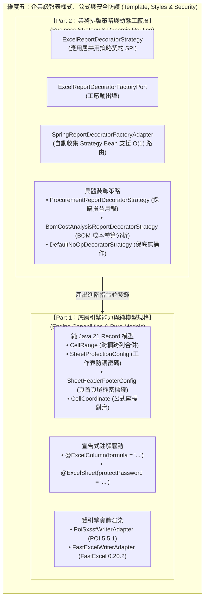
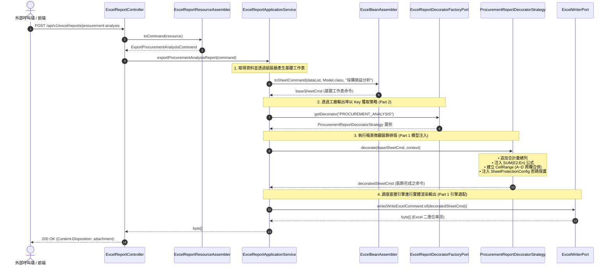

# 維度五：企業級報表樣式、動態公式與安全防護架構總覽 (Dimension 5: Template, Styles & Security Hub)

> 📌 本文件座落於 [`doc/design/template-styles-and-security.md`](file:///d:/桌面/ModuleWorkSpace/excel-module/doc/design/template-styles-and-security.md)，作為 `excel-module` 企業級擴充藍圖 **「維度五：企業級報表樣式、公式與安全防護」** 的核心入口與子模組總覽導讀。  
> 總體架構請參閱：👉 [Excel 模組架構設計與演進藍圖 (architecture-design.md)](file:///d:/桌面/ModuleWorkSpace/excel-module/doc/design/architecture-design.md)。

---

## 1. 子模組定位與設計哲學 (Sub-Module Vision & Architecture)

在企業資源規劃 (ERP)、製造執行 (MES) 與供應鏈管理 (SCM) 等核心後端系統中，Excel 匯出不僅是輸出二維資料表格，更需符合會計審計、防篡改保護、自適應公式計算與跨部門多租戶排版需求。

為同時兼顧 **Clean Architecture 六角形架構** 的純粹性、**巨量資料雙引擎 (FastExcel / POI)** 的效能平衡、以及 **業務報表高擴充性**，維度五採用「**雙軌分層架構 (Dual-Track Architecture)**」進行解耦與封裝：



---

## 2. 專題子文件導讀與跳轉索引 (Specialized Documentation Navigation)

本子模組之詳細技術規格、程式碼範例與實作細節，已依職責切分收納於專屬目錄 [`doc/design/template-styles-and-security/`](file:///d:/桌面/ModuleWorkSpace/excel-module/doc/design/template-styles-and-security/) 中：

| 專題技術文件 | 核心關注點 | 適合閱讀對象 | 涵蓋核心元件 |
| :--- | :--- | :--- | :--- |
| 👉 **[Part 1：底層樣式、公式與防護引擎規範 (01-engine-styles-and-protection.md)](file:///d:/桌面/ModuleWorkSpace/excel-module/doc/design/template-styles-and-security/01-engine-styles-and-protection.md)** | **底層能力與引擎適配**<br/>• POI / FastExcel 雙引擎特性差異<br/>• 宣告式註解驅動機制<br/>• 純 Java 21 Record 抽象模型 | 底層架構師、框架開發者、效能調優人員 | `CellRange`<br/>`SheetProtectionConfig`<br/>`SheetHeaderFooterConfig`<br/>`PoiSxssfWriterAdapter`<br/>`FastExcelWriterAdapter` |
| 👉 **[Part 2：企業級報表裝飾策略工廠模式指南 (02-customizable-report-decorator.md)](file:///d:/桌面/ModuleWorkSpace/excel-module/doc/design/template-styles-and-security/02-customizable-report-decorator.md)** | **業務應用與策略調度**<br/>• 報表微觀算術自 Service 抽離<br/>• 策略模式與工廠輸出埠設計<br/>• 依 Key 動態路由與多租戶風格 | 業務應用開發者、報表需求分析師、API 設計師 | `ExcelReportDecoratorFactoryPort`<br/>`ExcelReportDecoratorStrategy`<br/>`SpringReportDecoratorFactoryAdapter`<br/>`ProcurementReportDecoratorStrategy`<br/>`ReportDecorationContext` |

---

## 3. 六角形架構端到端元件矩陣 (Component & Port Matrix)

本子模組的所有實體元件嚴格依照 Clean Architecture 分層與 `AGENTS.md` 命名規則進行隔離：

| 分層 (Layer) | 元件名稱 / 介面 | 角色與職責 | AGENTS.md 命名規範 |
| :--- | :--- | :--- | :--- |
| **Presentation** | [`ExcelReportController`](file:///d:/桌面/ModuleWorkSpace/excel-module/src/main/java/com/example/demo/presentation/controller/report/ExcelReportController.java) | REST API 進入點，接收動態報表請求 | Controller |
| **Presentation** | [`ExcelReportResourceAssembler`](file:///d:/桌面/ModuleWorkSpace/excel-module/src/main/java/com/example/demo/presentation/assembler/ExcelReportResourceAssembler.java) | ACL 防腐層，負責 Request/Resource 轉 Command | Assembler |
| **Application (Port In)** | [`ExportFinancialReportUseCase`](file:///d:/桌面/ModuleWorkSpace/excel-module/src/main/java/com/example/demo/application/port/in/report/ExportFinancialReportUseCase.java) | 財務與採購報表匯出應用業務合約 | `*UseCase` (Rule 3-8) |
| **Application (Service)** | [`ExcelReportApplicationService`](file:///d:/桌面/ModuleWorkSpace/excel-module/src/main/java/com/example/demo/application/service/report/ExcelReportApplicationService.java) | 流程協調者，僅依賴工廠輸出埠，無排版算術耦合 | `*ApplicationService` (Rule 3-9) |
| **Application (Port Out)**| [`ExcelReportDecoratorFactoryPort`](file:///d:/桌面/ModuleWorkSpace/excel-module/src/main/java/com/example/demo/application/port/out/report/ExcelReportDecoratorFactoryPort.java) | 依 `reportKey` 動態獲取裝飾策略之工廠輸出通訊埠 | `*Port` (Rule 3-8) |
| **Application (Port Out)**| [`ExcelWriterPort`](file:///d:/桌面/ModuleWorkSpace/excel-module/src/main/java/com/example/demo/application/port/out/core/ExcelWriterPort.java) | 實體 Excel 二進位檔案寫入技術契約 | `*Port` (Rule 3-8) |
| **Application (Strategy)**| [`ExcelReportDecoratorStrategy`](file:///d:/桌面/ModuleWorkSpace/excel-module/src/main/java/com/example/demo/application/shared/strategy/ExcelReportDecoratorStrategy.java) | 應用層共用策略契約 SPI，由工廠管理與路由 | Strategy SPI |
| **Application (Model)**   | [`ReportDecorationContext`](file:///d:/桌面/ModuleWorkSpace/excel-module/src/main/java/com/example/demo/application/shared/model/ReportDecorationContext.java) | 包含標題、密碼、原始資料之不可變上下文 Record | Java 21 Record |
| **Application (Model)**   | [`CellRange`](file:///d:/桌面/ModuleWorkSpace/excel-module/src/main/java/com/example/demo/application/shared/model/CellRange.java) | 跨欄跨列矩形合併區間純數值物件 | Java 21 Record |
| **Application (Model)**   | [`SheetProtectionConfig`](file:///d:/桌面/ModuleWorkSpace/excel-module/src/main/java/com/example/demo/application/shared/model/SheetProtectionConfig.java) | 工作表防護密碼與限制設定純資料物件 | Java 21 Record |
| **Application (Model)**   | [`SheetHeaderFooterConfig`](file:///d:/桌面/ModuleWorkSpace/excel-module/src/main/java/com/example/demo/application/shared/model/SheetHeaderFooterConfig.java) | 列印頁首頁尾與審計機密標籤純資料物件 | Java 21 Record |
| **Infrastructure (Adapter)** | [`SpringReportDecoratorFactoryAdapter`](file:///d:/桌面/ModuleWorkSpace/excel-module/src/main/java/com/example/demo/infrastructure/adapter/report/SpringReportDecoratorFactoryAdapter.java) | 自動收集所有 Strategy Bean，提供 $O(1)$ 查找 | `*Adapter` (Rule 3-9) |
| **Infrastructure (Strategy)**| [`ProcurementReportDecoratorStrategy`](file:///d:/桌面/ModuleWorkSpace/excel-module/src/main/java/com/example/demo/infrastructure/adapter/report/ProcurementReportDecoratorStrategy.java) | 採購月報專屬排版：合計列、SUM 公式、A~D 跨欄合併 | Strategy Component |
| **Infrastructure (Strategy)**| [`BomCostAnalysisReportDecoratorStrategy`](file:///d:/桌面/ModuleWorkSpace/excel-module/src/main/java/com/example/demo/infrastructure/adapter/report/BomCostAnalysisReportDecoratorStrategy.java) | BOM 成本分析排版：A~K 跨欄合併、L 欄 SUM 公式、深海軍藍 (#1B365D) 配色與密碼防護 | Strategy Component |
| **Infrastructure (Strategy)**| [`DefaultNoOpDecoratorStrategy`](file:///d:/桌面/ModuleWorkSpace/excel-module/src/main/java/com/example/demo/infrastructure/adapter/report/DefaultNoOpDecoratorStrategy.java) | 無操作保底策略，未匹配時原樣輸出，確保高可用 | Fallback Strategy |
| **Infrastructure (Engine)**  | [`PoiSxssfWriterAdapter`](file:///d:/桌面/ModuleWorkSpace/excel-module/src/main/java/com/example/demo/infrastructure/adapter/core/PoiSxssfWriterAdapter.java)<br>[`FastExcelWriterAdapter`](file:///d:/桌面/ModuleWorkSpace/excel-module/src/main/java/com/example/demo/infrastructure/adapter/core/FastExcelWriterAdapter.java) | POI 5.5.1 與 FastExcel 0.20.2 底層引擎適配器 | `*Adapter` (Rule 3-9) |

---

## 4. 端到端調用執行流程 (End-to-End Sequence)



---

## 5. 測試驗證全景 (Testing & Verification Status)

本子模組各項功能均具備完整的單元測試與整合測試，包含異常分支、保底降級與雙引擎適配：

* [`ExcelReportApplicationServiceTest`](file:///d:/桌面/ModuleWorkSpace/excel-module/src/test/java/com/example/demo/application/service/report/ExcelReportApplicationServiceTest.java)：驗證應用服務流程協調、工廠路由與保底策略呼叫。
* [`ProcurementReportDecoratorStrategyTest`](file:///d:/桌面/ModuleWorkSpace/excel-module/src/test/java/com/example/demo/infrastructure/report/ProcurementReportDecoratorStrategyTest.java)：驗證合計列索引計算、SUM 公式生成、`CellRange` 合併區間與安全防護密碼設置。
* [`SpringReportDecoratorFactoryAdapterTest`](file:///d:/桌面/ModuleWorkSpace/excel-module/src/test/java/com/example/demo/infrastructure/adapter/report/SpringReportDecoratorFactoryAdapterTest.java)：驗證 Spring 容器 Bean 自動收錄、不區分大小寫查找與保底降級。
* [`PoiSxssfWriterAdapterTest`](file:///d:/桌面/ModuleWorkSpace/excel-module/src/test/java/com/example/demo/infrastructure/adapter/core/PoiSxssfWriterAdapterTest.java)：驗證 POI 引擎之多階儲存格合併、動態公式求值、密碼鎖定與頁首頁尾巨集。
* [`FastExcelWriterAdapterTest`](file:///d:/桌面/ModuleWorkSpace/excel-module/src/test/java/com/example/demo/infrastructure/adapter/core/FastExcelWriterAdapterTest.java)：驗證 FastExcel 引擎之巨量資料合併與公式串流沖刷。
* [`ExcelReportControllerTest`](file:///d:/桌面/ModuleWorkSpace/excel-module/src/test/java/com/example/demo/presentation/controller/report/ExcelReportControllerTest.java)：驗證 REST 表現層參數接收、防腐轉換與自訂檔名標頭輸出。

---

## 6. 子模組 Package 套件結構與分層對照 (Package Structure & Layer Mapping)

企業級報表樣式、公式與安全防護子模組遵循 Clean Architecture 六角形架構，其 Package 套件結構如下：

### 6.1 主程式 Package 結構 (`src/main/java`)

```text
com.example.demo
├── presentation/                                    # 表現層 (Inbound Adapters)
│   ├── controller/report/                           # 報表 REST 控制器
│   │   └── ExcelReportController.java               # POST /reports/{reportKey}/export
│   ├── assembler/                                   # 防腐層 Resource 組裝器
│   │   └── ExcelReportResourceAssembler.java        # Request 轉 Command 組裝器
│   └── resource/                                    # 表現層資料載體 (Rule 3-1 & 3-2)
│       ├── in/ (ExportFinancialReportResource.java)
│       └── out/ (ExcelReportExportedResource.java)
│
├── application/                                     # 應用層 (Application Core)
│   ├── port/in/report/                              # Inbound Ports (UseCases - Rule 3-8)
│   │   └── ExportFinancialReportUseCase.java        # 財務/採購報表匯出 UseCase
│   ├── port/out/report/                             # Outbound Ports (業務輸出埠 - Rule 3-8)
│   │   └── ExcelReportDecoratorFactoryPort.java     # 策略工廠輸出埠
│   ├── service/report/                              # 應用服務 (Rule 3-9)
│   │   └── ExcelReportApplicationService.java       # 流程協調與策略調度
│   └── shared/
│       ├── strategy/                                # 應用層策略契約 SPI
│       │   ├── ExcelReportDecoratorStrategy.java    # 樣式裝飾策略介面
│       │   └── ReportDecorationContext.java         # 裝飾執行上下文
│       └── command/                                 # 寫入命令載體
│           └── ExportFinancialReportCommand.java
│
└── infrastructure/                                  # 基礎設施層 (Outbound Adapters & Strategies)
    ├── adapter/report/                              # 輸出適配器 (Rule 3-9)
    │   └── SpringReportDecoratorFactoryAdapter.java # 實作 DecoratorFactoryPort (自動收錄 Bean)
    └── report/                                      # 具體業務報表裝飾策略 (Strategy Implementations)
        ├── ProcurementReportDecoratorStrategy.java  # 採購損益月報策略
        ├── BomCostAnalysisReportDecoratorStrategy.java # BOM 成本卷算分析策略
        └── DefaultNoOpDecoratorStrategy.java        # 預設保底無操作策略
```

### 6.2 測試套件 Package 結構 (`src/test/java`)

```text
com.example.demo
├── presentation/controller/report/
│   └── ExcelReportControllerTest.java               # 報表 REST 控制器端點測試
├── application/service/report/
│   └── ExcelReportApplicationServiceTest.java       # 報表應用服務單元測試
└── infrastructure/
    ├── adapter/report/
    │   └── SpringReportDecoratorFactoryAdapterTest.java # 工廠適配器單元測試
    └── report/
        ├── ProcurementReportDecoratorStrategyTest.java  # 採購策略單元測試
        └── BomCostAnalysisReportDecoratorStrategyTest.java # BOM 分析策略單元測試
```

```text
Results:
Tests run: 196, Failures: 0, Errors: 0, Skipped: 0
BUILD SUCCESS
```
