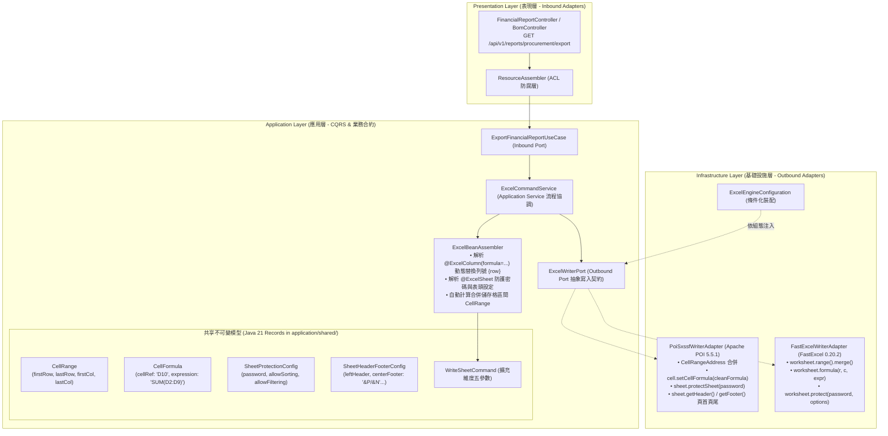

# 維度五 Part 1：Excel 企業級報表樣式、動態公式與安全防護底層引擎規範 (Report Styles, Dynamic Formulas & Sheet Protection Engine Guide)

> 📌 本文件座落於 [`doc/design/template-styles-and-security/01-engine-styles-and-protection.md`](file:///d:/桌面/ModuleWorkSpace/excel-module/doc/design/template-styles-and-security/01-engine-styles-and-protection.md)，屬於「維度五：企業級報表樣式、公式與安全防護」之【Part 1：底層樣式、公式與防護引擎規範】。  
> 詳述 `excel-module` 中基於 **Clean Architecture 六角形架構**、**Java 21 Record**、**雙引擎動態適配 (FastExcel & Apache POI)** 與 **宣告式註解驅動** 所打造之企業級 Excel 報表樣式、動態公式計算與試算表防篡改保護方案。  
> 
> 🔗 **模組導讀與關聯文件**：  
> • 模組入口主文件：👉 [維度五：企業級報表樣式、動態公式與安全防護架構總覽 (template-styles-and-security.md)](file:///d:/桌面/ModuleWorkSpace/excel-module/doc/design/template-styles-and-security.md)  
> • 業務策略工廠：👉 [維度五 Part 2：企業級報表裝飾策略工廠模式設計指南 (02-customizable-report-decorator.md)](file:///d:/桌面/ModuleWorkSpace/excel-module/doc/design/template-styles-and-security/02-customizable-report-decorator.md)

---

## 1. 背景與設計挑戰 (Background & Challenges)

### 1.1 傳統 Excel 匯出模組的典型痛點
在企業資源規劃 (ERP)、製造執行系統 (MES) 與供應鏈管理 (SCM) 中，產出的試算表不僅是單純的二維資料清單，往往需要符合嚴格的會計審計、合約驗收與跨部門分發要求。然而，傳統後端匯出架構常存在以下顯著缺陷：

1. **僅支援平鋪單階表頭，無法呈現多階複合報表 (Multi-Level Headers)**：
   * 傳統框架只能產生單一平鋪欄位（如「物料代碼」、「品名」、「基本單價」、「稅額」），無法產製包含分組階層的複合表頭（例如上方為「物料基本資訊」跨 2 欄，相鄰為「採購計價明細」跨 3 欄）。
2. **靜態數字缺乏靈動性，喪失試算表原生計算價值 (Static Values vs Dynamic Formulas)**：
   * 許多系統在後端以 Java 計算好「小計 = 單價 × 數量」並將死數值寫入儲存格。當財務或採購主管下載檔案後微調數量時，金額不會自動連動重算；亦無法利用 `=SUM(D2:D50)` 或 `=AVERAGE(...)` 進行動態加總。
3. **無防篡改機制，審計與法規風險高 (Lack of Sheet Protection)**：
   * 報表分發給供應商或外部客戶時，關鍵欄位（如核准單價、稅率、計算公式）極易被誤改或惡意篡改，缺乏原生工作表密碼防護與儲存格鎖定 (Locked Cells) 機制。
4. **列印與跨組織流轉缺乏合規標記 (Print Header/Footer & Confidentiality)**：
   * 當報表列印為實體紙本或 PDF 存檔時，缺少標準的頁首頁尾資訊（例如自動計算「第 1 頁 / 共 5 頁」、產製時間戳記、操作者工號與「機密資料・禁止外流」浮水印標記）。
5. **強烈技術侵入，破壞六角形架構隔離 (Framework Intrusion)**：
   * 多數自研模組直接將 Apache POI 的 `CellRangeAddress`、`CellStyle`、`HSSFColor` 散落於應用層甚至表現層，導致系統與特定第三方底層套件高度耦合，無法靈活切換高吞吐量的串流引擎（如 FastExcel）。

### 1.2 本設計核心目標
* 🎯 **純粹領域與應用合約 (Pure Java 21 Records)**：
  * 應用層（Application Layer）全面使用不可變 Java 21 Record 封裝樣式、區間、公式與防護參數，**100% 杜絕 Apache POI 與 FastExcel 技術侵入應用層與領域層**。
* 🎯 **宣告式 Model 驅動與命令式 Command 雙軌並進 (Declarative & Programmatic Dual-Track)**：
  * **宣告式**：在 JavaBean 或 Java 21 Record 上透過註解（`@ExcelColumn(formula = "B{row}*C{row}")`、`@ExcelSheet(protectPassword = "...")`）實現零程式碼侵入的智慧生成。
  * **命令式**：透過結構化的 [`WriteSheetCommand`](file:///d:/桌面/ModuleWorkSpace/excel-module/src/main/java/com/example/demo/application/shared/command/WriteSheetCommand.java) 支援複雜客製化動態報表建構。
* 🎯 **動態雙引擎全覆蓋適配 (Dynamic Dual-Engine Parity)**：
  * **Apache POI 5.5.1 (SXSSF)**：支援 100% 完整全特性（多階合併、動態公式、工作表保護、儲存格鎖定、列印頁首頁尾巨集標籤）。
  * **FastExcel 0.20.2**：針對百萬級巨量大數據，提供極致效能的常數級記憶體合併、公式寫入與工作表防護。
* 🎯 **防篡改安全與合規審計 (Tamper Resistance & Auditability)**：
  * 提供工作表層級密碼保護，預設鎖定公式與關鍵維度，僅開放指定輸入欄位編輯；支援列印標準頁首頁尾機密標記。

---

## 2. 總體架構與分層職責 (Architecture & Ports)



---

## 3. 應用層純值物件設計 (Pure Java 21 Records - Value Objects)

所有值物件皆座落於 [`com.example.demo.application.shared.vo`](file:///d:/桌面/ModuleWorkSpace/excel-module/src/main/java/com/example/demo/application/shared/vo)，無任何 Spring、JPA、POI 或 FastExcel 依賴，符合 `AGENTS.md` 規範。

### 3.1 儲存格合併區間 (`CellRange`)
代表一個封閉的矩形合併區間，包含起始與結束列號/欄號（0-based）：

```java
package com.example.demo.application.shared.vo;

/**
 * 儲存格合併區間純資料物件 (Cell Range Value Object)
 * <p>
 * 遵循 AGENTS.md 規範，採用 Java 21 Record 作為應用層不可變資料載體。
 * 嚴禁依賴 Apache POI 之 CellRangeAddress 或 FastExcel Range 物件。
 *
 * @param firstRow 起始列索引 (0-based, 包含)
 * @param lastRow  結束列索引 (0-based, 包含)
 * @param firstCol 起始欄索引 (0-based, 包含)
 * @param lastCol  結束欄索引 (0-based, 包含)
 */
public record CellRange(int firstRow, int lastRow, int firstCol, int lastCol) {

    /**
     * 緊湊建構子：座標合法性嚴格防禦
     */
    public CellRange {
        if (firstRow < 0 || firstCol < 0) {
            throw new IllegalArgumentException("Row and column indices must be non-negative.");
        }
        if (lastRow < firstRow) {
            throw new IllegalArgumentException("lastRow (" + lastRow + ") cannot be less than firstRow (" + firstRow + ").");
        }
        if (lastCol < firstCol) {
            throw new IllegalArgumentException("lastCol (" + lastCol + ") cannot be less than firstCol (" + firstCol + ").");
        }
    }

    /**
     * 便捷工廠方法：跨欄合併 (同一列中合併多欄)
     */
    public static CellRange ofRow(int row, int firstCol, int lastCol) {
        return new CellRange(row, row, firstCol, lastCol);
    }

    /**
     * 便捷工廠方法：跨列合併 (同一欄中合併多列)
     */
    public static CellRange ofColumn(int col, int firstRow, int lastRow) {
        return new CellRange(firstRow, lastRow, col, col);
    }
}
```

### 3.2 試算表座標參照 (`CellCoordinate`)
提供試算表標準字母數字座標（如 `"A1"`, `"D15"`）與二維陣列索引（`row=0, col=0`）之間的純 Java 快速轉換工具：

```java
package com.example.demo.application.shared.vo;

/**
 * Excel 儲存格二維座標純資料物件 (Cell Coordinate Value Object)
 *
 * @param row 0-based 列索引 (例如 0 代表 Excel 第 1 列)
 * @param col 0-based 欄索引 (例如 0 代表 Excel 'A' 欄)
 */
public record CellCoordinate(int row, int col) {

    public CellCoordinate {
        if (row < 0 || col < 0) {
            throw new IllegalArgumentException("Row and column indices must be non-negative.");
        }
    }

    /**
     * 解析標準 Excel 儲存格字串代碼 (如 "A1", "BC23")
     */
    public static CellCoordinate parse(String cellReference) {
        if (cellReference == null || cellReference.isBlank()) {
            throw new IllegalArgumentException("Cell reference must not be null or blank");
        }
        String ref = cellReference.trim().toUpperCase();
        int splitIdx = 0;
        while (splitIdx < ref.length() && Character.isLetter(ref.charAt(splitIdx))) {
            splitIdx++;
        }
        String colPart = ref.substring(0, splitIdx);
        String rowPart = ref.substring(splitIdx);

        int col = 0;
        for (int i = 0; i < colPart.length(); i++) {
            col = col * 26 + (colPart.charAt(i) - 'A' + 1);
        }
        int rowIndex = Integer.parseInt(rowPart) - 1;
        return new CellCoordinate(rowIndex, col - 1);
    }

    /**
     * 轉為標準 Excel 參照字串 (例如 row=0, col=0 -> "A1")
     */
    public String toCellReference() {
        StringBuilder sb = new StringBuilder();
        int tempCol = col + 1;
        while (tempCol > 0) {
            int rem = (tempCol - 1) % 26;
            sb.insert(0, (char) ('A' + rem));
            tempCol = (tempCol - 1) / 26;
        }
        sb.append(row + 1);
        return sb.toString();
    }
}
```

### 3.3 工作表安全防護配置 (`SheetProtectionConfig`)
定義保護密碼、可選權限與鎖定開關：

```java
package com.example.demo.application.shared.vo;

/**
 * 工作表安全防護與鎖定配置 (Sheet Protection Configuration)
 *
 * @param password               解鎖密碼 (為空字串或 null 表示不設密碼但啟動保護)
 * @param allowSorting           是否允許使用者進行資料排序 (預設 true)
 * @param allowFiltering         是否允許使用者使用自動篩選 (AutoFilter, 預設 true)
 * @param allowSelectLockedCells 是否允許使用者選取已鎖定的儲存格 (預設 true)
 * @param allowSelectUnlockedCells 是否允許使用者選取未鎖定的儲存格 (預設 true)
 */
public record SheetProtectionConfig(
    String password,
    boolean allowSorting,
    boolean allowFiltering,
    boolean allowSelectLockedCells,
    boolean allowSelectUnlockedCells
) {
    public static SheetProtectionConfig ofPassword(String password) {
        return new SheetProtectionConfig(password, true, true, true, true);
    }

    public static SheetProtectionConfig readOnly(String password) {
        return new SheetProtectionConfig(password, false, false, true, true);
    }
}
```

### 3.4 列印頁首頁尾與機密標記 (`SheetHeaderFooterConfig`)
支援列印版面配置與內建巨集標籤（Macro Tokens）：
* `&P`：當前頁碼 (Current Page Number)
* `&N`：總頁數 (Total Page Count)
* `&D`：目前日期 (Current Date)
* `&T`：目前時間 (Current Time)
* `&F`：活頁簿檔案名稱 (File Name)
* `&A`：工作表名稱 (Sheet Tab Name)

```java
package com.example.demo.application.shared.vo;

/**
 * 試算表列印頁首頁尾與合規中繼設定 (Sheet Header & Footer Configuration)
 *
 * @param leftHeader   頁首左側文字
 * @param centerHeader 頁首中間文字 (常置放報表大標題)
 * @param rightHeader  頁首右側文字
 * @param leftFooter   頁尾左側文字 (常置放「機密等級」)
 * @param centerFooter 頁尾中間文字 (常置放「第 &P 頁 / 共 &N 頁」)
 * @param rightFooter  頁尾右側文字 (常置放「製表時間：&D &T」)
 */
public record SheetHeaderFooterConfig(
    String leftHeader,
    String centerHeader,
    String rightHeader,
    String leftFooter,
    String centerFooter,
    String rightFooter
) {
    /**
     * 企業標準機密審計頁首頁尾範本
     *
     * @param reportTitle 報表名稱
     * @param classification 機密等級 (例如 "機密資料・內部流轉・嚴禁外流")
     */
    public static SheetHeaderFooterConfig enterpriseStandard(String reportTitle, String classification) {
        return new SheetHeaderFooterConfig(
            "系統產製", reportTitle, null,
            "【" + classification + "】", "第 &P 頁 / 共 &N 頁", "產製時間：&D &T"
        );
    }
}
```

### 3.5 擴充 [`WriteSheetCommand`](file:///d:/桌面/ModuleWorkSpace/excel-module/src/main/java/com/example/demo/application/shared/command/WriteSheetCommand.java)
保持 100% 向下相容，在原有的 Record 擴充新維度欄位，並提供流暢的 Builder：

```java
public record WriteSheetCommand(
    String sheetName,
    List<String> headers,
    List<List<Object>> rows,
    List<Double> columnWidths,
    boolean freezeHeader,
    String headerFillColor,
    String headerFontColor,
    // ===== 維度五新增擴充欄位 =====
    List<CellRange> mergedRegions,             // 合併儲存格區間清單
    Map<String, String> cellFormulas,          // 動態公式對照 (Key: "D11", Value: "SUM(D2:D10)")
    SheetProtectionConfig protectionConfig,    // 工作表防護 (密碼與權限)
    SheetHeaderFooterConfig headerFooterConfig // 頁首頁尾與浮水印機密標記
) {
    // 緊湊建構子防禦性拷貝與 null 預設值填補...
}
```

---

## 4. 基礎設施層雙引擎適配實作 (Infrastructure Adapters)

### 4.1 Apache POI 適配器 ([`PoiSxssfWriterAdapter.java`](file:///d:/桌面/ModuleWorkSpace/excel-module/src/main/java/com/example/demo/infrastructure/adapter/core/PoiSxssfWriterAdapter.java))
Apache POI 具備 Office OpenXML 最完備的規範支援，負責承載企業全特性：

```java
/**
 * 套用維度五企業級功能：合併、公式、工作表保護與頁首頁尾
 */
private void applyAdvancedFeatures(SXSSFWorkbook workbook, SXSSFSheet sheet, WriteSheetCommand sheetCommand) {
    // 1. 儲存格合併 (Cell Merging)
    if (sheetCommand.mergedRegions() != null && !sheetCommand.mergedRegions().isEmpty()) {
        for (CellRange range : sheetCommand.mergedRegions()) {
            sheet.addMergedRegion(new org.apache.poi.ss.util.CellRangeAddress(
                range.firstRow(), range.lastRow(), range.firstCol(), range.lastCol()
            ));
        }
    }

    // 2. 動態公式注入 (Dynamic Formulas)
    if (sheetCommand.cellFormulas() != null && !sheetCommand.cellFormulas().isEmpty()) {
        sheetCommand.cellFormulas().forEach((cellRef, formula) -> {
            CellCoordinate coord = CellCoordinate.parse(cellRef);
            Row row = sheet.getRow(coord.row());
            if (row == null) {
                row = sheet.createRow(coord.row());
            }
            Cell cell = row.getCell(coord.col());
            if (cell == null) {
                cell = row.createCell(coord.col());
            }
            // POI 公式嚴禁開頭包含 '='
            String cleanFormula = formula.startsWith("=") ? formula.substring(1).trim() : formula.trim();
            cell.setCellFormula(cleanFormula);
        });
    }

    // 3. 工作表防護 (Sheet Protection)
    if (sheetCommand.protectionConfig() != null) {
        SheetProtectionConfig prot = sheetCommand.protectionConfig();
        sheet.protectSheet(prot.password() != null ? prot.password() : "");
        sheet.enableLocking();
    }

    // 4. 列印頁首頁尾標記 (Print Header & Footer)
    if (sheetCommand.headerFooterConfig() != null) {
        SheetHeaderFooterConfig hf = sheetCommand.headerFooterConfig();
        org.apache.poi.ss.usermodel.Header header = sheet.getHeader();
        if (hf.leftHeader() != null) header.setLeft(hf.leftHeader());
        if (hf.centerHeader() != null) header.setCenter(hf.centerHeader());
        if (hf.rightHeader() != null) header.setRight(hf.rightHeader());

        org.apache.poi.ss.usermodel.Footer footer = sheet.getFooter();
        if (hf.leftFooter() != null) footer.setLeft(hf.leftFooter());
        if (hf.centerFooter() != null) footer.setCenter(hf.centerFooter());
        if (hf.rightFooter() != null) footer.setRight(hf.rightFooter());
    }
}
```

### 4.2 FastExcel 適配器 ([`FastExcelWriterAdapter.java`](file:///d:/桌面/ModuleWorkSpace/excel-module/src/main/java/com/example/demo/infrastructure/adapter/core/FastExcelWriterAdapter.java))
FastExcel 0.20.2 原生支援高性能合併、公式與工作表防護，適合海量資料串流輸出：

```java
/**
 * 套用 FastExcel 維度五企業級功能
 */
private void applyAdvancedFeatures(Worksheet worksheet, WriteSheetCommand sheetCommand) {
    // 1. 儲存格合併 (FastExcel Range API)
    if (sheetCommand.mergedRegions() != null && !sheetCommand.mergedRegions().isEmpty()) {
        for (CellRange range : sheetCommand.mergedRegions()) {
            worksheet.range(range.firstRow(), range.firstCol(), range.lastRow(), range.lastCol()).merge();
        }
    }

    // 2. 動態公式注入 (FastExcel Formula API)
    if (sheetCommand.cellFormulas() != null && !sheetCommand.cellFormulas().isEmpty()) {
        sheetCommand.cellFormulas().forEach((cellRef, formula) -> {
            CellCoordinate coord = CellCoordinate.parse(cellRef);
            String cleanFormula = formula.startsWith("=") ? formula.substring(1).trim() : formula.trim();
            worksheet.formula(coord.row(), coord.col(), cleanFormula);
        });
    }

    // 3. 工作表安全防護 (FastExcel Worksheet Protection API)
    if (sheetCommand.protectionConfig() != null) {
        SheetProtectionConfig prot = sheetCommand.protectionConfig();
        worksheet.protect(
            prot.password() != null ? prot.password() : "",
            SheetProtectionOption.SORT,
            SheetProtectionOption.AUTO_FILTER
        );
    }
}
```

### 4.3 雙引擎能力對照表 (Feature Parity Matrix)

| 企業級能力維度 | Apache POI 5.5.1 (SXSSF) | FastExcel 0.20.2 | 架構決策與使用建議 |
| :--- | :---: | :---: | :--- |
| **儲存格合併 (Merge Cells)** | ✅ 支援 (`addMergedRegion`) | ✅ 支援 (`range.merge()`) | 兩者均完全支援，建議多階複合表頭兩引擎通用。 |
| **動態公式 (Dynamic Formulas)** | ✅ 支援 (`setCellFormula`) | ✅ 支援 (`worksheet.formula`) | 兩者均完全支援，公式格式自動消除前導 `=`。 |
| **工作表密碼防護 (Protection)** | ✅ 完整支援 (含細部權限) | ✅ 支援 (`protect(password, options)`) | 均能有效防止 Excel 儲存格被使用者誤編輯。 |
| **列印頁首頁尾 (Header/Footer)** | ✅ 完整支援 (`&P/&N, &D, &T`) | ⚠️ 需底層 XML 操作 | 若業務要求嚴格之紙本列印頁首頁尾，自動推薦切換為 `APACHE_POI` 引擎。 |
| **百萬級常數記憶體串流** | ✅ 支援 (`flushRows()`) | ⚡ 極速支援 (`worksheet.flush()`) | 超巨量單據導出推薦 `FAST_EXCEL`。 |

---

## 5. 宣告式註解驅動設計 (`ExcelBeanAssembler` 整合)

為了讓業務端無須手動拼裝列號與座標，在應用層註解中引入宣告式公式與防護標註：

### 5.1 宣告式模型範例
```java
package com.example.demo.application.shared.model;

import com.example.demo.application.annotation.ExcelColumn;
import com.example.demo.application.annotation.ExcelSheet;
import java.math.BigDecimal;

/**
 * 物料採購與毛利分析報表模型 (支援動態公式與工作表鎖定)
 */
@ExcelSheet(
    name = "採購計價分析表",
    freezeHeader = true,
    protectPassword = "SecretPassword123" // 啟動工作表防護
)
public record MaterialCostAnalysisModel(
    @ExcelColumn(name = "物料代碼", index = 0)
    String materialCode,

    @ExcelColumn(name = "物料名稱", index = 1)
    String materialName,

    @ExcelColumn(name = "採購數量", index = 2, format = "#,##0")
    Integer quantity,

    @ExcelColumn(name = "採購單價", index = 3, format = "#,##0.00")
    BigDecimal unitPrice,

    // 宣告式動態公式：{row} 代表真實 Excel 所在列號 (1-based, 例如第 2 列會自動替換為 "C2*D2")
    @ExcelColumn(name = "採購總額", index = 4, formula = "C{row}*D{row}", format = "$#,##0.00")
    BigDecimal totalAmount,

    @ExcelColumn(name = "預估售價", index = 5, format = "#,##0.00")
    BigDecimal sellingPrice,

    // 宣告式複合毛利公式：(預估售價 - 採購單價) / 預估售價
    @ExcelColumn(name = "預估毛利率", index = 6, formula = "(F{row}-D{row})/F{row}", format = "0.00%")
    BigDecimal grossMarginRate
) {}
```

### 5.2 [`ExcelBeanAssembler`](file:///d:/桌面/ModuleWorkSpace/excel-module/src/main/java/com/example/demo/application/assembler/ExcelBeanAssembler.java) 動態解析演算法
在 `ExcelBeanAssembler.toSheetCommand(List<T> beans, Class<T> modelClass)` 中：
1. **解析表頭與起始列**：
   * 標題列位於第 1 列 (`row 0`)，資料列自第 2 列起算 (`row 1`，對應 Excel 標號 2)。
2. **動態公式 `{row}` 替換**：
   * 迭代每筆資料時，取得當前真實 Excel 列號 `currentRowNumber = startRow + 1 + i`。
   * 將註解中的 `formula` 模板（如 `C{row}*D{row}`）字串替換為 `C2*D2`、`C3*D3`...
   * 存入 `WriteSheetCommand.cellFormulas` 對照字典中，鍵值為當前儲存格座標（如 `"E2"`, `"E3"`）。
3. **解析 `@ExcelSheet` 防護參數**：
   * 若 `protectPassword` 有值，自動建構 `SheetProtectionConfig.ofPassword(pwd)` 帶入 `WriteSheetCommand`。

---

## 6. 端到端業務調用範例 (End-to-End Walkthrough)

### 6.1 業務 UseCase 實作範例
```java
@Service
public class ExportFinancialReportService {

    private final ExcelWriterPort excelWriterPort;

    @Autowired
    public ExportFinancialReportService(ExcelWriterPort excelWriterPort) {
        this.excelWriterPort = excelWriterPort;
    }

    public byte[] exportProcurementReport(List<MaterialCostAnalysisModel> dataList) {
        // 1. 透過 ExcelBeanAssembler 將 Java Record 清單轉為基礎 WriteSheetCommand
        WriteSheetCommand baseSheetCmd = ExcelBeanAssembler.toSheetCommand(dataList, MaterialCostAnalysisModel.class);

        // 2. 追加統計彙總列 (Summary Row) 與跨欄加總公式
        int totalRows = dataList.size();
        int summaryRowIdx = totalRows + 1; // 標題在第 1 列，資料自第 2 列至第 totalRows+1 列
        int excelSummaryRowNum = summaryRowIdx + 1; // 轉為 1-based Excel 列號

        List<List<Object>> allRows = new ArrayList<>(baseSheetCmd.rows());
        List<Object> summaryRow = Arrays.asList("合計彙總", null, null, null, null, null, null);
        allRows.add(summaryRow);

        // 3. 定義彙總列的加總公式：=SUM(E2:E{lastDataRow})
        Map<String, String> formulas = new HashMap<>(baseSheetCmd.cellFormulas());
        formulas.put("E" + excelSummaryRowNum, "SUM(E2:E" + (excelSummaryRowNum - 1) + ")");

        // 4. 定義彙總列跨欄合併：合併 A欄 至 D欄 (A:D 跨 4 欄顯示「合計彙總」)
        List<CellRange> mergeRanges = new ArrayList<>(baseSheetCmd.mergedRegions());
        mergeRanges.add(CellRange.ofRow(summaryRowIdx, 0, 3));

        // 5. 組合最終具備安全防護與頁首頁尾之命令
        WriteSheetCommand finalSheetCmd = WriteSheetCommand.builder()
            .from(baseSheetCmd)
            .rows(allRows)
            .cellFormulas(formulas)
            .mergedRegions(mergeRanges)
            .headerFooterConfig(SheetHeaderFooterConfig.enterpriseStandard("物料採購損益分析月報", "財務機密・嚴禁外流"))
            .build();

        return excelWriterPort.write(WriteExcelCommand.of(finalSheetCmd));
    }
}
```

---

## 7. 驗證策略與 Gherkin BDD 測試規劃

遵循 `AGENTS.md` Rule 5 規範，撰寫單元測試以確保跨引擎一致性：

```gherkin
Feature: 企業級報表樣式、動態公式與安全防護驗證 (Enterprise Report Styles & Security)

  Scenario: 成功產製包含動態公式與儲存格合併之防篡改 Excel
    Given 準備 10 筆物料成本分析資料
    And 指定第 12 列為合計彙總列，包含跨 4 欄合併區間 (CellRange: row 11, col 0 to 3)
    And 設定合計總金額公式為 "=SUM(E2:E11)"
    And 啟用工作表防護密碼為 "AuditSecure2026"
    When 透過 ExcelWriterPort 執行匯出輸出為 byte 陣列
    Then 輸出檔案不為空且位元組長度大於 0
    And 讀取驗證儲存格 "E12" 之公式確為 "SUM(E2:E11)"
    And 驗證工作表包含至少 1 個合併儲存格區間
    And 驗證工作表處於密碼鎖定保護狀態 (Sheet is protected)
```

---

## 8. 演進里程碑與落地藍圖 (Roadmap)

1. **Phase 1 (純模型與 Command 升級)**：
   * 於 `application/shared/vo/` 建立 `CellRange`、`CellCoordinate`、`SheetProtectionConfig`、`SheetHeaderFooterConfig`。
   * 擴充 `WriteSheetCommand`。
2. **Phase 2 (雙引擎適配實作)**：
   * 升級 [`PoiSxssfWriterAdapter`](file:///d:/桌面/ModuleWorkSpace/excel-module/src/main/java/com/example/demo/infrastructure/adapter/core/PoiSxssfWriterAdapter.java) 支援全功能。
   * 升級 [`FastExcelWriterAdapter`](file:///d:/桌面/ModuleWorkSpace/excel-module/src/main/java/com/example/demo/infrastructure/adapter/core/FastExcelWriterAdapter.java) 支援合併、公式與防護。
3. **Phase 3 (宣告式註解動態替換)**：
   * 升級 `@ExcelColumn` 與 `@ExcelSheet`，並在 [`ExcelBeanAssembler`](file:///d:/桌面/ModuleWorkSpace/excel-module/src/main/java/com/example/demo/application/assembler/ExcelBeanAssembler.java) 中實作 `{row}` 自動替換。
4. **Phase 4 (端對端測試驗證)**：
   * 針對 POI 與 FastExcel 雙引擎撰寫 Gherkin BDD 完整單元與整合測試。

