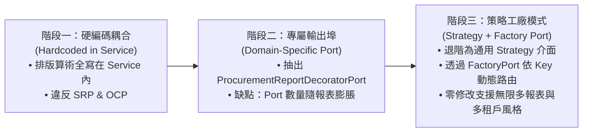
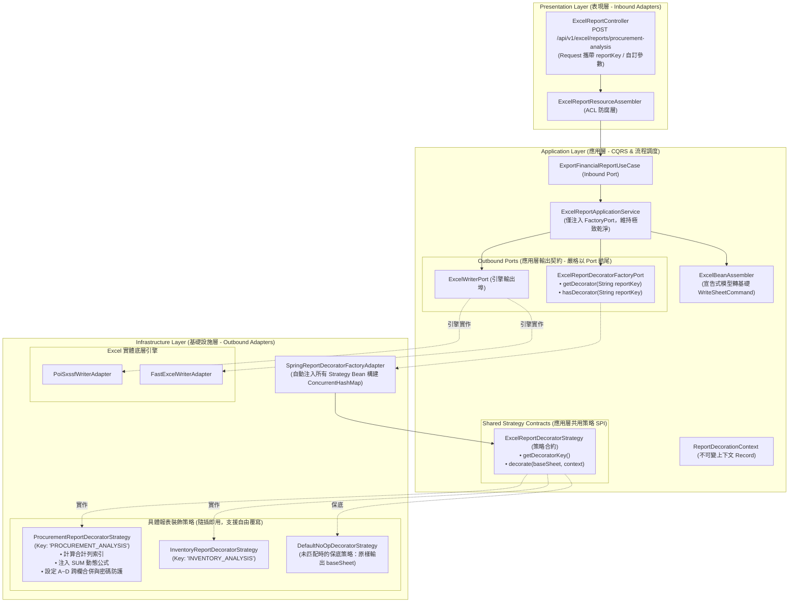
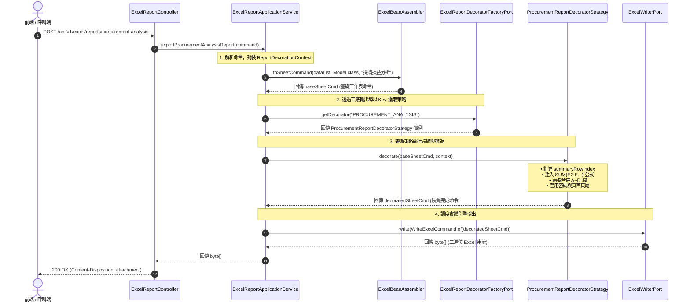

# 維度五 Part 2：企業級報表裝飾策略工廠模式架構設計指南 (Customizable Report Decorator Strategy & Factory Architecture Design)

> 📌 本文件座落於 [`doc/design/template-styles-and-security/02-customizable-report-decorator.md`](file:///d:/桌面/ModuleWorkSpace/excel-module/doc/design/template-styles-and-security/02-customizable-report-decorator.md)，屬於「維度五：企業級報表樣式、公式與安全防護」之【Part 2：企業級報表裝飾策略工廠模式指南】。  
> 詳述 `excel-module` 如何將特定領域之報表排版邏輯「退階泛化」為應用層通用策略契約，結合 **Clean Architecture 六角形架構**、**策略模式 (Strategy Pattern)** 與 **工廠模式 (Factory Pattern)**，透過標準鍵值（`reportKey` / `templateKey` / `styleKey`）動態路由與執行報表裝飾（合計列、跨欄合併、動態 SUM 公式、樣式配色與安全防護）。  
> 
> 🔗 **模組導讀與關聯文件**：  
> • 模組入口主文件：👉 [維度五：企業級報表樣式、動態公式與安全防護架構總覽 (template-styles-and-security.md)](file:///d:/桌面/ModuleWorkSpace/excel-module/doc/design/template-styles-and-security.md)  
> • 底層引擎規範：👉 [維度五 Part 1：Excel 企業級報表樣式、動態公式與安全防護底層引擎規範 (01-engine-styles-and-protection.md)](file:///d:/桌面/ModuleWorkSpace/excel-module/doc/design/template-styles-and-security/01-engine-styles-and-protection.md)

---

## 1. 背景與架構演進動機 (Evolution & Problem Analysis)

### 1.1 架構演進三部曲 (The 3 Stages of Architecture Evolution)



### 1.2 為什麼需要從「專屬 Port」進階為「策略工廠模式」？

在階段二中，我們成功將採購報表的微觀排版算術自 Application Service 抽離至 [`ProcurementReportDecoratorPort`](file:///d:/桌面/ModuleWorkSpace/excel-module/src/main/java/com/example/demo/application/port/out/ProcurementReportDecoratorPort.java)。然而，當系統邁向多業務線、多報表時，專屬 Port 會遭遇以下架構瓶頸：

1. **輸出埠數量爆炸（Port Explosion）**：
   * 若未來新增「庫存盤點表」、「BOM 成本展開表」、「業務提成結算表」，應用層必須為每種報表各自定義專用 Port：
     * `InventoryReportDecoratorPort`
     * `BomCostReportDecoratorPort`
     * `SalesCommissionReportDecoratorPort`
   * 這會導致 Application Service 被迫注入一大堆專屬 Port，或衍生出大量重複樣板程式碼的 Service 類別。
2. **無法因應動態多風格需求（Dynamic Styling & Multi-Tenancy）**：
   * 同一份採購報表，若「集團財務部」需要深藍色主題並附加審計浮水印，而「採購事業部」需要綠色主題與簡潔合計列，靜態綁定單一實作的專用 Port 無法依據 Request 動態切換排版。
3. **缺乏保底防禦機制（Graceful Fallback）**：
   * 若未特別配置裝飾器，專用 Port 容易發生注入失敗；而工廠模式可天生內建 `DefaultNoOpDecoratorStrategy`（原樣輸出基礎工作表，不拋出例外），提供卓越的系統韌性。

---

## 2. 總體架構設計原則 (Architectural Principles)

1. **策略介面退階泛化 (Generalize Strategy Interface & SPI Positioning)**：
   * 將特定於物料採購的裝飾方法「退階」為應用層通用策略契約 [`ExcelReportDecoratorStrategy`](file:///d:/桌面/ModuleWorkSpace/excel-module/src/main/java/com/example/demo/application/shared/strategy/ExcelReportDecoratorStrategy.java)。
   * **架構定位評估與目錄歸屬 (Option A)**：依據 Clean Architecture 與 AGENTS.md Rule 3-8 規範，`application/port/out/` 嚴格僅放置以 `Port` 結尾之 Outbound Port 介面；而 `ExcelReportDecoratorStrategy` 係由工廠輸出埠所生產與調度之策略契約（Strategy SPI / Policy），因此獨立座落於 `application/shared/strategy/`，確保 `port/out/` 維持純正單純的 Gateway Port 邊界。
   * 每個策略具備唯一的識別鍵 `getDecoratorKey()`（如 `"PROCUREMENT_ANALYSIS"`、`"INVENTORY_REPORT"`、`"PROCUREMENT:ENTERPRISE_GREEN"`）。
2. **工廠輸出埠動態查找 (Factory Port & Key-based Routing)**：
   * 在 Application Layer 定義 [`ExcelReportDecoratorFactoryPort`](file:///d:/桌面/ModuleWorkSpace/excel-module/src/main/java/com/example/demo/application/port/out/report/ExcelReportDecoratorFactoryPort.java)。
   * Application Service 只需依賴此工廠輸出埠，傳入 Key 即時取得對應策略，完全不知道底層有哪些具體排版類別。
3. **不可變通用裝飾上下文 (Pure Immutable Context)**：
   * 透過 Java 21 Record 定義 [`ReportDecorationContext`](file:///d:/桌面/ModuleWorkSpace/excel-module/src/main/java/com/example/demo/application/shared/model/ReportDecorationContext.java)，安全傳遞標題、密碼、機密等級、原始資料清單與擴充參數。
4. **自動化策略收錄 (Zero-Config Auto-Registration)**：
   * 在 Infrastructure Layer 的適配器 [`SpringReportDecoratorFactoryAdapter`](file:///d:/桌面/ModuleWorkSpace/excel-module/src/main/java/com/example/demo/infrastructure/adapter/report/SpringReportDecoratorFactoryAdapter.java) 中，利用 Spring 的 `List<ExcelReportDecoratorStrategy>` 自動注入特性，在容器啟動時自動掃描收錄所有策略 Bean，無需手動註冊。
5. **與現有 `ExcelTemplateRegistry` 形成完整閉環**：
   * [`ExcelTemplateRegistry`](file:///d:/桌面/ModuleWorkSpace/excel-module/src/main/java/com/example/demo/infrastructure/template/ExcelTemplateRegistry.java) 負責「依據 Key 路由 **資料模型 (Data Model)**」；
   * `ExcelReportDecoratorFactoryPort` 負責「依據 Key 路由 **版面裝飾策略 (Decorator Strategy)**」；
   * 兩者合一，達成百分之百無侵入之通用報表引擎。

---

## 3. 六角形架構全景與分層職責 (Architecture Blueprint)

### 3.1 系統分層架構圖



### 3.2 呼叫時序圖 (Sequence Diagram)



---

## 4. 詳細契約介面與模型設計 (Specifications & Contracts)

### 4.1 裝飾策略介面：`ExcelReportDecoratorStrategy`
座落於 [`application/shared/strategy/`](file:///d:/桌面/ModuleWorkSpace/excel-module/src/main/java/com/example/demo/application/shared/strategy/ExcelReportDecoratorStrategy.java)，符合純 Java 原則與 Clean Architecture 策略分層規範（Outbound Port 目錄嚴守 Rule 3-8 全數以 `Port` 結尾，策略合約統一置於 `shared/strategy/`）。

```java
package com.example.demo.application.shared.strategy;

import com.example.demo.application.shared.command.WriteSheetCommand;
import com.example.demo.application.shared.model.ReportDecorationContext;

/**
 * 企業級報表裝飾策略介面 (Excel Report Decorator Strategy SPI)
 * <p>
 * 屬於 Clean Architecture 六角形架構應用層共用策略契約（Strategy SPI / Policy）。
 * 定義於 {@code application.shared.strategy} 套件，與 Outbound Port 邊界隔離，
 * 供 {@link com.example.demo.application.port.out.ExcelReportDecoratorFactoryPort} 作為回傳合約。
 */
public interface ExcelReportDecoratorStrategy {

	/**
	 * 策略所支援的唯一識別鍵值 (Key)
	 * <p>
	 * 例如："PROCUREMENT_ANALYSIS"、"INVENTORY_ANALYSIS"、"PROCUREMENT:ENTERPRISE_GREEN"
	 *
	 * @return 唯一識別鍵值字串
	 */
	String getDecoratorKey();

	/**
	 * 對基礎工作表命令執行進階樣式裝飾、公式注入、儲存格合併與安全防護
	 *
	 * @param baseSheet 由 ExcelBeanAssembler 解析模型產出的基礎工作表命令
	 * @param context   通用裝飾上下文 (包含標題、密碼、機密等級、原始資料清單與自訂參數)
	 * @return 裝飾完成之 WriteSheetCommand
	 */
	WriteSheetCommand decorate(WriteSheetCommand baseSheet, ReportDecorationContext context);
}
```

---

### 4.2 工廠輸出埠：`ExcelReportDecoratorFactoryPort`
座落於 `application/port/out/`，以 `Port` 結尾，完全符合 Rule 3-8。

```java
package com.example.demo.application.port.out;

import java.util.Optional;

/**
 * 企業級報表裝飾策略工廠輸出埠 (Excel Report Decorator Factory Outbound Port)
 * <p>
 * 遵循 AGENTS.md 3-8 規範（Outbound Port 一律以 {@code Port} 結尾）。
 * 負責依據報表標識鍵 (Key) 動態獲取對應的 {@link ExcelReportDecoratorStrategy} 裝飾策略。
 */
public interface ExcelReportDecoratorFactoryPort {

	/**
	 * 依據報表 Key 取得對應之裝飾策略實例
	 * <p>
	 * 若未找到精確匹配之策略，應自動回傳保底策略 (如 {@code DefaultNoOpDecoratorStrategy})，保證系統不崩潰。
	 *
	 * @param reportKey 報表標識鍵 (如 "PROCUREMENT_ANALYSIS")
	 * @return 對應之裝飾策略實例 (必不為 null)
	 */
	ExcelReportDecoratorStrategy getDecorator(String reportKey);

	/**
	 * 檢查系統是否已註冊特定 Key 之專屬裝飾策略
	 *
	 * @param reportKey 報表標識鍵
	 * @return 若已註冊專屬策略回傳 true，否則回傳 false
	 */
	boolean hasDecorator(String reportKey);
}
```

---

### 4.3 通用裝飾上下文值物件：`ReportDecorationContext`
座落於 `application/shared/model/`，純 Java 21 Record，零外部框架侵入。

```java
package com.example.demo.application.shared.model;

import java.util.Collections;
import java.util.List;
import java.util.Map;
import java.util.Objects;

/**
 * 通用報表裝飾上下文純資料載體 (Report Decoration Context Value Object)
 * <p>
 * 遵循 AGENTS.md 規範，採用 Java 21 Record 作為應用層不可變純資料載體。
 * 統一封裝報表識別鍵、標題、密碼、機密等級、原始資料清單與額外自訂參數。
 *
 * @param reportKey       報表識別鍵值 (如 "PROCUREMENT_ANALYSIS")
 * @param reportTitle     自訂列印頁首報表標題
 * @param password        工作表防護解鎖密碼
 * @param classification  列印頁尾機密等級標記
 * @param rawDataList     原始業務資料物件清單 (唯讀)
 * @param extraParameters 額外自訂擴充參數對照表 (唯讀)
 */
public record ReportDecorationContext(
		String reportKey,
		String reportTitle,
		String password,
		String classification,
		List<?> rawDataList,
		Map<String, Object> extraParameters
) {

	public ReportDecorationContext {
		Objects.requireNonNull(reportKey, "reportKey must not be null");
		reportTitle = (reportTitle != null && !reportTitle.isBlank()) ? reportTitle.trim() : "企業報表";
		password = (password != null && !password.isBlank()) ? password.trim() : "AuditSecure2026";
		classification = (classification != null && !classification.isBlank()) ? classification.trim() : "內部機密";
		rawDataList = (rawDataList != null) ? List.copyOf(rawDataList) : Collections.emptyList();
		extraParameters = (extraParameters != null) ? Map.copyOf(extraParameters) : Collections.emptyMap();
	}

	/**
	 * 便捷靜態工廠方法
	 */
	public static ReportDecorationContext of(
			String reportKey,
			String reportTitle,
			String password,
			String classification,
			List<?> dataList
	) {
		return new ReportDecorationContext(reportKey, reportTitle, password, classification, dataList, Map.of());
	}
}
```

---

### 4.4 基礎設施工廠適配器：`SpringReportDecoratorFactoryAdapter`
座落於 `infrastructure/adapter/report/`，以 `Adapter` 結尾，完全符合 Rule 3-9。

```java
package com.example.demo.infrastructure.adapter.report;

import java.util.List;
import java.util.Map;
import java.util.concurrent.ConcurrentHashMap;
import java.util.function.Function;
import java.util.stream.Collectors;

import org.slf4j.Logger;
import org.slf4j.LoggerFactory;
import org.springframework.stereotype.Component;

import com.example.demo.application.port.out.ExcelReportDecoratorFactoryPort;
import com.example.demo.application.shared.strategy.ExcelReportDecoratorStrategy;

/**
 * Spring 容器自動收集型報表裝飾策略工廠適配器 (Spring Report Decorator Factory Adapter)
 * <p>
 * 遵循 AGENTS.md 3-9 規範（Outbound Adapter 一律以 {@code Adapter} 結尾）。
 * 實作 {@link ExcelReportDecoratorFactoryPort}。
 * 於 Spring 容器啟動時，自動掃描並收集所有 {@link ExcelReportDecoratorStrategy} 實作 Bean，
 * 建立內部執行緒安全之索引映射表，支援執行期 O(1) 極速動態路由。
 */
@Component
public class SpringReportDecoratorFactoryAdapter implements ExcelReportDecoratorFactoryPort {

	private static final Logger log = LoggerFactory.getLogger(SpringReportDecoratorFactoryAdapter.class);

	private final Map<String, ExcelReportDecoratorStrategy> strategyMap;
	private final ExcelReportDecoratorStrategy fallbackStrategy;

	/**
	 * 透過 Spring 建構子自動注入容器中所有註冊之裝飾策略 Bean
	 */
	public SpringReportDecoratorFactoryAdapter(List<ExcelReportDecoratorStrategy> strategies) {
		this.fallbackStrategy = new DefaultNoOpDecoratorStrategy();
		this.strategyMap = new ConcurrentHashMap<>();

		if (strategies != null) {
			for (ExcelReportDecoratorStrategy strategy : strategies) {
				String key = normalizeKey(strategy.getDecoratorKey());
				this.strategyMap.put(key, strategy);
				log.info("[ReportDecoratorFactory] Registered decorator strategy for key: '{}' -> {}", key, strategy.getClass().getSimpleName());
			}
		}
	}

	@Override
	public ExcelReportDecoratorStrategy getDecorator(String reportKey) {
		if (reportKey == null || reportKey.isBlank()) {
			return fallbackStrategy;
		}
		return strategyMap.getOrDefault(normalizeKey(reportKey), fallbackStrategy);
	}

	@Override
	public boolean hasDecorator(String reportKey) {
		if (reportKey == null || reportKey.isBlank()) {
			return false;
		}
		return strategyMap.containsKey(normalizeKey(reportKey));
	}

	private String normalizeKey(String key) {
		return key.trim().toUpperCase();
	}
}
```

---

### 4.5 採購報表專屬具體策略：`ProcurementReportDecoratorStrategy`
座落於 `infrastructure/report/`（抽離出 `adapter/`，遵循 Rule 2 僅 Port 輸出適配器留於 `adapter/`），實作 `ExcelReportDecoratorStrategy`。

```java
package com.example.demo.infrastructure.report;

import java.util.ArrayList;
import java.util.Arrays;
import java.util.HashMap;
import java.util.List;
import java.util.Map;

import org.springframework.stereotype.Component;

import com.example.demo.application.shared.command.WriteSheetCommand;
import com.example.demo.application.shared.model.CellRange;
import com.example.demo.application.shared.model.ReportDecorationContext;
import com.example.demo.application.shared.model.SheetHeaderFooterConfig;
import com.example.demo.application.shared.model.SheetProtectionConfig;
import com.example.demo.application.shared.strategy.ExcelReportDecoratorStrategy;
import com.example.demo.application.shared.strategy.ExcelReportStrategyKeys;

/**
 * 物料採購損益月報專屬裝飾策略 (Procurement Report Decorator Strategy)
 * <p>
 * 綁定唯一標識鍵 {@link ExcelReportStrategyKeys#PROCUREMENT_ANALYSIS}。
 * 負責採購損益月報之合計彙總列追加、SUM 動態公式計算、A~D 跨欄合併、工作表防護與企業列印頁首頁尾。
 */
@Component
public class ProcurementReportDecoratorStrategy implements ExcelReportDecoratorStrategy {

	public static final String STRATEGY_KEY = ExcelReportStrategyKeys.PROCUREMENT_ANALYSIS;

	@Override
	public String getDecoratorKey() {
		return STRATEGY_KEY;
	}

	@Override
	public WriteSheetCommand decorate(WriteSheetCommand baseSheet, ReportDecorationContext context) {
		int totalDataRows = (context.rawDataList() != null) ? context.rawDataList().size() : 0;
		int summaryRowIndex = totalDataRows + 1; // 0-based
		int excelSummaryRowNumber = summaryRowIndex + 1; // 1-based Excel 列號
		int lastDataRowNumber = totalDataRows + 1;

		// 1. 追加「合計彙總列」資料列
		List<List<Object>> allRows = new ArrayList<>(baseSheet.rows());
		allRows.add(Arrays.asList("合計彙總", null, null, null, null, null, null));

		// 2. 注入合計列動態 SUM 公式：=SUM(E2:E{lastDataRowNumber})
		Map<String, String> formulas = new HashMap<>(baseSheet.cellFormulas());
		formulas.put("E" + excelSummaryRowNumber, "SUM(E2:E" + lastDataRowNumber + ")");

		// 3. 配置跨欄合併區間：合併合計列的 A 至 D 欄 (col 0 ~ 3)
		List<CellRange> mergeRanges = new ArrayList<>(baseSheet.mergedRegions());
		mergeRanges.add(CellRange.ofRow(summaryRowIndex, 0, 3));

		// 4. 配置安全防護與列印標籤
		SheetProtectionConfig protectionConfig = SheetProtectionConfig.ofPassword(context.password());
		SheetHeaderFooterConfig headerFooterConfig = SheetHeaderFooterConfig.enterpriseStandard(
				context.reportTitle(),
				context.classification()
		);

		// 5. 組合最終具備樣式、公式與防護之工作表命令
		return WriteSheetCommand.builder()
				.from(baseSheet)
				.rows(allRows)
				.cellFormulas(formulas)
				.mergedRegions(mergeRanges)
				.protectionConfig(protectionConfig)
				.headerFooterConfig(headerFooterConfig)
				.headerFillColor("1F4E78")
				.headerFontColor("FFFFFF")
				.freezeHeader(true)
				.build();
	}
}
```

---

### 4.6 產品結構與標準成本卷算專屬策略：`BomCostAnalysisReportDecoratorStrategy`
座落於 `infrastructure/report/`（抽離出 `adapter/`，遵循 Rule 2 僅 Port 輸出適配器留於 `adapter/`），實作 `ExcelReportDecoratorStrategy`，專門用於串聯 `Bom` 與 `Material` 領域聚合根：

```java
package com.example.demo.infrastructure.report;

import java.util.ArrayList;
import java.util.Arrays;
import java.util.HashMap;
import java.util.List;
import java.util.Map;

import org.springframework.stereotype.Component;

import com.example.demo.application.shared.command.WriteSheetCommand;
import com.example.demo.application.shared.model.CellRange;
import com.example.demo.application.shared.model.ReportDecorationContext;
import com.example.demo.application.shared.model.SheetHeaderFooterConfig;
import com.example.demo.application.shared.model.SheetProtectionConfig;
import com.example.demo.application.shared.strategy.ExcelReportDecoratorStrategy;
import com.example.demo.application.shared.strategy.ExcelReportStrategyKeys;

/**
 * 產品結構配方與標準成本分析專屬裝飾策略 (BOM Cost Analysis Report Decorator Strategy)
 * <p>
 * 綁定唯一識別鍵 {@link ExcelReportStrategyKeys#BOM_COST_ANALYSIS}。
 * 負責 BOM 成本分析之合計彙總列追加、A~K 欄大跨度跨欄合併、L 欄動態加總 SUM 公式、
 * 商務深海軍藍 (#1B365D) 配色、工作表密碼防護與審計頁首頁尾標籤。
 */
@Component
public class BomCostAnalysisReportDecoratorStrategy implements ExcelReportDecoratorStrategy {

	public static final String STRATEGY_KEY = ExcelReportStrategyKeys.BOM_COST_ANALYSIS;

	@Override
	public String getDecoratorKey() {
		return STRATEGY_KEY;
	}

	@Override
	public WriteSheetCommand decorate(WriteSheetCommand baseSheet, ReportDecorationContext context) {
		int totalDataRows = (context.rawDataList() != null) ? context.rawDataList().size() : 0;
		int summaryRowIndex = totalDataRows + 1; // 0-based
		int excelSummaryRowNumber = summaryRowIndex + 1; // 1-based Excel 列號
		int lastDataRowNumber = Math.max(totalDataRows + 1, 2);

		// 1. 追加「合計彙總列」資料列 (A~K 欄合併，L 欄加總公式)
		String parentInfo = "";
		if (context.extraParameters() != null && context.extraParameters().containsKey("parentMaterialCode")) {
			Object code = context.extraParameters().get("parentMaterialCode");
			Object name = context.extraParameters().get("parentMaterialName");
			parentInfo = " (母件：" + code + (name != null && !name.toString().isBlank() ? " - " + name : "") + ")";
		}
		String summaryText = "【整機 BOM 標準總成本合計】" + parentInfo;

		List<List<Object>> allRows = new ArrayList<>(baseSheet.rows());
		allRows.add(Arrays.asList(
				summaryText, null, null, null, null, null, null, null, null, null, null,
				null, null, null
		));

		// 2. 注入合計列動態 SUM 公式：=SUM(L2:L{lastDataRowNumber})
		Map<String, String> formulas = new HashMap<>(baseSheet.cellFormulas());
		String sumFormula = (totalDataRows > 0) ? "SUM(L2:L" + lastDataRowNumber + ")" : "0.00";
		formulas.put("L" + excelSummaryRowNumber, sumFormula);

		// 3. 配置大跨度跨欄合併區間：合併合計列的 A 至 K 欄 (col 0 ~ 10)
		List<CellRange> mergeRanges = new ArrayList<>(baseSheet.mergedRegions());
		mergeRanges.add(CellRange.ofRow(summaryRowIndex, 0, 10));

		// 4. 配置安全防護密碼與列印標籤
		SheetProtectionConfig protectionConfig = SheetProtectionConfig.ofPassword(
				context.password() != null && !context.password().isBlank() ? context.password().trim() : "BomAuditSecure2026"
		);
		SheetHeaderFooterConfig headerFooterConfig = new SheetHeaderFooterConfig(
				"【機密審計・嚴禁外流】",
				context.reportTitle(),
				"產製時間：&D &T",
				"智慧製造與成本工程系統",
				"第 &P 頁 / 共 &N 頁",
				"【" + context.classification() + "】"
		);

		// 5. 組合最終具備樣式、公式與防護之工作表命令 (深海軍藍 #1B365D + 凍結首列)
		return WriteSheetCommand.builder()
				.from(baseSheet)
				.rows(allRows)
				.cellFormulas(formulas)
				.mergedRegions(mergeRanges)
				.protectionConfig(protectionConfig)
				.headerFooterConfig(headerFooterConfig)
				.headerFillColor("1B365D")
				.headerFontColor("FFFFFF")
				.freezeHeader(true)
				.build();
	}
}
```

---

### 4.7 保底策略：`DefaultNoOpDecoratorStrategy`
座落於 `infrastructure/report/`（抽離出 `adapter/`）。當未指定或找不到對應的裝飾策略時，提供原樣輸出的保底機制，確保系統永不崩潰：

```java
package com.example.demo.infrastructure.report;

import com.example.demo.application.shared.command.WriteSheetCommand;
import com.example.demo.application.shared.model.ReportDecorationContext;
import com.example.demo.application.shared.strategy.ExcelReportDecoratorStrategy;
import com.example.demo.application.shared.strategy.ExcelReportStrategyKeys;

/**
 * 預設無操作保底裝飾策略 (No-Op Fallback Decorator Strategy)
 * <p>
 * 當請求之報表 Key 未註冊任何自訂策略時，原樣回傳基礎工作表命令，確保系統高可用性。
 */
public class DefaultNoOpDecoratorStrategy implements ExcelReportDecoratorStrategy {

	@Override
	public String getDecoratorKey() {
		return ExcelReportStrategyKeys.DEFAULT;
	}

	@Override
	public WriteSheetCommand decorate(WriteSheetCommand baseSheet, ReportDecorationContext context) {
		return baseSheet; // 原樣回傳，不做任何修改
	}
}
```

---

## 5. 重構後 Application Service 的極簡調度

```java
@Service
public class ExcelReportApplicationService implements ExportFinancialReportUseCase {

	private final ExcelWriterPort excelWriterPort;
	private final ExcelReportDecoratorFactoryPort decoratorFactoryPort; // 僅注入工廠輸出埠！
	private final BomRepositoryPort bomRepositoryPort;                 // 注入領域聚合根儲存庫
	private final MaterialRepositoryPort materialRepositoryPort;

	public ExcelReportApplicationService(
			ExcelWriterPort excelWriterPort,
			ExcelReportDecoratorFactoryPort decoratorFactoryPort,
			BomRepositoryPort bomRepositoryPort,
			MaterialRepositoryPort materialRepositoryPort
	) {
		this.excelWriterPort = Objects.requireNonNull(excelWriterPort, "excelWriterPort must not be null");
		this.decoratorFactoryPort = Objects.requireNonNull(decoratorFactoryPort, "decoratorFactoryPort must not be null");
		this.bomRepositoryPort = Objects.requireNonNull(bomRepositoryPort, "bomRepositoryPort must not be null");
		this.materialRepositoryPort = Objects.requireNonNull(materialRepositoryPort, "materialRepositoryPort must not be null");
	}

	@Override
	public byte[] exportBomCostAnalysisReport(ExportBomCostAnalysisCommand command) {
		// 1. 取得 BOM 成本明細資料 (若命令自帶清單則優先使用，否則調用領域儲存庫載入)
		List<BomCostAnalysisReportModel> dataList = (command != null && command.items() != null && !command.items().isEmpty())
				? command.items()
				: resolveBomCostDataFromDomain(command != null ? command.parentMaterialCode() : "MAT-FG-001");

		ReportDecorationContext context = new ReportDecorationContext(
				BomCostAnalysisReportDecoratorStrategy.STRATEGY_KEY,
				command != null ? command.reportTitle() : "產品結構配方與標準成本卷算分析表",
				command != null ? command.password() : "BomAuditSecure2026",
				command != null ? command.classification() : "極機密・核心配方與成本審計",
				dataList,
				Map.of("parentMaterialCode", command != null ? command.parentMaterialCode() : "MAT-FG-001")
		);

		// 2. 透過 ExcelBeanAssembler 解析宣告式模型產出基礎工作表
		WriteSheetCommand baseSheetCmd = ExcelBeanAssembler.toSheetCommand(dataList, BomCostAnalysisReportModel.class, "BOM成本分析");

		// 3. 核心亮點：透過 Factory Port 依 Key 動態取得策略並執行裝飾！
		ExcelReportDecoratorStrategy strategy = decoratorFactoryPort.getDecorator(context.reportKey());
		WriteSheetCommand decoratedSheetCmd = strategy.decorate(baseSheetCmd, context);

		// 4. 調度底層寫入引擎輸出 Excel
		return excelWriterPort.write(WriteExcelCommand.of(decoratedSheetCmd));
	}
}
```

---

## 6. 架構優勢與效益對比 (Comparative Advantages)

| 比較維度 | 階段二 (專案專屬 Port) | 階段三 (策略工廠模式) |
| :--- | :--- | :--- |
| **新增一種報表所需改動** | 需新增專屬 Port 介面，並修改 Application Service 建構子注入新 Port。 | **零修改 Service 排版代碼**。只需寫一個 `@Component` 實作 Strategy，工廠自動收錄。 |
| **動態風格切換 (Multi-Styling)** | ❌ 無法動態切換，寫死在單一 Adapter 中。 | ✅ **原生支援**。Request 傳入 `styleKey` 即可動態切換不同企業配色與排版。 |
| **多租戶支援 (Multi-Tenancy)** | ❌ 無法支援不同客戶不同排版。 | ✅ **支援租戶鍵路由**（如 `STRATEGY_KEY:TENANT_A`）。 |
| **容錯保底機制** | ⚠️ 若未註冊 Bean 則啟動崩潰。 | ✅ 找不到策略自動退化為 `DefaultNoOpDecoratorStrategy`，平穩運行。 |
| **六角形架構合規性** | 符合 Clean Architecture。 | **極致符合 Clean Architecture**，Application Layer 完全不感知具體排版細節。 |

---

## 7. 重構實施步驟清單 (Action Checklist)

* [x] **Step 1**：在 `application/shared/strategy/` 建立策略契約介面 [`ExcelReportDecoratorStrategy.java`](file:///d:/桌面/ModuleWorkSpace/excel-module/src/main/java/com/example/demo/application/shared/strategy/ExcelReportDecoratorStrategy.java)（嚴守 Rule 3-8，避免非 Port 介面污染 `port/out/`）。
* [x] **Step 2**：在 `application/port/out/` 建立工廠輸出埠 [`ExcelReportDecoratorFactoryPort.java`](file:///d:/桌面/ModuleWorkSpace/excel-module/src/main/java/com/example/demo/application/port/out/report/ExcelReportDecoratorFactoryPort.java)。
* [x] **Step 3**：在 `application/shared/model/` 建立通用上下文 [`ReportDecorationContext.java`](file:///d:/桌面/ModuleWorkSpace/excel-module/src/main/java/com/example/demo/application/shared/model/ReportDecorationContext.java)。
* [x] **Step 4**：在 `infrastructure/adapter/report/` 實作工廠適配器 [`SpringReportDecoratorFactoryAdapter.java`](file:///d:/桌面/ModuleWorkSpace/excel-module/src/main/java/com/example/demo/infrastructure/adapter/report/SpringReportDecoratorFactoryAdapter.java)，並將具體裝飾策略與保底策略抽離至 `infrastructure/report/`（[`DefaultNoOpDecoratorStrategy.java`](file:///d:/桌面/ModuleWorkSpace/excel-module/src/main/java/com/example/demo/infrastructure/report/DefaultNoOpDecoratorStrategy.java)）。
* [x] **Step 5**：將既有採購裝飾器重構為具體策略並抽離出 adapter package：[`ProcurementReportDecoratorStrategy.java`](file:///d:/桌面/ModuleWorkSpace/excel-module/src/main/java/com/example/demo/infrastructure/report/ProcurementReportDecoratorStrategy.java)。
* [x] **Step 6**：依據現有 `Bom` 與 `Material` 領域聚合根，建立自訂策略並置於 `infrastructure/report/`：[`BomCostAnalysisReportDecoratorStrategy.java`](file:///d:/桌面/ModuleWorkSpace/excel-module/src/main/java/com/example/demo/infrastructure/report/BomCostAnalysisReportDecoratorStrategy.java)（Key: `ExcelReportStrategyKeys.BOM_COST_ANALYSIS`）。
* [x] **Step 7**：在表現層與應用層擴充 [`ExcelReportController`](file:///d:/桌面/ModuleWorkSpace/excel-module/src/main/java/com/example/demo/presentation/controller/report/ExcelReportController.java) 與 [`ExcelReportApplicationService`](file:///d:/桌面/ModuleWorkSpace/excel-module/src/main/java/com/example/demo/application/service/report/ExcelReportApplicationService.java)，開放 `GET` 與 `POST` 匯出端點。
* [x] **Step 8**：執行全套 Maven 測試，確保 203 測試 100% 通過 (`BUILD SUCCESS`)。

---

## 8. 實戰驗證：領域聚合根自訂報表 API 威力展示 (API Demonstration)

本模組根據領域模型 `Material`（物料聚合根）與 `Bom`（物料清單聚合根），自定義了專屬裝飾策略 `BomCostAnalysisReportDecoratorStrategy`（`BOM_COST_ANALYSIS`），提供完整展示維度五所有特性的實測端點：

### 8.1 一鍵 GET 實測 (瀏覽器 / Swagger 隨點即下)

```bash
# 預設以 MAT-FG-001 (商用巡檢無人機) 自動穿透資料庫聚合根產製 Excel
curl -X GET "http://localhost:8080/api/v1/excel/reports/bom-cost-analysis?materialCode=MAT-FG-001" \
     -o bom_cost_analysis_MAT-FG-001.xlsx
```

### 8.2 POST 實測 (傳入自訂母件或自訂物料子件明細清單)

```bash
curl -X POST "http://localhost:8080/api/v1/excel/reports/bom-cost-analysis" \
     -H "Content-Type: application/json" \
     -d '{
       "parentMaterialCode": "MAT-FG-001",
       "reportTitle": "2026年Q4產品結構與成本分析表",
       "password": "BomAuditSecure888",
       "classification": "極機密・核心配方與成本審計",
       "items": [
         {
           "level": 1,
           "itemSequence": 10,
           "childMaterialCode": "MAT-SFG-001",
           "childMaterialName": "飛控主板電路總成",
           "specification": "STM32H743 Cortex-M7",
           "category": "半成品",
           "unit": "套/組",
           "baseQuantity": 1.00,
           "scrapRate": 0.01,
           "standardCost": 4800.00,
           "positionCode": "FC-ASM",
           "remark": "核心飛控模組"
         },
         {
           "level": 1,
           "itemSequence": 20,
           "childMaterialCode": "MAT-SFG-002",
           "childMaterialName": "2212 動力推進總成 (4組)",
           "specification": "2212 920KV 碳纖快拆",
           "category": "半成品",
           "unit": "套/組",
           "baseQuantity": 4.00,
           "scrapRate": 0.00,
           "standardCost": 680.00,
           "positionCode": "PROP-1~4",
           "remark": "動力系統"
         }
       ]
     }' \
     -o custom_bom_cost_report.xlsx
```

### 8.3 產出 Excel 特性亮點解析

| 特性項目 | 實體展現與效果 |
| :--- | :--- |
| **商務高階配色** | 表頭採用深海軍藍背景（`#1B365D`）搭配白字粗體，並開啟**首列凍結 (Freeze Header)**。 |
| **表身動態小計公式** | 需求用量注入公式 `=H{row}*(1+I{row})`；成本小計注入公式 `=J{row}*K{row}`。在 Excel 中隨意修改單價或用量，數值即時自動重新計算。 |
| **大跨度跨欄合併** | 合計列橫跨第 A 欄至第 K 欄（col 0 至 10）寬幅合併，清楚標註「【整機 BOM 標準總成本合計】 (母件：MAT-FG-001)」。 |
| **動態加總 SUM 公式** | 合計列 L 欄注入原生 `=SUM(L2:L{lastRow})`，完整卷算整機總成本。 |
| **工作表安全防篡改** | 以自訂密碼鎖定工作表（預設 `BomAuditSecure2026`），防止審計公式儲存格被非授權修改。 |
| **企業合規頁首頁尾** | 列印預覽包含頁首報表標題與時間戳記、頁尾動態頁碼（`第 &P 頁 / 共 &N 頁`）與機密等級標記。 |
