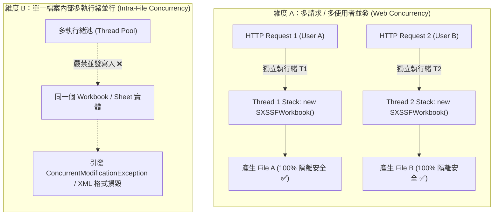
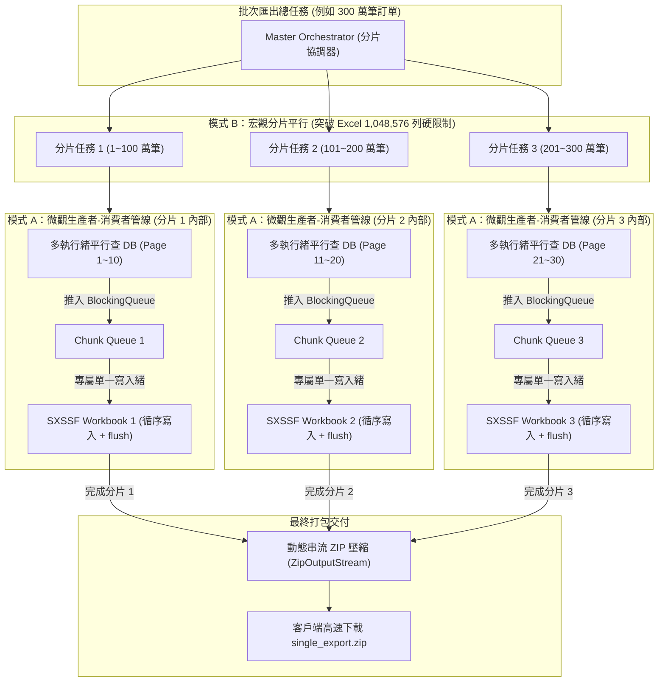

# 高並發與執行緒安全設計架構總覽 (Thread Safety & Concurrency Architecture)

> 📌 本文件座落於 [`doc/design/thread-safety-and-concurrency.md`](file:///d:/桌面/ModuleWorkSpace/excel-module/doc/design/thread-safety-and-concurrency.md)，專門探討與規範 `excel-module` 在多執行緒、高並發 Web 請求以及巨量資料匯出情境下的**執行緒安全 (Thread Safety)** 與**並行加速架構 (Parallel Acceleration Architecture)**。  
> 總體架構請參閱：👉 [Excel 模組架構設計與演進藍圖 (architecture-design.md)](file:///d:/桌面/ModuleWorkSpace/excel-module/doc/design/architecture-design.md)。

---

## 1. 核心結論與問題本質 (Core Verdict & Problem Analysis)

### 1-1. 底層引擎本質：非執行緒安全 (Not Thread-Safe)
在 Java 生態系中，無論是 **Apache POI (`SXSSFWorkbook`, `XSSFWorkbook`, `HSSFWorkbook`)** 還是 **FastExcel (`Workbook`, `Worksheet`)**，官方設計皆明確宣告其底層模型物件（Workbook、Sheet、Row、Cell）**嚴禁跨執行緒同時存取或並行修改**：
1. **SXSSF 滑動視窗暫存沖刷競態**：`SXSSFWorkbook` 透過 `SheetDataWriter` 將超出記憶體視窗（預設 100 列）的列寫出至暫存 XML 檔案，底層無任何同步鎖，多執行緒同時 `createRow()` 會導致 XML 標籤損壞。
2. **全域樣式與字型表共用**：活頁簿共用全域 `StylesTable` 與 `SharedStringsTable`，多執行緒同時建立樣式會破壞內部計數器與索引。
3. **ZIP 串流循序打包限制**：`FastExcel` 與 POI 在輸出時直接以串流循序寫入壓縮封裝，多執行緒寫入同檔案會引發底層 `ZipOutputStream` 錯亂。

### 1-2. 本模組的架構保證：兩大維度清晰劃分

- **維度 A（請求級並發）：100% 執行緒安全 ✅**  
  Spring 服務與 Adapter 均為**無狀態單例 (Stateless Singleton)**，所有工作簿均為方法內部之**區域變數 (Method-Local / Stack Confinement)**，請求間完全隔離。
- **維度 B（單檔內部並行）：底層不支援 ❌**  
  禁止跨執行緒直接對同一個 `Workbook` 呼叫寫入操作；必須透過**「生產者-消費者架構」**或**「多活頁簿分片」**解耦。

---

## 2. 專題子文件導讀與跳轉索引 (Specialized Documentation Navigation)

詳細技術分析與實作程式碼指引已切分收納於專屬目錄 [`doc/design/thread-safety-and-concurrency/`](file:///d:/桌面/ModuleWorkSpace/excel-module/doc/design/thread-safety-and-concurrency/) 中：

| 專題技術文件 | 核心關注點 | 適合閱讀對象 | 涵蓋核心元件 |
| :--- | :--- | :--- | :--- |
| 👉 **[Part 1：執行緒安全深入剖析與棧隔離設計 (01-thread-safety-analysis-and-stack-confinement.md)](file:///d:/桌面/ModuleWorkSpace/excel-module/doc/design/thread-safety-and-concurrency/01-thread-safety-analysis-and-stack-confinement.md)** | **底層安全機制與防禦架構** • SXSSF 與 FastExcel 非執行緒安全深度原理解析 • 無狀態單例與棧隔離 (Stack Confinement) 保證 • `ThreadLocal` 任務上下文生命週期與防污染清除 • `ConcurrentHashMap` 反射中繼資料快取執行緒安全 | 系統架構師、核心中台工程師、高並發後端專家 | `PoiSxssfWriterAdapter` `FastExcelWriterAdapter` `ExcelTaskContextHolder` `ExcelBeanAssembler` |
| 👉 **[Part 2：生產者-消費者管線與多活頁簿 ZIP 分片 (02-producer-consumer-and-multithread-zip-partition.md)](file:///d:/桌面/ModuleWorkSpace/excel-module/doc/design/thread-safety-and-concurrency/02-producer-consumer-and-multithread-zip-partition.md)** | **巨量資料並行加速實作指引** • 模式 A：平行查 DB + 單緒循序串流寫入 (生產者-消費者) • 模式 B：多檔案平行產製 + ZIP 串流打包 (分片平行) • 組合拳模式 A + B：突破 Excel 104 萬列天花板的極致架構 • 實戰程式碼示範、Poison Pill 終止與例外處置 | 大數據匯出開發者、批次排程工程師、效能調優人員 | `WriteStreamExcelCommand` `BlockingQueue` `ZipOutputStream` `SXSSFWorkbook` |
| 👉 **[選型指引：ExcelWriterPort 與 ExcelPartitionWriterPort 設計對比 (excel-writer-vs-partition-writer-comparison.md)](file:///d:/桌面/ModuleWorkSpace/excel-module/doc/design/excel-writer-vs-partition-writer-comparison.md)** | **輸出埠特性比較與選型指引** • 單檔序列化 vs 高並發並行調度 • 架構選型決策樹 (Decision Tree) • 典型場景使用建議與代碼模式對照 | 架構師、資深開發者、業務開發工程師 | `ExcelWriterPort` `ExcelPartitionWriterPort` `ParallelPartitionExcelWriterAdapter` |

---

## 3. 模式 A 與 模式 B 的「組合拳」互補架構 (Complementary Synergy)

業界在處理數百萬至千萬筆資料時，**模式 A 與模式 B 完全不衝突，而是層次分明的組合拳**：

### 互補對比總表

| 比較維度 | 模式 A (微觀管線加速) | 模式 B (宏觀分片拆解) | 模式 A + B 混合架構 (終極組合) |
| :--- | :--- | :--- | :--- |
| **核心目的** | 消除資料庫查詢與業務計算的 I/O 阻塞 | 突破 Excel 單工作表 1,048,576 列限制，防止單檔過大當機 | 同時獲得多核 I/O 查詢高吞吐與多活頁簿平行封裝能力 |
| **執行緒安全手段** | **生產者與消費者解耦**：查資料平行，寫入 Excel 單緒循序 | **活頁簿實體隔離**：每個分片建立獨立的 `SXSSFWorkbook` | 各分片內部循序安全，分片之間互不干涉 |
| **適用資料量級** | 5 萬 ~ 100 萬列 (單一 Excel 檔案上限內) | 超過 100 萬列或需分批歸檔 | 100 萬 ~ 1,000 萬+ 超巨量歷史資料導出 |
| **記憶體特徵** | $O(1)$ 常數視窗沖刷 + 佇列背壓 (Backpressure) | $N \times O(1)$（$N$ 為同時運行的分片 Worker 數） | 記憶體精確可控，無 Full GC / OOM 風險 |

---

## 4. 關鍵設計原則 (Key Architectural Rules)

1. **嚴守無狀態原則**：任何 Outbound Adapter 介面實作類別（如 `ExcelWriterPort`）嚴禁持有 `Workbook`、`Sheet` 或 `OutputStream` 成員變數。
2. **棧隔離 (Stack Confinement)**：所有 Excel 寫入實體生命週期限定於方法呼叫之內，並在 `finally` 區塊明確呼叫 `dispose()` 與 `close()` 清理磁碟暫存檔。
3. **安全使用 ThreadLocal**：跨層上下文（如 `ExcelTaskContextHolder`）必須於 AOP 攔截器之 `finally` 區塊徹底清除，以杜絕 Tomcat / Undertow 執行緒池複用帶來的資料污染。
4. **平行與寫入解耦**：若需透過多執行緒查詢加速，必須以「佇列」或「分批回呼」將資料匯總，由單一執行緒與 Excel 引擎互動。

