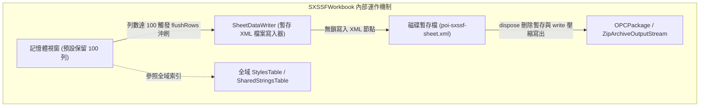
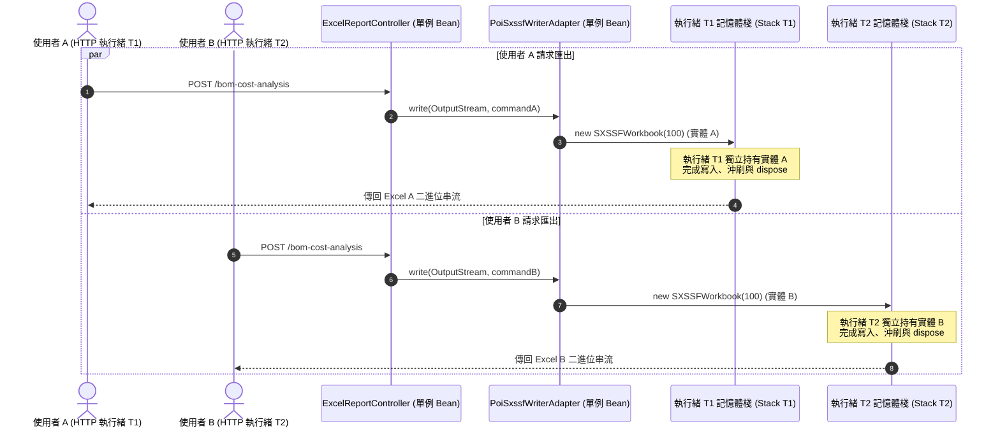
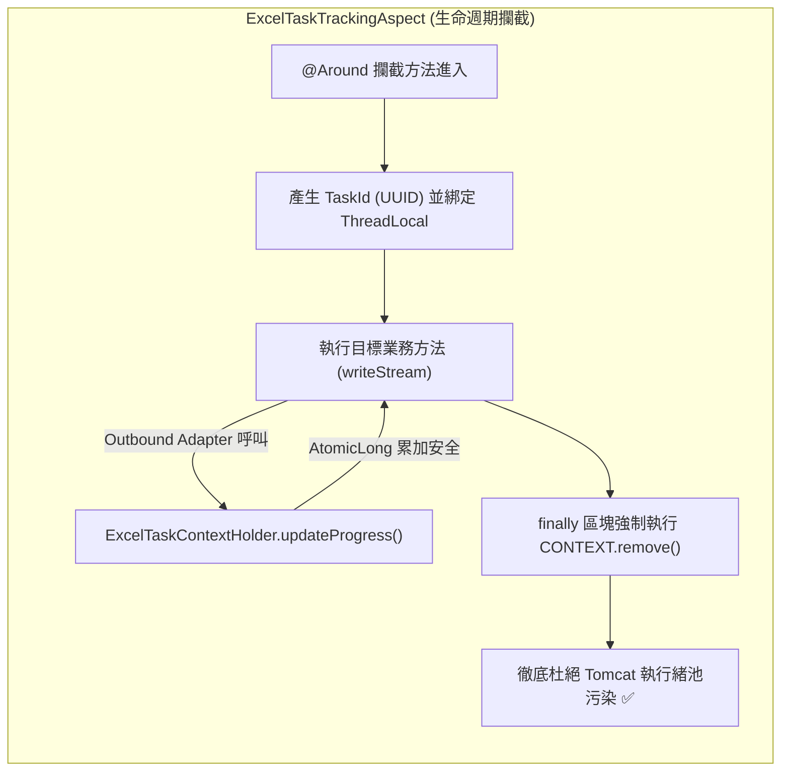

# Part 1：執行緒安全深入剖析與棧隔離設計 (Thread Safety & Stack Confinement)

> 📌 本文件座落於 [`doc/design/thread-safety-and-concurrency/01-thread-safety-analysis-and-stack-confinement.md`](file:///d:/桌面/ModuleWorkSpace/excel-module/doc/design/thread-safety-and-concurrency/01-thread-safety-analysis-and-stack-confinement.md)，深入剖析 Apache POI 與 FastExcel 底層執行緒安全性，並說明本模組如何透過「無狀態單例」、「棧隔離」與「ThreadLocal 安全生命週期」達成 100% 的並發安全。  
> 上層總覽請參閱：👉 [高並發與執行緒安全設計架構總覽 (thread-safety-and-concurrency.md)](file:///d:/桌面/ModuleWorkSpace/excel-module/doc/design/thread-safety-and-concurrency.md)。

---

## 1. 底層引擎非執行緒安全深度剖析 (Underlying Engine Concurrency Internals)

### 1-1. Apache POI SXSSF 核心機制與競態條件
Apache POI 的 `SXSSFWorkbook` 專為串流大數據寫入而設計，其核心記憶體限制機制為「滑動視窗 (Sliding Window)」：



若應用程式允許多個執行緒對「同一個 `SXSSFWorkbook` 或 `SXSSFSheet`」進行並發操作，將引發以下嚴重致命問題：
1. **XML 標籤錯亂損壞 (`Corrupted XML`)**：  
   `SheetDataWriter` 直接透過底層無同步防護的 `Writer` 輸出 `<row r="101"><c ...>...</c></row>` 字串。若 Thread 1 與 Thread 2 同步呼叫 `createRow()`，輸出的 XML 節點將交錯穿插，產出的 `.xlsx` 會在 Excel 開啟時回報「檔案已損毀，無法開啟」。
2. **全域樣式表計數器競態 (`StylesTable Race Condition`)**：  
   在活頁簿中建立儲存格樣式（`workbook.createCellStyle()`）會將樣式註冊進共用的 `List<CTXf>`。此清單非同步容器，多執行緒並發註冊會引發 `ArrayIndexOutOfBoundsException` 或索引重複覆寫。
3. **跨 Sheet 寫入亦不安全**：  
   即使各執行緒分別寫入不同的 `Sheet`（例如 Thread 1 寫 Sheet1，Thread 2 寫 Sheet2），由於 `SXSSFWorkbook` 底層維護統一的 `OPCPackage` 關聯與工作表索引列表，最後呼叫 `workbook.write(outputStream)` 進行組裝壓縮時，關聯中繼資料（`_rels`）仍會發生執行緒競態異常。

---

### 1-2. FastExcel 核心機制與循序寫入限制
FastExcel (`org.dhatim:fastexcel`) 採用無 DOM 抽象的高速寫入策略：
- 寫入時直接透過 `ZipOutputStream` 產生 ZIP entry，並串流寫出 OpenXML 字節。
- 由於底層 `java.util.zip.ZipOutputStream` 本身嚴格要求循序寫入，任何跨執行緒並行呼叫 `worksheet.value()` 或 `worksheet.finish()` 都會直接導致 `ZipException: duplicate entry` 或資料流截斷。

> [!CAUTION]
> **絕對禁止**：跨執行緒共用同一個 `Workbook`、`Worksheet`、`Row` 或 `Cell` 實體。單一檔案的建構必須由單一執行緒從頭到尾循序完成！

---

## 2. 應用層與適配器之棧隔離設計 (Stack Confinement Architecture)

本模組透過「**無狀態服務 (Stateless Service)**」與「**棧隔離 (Stack Confinement)**」徹底解決多使用者/多請求並發問題：



### 關鍵程式碼防護規範 (以 `PoiSxssfWriterAdapter` 為例)
```java
public class PoiSxssfWriterAdapter implements ExcelWriterPort {

    // 1. 類別成員嚴格保持「無狀態」，僅有不可變的常數配置
    private static final int DEFAULT_WINDOW_SIZE = 100;

    @Override
    public void write(OutputStream outputStream, WriteExcelCommand command) {
        // 2. 實體完全限定於方法內部的區域變數 (棧隔離)，各執行緒互不相干
        SXSSFWorkbook workbook = new SXSSFWorkbook(DEFAULT_WINDOW_SIZE);
        workbook.setCompressTempFiles(true);

        try {
            // 3. 循序寫入工作表與資料
            for (WriteSheetCommand sheetCommand : command.getSheets()) {
                writeWorksheet(workbook, sheetCommand);
            }
            workbook.write(outputStream);
            outputStream.flush();
        } catch (IOException e) {
            throw new ExcelWriteException("...", e);
        } finally {
            // 4. 強制清理硬碟暫存檔案，防止暫存磁區洩漏
            workbook.dispose();
            try {
                workbook.close();
            } catch (IOException ignored) {}
        }
    }
}
```

---

## 3. 跨層上下文與快取的執行緒安全機制 (Context & Cache Concurrency Protection)

除了 Excel 引擎實體外，模組內的上下文與中繼資料快取亦落實嚴格的並發安全設計：

### 3-1. `ExcelTaskContextHolder`：安全生命週期與 ThreadLocal 防護
模組提供非同步長任務進度追蹤功能，透過 `ThreadLocal<TaskContext>` 在呼叫鏈路中隱式傳遞任務 ID 與計數器。



1. **計數器原子性**：`TaskContext` 中的 `processedRows` 採用 `AtomicLong`，確保非同步累加時的原子性與記憶體可見性。
2. **防執行緒池污染**：Web 容器（如 Tomcat / Undertow）採用執行緒池複用工作緒。AOP 切面在 `finally` 區塊中百分之百呼叫 `ExcelTaskContextHolder.clear()`，徹底避免 ThreadLocal 殘留導致不同使用者間的資料穿透與記憶體洩漏。

---

### 3-2. `ExcelBeanAssembler`：並發快取與不可變物件
在宣告式 Bean 映射中，每次反射掃描欄位中繼資料具有一定開銷：
- **`METADATA_CACHE`**：採用 `ConcurrentHashMap<Class<?>, ModelMetadata>()`，保證百萬次並發讀取無鎖、並發寫入時具備分段執行緒安全。
- **不可變載體**：`ModelMetadata` 與 `ColumnMetadata` 皆宣告為 Java Record（純不可變物件），快取發布後永不被篡改。
- **執行緒安全時間解析器**：採用 Java 8 現代時間 API `DateTimeFormatter`（官方保證 Immutable and Thread-Safe），取代傳統執行緒不安全的 `SimpleDateFormat`。

---

## 4. 架構驗證檢查清單 (Architecture Verification Checklist)

| 檢驗項目 | 實作策略 | 驗證標準 | 符合狀況 |
| :--- | :--- | :--- | :---: |
| **Spring Bean 無狀態性** | 寫入適配器不保留可變欄位 | 類別內無可變實體屬性，多緒共用 Bean 互不影響 | ✅ 符合 |
| **Excel 實體棧隔離** | `SXSSFWorkbook` / `Workbook` 限於方法內部 | 區域變數隔離於各自線程 Stack，無共享風險 | ✅ 符合 |
| **暫存檔確定銷毀** | `finally` 區塊呼叫 `dispose()` | 即使業務邏輯拋出例外，磁碟暫存檔仍被安全刪除 | ✅ 符合 |
| **ThreadLocal 安全清理** | AOP `finally` 呼叫 `clear()` | 每次執行緒返回執行緒池前必定重置上下文 | ✅ 符合 |
| **中繼資料快取安全** | 採用 `ConcurrentHashMap` + Record | 高並發反射讀寫安全，無鎖競爭損耗 | ✅ 符合 |

