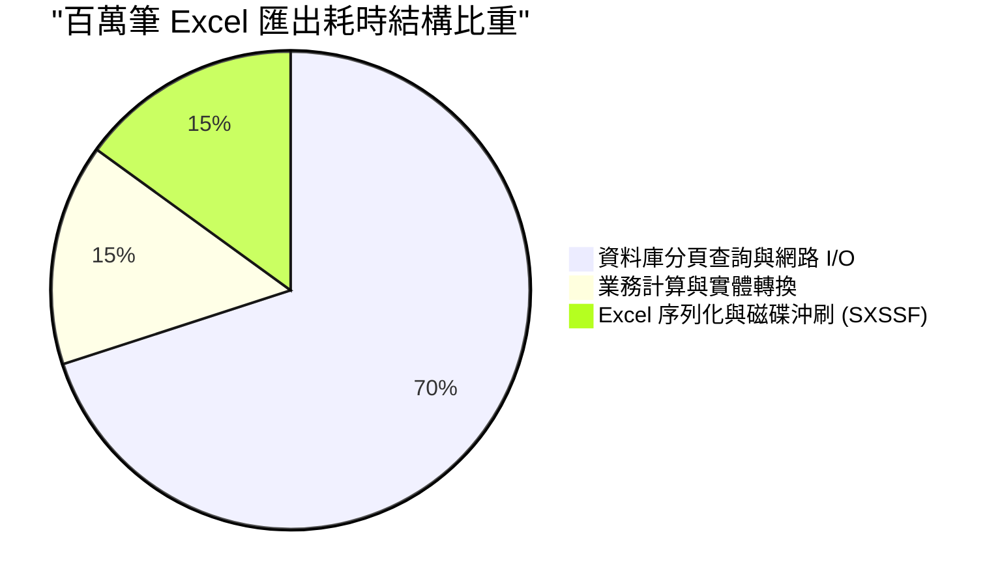
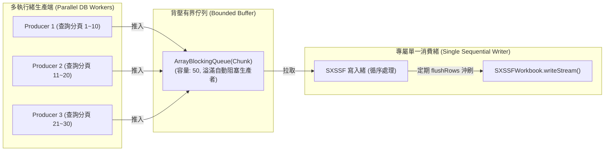
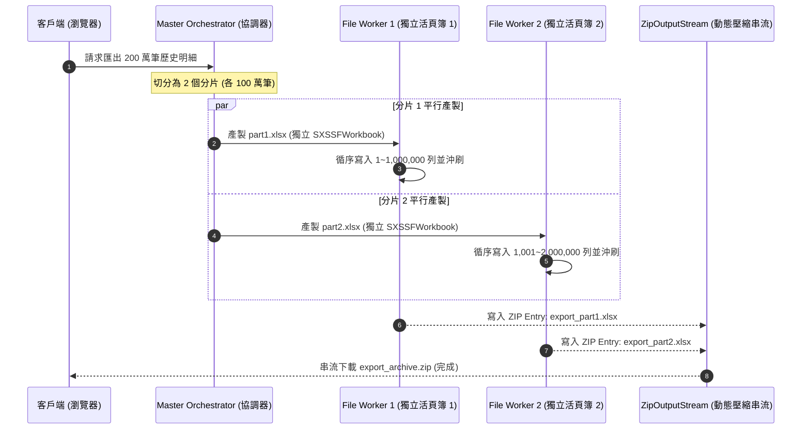
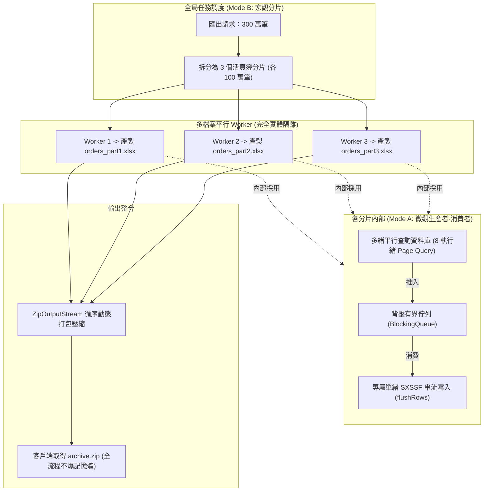

# Part 2：生產者-消費者管線與多活頁簿 ZIP 分片 (Producer-Consumer & ZIP Partition)

> 📌 本文件座落於 [`doc/design/thread-safety-and-concurrency/02-producer-consumer-and-multithread-zip-partition.md`](file:///d:/桌面/ModuleWorkSpace/excel-module/doc/design/thread-safety-and-concurrency/02-producer-consumer-and-multithread-zip-partition.md)，提供百萬級至千萬級巨量資料匯出的加速實作指引，詳述「模式 A (微觀生產者-消費者管線)」與「模式 B (宏觀多活頁簿 ZIP 分片)」之設計與代碼模式。  
> 上層總覽請參閱：👉 [高並發與執行緒安全設計架構總覽 (thread-safety-and-concurrency.md)](file:///d:/桌面/ModuleWorkSpace/excel-module/doc/design/thread-safety-and-concurrency.md)。

---

## 1. 核心效能瓶頸剖析 (Performance Bottleneck Reality)

在分析如何並行加速前，必須清楚巨量資料匯出的**耗時佔比分布**：



- **真正瓶頸在資料庫與運算**：約有 70%~85% 的時間耗在 SQL 執行、網路傳輸與業務邏輯計算。SXSSF 或 FastExcel 的循序寫入速度每秒可達 1~3 萬列，反而是寫入端常常處於「等待資料提供」的飢餓狀態。
- **結論**：只要將**「資料查詢/運算 (多執行緒平行)」**與**「Excel 序列化 (單執行緒循序)」**解耦，就能釋放 70% 以上的平行潛能，且完全不違背 POI/FastExcel 的單緒安全約束！

---

## 2. 模式 A：微觀生產者-消費者管線 (Producer-Consumer Pipeline)

### 2-1. 設計原理與背壓控制 (Backpressure)
模式 A 適用於**單一 Excel 活頁簿內（1 萬 ~ 100 萬列）**的極速匯出：
- **生產者 (多個 DB 工作緒)**：透過執行緒池平行分段查詢資料庫（例如依 ID 區間或分頁查詢），並將轉換好的資料區塊（Chunk）推入有界阻斷佇列 (`ArrayBlockingQueue`)。
- **背壓防護 (Backpressure)**：設定佇列容量上限（如 50 個 Chunks），當生產速度大於消費速度時，生產緒自動阻塞，**嚴格杜絕記憶體累積暴增引發 OOM**。
- **消費者 (專屬單一寫入緒)**：從佇列持續取出 Chunk，直接呼叫 `PoiSxssfWriterAdapter.writeStream()`，每滿 100 列執行 `sheet.flushRows(0)` 沖刷磁碟。
- **安全終止 (Poison Pill Pattern)**：當所有生產者完成時，推入一枚「毒丸物件 (Poison Pill)」，通知消費者安全關閉檔案。



---

### 2-2. 模式 A 實作程式碼模式 (Implementation Pattern)

```java
public class StreamExportPipelineService {

    private final ExecutorService producerPool = Executors.newFixedThreadPool(4);
    private final ExcelWriterPort excelWriterPort;

    // 定義有界佇列，避免查出過多資料撐爆記憶體
    private static final int QUEUE_CAPACITY = 30;
    private static final List<List<Object>> POISON_PILL = Collections.emptyList();

    public void exportLargeDataset(OutputStream outputStream, long totalRows, int chunkSize) throws Exception {
        BlockingQueue<List<List<Object>>> queue = new ArrayBlockingQueue<>(QUEUE_CAPACITY);
        int totalChunks = (int) Math.ceil((double) totalRows / chunkSize);
        CountDownLatch producerLatch = new CountDownLatch(totalChunks);

        // 1. 啟動多個生產者執行緒平行查詢資料庫
        for (int i = 0; i < totalChunks; i++) {
            final int chunkIndex = i;
            producerPool.submit(() -> {
                try {
                    List<List<Object>> rows = queryDataChunkFromDb(chunkIndex * chunkSize, chunkSize);
                    queue.put(rows); // 隊列滿時自動阻塞背壓
                } catch (InterruptedException e) {
                    Thread.currentThread().interrupt();
                } finally {
                    producerLatch.countDown();
                }
            });
        }

        // 2. 獨立執行緒監控生產進度，完成後放入毒丸
        CompletableFuture.runAsync(() -> {
            try {
                producerLatch.await();
                queue.put(POISON_PILL); // 推入毒丸通知消費結束
            } catch (InterruptedException e) {
                Thread.currentThread().interrupt();
            }
        });

        // 3. 消費者在「當前主執行緒」中循序寫入 Excel (符合單緒安全要求)
        Iterable<List<Object>> streamIterable = () -> new Iterator<>() {
            private List<List<Object>> currentChunk = Collections.emptyList();
            private int indexInChunk = 0;
            private boolean finished = false;

            @Override
            public boolean hasNext() {
                if (indexInChunk < currentChunk.size()) return true;
                if (finished) return false;

                try {
                    currentChunk = queue.take(); // 阻塞等待下一個 Chunk
                    if (currentChunk == POISON_PILL) {
                        finished = true;
                        return false;
                    }
                    indexInChunk = 0;
                    return !currentChunk.isEmpty();
                } catch (InterruptedException e) {
                    Thread.currentThread().interrupt();
                    return false;
                }
            }

            @Override
            public List<Object> next() {
                return currentChunk.get(indexInChunk++);
            }
        };

        // 4. 委託給具備常數記憶體沖刷之 SXSSF 寫入適配器
        WriteStreamSheetCommand sheetCommand = new WriteStreamSheetCommand(
                "巨量資料", getHeaders(), streamIterable, 100, true
        );
        excelWriterPort.writeStream(outputStream, new WriteStreamExcelCommand("BatchApp", "1.0", List.of(sheetCommand)));
    }
}
```

---

## 3. 模式 B：宏觀多活頁簿 ZIP 分片 (Multi-Workbook Partition & ZIP)

### 3-1. 為什麼必須有分片架構？
1. **Excel 實體上限**：單一 Sheet 的最大列數極限為 **$1,048,576$ 列**。如果匯出 300 萬筆，單檔單表必然失敗。
2. **客戶端軟體體驗**：超過 100MB 或 50 萬筆以上的單一 `.xlsx` 檔案，一般使用者的 Excel 桌面端開啟時極易卡頓甚至崩潰。
3. **分片平行**：將 300 萬筆拆分成 3 個獨立任務（各 100 萬筆），每個任務建立獨立的 `SXSSFWorkbook`，在不同的 CPU 核心上**真正完全並行**。



---

## 4. 模式 A + 模式 B：超大規模巨量資料的「終極組合拳」

當面對 **300 萬 ~ 1,000 萬筆** 以上的企業級歷史數據導出時，兩者疊加形成最強架構：



### 架構核心優勢總結
1. **多核心極致利用**：宏觀層面有多個活頁簿在並行，微觀層面有資料庫並行查詢，CPU 算力與網路帶寬得以完全飽和。
2. **百分之百執行緒安全**：
   - 宏觀層：每個 Worker 建立自己的 `SXSSFWorkbook`，實體彼此隔離，無任何競態。
   - 微觀層：每個 Workbook 內部由單一消費者緒專屬寫入，完全符合 POI / FastExcel 的單緒設計規範。
3. **記憶體極限控制 ($N \times O(1)$)**：
   - 無論匯出幾百萬筆，記憶體佔用只取決於「分片工作緒數量 $\times$ 佇列容量 $\times$ 滑動視窗大小」，GC 負擔極輕，徹底告別 OOM。

