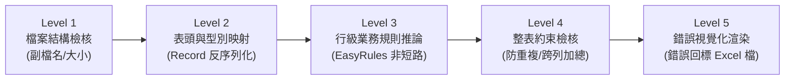

# Excel 客製驗證與「錯誤回標檔」使用與維護手冊 (Custom Validation & Error Feedback Manual)

> 📌 **文件位置**：`doc/maintenance/custom-validation-and-error-feedback-manual.md`  
> 🎯 **適用對象**：後端開發人員、系統維運人員、前端整合工程師、測試工程師  
> 🏷️ **核心技術**：Java 21 Record、EasyRules 規則引擎、Apache POI SXSSF、Clean Architecture  
> 📖 **測試操作手冊**：[`doc/test/custom_validation_testing_guide.md`](file:///d:/桌面/ModuleWorkSpace/excel-module/doc/test/custom_validation_testing_guide.md)  
> 📁 **實體測試範本**：[`doc/template/README.md`](file:///d:/桌面/ModuleWorkSpace/excel-module/doc/template/README.md)

---

## 目錄 (Table of Contents)
- [1. 模組簡介與痛點解決](#1-模組簡介與痛點解決)
- [2. 五層檢核管線全貌](#2-五層檢核管線全貌)
- [3. 開發指南：4 步驟新增自訂業務規則](#3-開發指南4-步驟新增自訂業務規則)
- [4. 錯誤事實模型與視覺化回標機制](#4-錯誤事實模型與視覺化回標機制)
- [5. 對外 REST API 調用手冊](#5-對外-rest-api-調用手冊)
- [6. 與工作區模組協同策略](#6-與工作區模組協同策略)
- [7. 常見問題與維運排查 (FAQ)](#7-常見問題與維運排查-faq)

---

## 1. 模組簡介與痛點解決

在傳統的 Excel 批次匯入業務中，系統常面臨兩大嚴重痛點：
1. **「改一筆、傳一次、爆一次」 (Fail-Fast 體驗極差)**：後端只要遇到一筆資料出錯就中斷拋出例外，使用者必須反覆修改上傳十幾次。
2. **文字報錯定位困難**：回傳訊息如 `第 35 列金額錯誤`，使用者需要手動開啟 Excel 核對，排查溝通成本高。

### 本模組的核心價值：
* **全量錯誤累積模式 (Accumulate Mode)**：一次性完整掃描試算表所有資料行，收集所有欄位違規細節。
* **輕量級規則引擎解耦 (EasyRules)**：業務規則獨立為 POJO，告別傳統 `if-else` 義大利麵程式碼。
* **視覺化「錯誤回標檔」生成**：保留原始上傳 Excel 排版，出錯儲存格套用**淡紅底深紅字**，最右側自動追加**錯誤原因說明欄**，使用者改完即可直接重新匯入！

---

## 2. 五層檢核管線全貌

資料自上傳至生成回標檔，依序流經以下 5 道檢核管線：



| 管線層級 | 檢核類型 | 負責組件 | 檢核職責與說明 |
| :--- | :--- | :--- | :--- |
| **Level 1** | **檔案物理層** | Controller / Jakarta Validation | 檢查檔案是否為空、副檔名是否為 `.xlsx`/`.xls`、檔案大小是否超標。 |
| **Level 2** | **資料結構層** | `ExcelBeanAssembler` | 驗證必要欄位表頭是否存在，將儲存格二維資料轉換為強型別 Java Record / JavaBean。 |
| **Level 3** | **行級業務層** | `EasyRulesExcelValidatorAdapter`<br/>+ POJO Rules | 核心業務規則推論（金額非負、數量區間、狀態碼檢核等），收集 `List<ExcelRowError>`。 |
| **Level 4** | **整表統計層** | `ExcelSheetValidatorPort` | 跨列集合約束（料號全表唯一性、明細金額總和與表身加總對帳）。 |
| **Level 5** | **回標渲染層** | `PoiExcelErrorMarkerAdapter` | 若存在錯誤事實，自動產製原版樣式淡紅底深紅字高亮，並追加錯誤說明欄之回標檔。 |

---

## 3. 開發指南：4 步驟新增自訂業務規則

模組已在 [`infrastructure/validator/rules/`](file:///d:/桌面/ModuleWorkSpace/excel-module/src/main/java/com/example/demo/infrastructure/validator/rules/) 封裝了泛型抽象基類 [`AbstractExcelRowValidationRule<T>`](file:///d:/桌面/ModuleWorkSpace/excel-module/src/main/java/com/example/demo/infrastructure/validator/rules/AbstractExcelRowValidationRule.java)。新增自訂規則時，**不需修改任何既有 Service 或 Controller**。

### 步驟 1：建立規則類別並繼承抽象基類
指定目標資料模型類別（支援 JavaBean 與 Java 21 Record）：

```java
package com.example.demo.infrastructure.validator.rules;

import java.math.BigDecimal;
import org.jeasy.rules.annotation.Rule;
import org.springframework.stereotype.Component;
import com.example.demo.application.shared.model.ExcelRowError;
import com.example.demo.application.shared.model.OrderModel;

/**
 * 訂單金額合法性檢核規則 (Order Amount Validation Rule)
 */
@Component
@Rule(name = "OrderAmountValidationRule", description = "驗證訂單購買金額必須大於零", priority = 1)
public class OrderAmountValidationRule extends AbstractExcelRowValidationRule<OrderModel> {

    public OrderAmountValidationRule() {
        super(OrderModel.class);
    }
```

### 步驟 2：標註 `@Component` 與 `@Rule`
* `@Component`：交由 Spring 自動掃描並注入至 `EasyRulesExcelValidatorAdapter`。
* `@Rule(name = "...", priority = n)`：設定規則唯一名稱與優先級（`priority` 數字越小越優先執行）。

### 步驟 3：覆寫 `isInvalid(...)` 業務判斷邏輯
編寫純 Java 業務邏輯，回傳 `true` 即代表違規（需報錯）：
```java
    @Override
    public boolean isInvalid(OrderModel order) {
        BigDecimal amount = order.getAmount();
        return amount == null || amount.compareTo(BigDecimal.ZERO) <= 0;
    }
```

### 步驟 4：覆寫 `createError(...)` 組裝錯誤事實
利用基類內建的語意化輔助方法 `errorOfCell` 或 `errorOfRow`：
```java
    @Override
    public ExcelRowError createError(OrderModel order, int rowIndex) {
        return errorOfCell(
                rowIndex,
                2,                      // C 欄 (購買金額)
                "購買金額",              // 欄位標題
                order.getAmount(),      // 使用者輸入之原始違規值
                "購買金額必須大於 0.00",  // 給使用者看的白話錯誤提示
                "INVALID_ORDER_AMOUNT"  // 業務規則錯誤代碼
        );
    }
}
```

---

## 4. 錯誤事實模型與視覺化回標機制

### 4.1 錯誤事實載體：[`ExcelRowError`](file:///d:/桌面/ModuleWorkSpace/excel-module/src/main/java/com/example/demo/application/shared/model/ExcelRowError.java)
```java
public record ExcelRowError(
    int rowIndex,        // 1-based 列號 (對齊 Excel 實際行數)
    int columnIndex,     // 0-based 欄號 (-1 代表整列層級錯誤)
    String columnName,   // 欄位名稱 (如 "購買金額")
    Object invalidValue, // 使用者填入的原始無效資料 (如 -500)
    String errorMessage, // 錯誤詳細原因 (如 "購買金額必須大於 0.00")
    String ruleCode      // 規則唯一代碼 (如 "INVALID_ORDER_AMOUNT")
) implements Serializable
```

### 4.2 回標檔視覺化標準
由 [`PoiExcelErrorMarkerAdapter`](file:///d:/桌面/ModuleWorkSpace/excel-module/src/main/java/com/example/demo/infrastructure/adapter/PoiExcelErrorMarkerAdapter.java) 負責繪製：
* **出錯儲存格樣式**：
  * 背景填色：淡紅色 (`#FFC7CE` / `IndexedColors.ROSE`)
  * 字體樣式：粗體深紅字 (`#9C0006` / `IndexedColors.DARK_RED`)
* **動態追加說明欄**：
  * 在工作表最後一欄追加標題：`檢核結果與錯誤原因 (Validation Errors)`
  * 彙整同一列的多個錯誤（若該列有 2 個欄位出錯，以分號串接，如：`[購買金額] 購買金額必須大於 0.00; [數量] 購買數量必須為正整數`）
  * 欄寬自適應擴充為 35 字元寬度。

---

## 5. 對外 REST API 調用手冊

控制器具體落地於 [`ExcelValidationController.java`](file:///d:/桌面/ModuleWorkSpace/excel-module/src/main/java/com/example/demo/presentation/controller/ExcelValidationController.java)，遵循 OCP 開放封閉原則，收斂為 5 隻核心端點：

### 5.1 OCP 統一動態範本校驗 API (支援 orders, products, materials, boms 等所有業務)

#### 模式 A：純 JSON 檢核報告 (前端預檢)
* **端點**：`POST /api/v1/excel/validation/{templateKey}`（例如 `/orders`, `/products`）
* **Content-Type**：`multipart/form-data`
* **Form 欄位**：`file`（`.xlsx` 檔案）
* **cURL 範例**：
  ```bash
  curl -X POST "http://localhost:8080/api/v1/excel/validation/orders" \
       -H "Content-Type: multipart/form-data" \
       -F "file=@orders_with_errors.xlsx"
  ```
* **回應情境**：
  * 若完全合格：HTTP 200 OK
  * 若包含錯誤：HTTP 422 Unprocessable Entity
* **JSON 回應範例**：
  ```json
  {
    "valid": false,
    "totalRows": 5,
    "validRowCount": 3,
    "errorCount": 2,
    "errors": [
      {
        "rowIndex": 2,
        "columnIndex": 2,
        "columnName": "購買金額",
        "invalidValue": -50.0,
        "errorMessage": "購買金額必須大於 0.00",
        "ruleCode": "INVALID_ORDER_AMOUNT"
      },
      {
        "rowIndex": 4,
        "columnIndex": 3,
        "columnName": "數量",
        "invalidValue": 10000,
        "errorMessage": "購買數量必須為正整數且不可超過 9,999",
        "ruleCode": "INVALID_ORDER_QUANTITY"
      }
    ]
  }
  ```

#### 模式 B：視覺化「錯誤回標檔」直接下載 (OCP 統一接口)
* **端點**：`POST /api/v1/excel/validation/{templateKey}/feedback`（例如 `/orders/feedback`, `/products/feedback`）
* **Content-Type**：`multipart/form-data`
* **cURL 範例**：
  ```bash
  curl -X POST "http://localhost:8080/api/v1/excel/validation/orders/feedback" \
       -F "file=@orders_with_errors.xlsx" \
       --output "訂單錯誤修正檔.xlsx"
  ```
* **回應行為**：
  * 若完全無錯誤：智能降級回傳 HTTP 200 OK 及合格 JSON 報告。
  * 若存在任何錯誤：直接回傳二進位串流，瀏覽器或客戶端自動觸發下載帶有紅底標註的 `訂單檢核錯誤回標檔.xlsx`。

---

### 5.2 Zero-Config 智慧自動探測回標 API
* **端點**：`POST /api/v1/excel/validation/feedback`
* **特點**：呼叫端免填 `templateKey`，後端由第一個工作表名稱（如「訂單匯入清單」）自動探測對應模型並執行檢核與回標生成。

---

### 5.3 範本探索與 AOP 宣告式端點
* **範本探索**：`GET /api/v1/excel/validation/templates`（查詢可用範本元數據）
* **宣告式 AOP 示範**：`POST /api/v1/excel/validation/declarative/orders`（`@ValidateExcel` 自動攔截防守並注入 `@ValidatedExcelData List<OrderModel>`）

---

## 6. 與工作區模組協同策略

當專案引入工作區的 [`customized-validation-module`](file:///d:/桌面/ModuleWorkSpace/customized-validation-module/README.md) 時，兩者協同分工如下：

```text
[使用者上傳 Excel]
       │
       ▼
【customized-validation-module】 (防腐層與動態資料庫規則)
  • 工作表名稱正規化 (例如 "訂單清單" 映射為 "OrderSheet")
  • 欄位別名正規化 (例如 "訂單金額"、"總價" 統一對齊為 "amount")
  • 資料庫 SpEL 動態白名單檢核 (如 #validateVendorCode(vendId))
       │
       ▼ 格式與動態規則通過
【excel-module】 (核心模型解析與深度業務推論)
  • ExcelBeanAssembler 高性能反序列化
  • EasyRules 複雜業務規則編排 (多條件、優先級排程)
  • 產製「淡紅底＋深紅字＋錯誤原因欄」之視覺化回標檔
```

---

## 7. 常見問題與維運排查 (FAQ)

### Q1：自訂的規則類別沒有被觸發執行？
* **檢查 1**：該規則類別是否已加上 Spring `@Component` 註解？（缺少此註解 Spring 不會自動實例化 Bean）。
* **檢查 2**：該規則類別是否標註了 EasyRules `@Rule` 註解？
* **檢查 3**：建構子中的 `super(TargetClass.class)` 是否與目前正在檢核的實體 Class 完全一致？若泛型不匹配，基類防護機制會自動略過。

### Q2：如何讓一條規則同時報出多個欄位的錯誤？
覆寫基類的 `createErrors(item, context, rowIndex)` 方法，回傳 `List<ExcelRowError>`：
```java
@Override
public List<ExcelRowError> createErrors(OrderModel order, ExcelValidationContext<?> context, int rowIndex) {
    return List.of(
        errorOfCell(rowIndex, 2, "購買金額", order.getAmount(), "金額異常", "ERR_01"),
        errorOfCell(rowIndex, 3, "數量", order.getQuantity(), "數量異常", "ERR_02")
    );
}
```

### Q3：整表唯一性（防重複）要在哪裡寫？
對於跨列防重複或加總對帳等整表約束，請實作應用層 Outbound Port [`ExcelSheetValidatorPort<T>`](file:///d:/桌面/ModuleWorkSpace/excel-module/src/main/java/com/example/demo/application/port/out/ExcelSheetValidatorPort.java)，並透過 `context.allRows()` 走訪整表快照進行重複性過濾。

---

## 8. 宣告式 AOP 攔截架構 (@ValidateExcel & @ValidatedExcelData)

為消除 Controller 或業務方法中繁瑣的手動檢核與例外處置樣板代碼，模組支援**宣告式註解驅動架構 (Annotation-Driven Architecture)**。

### 8.1 核心註解與切面角色

| 類別 / 註解 | 套件與架構分層 | 職責與用途 |
| :--- | :--- | :--- |
| [`@ValidateExcel`](file:///d:/桌面/ModuleWorkSpace/excel-module/src/main/java/com/example/demo/application/annotation/validation/ValidateExcel.java) | `application/annotation/validation/` | 宣告於方法上方，指定目標模型 `model()`、處置策略 `action()` 與回標檔名。 |
| [`@ValidatedExcelData`](file:///d:/桌面/ModuleWorkSpace/excel-module/src/main/java/com/example/demo/application/annotation/validation/ValidatedExcelData.java) | `application/annotation/validation/` | 宣告於 Controller 方法參數，由 Spring MVC 與 AOP 自動注入 100% 合格之模型清單。 |
| [`ExcelValidationAspect`](file:///d:/桌面/ModuleWorkSpace/excel-module/src/main/java/com/example/demo/presentation/aspect/ExcelValidationAspect.java) | `presentation/aspect/` | 表現層前置防衛切面（Inbound Guard），前置攔截 `MultipartFile`，依策略執行自動回標短路或例外拋出。 |
| [`ExcelValidationContextHolder`](file:///d:/桌面/ModuleWorkSpace/excel-module/src/main/java/com/example/demo/application/shared/context/ExcelValidationContextHolder.java) | `application/shared/context/` | `ThreadLocal` 執行緒上下文保持器，安全透傳合格檢核結果，防範記憶體洩漏。 |
| [`ValidatedExcelDataArgumentResolver`](file:///d:/桌面/ModuleWorkSpace/excel-module/src/main/java/com/example/demo/presentation/resolver/ValidatedExcelDataArgumentResolver.java) | `presentation/resolver/` | Spring MVC 自訂參數解析器，支援直接綁定 `List<T>` 免去反射建構例外。 |

### 8.2 兩種攔截處置策略 (OnErrorAction)

#### 模式 1：AUTO_FEEDBACK（自動回標短路阻斷）
* **適用場景**：提供使用者極佳的前端檔案匯入體驗。
* **行為**：若上傳之 Excel 含有任何違規，切面在進入 Controller 方法前**直接短路阻斷**，即時生成套用淡紅底深紅字高亮標註之 `.xlsx` 錯誤回標檔並回傳瀏覽器下載；若完全合格，才放行進入方法，並將乾淨資料注入入參。
```java
@PostMapping("/declarative/orders")
@ValidateExcel(
    model = OrderModel.class,
    action = ValidateExcel.OnErrorAction.AUTO_FEEDBACK,
    feedbackFilename = "訂單檢核錯誤回標檔.xlsx"
)
public ResponseEntity<ExcelValidatedResource> importOrders(
        @RequestParam("file") MultipartFile file,
        @ValidatedExcelData List<OrderModel> validOrders) {
    // 進入此處代表「100% 合格」，業務方法無需撰寫任何反序列化與防守邏輯！
    return ResponseEntity.ok(new ExcelValidatedResource(true, validOrders.size(), validOrders.size(), 0, List.of(), validOrders));
}
```

#### 模式 2：THROW_EXCEPTION（全域例外轉譯）
* **適用場景**：前後端分離 SPA 系統或微服務 RPC 呼叫。
* **行為**：若發現資料違規，切面拋出 [`ExcelValidationFailedException`](file:///d:/桌面/ModuleWorkSpace/excel-module/src/main/java/com/example/demo/application/shared/exception/ExcelValidationFailedException.java)，由 [`GlobalExceptionHandler`](file:///d:/桌面/ModuleWorkSpace/excel-module/src/main/java/com/example/demo/presentation/exception/GlobalExceptionHandler.java) 統一攔截轉譯為 `HTTP 422 Unprocessable Entity` 全量錯誤 JSON。


