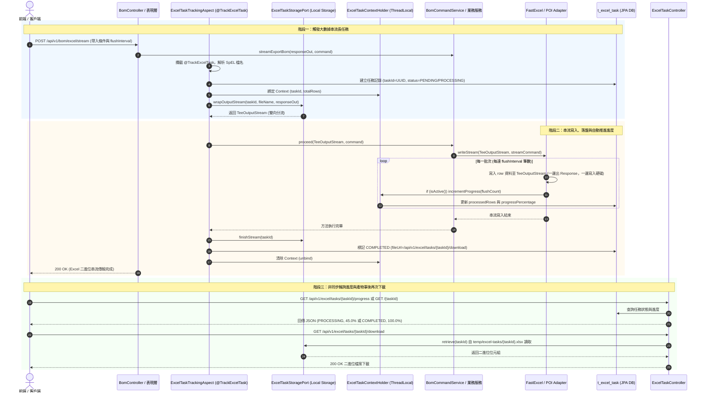

# Excel 宣告式長任務 (Annotation-Driven Task) 測試與驗證指南

> 📌 本指南專門說明如何針對 `excel-module` 中基於 **Spring AOP** 與 **宣告式註解 (`@TrackExcelTask`)** 所建構的長任務監控模組進行端到端 (End-to-End) 測試、API 呼叫觸發、進度輪詢、產物下載與單元/整合自動化測試驗證。

---

## 一、架構核心與測試運作概念

### 1.1 什麼是宣告式長任務監控？
在經過 Clean Architecture 與 AOP 切面重構後，系統**不再需要**維護專門用來啟動非同步任務的樣板 Controller 端點（如傳統手動撰寫的 `POST /export/async`）。

相反地，本模組採用**策略 B 宣告式註解驅動機制 (Strategy B: Explicit Business Annotation-Driven)**：
1. **業務服務節點顯式標註 (Strategy B)**：
   * 在業務應用服務層（如 [`BomCommandService`](file:///d:/桌面/ModuleWorkSpace/excel-module/src/main/java/com/example/demo/application/service/bom/BomCommandService.java) 與 [`BomQueryService`](file:///d:/桌面/ModuleWorkSpace/excel-module/src/main/java/com/example/demo/application/service/bom/BomQueryService.java)）的匯出與大數據串流方法上方顯式標註 [`@TrackExcelTask`](file:///d:/桌面/ModuleWorkSpace/excel-module/src/main/java/com/example/demo/application/annotation/task/TrackExcelTask.java)。
   * 底層技術適配器（[`FastExcelWriterAdapter`](file:///d:/桌面/ModuleWorkSpace/excel-module/src/main/java/com/example/demo/infrastructure/adapter/core/FastExcelWriterAdapter.java) 與 [`PoiSxssfWriterAdapter`](file:///d:/桌面/ModuleWorkSpace/excel-module/src/main/java/com/example/demo/infrastructure/adapter/core/PoiSxssfWriterAdapter.java)）維持極簡純粹與零開銷，不預設標註追蹤，保證未標註的普通匯出（如物料主檔小量查詢）不產生多餘長任務或暫存檔。
2. **切面無感接管生命週期與檔案落盤**：
   * AOP 切面 [`ExcelTaskTrackingAspect`](file:///d:/桌面/ModuleWorkSpace/excel-module/src/main/java/com/example/demo/infrastructure/aspect/ExcelTaskTrackingAspect.java) 自動攔截業務執行點，動態解析 SpEL 檔名與預估筆數，於資料庫表 `t_excel_task` 建立唯一 `taskId`（UUID）。
   * 將任務資訊綁定至當前執行緒上下文 [`ExcelTaskContextHolder`](file:///d:/桌面/ModuleWorkSpace/excel-module/src/main/java/com/example/demo/application/shared/context/ExcelTaskContextHolder.java)。
   * 同步串流匯出時，透過 `ExcelTaskStoragePort.wrapOutputStream` 自動以 `TeeOutputStream` 攔截二進位資料：一邊持續輸出至 HTTP Response，另一邊同時寫入本機目錄 (`temp/excel-tasks/{taskId}.xlsx`)。
3. **串流自動分批回報進度**：
   * 底層串流引擎每逢寫入滿 `flushInterval` 筆數時（如每 10 筆或每 1000 筆），探測到 `ExcelTaskContextHolder.isActive()` 為 true，即自動向上下文累加已處理列數並更新資料庫。
4. **前端雙路徑輪詢與二次下載閉環**：
   * 前端使用 [`ExcelTaskController`](file:///d:/桌面/ModuleWorkSpace/excel-module/src/main/java/com/example/demo/presentation/controller/task/ExcelTaskController.java) 提供的 `GET /api/v1/excel/tasks/{taskId}/progress`（或 `GET /api/v1/excel/tasks/{taskId}`）查詢百分比。
   * 任務完成後由 `GET /api/v1/excel/tasks/{taskId}/download` 隨時從本機暫存目錄下載產物檔案。



---

## 二、觸發 API 與詳細 Request Data

要測試與觸發 `@TrackExcelTask`，可透過以下 **4 種方式**：

| 觸發途徑 | HTTP 方法 | API 端點 (URL) | 適用情境與說明 |
| :--- | :---: | :--- | :--- |
| **途徑 A** | **POST** | `/api/v1/bom/excel/stream` | **【推薦】** 結構化條件大數據串流匯出，支援 JSON 請求設定料號與分批沖刷頻率 (`flushInterval`) |
| **途徑 B** | **GET** | `/api/v1/bom/excel/stream` | 瀏覽器直接點擊或透過 Query Param 觸發串流匯出 |
| **途徑 C** | **POST** | `/api/v1/excel/export/stream` | 通用自訂多工作表大數據串流匯出 (自訂欄位與多列資料) |
| **途徑 D** | **POST/GET** | `/api/v1/bom/excel/export` 或 `/api/v1/bom/excel` | BOM 標準批次匯出（無論批次 `write` 或串流 `writeStream` 皆自動全數記錄至 `t_excel_task`） |
| **途徑 E** | **Java 代碼** | `@TrackExcelTask(async = true)` | 業務應用服務層 (Application Service) 宣告式非同步背景任務 |

---

### 途徑 A：BOM 結構化條件大數據串流匯出 (POST /stream) 【最常用】

此端點接收 JSON 格式之匯出設定。當指定較小的 `flushInterval`（例如 5 或 10）時，底層串流適配器會在生成 Excel 時頻繁執行沖刷並觸發進度回報，非常適合測試任務生命週期追蹤。

#### 1. HTTP 請求資訊
* **HTTP 方法**：`POST`
* **完整 URL**：`http://localhost:8080/api/v1/bom/excel/stream`
* **請求標頭 (Headers)**：
  ```http
  Content-Type: application/json
  Accept: application/vnd.openxmlformats-officedocument.spreadsheetml.sheet
  ```

#### 2. Request Data (JSON 請求載體)
```json
{
  "parentMaterialCode": "MAT-FG-001",
  "version": "1.0",
  "includeMultiLevel": true,
  "includeSingleLevel": true,
  "includeMaterialMaster": true,
  "flushInterval": 5
}
```

#### 3. 欄位意義說明
| 欄位名稱 | 型別 | 必填 | 預設值 | 說明與測試建議 |
| :--- | :---: | :---: | :---: | :--- |
| `parentMaterialCode` | String | 否 | null | 母件物料料號。填入 `MAT-FG-001`（四軸無人機）展開 3 階樹狀 BOM；若不填則匯出系統所有 25 筆 BOM 與 2000 筆料件。 |
| `version` | String | 否 | null | BOM 版本號（如 `1.0`）。 |
| `includeMultiLevel` | Boolean | 否 | `true` | 是否包含多階層樹狀展開工作表。 |
| `includeSingleLevel` | Boolean | 否 | `true` | 是否包含單階匯入平鋪格式工作表。 |
| `includeMaterialMaster` | Boolean | 否 | `true` | 是否包含物料主檔對照表工作表。 |
| `flushInterval` | Integer | 否 | `1000` | **串流分批沖刷筆數間隔**。測試時建議設為 `5` 或 `10`，可觀察到頻繁的資料庫進度累計。 |

#### 4. cURL 執行指令範例
```bash
curl -i -X POST "http://localhost:8080/api/v1/bom/excel/stream" \
     -H "Content-Type: application/json" \
     -d '{
       "parentMaterialCode": "MAT-FG-001",
       "version": "1.0",
       "includeMultiLevel": true,
       "includeSingleLevel": true,
       "includeMaterialMaster": true,
       "flushInterval": 5
     }' \
     -O -J
```
> 💡 **說明**：`-O -J` 參數會自動依照後端回傳的 `Content-Disposition` 標頭將產生的 Excel 檔案儲存為 `BOM_MAT-FG-001.xlsx`。

---

### 途徑 B：BOM 快速查詢大數據串流下載 (GET /stream)

無需組裝 JSON Body，直接透過瀏覽器或 URL Query 參數即可發送請求：

#### 1. HTTP 請求資訊
* **HTTP 方法**：`GET`
* **完整 URL**：`http://localhost:8080/api/v1/bom/excel/stream?parentMaterialCode=MAT-FG-001&flushInterval=5`

#### 2. Query 參數對照
* `parentMaterialCode=MAT-FG-001`
* `version=1.0`（選填）
* `flushInterval=5`（沖刷間隔設為 5 筆）

#### 3. cURL 執行指令範例
```bash
curl -i -X GET "http://localhost:8080/api/v1/bom/excel/stream?parentMaterialCode=MAT-FG-001&flushInterval=5" \
     -O -J
```

---

### 途徑 C：通用大數據串流匯出 (POST /api/v1/excel/export/stream)

若欲測試通用表格資料的串流追蹤，可直接呼叫通用 Excel 處理端點：

#### 1. HTTP 請求資訊
* **HTTP 方法**：`POST`
* **完整 URL**：`http://localhost:8080/api/v1/excel/export/stream`
* **請求標頭 (Headers)**：
  ```http
  Content-Type: application/json
  ```

#### 2. Request Data (JSON 請求載體)
```json
{
  "fileName": "LargeOrderTrackingReport.xlsx",
  "sheetName": "訂單資料批次",
  "headers": ["訂單流水號", "客戶代碼", "訂購品項", "結帳金額", "付款狀態"],
  "rowCount": 5000,
  "batchFlushSize": 500
}
```

#### 3. 欄位意義說明
| 欄位名稱 | 型別 | 必填 | 預設值 | 說明 |
| :--- | :---: | :---: | :---: | :--- |
| `fileName` | String | 是 | - | 匯出檔案名稱，需以 `.xlsx` 或 `.xls` 結尾 |
| `sheetName` | String | 是 | - | 工作表名稱 |
| `headers` | List<String> | 是 | - | 標題列欄位名稱清單 |
| `rowCount` | Integer | 否 | `1000` | 欲串流生成之資料列數（模擬大數據輸出） |
| `batchFlushSize` | Integer | 否 | `500` | 分批沖刷筆數間隔 (Flush Interval) |

#### 4. cURL 執行指令範例
```bash
curl -i -X POST "http://localhost:8080/api/v1/excel/export/stream" \
     -H "Content-Type: application/json" \
     -d '{
       "fileName": "LargeOrderTrackingReport.xlsx",
       "sheetName": "訂單資料批次",
       "headers": ["訂單流水號", "客戶代碼", "訂購品項", "結帳金額", "付款狀態"],
       "rowCount": 5000,
       "batchFlushSize": 500
     }' \
     -O -J
```

---

### 途徑 D：程式化 / 業務應用層自訂非同步長任務 (@TrackExcelTask(async = true))

在業務服務（Service）需要背景非同步產製檔案時，開發者只需宣告註解：

```java
@Service
public class OrderReportApplicationService {

    /**
     * 宣告式非同步大數據報表長任務：
     * 切面會自動在 excelTaskExecutor 執行緒池非同步執行，並立刻返回 PENDING 的任務狀態。
     */
    @TrackExcelTask(
        type = ExcelTaskType.EXPORT,
        fileName = "#reportName + '.xlsx'",
        totalRows = "#expectedRows",
        async = true,
        description = "非同步訂單大數據統計匯出"
    )
    public ExcelTaskGottenResult generateOrderReportAsync(String reportName, long expectedRows) {
        // 耗時的商業邏輯與 Excel 寫入操作...
        // 內部自動透過 ExcelTaskContextHolder 累加進度
        return null; // 切面會自動攔截並填補 initialTask 回傳給外層
    }
}
```

---

## 三、任務狀態與進度輪詢 API

當任務建立後，前端或調用端可透過任務 ID (`taskId`) 調用 [`ExcelTaskController`](file:///d:/桌面/ModuleWorkSpace/excel-module/src/main/java/com/example/demo/presentation/controller/task/ExcelTaskController.java) 進行即時狀態輪詢。

### 1. HTTP 請求資訊
* **HTTP 方法**：`GET`
* **URL 格式**：`http://localhost:8080/api/v1/excel/tasks/{taskId}/progress`
* **請求標頭 (Headers)**：
  ```http
  Accept: application/json
  ```

### 2. cURL 執行指令範例
```bash
curl -i -X GET "http://localhost:8080/api/v1/excel/tasks/7e3b6a21-9d8f-4d2c-84cb-3bf87693e502/progress"
```

---

### 3. 各狀態預期回應 (Responses)

#### 情境 3-1：任務執行中 (`PROCESSING`)
任務正在背景執行緒或串流輸出中，顯示已處理列數與百分比：
* **HTTP 狀態碼**：`200 OK`
* **Response Body**：
```json
{
  "taskId": "7e3b6a21-9d8f-4d2c-84cb-3bf87693e502",
  "taskType": "EXPORT",
  "taskStatus": "PROCESSING",
  "totalRows": 10000,
  "processedRows": 4500,
  "progressPercentage": 45.0,
  "fileName": "BOM_MAT-FG-001.xlsx",
  "fileUrl": null,
  "errorMessage": null,
  "createdAt": "2026-11-04T00:15:30",
  "updatedAt": "2026-11-04T00:15:32"
}
```

#### 情境 3-2：任務已順利完成 (`COMPLETED`)
所有資料列寫入完畢並沖刷至目標，提供產物下載位址：
* **HTTP 狀態碼**：`200 OK`
* **Response Body**：
```json
{
  "taskId": "7e3b6a21-9d8f-4d2c-84cb-3bf87693e502",
  "taskType": "EXPORT",
  "taskStatus": "COMPLETED",
  "totalRows": 10000,
  "processedRows": 10000,
  "progressPercentage": 100.0,
  "fileName": "BOM_MAT-FG-001.xlsx",
  "fileUrl": "/api/v1/excel/tasks/7e3b6a21-9d8f-4d2c-84cb-3bf87693e502/download",
  "errorMessage": null,
  "createdAt": "2026-11-04T00:15:30",
  "updatedAt": "2026-11-04T00:15:35"
}
```

#### 情境 3-3：任務執行異常失敗 (`FAILED`)
若中途發生 I/O 錯誤、記憶體不足或未檢查例外，切面自動攔截並標記失敗：
* **HTTP 狀態碼**：`200 OK`
* **Response Body**：
```json
{
  "taskId": "7e3b6a21-9d8f-4d2c-84cb-3bf87693e502",
  "taskType": "EXPORT",
  "taskStatus": "FAILED",
  "totalRows": 10000,
  "processedRows": 3200,
  "progressPercentage": 32.0,
  "fileName": "BOM_MAT-FG-001.xlsx",
  "fileUrl": null,
  "errorMessage": "磁碟空間不足或串流寫入中斷: Connection reset by peer",
  "createdAt": "2026-11-04T00:15:30",
  "updatedAt": "2026-11-04T00:15:33"
}
```

#### 情境 3-4：查無該任務識別碼 (`404 Not Found`)
傳入不存在或無效之 `taskId`：
* **HTTP 狀態碼**：`404 Not Found`
* **Response Body**：
```json
{
  "timestamp": "2026-11-04T00:16:00",
  "status": 404,
  "error": "Not Found",
  "message": "查無指定識別碼之 Excel 長任務: non-existent-task-id",
  "errors": []
}
```

---

## 四、長任務產物檔案下載 API

當任務狀態為 `COMPLETED` 時，可調用下載端點取回產製完成之 `.xlsx` 活頁簿：

### 1. HTTP 請求資訊
* **HTTP 方法**：`GET`
* **URL 格式**：`http://localhost:8080/api/v1/excel/tasks/{taskId}/download`

### 2. cURL 執行指令範例
```bash
curl -i -X GET "http://localhost:8080/api/v1/excel/tasks/7e3b6a21-9d8f-4d2c-84cb-3bf87693e502/download" \
     -O -J
```

### 3. 預期 HTTP 回應標頭 (Response Headers)
```http
HTTP/1.1 200 OK
Content-Type: application/vnd.openxmlformats-officedocument.spreadsheetml.sheet
Content-Disposition: attachment; filename="BOM_MAT-FG-001.xlsx"; filename*=UTF-8''BOM_MAT-FG-001.xlsx
Content-Length: 45620
```

---

## 五、資料庫持久化驗證 (Database Verification)

所有由 `@TrackExcelTask` 接管的任務，均持久化於關聯式資料庫資料表 [`t_excel_task`](file:///d:/桌面/ModuleWorkSpace/excel-module/src/main/java/com/example/demo/infrastructure/persistence/task/entity/ExcelTaskJpaEntity.java)。

### 5.1 資料表欄位結構 (Table Schema)
| 欄位名稱 | 型別 | 說明 |
| :--- | :--- | :--- |
| `task_id` | VARCHAR(64) | 任務唯一主鍵 (UUID) |
| `task_type` | VARCHAR(20) | 任務類型 (`IMPORT` / `EXPORT`) |
| `task_status` | VARCHAR(20) | 當前狀態 (`PENDING` / `PROCESSING` / `COMPLETED` / `FAILED`) |
| `total_rows` | BIGINT | 預估或最終總處理列數 |
| `processed_rows` | BIGINT | 當前已完成處理之資料列數 |
| `progress_percentage`| DOUBLE | 即時完成百分比 ($0.0 \sim 100.0$) |
| `file_name` | VARCHAR(255) | 產出或上傳之目標檔案名稱 |
| `file_url` | VARCHAR(1000)| 產物下載位址 (如 `/api/v1/excel/tasks/{id}/download`) |
| `error_message` | VARCHAR(2000)| 失敗時之異常堆疊摘要訊息 |
| `created_at` | TIMESTAMP | 任務建立時間 (UTC/GMT+8) |
| `updated_at` | TIMESTAMP | 最後狀態更新時間戳記 |

### 5.2 常用 SQL 驗證指令
在 MySQL 或 H2 控制台執行以下 SQL 語法驗證任務生命週期：

```sql
-- 1. 查詢最新建立之 10 筆 Excel 任務
SELECT task_id, task_type, task_status, processed_rows, total_rows, progress_percentage, file_name, created_at, updated_at
FROM t_excel_task
ORDER BY created_at DESC
LIMIT 10;

-- 2. 檢查是否有失敗或異常卡住的任務
SELECT task_id, task_status, error_message, updated_at
FROM t_excel_task
WHERE task_status = 'FAILED';

-- 3. 查看特定任務的詳細紀錄
SELECT * FROM t_excel_task WHERE task_id = '7e3b6a21-9d8f-4d2c-84cb-3bf87693e502';
```

---

## 六、自動化單元與整合測試驗證 (Automated Tests)

本專案已建置完整之 BDD / Gherkin 自動化測試套件，涵蓋切面攔截、SpEL 解析、上下文防重複建檔、串流進度回報與表現層 Controller 轉譯。

### 6.1 執行 Maven 測試指令
在終端機執行下列指令，即可單獨執行所有長任務相關測試：

```bash
# 執行長任務相關之單元與整合測試套件
./mvnw test -Dtest=ExcelTaskTrackingAspectTest,ExcelTaskControllerTest,ExcelTaskRepositoryAdapterTest,ExcelTaskContextHolderTest
```

### 6.2 測試套件涵蓋矩陣 (Test Matrix)

| 測試類別名稱 | 涵蓋層級 | 驗證場景與 BDD 特性 (Feature & Scenario) |
| :--- | :--- | :--- |
| [`ExcelTaskTrackingAspectTest`](file:///d:/桌面/ModuleWorkSpace/excel-module/src/test/java/com/example/demo/infrastructure/aspect/ExcelTaskTrackingAspectTest.java) | Infrastructure (AOP) | 1. 驗證標註 `@TrackExcelTask` 方法成功自動建檔、狀態維護並標記 `COMPLETED`<br>2. 驗證方法拋出例外時自動標記 `FAILED` 且釋放上下文<br>3. 驗證 `async = true` 時立即返回受理初值並於背景完成<br>4. 驗證上下文已有作用中任務時自動沿用（防重複建檔 Task Context Joining）<br>5. 驗證業務服務調用 `FastExcelWriterAdapter.writeStream` 串流寫入自動回報進度與落盤<br>6. 驗證業務服務調用 `PoiSxssfWriterAdapter.writeStream` 串流沖刷自動回報進度與落盤<br>7. 驗證策略 B 下未標註 `@TrackExcelTask` 時直接調用 Adapter 不會建立任務（零開銷保證）<br>8. 驗證長任務開關 `excel.task.enabled=false` 時切面直接放行 (Bypass) 不建檔不落盤 |
| [`LocalDirectoryExcelTaskStorageAdapterTest`](file:///d:/桌面/ModuleWorkSpace/excel-module/src/test/java/com/example/demo/infrastructure/adapter/task/LocalDirectoryExcelTaskStorageAdapterTest.java) | Infrastructure (Adapter) | 驗證檔案寫入落盤、`TeeOutputStream` 雙向分流、檔案讀取、刪除與查無檔案空值防護 |
| [`ExcelTaskControllerTest`](file:///d:/桌面/ModuleWorkSpace/excel-module/src/test/java/com/example/demo/presentation/controller/task/ExcelTaskControllerTest.java) | Presentation (REST) | 1. 驗證雙路徑 `GET /{taskId}/progress` 與 `GET /{taskId}` 成功回傳 HTTP 200 OK 與進度結構<br>2. 驗證查詢不存在任務時由全域例外處理器轉譯為 HTTP 404 Not Found<br>3. 驗證 `GET /{taskId}/download` 成功下載已完成任務之 Excel 二進位檔案<br>4. 驗證檔案未就緒時安全回傳 HTTP 404 |
| [`ExcelTaskRepositoryAdapterTest`](file:///d:/桌面/ModuleWorkSpace/excel-module/src/test/java/com/example/demo/infrastructure/adapter/task/ExcelTaskRepositoryAdapterTest.java) | Infrastructure (Adapter) | 驗證 JPA ORM 實體映射、進度更新、狀態變更持久化與百分比浮點數精準計算 |
| [`ExcelTaskContextHolderTest`](file:///d:/桌面/ModuleWorkSpace/excel-module/src/test/java/com/example/demo/application/shared/context/ExcelTaskContextHolderTest.java) | Application (Context) | 驗證 ThreadLocal 執行緒隔離性、上下文綁定與安全釋放 (unbind) |

---

## 七、常見問題與除錯建議 (FAQ & Troubleshooting)

### Q1：為什麼我打串流端點時，去資料庫看任務瞬間已經是 `COMPLETED` 了？
* **原因**：若測試資料筆數較少（例如展開後僅十幾筆料件），以 FastExcel 毫秒級（< 10ms）的極致處理速度，整個匯出流程在極短瞬間即告完成。
* **測試技巧**：
  1. 在 Request JSON 中設定極小的 `flushInterval: 1` 或 `flushInterval: 2`。
  2. 若欲長時間觀察 `PROCESSING` 狀態，可匯出系統全部物料主檔（不帶 `parentMaterialCode`，展開 2000 筆物料），或在自訂 Service 方法中模擬短暫的資料庫查詢耗時。

### Q2：底層切換為 Apache POI (`excel.engine=APACHE_POI`) 時，任務追蹤功能是否一樣有效？
* **答案**：**完全有效**！在策略 B 架構下，`@TrackExcelTask` 宣告於上層業務服務節點（如 `BomCommandService`, `BomQueryService`），切面統一管理任務與檔案落盤。底層不論切換為 [`PoiSxssfWriterAdapter`](file:///d:/桌面/ModuleWorkSpace/excel-module/src/main/java/com/example/demo/infrastructure/adapter/core/PoiSxssfWriterAdapter.java) 還是 `FastExcelWriterAdapter`，在執行磁碟快取沖刷時都會自動向 `ExcelTaskContextHolder` 累加進度，無縫透明相容。

### Q3：如果在已有外層任務的環境下呼叫了 `writeStream`，會不會產生兩個衝突的任務 ID？
* **答案**：**不會**！切面具備智慧「Context Joining」穿透防護：
  ```java
  if (ExcelTaskContextHolder.isActive()) {
      return joinPoint.proceed();
  }
  ```
  若外層已經建立了長任務上下文，內部呼叫會自動繼承現有任務，並直接將串流產生的筆數累積到既有任務中，確保任務實體全域唯一。

### Q4：如何完全關閉長任務紀錄與落盤（例如效能基準測試環境）？
* **配置方式**：在 `application.properties` 中加入：
  ```properties
  # 停用長任務宣告式追蹤與資料庫記錄 (預設為 true)
  excel.task.enabled=false
  ```
* **運作機制**：
  1. **Spring 容器層級**：透過 `@ConditionalOnProperty(prefix = "excel.task", name = "enabled", havingValue = "true", matchIfMissing = true)`，Spring 不會裝配 `ExcelTaskTrackingAspect` 切面 Bean，達成零 AOP 代理開銷。
  2. **切面防護層級**：即使在非 Spring 託管或手動代理情境下，切面內部亦具備 fast-path 檢查 `if (!taskTrackingEnabled) return joinPoint.proceed();`，直接執行原生業務方法，不建立資料庫紀錄、不包裝 TeeOutputStream、不耗用磁碟空間。


