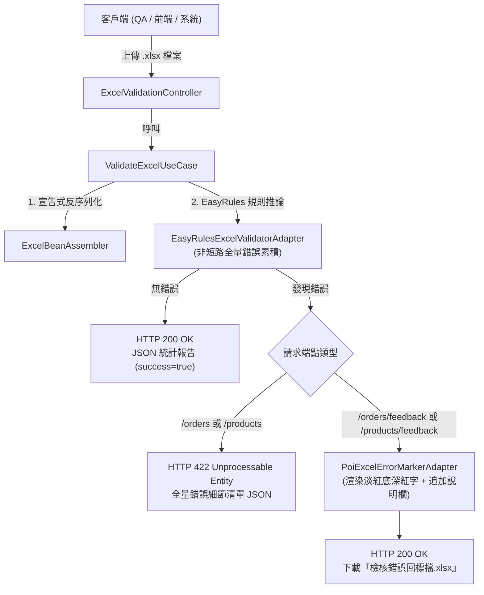

# Excel 客製驗證與錯誤回標測試指引與操作手冊 (Custom Validation & Error Feedback Testing Guide)

> 📌 **文件位置**：`doc/test/custom_validation_testing_guide.md`  
> 🎯 **適用對象**：測試工程師 (QA)、前端開發人員、維運工程師、第三方系統整合人員  
> 📖 **相關參考文件**：
> * 維護與業務規則擴充手冊：[`doc/maintenance/custom-validation-and-error-feedback-manual.md`](file:///d:/桌面/ModuleWorkSpace/excel-module/doc/maintenance/custom-validation-and-error-feedback-manual.md)
> * 底層架構設計指南：[`doc/design/custom-validation-and-error-feedback.md`](file:///d:/桌面/ModuleWorkSpace/excel-module/doc/design/custom-validation-and-error-feedback.md)
> * 實體測試範本庫：[`doc/template/README.md`](file:///d:/桌面/ModuleWorkSpace/excel-module/doc/template/README.md)

---

## 目錄 (Table of Contents)
- [1. 測試核心機制與驗證策略](#1-測試核心機制與驗證策略)
- [2. REST API 測試端點總覽](#2-rest-api-測試端點總覽)
- [3. 測試範本與違規資料設計矩陣](#3-測試範本與違規資料設計矩陣)
- [4. 端到端實測情境與 cURL 操作範例](#4-端到端實測情境與-curl-操作範例)
  - [情境 1：標準訂單檢核合格場景 (JavaBean - OrderModel)](#情境-1標準訂單檢核合格場景-javabean---ordermodel)
  - [情境 2：訂單違規檢核與全量錯誤累積 (Accumulate Mode)](#情境-2訂單違規檢核與全量錯誤累積-accumulate-mode)
  - [情境 3：視覺化「錯誤回標檔」生成與樣式驗證](#情境-3視覺化錯誤回標檔生成與樣式驗證)
  - [情境 4：商品主檔不可變 Record 檢核 (Java 21 Record)](#情境-4商品主檔不可變-record-檢核-java-21-record)
  - [情境 5：邊界條件與異常防護測試](#情境-5邊界條件與異常防護測試)
- [5. 使用 Swagger UI (OpenAPI 3.0) 進行介面互動測試](#5-使用-swagger-ui-openapi-30-進行介面互動測試)
- [6. Postman 自動化測試腳本與斷言設計](#6-postman-自動化測試腳本與斷言設計)
- [7. JUnit 5 & MockMvc 自動化測試套件](#7-junit-5--mockmvc-自動化測試套件)
- [8. 測試常見問題與排查診斷 (FAQ)](#8-測試常見問題與排查診斷-faq)

---

## 1. 測試核心機制與驗證策略

本模組提供針對 Excel 批次匯入的進階資料校驗能力，測試核心聚焦於兩大差異化機制：



### 關鍵測試驗證維度：
1. **全量錯誤累積 (Accumulate Mode) 驗證**：
   * 嚴格禁止傳統「Fail-Fast」遇錯即斷行為。
   * 即使第 2 列出錯，系統仍須持續掃描至最後一列，並在同一列中同時觸發多項不同規則（例如金額負數且數量為零）。
2. **雙軌反序列化支援**：
   * 傳統 **JavaBean 模式**（如 [`OrderModel`](file:///d:/桌面/ModuleWorkSpace/excel-module/src/main/java/com/example/demo/application/shared/model/OrderModel.java)）。
   * 現代 **Java 21 Record 模式**（如 [`ProductRecordModel`](file:///d:/桌面/ModuleWorkSpace/excel-module/src/main/java/com/example/demo/application/shared/model/ProductRecordModel.java)）。
3. **高傳真視覺化錯誤回標檔**：
   * 保持原始上傳檔案之所有工作表、字體與排版樣式。
   * 違規儲存格精確套用淡紅底色（`#FFC7CE` / ROSE）與深紅文字（`#9C0006` / DARK_RED）。
   * 表頭最右側自動追加 `檢核結果與錯誤原因 (Validation Errors)` 欄位，彙整該列所有違規訊息。

---

## 2. REST API 測試端點總覽 (精簡 5 隻核心接口)

控制器類別：[`ExcelValidationController`](file:///d:/桌面/ModuleWorkSpace/excel-module/src/main/java/com/example/demo/presentation/controller/validation/ExcelValidationController.java)  
基礎路徑 (Base URL)：`http://localhost:8080/api/v1/excel/validation`

經過架構重構與開放封閉原則 (OCP) 收斂，介面已由過往為各業務硬編碼之重複端點全面精簡為 **5 隻高內聚核心 API**：

| # | HTTP 方法 | 端點路徑 (Endpoint) | 功能說明 | 請求參數 | 預期回應 (合格 / 違規) |
| :-: | :---: | :--- | :--- | :--- | :--- |
| **1** | **GET** | `/templates` | 查詢已註冊之可用範本列表 (Template Discovery) | 無 | `200 OK` (包含 orders, products, materials, boms 之元數據 JSON 清單) |
| **2** | **POST** | `/{templateKey}/feedback` | **統一動態範本校驗並生成「錯誤回標檔」(OCP 核心統一接口)**<br>*(例：`/orders/feedback`、`/products/feedback`)* | `file` (`.xlsx`) | **合格**：`200 OK` (JSON 統計報告)<br>**違規**：`200 OK` (標註淡紅底深紅字二進位 `.xlsx` 下載) |
| **3** | **POST** | `/{templateKey}` | **統一動態範本校驗 (回傳 JSON 統計結果 - OCP 核心統一接口)**<br>*(例：`/orders`、`/products`)* | `file` (`.xlsx`) | **合格**：`200 OK` (JSON 成功報告)<br>**違規**：`422 Unprocessable Entity` (全量錯誤 JSON) |
| **4** | **POST** | `/feedback` | **智慧自動偵測範本並生成「錯誤回標檔」(Zero-Config 自動路由接口)**<br>*(免填 templateKey，自 Excel Sheet 名稱自動探測)* | `file` (`.xlsx`) | **合格**：`200 OK` (JSON 統計報告)<br>**違規**：`200 OK` (標註淡紅底深紅字二進位 `.xlsx` 下載) |
| **5** | **POST** | `/declarative/orders` | **宣告式訂單匯入 (AOP 自動回標攔截最佳實踐示範)** | `file` (`.xlsx`) | **合格**：`200 OK` (切面放行，自動注入合規清單)<br>**違規**：`200 OK` (切面短路二進位 `.xlsx` 下載) |

---

## 3. 測試範本與違規資料設計矩陣

測試所需之真實 `.xlsx` 檔案均位於 [`doc/template/`](file:///d:/桌面/ModuleWorkSpace/excel-module/doc/template/)，各範本之預期資料情境如下：

| 測試範本檔案 | 對應模型 | 測試資料筆數 | 預期檢核結果 | 違規列號與原因分析 |
| :--- | :--- | :---: | :---: | :--- |
| [`ORDER_IMPORT_SUCCESS.xlsx`](file:///d:/桌面/ModuleWorkSpace/excel-module/doc/template/ORDER_IMPORT_SUCCESS.xlsx) | [`OrderModel`](file:///d:/桌面/ModuleWorkSpace/excel-module/src/main/java/com/example/demo/application/shared/model/OrderModel.java) | 3 | **100% 合格** | 全數通過，無任何違規錯誤。 |
| [`ORDER_IMPORT_WITH_ERRORS.xlsx`](file:///d:/桌面/ModuleWorkSpace/excel-module/doc/template/ORDER_IMPORT_WITH_ERRORS.xlsx) | [`OrderModel`](file:///d:/桌面/ModuleWorkSpace/excel-module/src/main/java/com/example/demo/application/shared/model/OrderModel.java) | 4 | **4 處錯誤違規** | • **第 3 列 (ORD-ERR-002)**：金額 `-500.00` 違規<br>• **第 4 列 (ORD-ERR-003)**：數量 `0` 且金額 `0.00` (同時觸發兩項規則)<br>• **第 5 列 (ORD-ERR-004)**：數量 `-5` 違規 |
| [`PRODUCT_IMPORT_SUCCESS.xlsx`](file:///d:/桌面/ModuleWorkSpace/excel-module/doc/template/PRODUCT_IMPORT_SUCCESS.xlsx) | [`ProductRecordModel`](file:///d:/桌面/ModuleWorkSpace/excel-module/src/main/java/com/example/demo/application/shared/model/ProductRecordModel.java) | 3 | **100% 合格** | Record 不可變模型宣告式映射全數合格。 |
| [`PRODUCT_IMPORT_WITH_ERRORS.xlsx`](file:///d:/桌面/ModuleWorkSpace/excel-module/doc/template/PRODUCT_IMPORT_WITH_ERRORS.xlsx) | [`ProductRecordModel`](file:///d:/桌面/ModuleWorkSpace/excel-module/src/main/java/com/example/demo/application/shared/model/ProductRecordModel.java) | 4 | **3 處錯誤違規** | • **第 3 列 (PROD-E01)**：售價 `-120.00` 違規<br>• **第 4 列 (PROD-E02)**：售價 `0.00` 違規<br>• **第 5 列 (PROD-E03)**：庫存量 `-50` 違規 |

---

## 4. 端到端實測情境與 cURL 操作範例

### 情境 1：標準訂單檢核合格場景 (JavaBean - OrderModel)

#### 1-1. 執行檢核並取得成功統計 JSON
上傳全數合格的 [`ORDER_IMPORT_SUCCESS.xlsx`](file:///d:/桌面/ModuleWorkSpace/excel-module/doc/template/ORDER_IMPORT_SUCCESS.xlsx)：

```bash
curl -i -X POST "http://localhost:8080/api/v1/excel/validation/orders" \
     -H "Content-Type: multipart/form-data" \
     -F "file=@doc/template/ORDER_IMPORT_SUCCESS.xlsx"
```

* **預期 HTTP 狀態碼**：`200 OK`
* **預期 Response Body (JSON)**：
```json
{
  "success": true,
  "totalRows": 3,
  "validCount": 3,
  "errorCount": 0,
  "errors": []
}
```

#### 1-2. 呼叫回標端點驗證全數合格行為
當上傳完全合格檔案至 `/feedback` 端點時，後端**不會**產製空的回標檔，而是聰明地回傳 `200 OK` 與 JSON 成功統計報告：

```bash
curl -i -X POST "http://localhost:8080/api/v1/excel/validation/orders/feedback" \
     -H "Content-Type: multipart/form-data" \
     -F "file=@doc/template/ORDER_IMPORT_SUCCESS.xlsx"
```
* **驗證重點**：
  * HTTP 狀態碼為 `200 OK`。
  * `Content-Type` 為 `application/json`。
  * `success` 為 `true`，`errorCount` 為 `0`。

---

### 情境 2：訂單違規檢核與全量錯誤累積 (Accumulate Mode)

#### 2-1. 執行檢核並取得全量錯誤清單 (HTTP 422)
上傳包含故意設計違規項目的 [`ORDER_IMPORT_WITH_ERRORS.xlsx`](file:///d:/桌面/ModuleWorkSpace/excel-module/doc/template/ORDER_IMPORT_WITH_ERRORS.xlsx)：

```bash
curl -i -X POST "http://localhost:8080/api/v1/excel/validation/orders" \
     -H "Content-Type: multipart/form-data" \
     -F "file=@doc/template/ORDER_IMPORT_WITH_ERRORS.xlsx"
```

* **預期 HTTP 狀態碼**：`422 Unprocessable Entity`
* **預期 Response Body (JSON)**：
```json
{
  "success": false,
  "totalRows": 4,
  "validCount": 1,
  "errorCount": 4,
  "errors": [
    {
      "rowNumber": 3,
      "columnIndex": 2,
      "columnName": "購買金額",
      "invalidValue": "-500.0",
      "errorMessage": "訂單金額必須大於 0.00",
      "ruleName": "OrderAmountValidationRule"
    },
    {
      "rowNumber": 4,
      "columnIndex": 2,
      "columnName": "購買金額",
      "invalidValue": "0.0",
      "errorMessage": "訂單金額必須大於 0.00",
      "ruleName": "OrderAmountValidationRule"
    },
    {
      "rowNumber": 4,
      "columnIndex": 3,
      "columnName": "購買數量",
      "invalidValue": "0",
      "errorMessage": "訂單購買數量必須大於 0 且小於等於 9999",
      "ruleName": "OrderQuantityValidationRule"
    },
    {
      "rowNumber": 5,
      "columnIndex": 3,
      "columnName": "購買數量",
      "invalidValue": "-5",
      "errorMessage": "訂單購買數量必須大於 0 且小於等於 9999",
      "ruleName": "OrderQuantityValidationRule"
    }
  ]
}
```

* **斷言與檢核重點**：
  * **非短路驗證**：第 3 列出錯後，第 4 列與第 5 列仍如實被檢核並收集，`errorCount` 累計達 4 筆。
  * **同列多錯誤驗證**：第 4 列同時違反「金額規則」與「數量規則」，同一列產生 2 筆獨立錯誤紀錄，`columnIndex` 分別指向索引 2 (購買金額) 與索引 3 (購買數量)。

---

### 情境 3：視覺化「錯誤回標檔」生成與樣式驗證

#### 3-1. 下載錯誤回標 Excel 檔案
呼叫 `/orders/feedback` 端點並將二進位回應儲存為本地檔案：

```bash
curl -X POST "http://localhost:8080/api/v1/excel/validation/orders/feedback" \
     -H "Content-Type: multipart/form-data" \
     -F "file=@doc/template/ORDER_IMPORT_WITH_ERRORS.xlsx" \
     -o "訂單檢核錯誤回標檔.xlsx"
```

* **預期 Response Headers**：
  * `Content-Type: application/vnd.openxmlformats-officedocument.spreadsheetml.sheet`
  * `Content-Disposition: attachment; filename="訂單檢核錯誤回標檔.xlsx"; filename*=UTF-8''%E8%A8%82%E5%96%AE%E6%AA%A2%E6%A0%B8%E9%8错...`
* **檔案視覺化實體驗證**（使用 Excel 或 WPS 開啟 `訂單檢核錯誤回標檔.xlsx`）：
  1. **原始排版保持**：原始工作表名稱 `訂單匯入` 與既有欄位標題、格式完全維持不變。
  2. **高亮樣式渲染**：
     * 第 3 列第 C 欄（購買金額 `-500.00`）背景呈現**淡紅色 (#FFC7CE)**，字體為**深紅粗體 (#9C0006)**。
     * 第 4 列第 C 欄（`0.00`）與第 D 欄（`0`）皆呈現淡紅底深紅字高亮。
     * 第 5 列第 D 欄（`-5`）呈現淡紅底深紅字高亮。
  3. **追加錯誤欄位**：
     * 表頭第 G 欄（最右側）自動追加欄位名：`檢核結果與錯誤原因 (Validation Errors)`。
     * 第 3 列 G 欄內容為：`購買金額: 訂單金額必須大於 0.00`
     * 第 4 列 G 欄內容為：`購買金額: 訂單金額必須大於 0.00; 購買數量: 訂單購買數量必須大於 0 且小於等於 9999`
     * 第 5 列 G 欄內容為：`購買數量: 訂單購買數量必須大於 0 且小於等於 9999`

---

### 情境 4：商品主檔不可變 Record 檢核 (Java 21 Record)

#### 4-1. Record 正常匯入檢核 (HTTP 200)
```bash
curl -i -X POST "http://localhost:8080/api/v1/excel/validation/products" \
     -H "Content-Type: multipart/form-data" \
     -F "file=@doc/template/PRODUCT_IMPORT_SUCCESS.xlsx"
```
* **預期結果**：HTTP `200 OK`，`success: true`，`totalRows: 3`，`validCount: 3`。

#### 4-2. Record 違規檢核並產製回標檔
```bash
curl -X POST "http://localhost:8080/api/v1/excel/validation/products/feedback" \
     -H "Content-Type: multipart/form-data" \
     -F "file=@doc/template/PRODUCT_IMPORT_WITH_ERRORS.xlsx" \
     -o "商品檢核錯誤回標檔.xlsx"
```
* **預期結果**：
  * 生成 `商品檢核錯誤回標檔.xlsx`。
  * 售價負數及庫存負數儲存格高亮標註。
  * 最右側追加欄位說明：`商品售價: 商品定價必須大於零` 與 `現有庫存量: 庫存數量不得為負數`。

---

### 情境 5：邊界條件與異常防護測試

#### 5-1. 未攜帶檔案或檔案為空 (HTTP 400 Bad Request)
```bash
curl -i -X POST "http://localhost:8080/api/v1/excel/validation/orders" \
     -H "Content-Type: multipart/form-data" \
     -F "file="
```
* **預期 HTTP 狀態碼**：`400 Bad Request`。

#### 5-2. 上傳非 Excel 格式之無效檔案 (如文字檔或圖片)
```bash
curl -i -X POST "http://localhost:8080/api/v1/excel/validation/orders" \
     -H "Content-Type: multipart/form-data" \
     -F "file=@pom.xml;type=application/xml"
```
* **預期結果**：後端攔截二進位標頭與解析失敗，回傳 HTTP 400 或標準 Global Exception 結構，防止惡意文件穿透。

---

### 情境 6：宣告式 AOP 攔截端點實測 (@ValidateExcel & @ValidatedExcelData)

#### 6-1. 宣告式自動回標短路測試 (違規時 AOP 直接短路下載 Excel)
上傳違規範本 [`ORDER_IMPORT_WITH_ERRORS.xlsx`](file:///d:/桌面/ModuleWorkSpace/excel-module/doc/template/ORDER_IMPORT_WITH_ERRORS.xlsx) 至宣告式端點：

```bash
curl -X POST "http://localhost:8080/api/v1/excel/validation/declarative/orders" \
     -H "Content-Type: multipart/form-data" \
     -F "file=@doc/template/ORDER_IMPORT_WITH_ERRORS.xlsx" \
     -o "AOP訂單檢核錯誤回標檔.xlsx"
```
* **驗證重點**：
  * 切面在進入 Controller 方法前直接短路阻斷（Controller 方法不被執行）。
  * 自動產出帶有淡紅底深紅字高亮標註之 `AOP訂單檢核錯誤回標檔.xlsx`。

#### 6-2. 宣告式合格放行與資料自動注入測試 (合格時 AOP 自動注入 List<OrderModel>)
上傳合格範本 [`ORDER_IMPORT_SUCCESS.xlsx`](file:///d:/桌面/ModuleWorkSpace/excel-module/doc/template/ORDER_IMPORT_SUCCESS.xlsx) 至宣告式端點：

```bash
curl -i -X POST "http://localhost:8080/api/v1/excel/validation/declarative/orders" \
     -H "Content-Type: multipart/form-data" \
     -F "file=@doc/template/ORDER_IMPORT_SUCCESS.xlsx"
```
* **預期回應**：`HTTP 200 OK`，`success: true`，`validCount: 3`。
* **驗證重點**：Controller 方法正常被執行，且 `@ValidatedExcelData List<OrderModel> validOrders` 由切面自動注入已反序列化之合格清單。

#### 6-3. Zero-Config 智慧自動探測回標測試 (免指定 Key，自動從 Sheet Name 辨識)
```bash
curl -i -X POST "http://localhost:8080/api/v1/excel/validation/feedback" \
     -H "Content-Type: multipart/form-data" \
     -F "file=@doc/template/ORDER_IMPORT_WITH_ERRORS.xlsx" \
     -O -J
```
* **預期狀態碼**：`HTTP 200 OK`
* **驗證重點**：後端由「訂單匯入清單」Sheet 名稱自動探測出 `OrderModel` 並觸發 EasyRules 檢核與回標生成，下載 `訂單檢核錯誤回標檔.xlsx`。

---

## 5. 使用 Swagger UI (OpenAPI 3.0) 進行介面互動測試

Spring Boot 應用啟動後，已自動整合 OpenAPI 3.0 規範，可透過視覺化網頁直接進行檔案上傳與即時回標下載：

* **Swagger UI URL**：`http://localhost:8080/swagger-ui.html`
* **API 分組名稱**：`Excel 客製驗證與錯誤回標介面`

### 互動測試步驟指引：
1. 開啟瀏覽器訪問 `http://localhost:8080/swagger-ui.html`。
2. 展開 **`Excel 客製驗證與錯誤回標介面`**。
3. 點選 **`POST /api/v1/excel/validation/orders/feedback`**。
4. 點擊右上角 **`Try it out`**。
5. 在 `file` 欄位點擊 **選擇檔案 (Choose File)**，選取專案目錄下的 [`doc/template/ORDER_IMPORT_WITH_ERRORS.xlsx`](file:///d:/桌面/ModuleWorkSpace/excel-module/doc/template/ORDER_IMPORT_WITH_ERRORS.xlsx)。
6. 點擊藍色 **`Execute`** 按鈕發送請求。
7. 在下方 Response 區域將呈現：
   * Code: `200`
   * 出現 **`Download file`** 藍色超連結，點擊即可直接將 `訂單檢核錯誤回標檔.xlsx` 下載至本機檢視驗證！

---

## 6. Postman 自動化測試腳本與斷言設計

若使用 Postman 進行回歸測試，可在 Request 的 **Tests** 標籤頁貼入以下自動化斷言腳本：

### 腳本 1：檢驗 POST `/orders` 違規時的 422 結構與錯誤明細
```javascript
// 1. 斷言 HTTP 狀態碼為 422 Unprocessable Entity
pm.test("Status code is 422 Unprocessable Entity", function () {
    pm.response.to.have.status(422);
});

// 2. 斷言 Content-Type 為 JSON
pm.test("Response is JSON format", function () {
    pm.response.to.be.json;
});

const jsonData = pm.response.json();

// 3. 斷言檢核統計欄位
pm.test("Validation summary contains correct counters", function () {
    pm.expect(jsonData.success).to.eql(false);
    pm.expect(jsonData.totalRows).to.eql(4);
    pm.expect(jsonData.validCount).to.eql(1);
    pm.expect(jsonData.errorCount).to.eql(4);
    pm.expect(jsonData.errors).to.be.an("array").that.is.not.empty;
});

// 4. 斷言全量錯誤中必須包含指定列號與規則名稱
pm.test("Errors contain expected violations", function () {
    const amountErrors = jsonData.errors.filter(e => e.ruleName === "OrderAmountValidationRule");
    const quantityErrors = jsonData.errors.filter(e => e.ruleName === "OrderQuantityValidationRule");
    
    pm.expect(amountErrors.length).to.be.at.least(2);
    pm.expect(quantityErrors.length).to.be.at.least(2);
});
```

### 腳本 2：檢驗 POST `/orders/feedback` 錯誤回標檔二進位下載
```javascript
// 1. 斷言 HTTP 狀態碼為 200 OK
pm.test("Status code is 200 OK", function () {
    pm.response.to.have.status(200);
});

// 2. 斷言 Content-Type 為 OpenXML Excel
pm.test("Content-Type is Excel Spreadsheet", function () {
    pm.expect(pm.response.headers.get("Content-Type"))
      .to.include("application/vnd.openxmlformats-officedocument.spreadsheetml.sheet");
});

// 3. 斷言 Content-Disposition 帶有 UTF-8 編碼之檔名
pm.test("Content-Disposition contains encoded filename", function () {
    const disposition = pm.response.headers.get("Content-Disposition");
    pm.expect(disposition).to.include("attachment");
    pm.expect(disposition).to.include("filename");
});
```

---

## 7. JUnit 5 & MockMvc 自動化測試套件

本模組遵循 `AGENTS.md` 規範，對應 Controller、Service 與 Adapter 皆具備完整單元測試與 BDD Gherkin 測試註解：

### 測試類別清單與職責矩陣

| 測試類別路徑 | 架構層級 | 測試職責與驗證情境 |
| :--- | :--- | :--- |
| [`ExcelValidationControllerTest`](file:///d:/桌面/ModuleWorkSpace/excel-module/src/test/java/com/example/demo/presentation/controller/validation/ExcelValidationControllerTest.java) | 表現層 (Presentation) | 驗證 Multipart 檔案上傳接收、HTTP 200/422/400 狀態碼切換、JSON 錯誤欄位反序列化、二進位回標檔下載 Header。 |
| [`ExcelValidationApplicationServiceTest`](file:///d:/桌面/ModuleWorkSpace/excel-module/src/test/java/com/example/demo/application/service/validation/ExcelValidationApplicationServiceTest.java) | 應用層 (Application) | 驗證 `ValidateExcelUseCase` 調度邏輯、全數合格時略過回標生成、存在錯誤時觸發 `ExcelErrorMarkerPort`。 |
| [`EasyRulesExcelValidatorAdapterTest`](file:///d:/桌面/ModuleWorkSpace/excel-module/src/test/java/com/example/demo/infrastructure/adapter/validation/EasyRulesExcelValidatorAdapterTest.java) | 基礎設施層 (Adapter) | 驗證 EasyRules 規則引擎之非短路全量錯誤累積、JavaBean 與 Java 21 Record 泛型推論、同一列多項違規事實收集。 |
| [`PoiExcelErrorMarkerAdapterTest`](file:///d:/桌面/ModuleWorkSpace/excel-module/src/test/java/com/example/demo/infrastructure/adapter/validation/PoiExcelErrorMarkerAdapterTest.java) | 基礎設施層 (Adapter) | 驗證 Apache POI 儲存格淡紅底深紅字樣式渲染 (`ROSE` / `DARK_RED`)、工作表最右側表頭與錯誤內容欄位自動追加。 |
| [`TestTemplateGeneratorTest`](file:///d:/桌面/ModuleWorkSpace/excel-module/src/test/java/com/example/demo/infrastructure/adapter/TestTemplateGeneratorTest.java) | 整合驗證 (Integration) | 驗證 `doc/template/` 下所有實體測試範本檔案結構，確保各範本皆可正常解析且預期違規點 100% 吻合。 |

### 本地執行測試指令

#### 執行客製檢核相關測試套件：
```powershell
cmd /c "set JAVA_HOME=C:\Users\nick5\.jdks\temurin-22.0.2&& mvnw.cmd test -Dtest=*Validation*,*ErrorMarker*"
```

#### 執行全專案全量測試套件 (153 項測試)：
```powershell
cmd /c "set JAVA_HOME=C:\Users\nick5\.jdks\temurin-22.0.2&& mvnw.cmd test"
```

---

## 8. 測試常見問題與排查診斷 (FAQ)

### Q1：為什麼檢核發現資料違規時，API 回傳 `422 Unprocessable Entity` 而非 `400 Bad Request`？
* **RESTful 語意原則**：
  * **`400 Bad Request`**：代表請求本身格式錯誤、語意無效或檔案損毀（例如未傳 `file` 參數、檔案大小為 0 位元組、上傳偽裝成 Excel 的文字檔）。
  * **`422 Unprocessable Entity`**：代表請求語法與檔案結構完全正確（成功讀取 Excel 工作表），但內容違反了深層業務邏輯與領域規則（金額負數、數量為零等）。此設計有助於前端清晰區分「網路/格式錯誤」與「資料內容校驗錯誤」。

### Q2：瀏覽器下載錯誤回標檔時，中文檔名顯示亂碼或底線？
* **排查重點**：後端嚴格採用 RFC 5987 / RFC 6266 雙重相容格式：
  ```http
  Content-Disposition: attachment; filename="訂單檢核錯誤回標檔.xlsx"; filename*=UTF-8''%E8%A8%82%E5%96%AE%E6%AA%A2%E6%A0%B8%E9%8C%AF%E8%AA%A4%E5%9B%9E%E6%A8%99%E6%AA%94.xlsx
  ```
  現代主流瀏覽器（Chrome, Edge, Firefox, Safari）會自動優先採用 `filename*=UTF-8''` 取得正確的 UTF-8 中文檔名。若使用 cURL 測試，請加上 `-O -J` 參數以自動解析 Header 檔名：
  ```bash
  curl -X POST "http://localhost:8080/api/v1/excel/validation/orders/feedback" -F "file=@doc/template/ORDER_IMPORT_WITH_ERRORS.xlsx" -O -J
  ```

### Q3：當上傳的 Excel 資料列數達數萬列時，錯誤回標渲染是否會引發記憶體溢出 (OOM)？
* **效能與記憶體策略**：
  * **純校驗端點 (`/orders`, `/products`)**：底層整合串流讀取，具備極低記憶體開銷。
  * **回標渲染端點 (`/orders/feedback`, `/products/feedback`)**：由於需要修改既有儲存格背景色並在最右側動態追加欄位，此階段使用 Apache POI DOM 模式。在十萬列以上極端超大型試算表場景，建議搭配 `@TrackExcelTask` 宣告式非同步任務切面執行，或引導使用者分批匯入。

