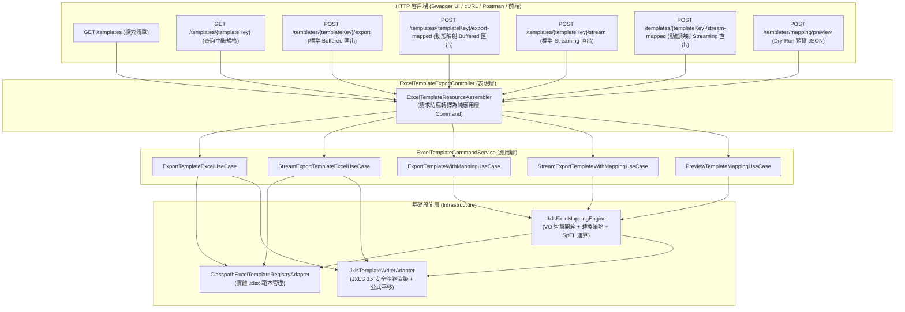

# Excel 宣告式範本匯出 API 測試手冊 (含 7 大端點完整 RequestData 與實測指引)

> 📌 **文件位置**：[`doc/test/excel_template_export_testing_guide.md`](file:///d:/桌面/ModuleWorkSpace/excel-module/doc/test/excel_template_export_testing_guide.md)  
> 🎯 **適用對象**：測試工程師 (QA)、後端研發人員、前端開發人員、多租戶架構師與報表維運人員  
> 📖 **相關參考文件**：
> * JXLS 範本定義總模組：👉 [`doc/design/jxls-template-export.md`](file:///d:/桌面/ModuleWorkSpace/excel-module/doc/design/jxls-template-export.md)
> * 欄位動態映射引擎核心設計：👉 [`doc/design/jxls-template-export/04-dynamic-field-mapping-engine.md`](file:///d:/桌面/ModuleWorkSpace/excel-module/doc/design/jxls-template-export/04-dynamic-field-mapping-engine.md)
> * 實體 Excel 測試範本庫：👉 [`doc/template/README.md`](file:///d:/桌面/ModuleWorkSpace/excel-module/doc/template/README.md)
> * OpenAPI 3.0 標準規範檔：👉 [`doc/test/openapi_specification.yaml`](file:///d:/桌面/ModuleWorkSpace/excel-module/doc/test/openapi_specification.yaml)

---

## 目錄 (Table of Contents)
- [一、 7 大核心 API 端點架構總覽](#一-7-大核心-api-端點架構總覽)
- [二、 測試端點詳細規格與 RequestData 實測大全](#二-測試端點詳細規格與-requestdata-實測大全)
  - [API 1：GET /api/v1/excel/templates (查詢所有範本清單)](#api-1get-apiv1exceltemplates-查詢所有範本清單)
  - [API 2：GET /api/v1/excel/templates/{templateKey} (查詢單一範本規格)](#api-2get-apiv1exceltemplatestemplatekey-查詢單一範本規格)
  - [API 3：POST /api/v1/excel/templates/{templateKey}/export (標準資料模型 Buffered 匯出)](#api-3post-apiv1exceltemplatestemplatekeyexport-標準資料模型-buffered-匯出)
  - [API 4：POST /api/v1/excel/templates/{templateKey}/export-mapped (自訂欄位映射 Buffered 匯出)](#api-4post-apiv1exceltemplatestemplatekeyexport-mapped-自訂欄位映射-buffered-匯出)
  - [API 5：POST /api/v1/excel/templates/{templateKey}/stream (標準資料模型 Streaming 串流匯出)](#api-5post-apiv1exceltemplatestemplatekeystream-標準資料模型-streaming-串流匯出)
  - [API 6：POST /api/v1/excel/templates/{templateKey}/stream-mapped (自訂欄位映射 Streaming 串流匯出)](#api-6post-apiv1exceltemplatestemplatekeystream-mapped-自訂欄位映射-streaming-串流匯出)
  - [API 7：POST /api/v1/excel/templates/mapping/preview (欄位映射即時預覽 Context Preview)](#api-7post-apiv1exceltemplatesmappingpreview-欄位映射即時預覽-context-preview)
- [三、 雙軌匯出模式對比矩陣 (標準 vs 動態映射)](#三-雙軌匯出模式對比矩陣-標準-vs-動態映射)
- [四、 系統內建範本對照與必備資料模型表](#四-系統內建範本對照與必備資料模型表)
- [五、 使用 Swagger UI 進行視覺化互動測試指引](#五-使用-swagger-ui-進行視覺化互動測試指引)
- [六、 產出 Excel 檔案特性視覺化檢驗清單](#六-產出-excel-檔案特性視覺化檢驗清單)
- [七、 常見問題與排查診斷 (FAQ)](#七-常見問題與排查診斷-faq)

---

## 一、 7 大核心 API 端點架構總覽

本模組座落於 Clean Architecture 表現層控制器 [`ExcelTemplateExportController`](file:///d:/桌面/ModuleWorkSpace/excel-module/src/main/java/com/example/demo/presentation/controller/template/ExcelTemplateExportController.java)，在 Swagger UI 中隸屬於 **`Excel 宣告式範本匯出 API`** 分組。



### 7 隻端點一覽清單：
| # | HTTP 方法 | 端點路徑 (Endpoint) | 功能簡述 | 傳輸特徵 |
| :-: | :---: | :--- | :--- | :--- |
| **1** | **GET** | `/api/v1/excel/templates` | 查詢所有已註冊之 Excel 範本清單 | `200 OK`，回傳範本中繼資訊 JSON 清單 |
| **2** | **GET** | `/api/v1/excel/templates/{templateKey}` | 查詢單一範本之中繼規格與變數結構 | `200 OK`，回傳單一範本詳細規格 JSON |
| **3** | **POST** | `/api/v1/excel/templates/{templateKey}/export` | 依據範本與標準資料模型匯出 Excel (Buffered) | `200 OK`，一次性記憶體緩衝下載 `.xlsx` |
| **4** | **POST** | `/api/v1/excel/templates/{templateKey}/export-mapped` | 依據自訂欄位動態映射匯出 Excel (Buffered) | `200 OK`，自動開箱與轉換後下載 `.xlsx` |
| **5** | **POST** | `/api/v1/excel/templates/{templateKey}/stream` | 依據範本與標準資料模型串流匯出 (Streaming) | `200 OK`，`Transfer-Encoding: chunked` 直通串流 |
| **6** | **POST** | `/api/v1/excel/templates/{templateKey}/stream-mapped` | 依據自訂欄位動態映射串流匯出 (Streaming) | `200 OK`，低記憶體大數據串流直通下載 |
| **7** | **POST** | `/api/v1/excel/templates/mapping/preview` | 預覽欄位動態映射後之 JXLS 資料模型 (Dry-Run) | `200 OK`，不渲染 Excel，直接回傳 JSON Context |

---

## 二、 測試端點詳細規格與 RequestData 實測大全

### API 1：GET /api/v1/excel/templates (查詢所有範本清單)

* **HTTP 方法**：`GET`
* **端點路徑**：`http://localhost:8080/api/v1/excel/templates`
* **功能說明**：動態獲取目前系統中已註冊之所有 Excel 實體範本元數據（如範本識別鍵、業務名稱、分類、必備變數清單與最後更新時間戳記）。
* **請求格式**：無 Request Body。

#### cURL 實測指令：
```bash
curl -i -X GET "http://localhost:8080/api/v1/excel/templates" \
     -H "Accept: application/json"
```

#### 預期 HTTP 回應本文 (200 OK)：
```json
[
  {
    "templateKey": "MATERIAL_MASTER",
    "templateName": "物料主檔清單",
    "category": "MATERIAL",
    "description": "物料主檔資訊清單，基於 Material 聚合根，包含料號、品名、規格、分類、計量單位與標準成本",
    "requiredVariables": [
      "materials",
      "companyName",
      "exportDate"
    ],
    "lastModifiedAt": "2026-11-10T01:00:00Z"
  },
  {
    "templateKey": "BOM_COST_ANALYSIS",
    "templateName": "產品結構配方與成本分析展開表",
    "category": "BOM",
    "description": "產品結構配方與標準成本卷算分析表，基於 Bom 聚合根與 BomItem 實體，支援有效用量與成本加總動態公式",
    "requiredVariables": [
      "parentMaterialCode",
      "parentMaterialName",
      "version",
      "status",
      "baseQuantity",
      "currency",
      "items"
    ],
    "lastModifiedAt": "2026-11-10T01:00:00Z"
  },
  {
    "templateKey": "PROCUREMENT_COMPARISON",
    "templateName": "採購詢價比價單",
    "category": "PROCUREMENT",
    "description": "包含多供應商比價明細、最佳報價推薦與自適應加總公式",
    "requiredVariables": [
      "inquiryNo",
      "inquiryDate",
      "quotationItems",
      "vendorNames"
    ],
    "lastModifiedAt": "2026-11-10T01:00:00Z"
  }
]
```

---

### API 2：GET /api/v1/excel/templates/{templateKey} (查詢單一範本規格)

* **HTTP 方法**：`GET`
* **端點路徑**：`http://localhost:8080/api/v1/excel/templates/{templateKey}`
* **路徑參數 (`templateKey`)**：
  * `MATERIAL_MASTER`（物料主檔）
  * `BOM_COST_ANALYSIS`（BOM 成本分析）
  * `PROCUREMENT_COMPARISON`（採購詢價比價）

#### cURL 實測指令：
```bash
curl -i -X GET "http://localhost:8080/api/v1/excel/templates/MATERIAL_MASTER" \
     -H "Accept: application/json"
```

#### 預期 HTTP 回應本文 (200 OK)：
```json
{
  "templateKey": "MATERIAL_MASTER",
  "templateName": "物料主檔清單",
  "category": "MATERIAL",
  "description": "物料主檔資訊清單，基於 Material 聚合根，包含料號、品名、規格、分類、計量單位與標準成本",
  "requiredVariables": [
    "materials",
    "companyName",
    "exportDate"
  ],
  "lastModifiedAt": "2026-11-10T01:00:00Z"
}
```

---

### API 3：POST /api/v1/excel/templates/{templateKey}/export (標準資料模型 Buffered 匯出)

* **HTTP 方法**：`POST`
* **端點路徑**：`http://localhost:8080/api/v1/excel/templates/{templateKey}/export`
* **請求格式**：`Content-Type: application/json`
* **回應格式**：`Content-Type: application/vnd.openxmlformats-officedocument.spreadsheetml.sheet`
* **功能說明**：直接傳送符合 JXLS 範本變數結構之 `dataModel` 字典，伺服器一次性渲染並回傳二進位 `.xlsx` 檔案下載。

#### 📌 測試案例 3-A：採購詢價比價單 (`PROCUREMENT_COMPARISON`)
> 💡 **智慧欄位別名相容性說明**：  
> 範本底層變數對應為 `${item.materialCode}`, `${item.materialName}`, `${item.requiredQuantity}`, `${item.vendorName}`, `${item.quoteUnitPrice}`。  
> 系統已內建 **Smart Alias Normalization** 機制，無論傳入 `materialCode` 或 `itemCode`、`materialName` 或 `itemName`、`requiredQuantity` 或 `quantity`、`quoteUnitPrice` 或 `lowestPrice`/`targetPrice`，系統皆能自動雙向對齊解析！

##### RequestData (JSON Payload)：
```json
{
  "outputFileName": "procurement_comparison_2026.xlsx",
  "dataModel": {
    "inquiryNo": "INQ-202611-008",
    "inquiryDate": "2026-11-10",
    "vendorNames": "漢翔精密, 長榮航太, 神盾精密",
    "quotationItems": [
      {
        "materialCode": "MAT-SFG-001",
        "materialName": "飛控主板電路總成",
        "specification": "FC-STM32H7",
        "requiredQuantity": 50,
        "vendorName": "漢翔精密",
        "quoteUnitPrice": 4520.00,
        "itemCode": "MAT-SFG-001",
        "itemName": "飛控主板電路總成",
        "quantity": 50,
        "targetPrice": 4500.00,
        "vendorA_Price": 4800.00,
        "vendorB_Price": 4650.00,
        "vendorC_Price": 4520.00,
        "lowestPrice": 4520.00,
        "priceDiff": 20.00
      },
      {
        "materialCode": "MAT-SFG-002",
        "materialName": "2212 920KV 無刷動力馬達組",
        "specification": "920KV CW/CCW",
        "requiredQuantity": 200,
        "vendorName": "神盾精密",
        "quoteUnitPrice": 640.00,
        "itemCode": "MAT-SFG-002",
        "itemName": "2212 920KV 無刷動力馬達組",
        "quantity": 200,
        "targetPrice": 650.00,
        "vendorA_Price": 680.00,
        "vendorB_Price": 660.00,
        "vendorC_Price": 640.00,
        "lowestPrice": 640.00,
        "priceDiff": -10.00
      },
      {
        "materialCode": "MAT-RM-0076",
        "materialName": "航太級碳纖維十字機臂管件",
        "specification": "3K Carbon D16",
        "requiredQuantity": 100,
        "vendorName": "神盾精密",
        "quoteUnitPrice": 1190.00,
        "itemCode": "MAT-RM-0076",
        "itemName": "航太級碳纖維十字機臂管件",
        "quantity": 100,
        "targetPrice": 1200.00,
        "vendorA_Price": 1250.00,
        "vendorB_Price": 1220.00,
        "vendorC_Price": 1190.00,
        "lowestPrice": 1190.00,
        "priceDiff": -10.00
      }
    ]
  }
}
```

##### cURL 執行指令：
```bash
curl -i -X POST "http://localhost:8080/api/v1/excel/templates/PROCUREMENT_COMPARISON/export" \
     -H "Content-Type: application/json" \
     -d @procurement_data.json \
     -o procurement_comparison_2026.xlsx
```

---

#### 📌 測試案例 3-B：BOM 配方成本分析表 (`BOM_COST_ANALYSIS`)
##### RequestData (JSON Payload)：
```json
{
  "outputFileName": "bom_cost_analysis_PRO4K.xlsx",
  "dataModel": {
    "parentMaterialCode": "MAT-FG-001",
    "parentMaterialName": "4K 專業商用巡檢無人機旗艦裝配 (PRO-4K)",
    "version": "V1.0",
    "status": "APPROVED",
    "baseQuantity": 1.00,
    "currency": "TWD",
    "items": [
      {
        "level": 1,
        "itemSequence": 10,
        "childMaterialCode": "MAT-SFG-001",
        "childMaterialName": "飛控主板電路總成",
        "specification": "FC-STM32H7",
        "category": "半成品",
        "unit": "套/組",
        "baseQuantity": 1.00,
        "scrapRate": 0.01,
        "standardCost": 4800.00,
        "positionCode": "FC-ASM",
        "remark": "高算力航行主控板"
      },
      {
        "level": 1,
        "itemSequence": 20,
        "childMaterialCode": "MAT-SFG-002",
        "childMaterialName": "2212 動力推進總成",
        "specification": "920KV 4-Pack",
        "category": "半成品",
        "unit": "套/組",
        "baseQuantity": 4.00,
        "scrapRate": 0.00,
        "standardCost": 680.00,
        "positionCode": "PROP-1~4",
        "remark": "動力總成"
      },
      {
        "level": 1,
        "itemSequence": 30,
        "childMaterialCode": "MAT-SFG-003",
        "childMaterialName": "4K 三軸增穩雲台相機",
        "specification": "Sony 1/2 CMOS",
        "category": "半成品",
        "unit": "套/組",
        "baseQuantity": 1.00,
        "scrapRate": 0.00,
        "standardCost": 3600.00,
        "positionCode": "CAM-GIMBAL",
        "remark": "高解析感測器"
      }
    ]
  }
}
```

##### 預期產出驗證：
* **表身動態公式**：Row 4 的有效用量自動注入 `=H4*(1+I4)`，成本小計為 `=J4*K4`。
* **合計彙總列**：合計列橫跨 A~K 欄合併，L 欄自動計算 `=SUM(L4:L6)`。

---

### API 4：POST /api/v1/excel/templates/{templateKey}/export-mapped (自訂欄位映射 Buffered 匯出)

* **HTTP 方法**：`POST`
* **端點路徑**：`http://localhost:8080/api/v1/excel/templates/{templateKey}/export-mapped`
* **功能說明**：透過宣告式 `mappingDefinition`，後端引擎自動對 Value Object 智慧開箱、執行格式轉換策略（`CURRENCY`, `DATE`, `ENUM_DICT`, `MASKING`）、SpEL 跨欄虛擬求值並保底替換。
* **來源資料支援**：
  * **方式 A**：`sourceData` 設為 `null` 或省略 $\to$ 系統自動自資料庫撈取現有真實 `Material` 聚合根。
  * **方式 B**：自訂傳入任意異質結構之 `sourceData` 陣列 $\to$ 引擎動態映射。

#### 📌 測試案例 4-A：自動穿透領域資料庫 + Value Object 開箱 + 字典轉換 + 貨幣格式化
##### RequestData (JSON Payload)：
```json
{
  "outputFileName": "material_master_db_auto_mapped.xlsx",
  "mappingDefinition": {
    "templateKey": "material_master",
    "rootCollectionVar": "materials",
    "itemAlias": "m",
    "globalMeta": {
      "companyName": "神盾航太科技股份有限公司 (總部物料清單)",
      "exportDate": "2026-11-10"
    },
    "rules": [
      {
        "sourcePath": "code.value",
        "targetKey": "materialCode"
      },
      {
        "sourcePath": "name",
        "targetKey": "materialName"
      },
      {
        "sourcePath": "specification",
        "targetKey": "specification",
        "defaultValue": "通用標準規格"
      },
      {
        "sourcePath": "category",
        "targetKey": "category",
        "converterKey": "ENUM_DICT",
        "formatPattern": "MATERIAL_CATEGORY"
      },
      {
        "sourcePath": "unit",
        "targetKey": "unit"
      },
      {
        "sourcePath": "standardCost",
        "targetKey": "standardCost",
        "converterKey": "CURRENCY",
        "formatPattern": "#,##0.00"
      }
    ]
  }
}
```

##### cURL 執行指令：
```bash
curl -i -X POST "http://localhost:8080/api/v1/excel/templates/material_master/export-mapped" \
     -H "Content-Type: application/json" \
     -d '{
       "outputFileName": "material_master_db_auto_mapped.xlsx",
       "mappingDefinition": {
         "templateKey": "material_master",
         "rootCollectionVar": "materials",
         "itemAlias": "m",
         "globalMeta": {
           "companyName": "神盾航太科技股份有限公司 (總部物料清單)",
           "exportDate": "2026-11-10"
         },
         "rules": [
           { "sourcePath": "code.value", "targetKey": "materialCode" },
           { "sourcePath": "name", "targetKey": "materialName" },
           { "sourcePath": "specification", "targetKey": "specification", "defaultValue": "通用標準規格" },
           { "sourcePath": "category", "targetKey": "category", "converterKey": "ENUM_DICT", "formatPattern": "MATERIAL_CATEGORY" },
           { "sourcePath": "unit", "targetKey": "unit" },
           { "sourcePath": "standardCost", "targetKey": "standardCost", "converterKey": "CURRENCY", "formatPattern": "#,##0.00" }
         ]
       }
     }' \
     -o material_master_db_auto_mapped.xlsx
```

---

#### 📌 測試案例 4-B：傳入自訂異質 sourceData + SpEL 複合跨欄虛擬表達式 + 機密成本遮罩
##### RequestData (JSON Payload)：
```json
{
  "outputFileName": "material_master_custom_masked.xlsx",
  "sourceData": [
    {
      "vendorMaterialId": "EXT-9001",
      "prodName": "高精度雙頻 GPS 接收模組",
      "prodSpec": "L1/L5 RTK-0.01m",
      "rawCategory": "RAW_MATERIAL",
      "packUnit": "SET",
      "confidentialCost": 15800.00
    },
    {
      "vendorMaterialId": "EXT-9002",
      "prodName": "長距離圖傳發射發射機",
      "prodSpec": null,
      "rawCategory": "SEMI_FINISHED_GOODS",
      "packUnit": "PCS",
      "confidentialCost": 26500.00
    }
  ],
  "mappingDefinition": {
    "templateKey": "material_master",
    "rootCollectionVar": "materials",
    "itemAlias": "m",
    "globalMeta": {
      "companyName": "神盾航太科技 - 外包裝配協力廠專用清單"
    },
    "rules": [
      {
        "sourcePath": "vendorMaterialId",
        "targetKey": "materialCode"
      },
      {
        "targetKey": "materialName",
        "virtualExpression": "#{m.prodName} + ' [' + #{m.vendorMaterialId} + ']'"
      },
      {
        "sourcePath": "prodSpec",
        "targetKey": "specification",
        "defaultValue": "【外包標準件-無特殊規格】"
      },
      {
        "sourcePath": "rawCategory",
        "targetKey": "category",
        "converterKey": "ENUM_DICT",
        "formatPattern": "MATERIAL_CATEGORY"
      },
      {
        "sourcePath": "packUnit",
        "targetKey": "unit"
      },
      {
        "sourcePath": "confidentialCost",
        "targetKey": "standardCost",
        "converterKey": "MASKING",
        "formatPattern": "COST_PROTECT"
      }
    ]
  }
}
```

##### 預期產出驗證：
* **品名欄**：顯示為 `高精度雙頻 GPS 接收模組 [EXT-9001]`（SpEL 跨欄運算生效）。
* **規格欄**：第二列規格為 `null`，自動替換為 `【外包標準件-無特殊規格】`。
* **單價欄**：兩筆機密成本均被遮罩為 `***`。

---

### API 5：POST /api/v1/excel/templates/{templateKey}/stream (標準資料模型 Streaming 串流匯出)

* **HTTP 方法**：`POST`
* **端點路徑**：`http://localhost:8080/api/v1/excel/templates/{templateKey}/stream`
* **請求格式**：`Content-Type: application/json`
* **回應格式**：`Transfer-Encoding: chunked`（無堆疊快取直通 Servlet OutputStream）
* **功能說明**：適用於資料量較大時（例如幾千至上萬筆比價明細），直通 HTTP 輸出串流，徹底避免伺服器記憶體 OOM。

#### RequestData (JSON Payload)：
```json
{
  "outputFileName": "stream_procurement_report.xlsx",
  "dataModel": {
    "inquiryNo": "INQ-STREAM-202611",
    "inquiryDate": "2026-11-10",
    "vendorNames": "漢翔工業, 宏達精密, 神盾航太",
    "quotationItems": [
      {
        "materialCode": "MAT-SFG-001",
        "materialName": "飛控主板電路總成",
        "specification": "FC-STM32H7",
        "requiredQuantity": 100,
        "vendorName": "漢翔工業",
        "quoteUnitPrice": 4550.00,
        "itemCode": "MAT-SFG-001",
        "itemName": "飛控主板電路總成",
        "quantity": 100,
        "targetPrice": 4500.00,
        "lowestPrice": 4550.00
      },
      {
        "materialCode": "MAT-SFG-004",
        "materialName": "4S 5000mAh 智慧動力鋰電池",
        "specification": "4S 60C XT60",
        "requiredQuantity": 500,
        "vendorName": "神盾航太",
        "quoteUnitPrice": 1790.00,
        "itemCode": "MAT-SFG-004",
        "itemName": "4S 5000mAh 智慧動力鋰電池",
        "quantity": 500,
        "targetPrice": 1800.00,
        "lowestPrice": 1790.00
      }
    ]
  }
}
```

#### cURL 執行指令：
```bash
curl -i -X POST "http://localhost:8080/api/v1/excel/templates/PROCUREMENT_COMPARISON/stream" \
     -H "Content-Type: application/json" \
     -d @stream_data.json \
     -o stream_procurement_report.xlsx
```

#### 預期 HTTP 回應標頭：
```http
HTTP/1.1 200 OK
Content-Type: application/vnd.openxmlformats-officedocument.spreadsheetml.sheet
Content-Disposition: attachment; filename="stream_procurement_report.xlsx"; filename*=UTF-8''stream_procurement_report.xlsx
Transfer-Encoding: chunked
```

---

### API 6：POST /api/v1/excel/templates/{templateKey}/stream-mapped (自訂欄位映射 Streaming 串流匯出)

* **HTTP 方法**：`POST`
* **端點路徑**：`http://localhost:8080/api/v1/excel/templates/{templateKey}/stream-mapped`
* **功能說明**：同時結合 **「動態欄位解構與格式轉換」** 與 **「Zero-Copy HTTP 串流」** 兩大企業級特性，在維持領域純粹性的同時，實現百萬級別低堆疊串流匯出。

#### RequestData (JSON Payload)：
```json
{
  "outputFileName": "stream_mapped_materials.xlsx",
  "mappingDefinition": {
    "templateKey": "material_master",
    "rootCollectionVar": "materials",
    "itemAlias": "m",
    "globalMeta": {
      "companyName": "神盾航太科技 - 高並發串流中心",
      "exportDate": "2026-11-10 19:30:00"
    },
    "rules": [
      {
        "sourcePath": "code.value",
        "targetKey": "materialCode"
      },
      {
        "sourcePath": "name",
        "targetKey": "materialName"
      },
      {
        "sourcePath": "specification",
        "targetKey": "specification",
        "defaultValue": "標配標準件"
      },
      {
        "sourcePath": "category",
        "targetKey": "category",
        "converterKey": "ENUM_DICT",
        "formatPattern": "MATERIAL_CATEGORY"
      },
      {
        "sourcePath": "unit",
        "targetKey": "unit"
      },
      {
        "sourcePath": "standardCost",
        "targetKey": "standardCost",
        "converterKey": "CURRENCY",
        "formatPattern": "#,##0.00"
      }
    ]
  }
}
```

#### cURL 執行指令：
```bash
curl -i -X POST "http://localhost:8080/api/v1/excel/templates/material_master/stream-mapped" \
     -H "Content-Type: application/json" \
     -d @stream_mapped_data.json \
     -o stream_mapped_materials.xlsx
```

---

### API 7：POST /api/v1/excel/templates/mapping/preview (欄位映射即時預覽 Context Preview)

* **HTTP 方法**：`POST`
* **端點路徑**：`http://localhost:8080/api/v1/excel/templates/mapping/preview`
* **功能說明**：**Dry-Run 除錯神器**。不觸發實體 Excel 檔案渲染，直接在後端執行屬性路徑導航、Value Object 自動開箱、各類格式轉換策略與 SpEL 虛擬表達式，回傳組裝完成之 JXLS 資料模型 Context JSON。便於 QA、前端工程師或外部整合者即時檢視轉換結果是否合規。

#### RequestData (JSON Payload)：
```json
{
  "sourceData": [
    {
      "code": { "value": "MAT-PREVIEW-001" },
      "name": "高精度毫米波防撞避障雷達",
      "specification": "77GHz FMCW 200m",
      "category": "SEMI_FINISHED_GOODS",
      "standardCost": { "amount": 12800.00 }
    },
    {
      "code": { "value": "MAT-PREVIEW-002" },
      "name": "航太鈦合金裝配螺絲包",
      "specification": null,
      "category": "RAW_MATERIAL",
      "standardCost": { "amount": 150.00 }
    }
  ],
  "mappingDefinition": {
    "templateKey": "material_master",
    "rootCollectionVar": "materials",
    "itemAlias": "m",
    "globalMeta": {
      "companyName": "神盾航太科技 - 即時預覽驗證"
    },
    "rules": [
      {
        "sourcePath": "code.value",
        "targetKey": "materialCode"
      },
      {
        "sourcePath": "name",
        "targetKey": "materialName"
      },
      {
        "sourcePath": "specification",
        "targetKey": "specification",
        "defaultValue": "【通用通用無規格標記】"
      },
      {
        "sourcePath": "category",
        "targetKey": "categoryText",
        "converterKey": "ENUM_DICT",
        "formatPattern": "MATERIAL_CATEGORY"
      },
      {
        "sourcePath": "standardCost.amount",
        "targetKey": "formattedCost",
        "converterKey": "CURRENCY",
        "formatPattern": "$#,##0.00"
      },
      {
        "targetKey": "compositeLabel",
        "virtualExpression": "#{m.name} + ' (' + #{m.code.value} + ')'"
      }
    ]
  }
}
```

#### cURL 執行指令：
```bash
curl -i -X POST "http://localhost:8080/api/v1/excel/templates/mapping/preview" \
     -H "Content-Type: application/json" \
     -d @preview_request.json
```

#### 預期 HTTP 回應本文 (200 OK - JSON)：
```json
{
  "companyName": "神盾航太科技 - 即時預覽驗證",
  "materials": [
    {
      "materialCode": "MAT-PREVIEW-001",
      "materialName": "高精度毫米波防撞避障雷達",
      "specification": "77GHz FMCW 200m",
      "categoryText": "半成品",
      "formattedCost": "$12,800.00",
      "compositeLabel": "高精度毫米波防撞避障雷達 (MAT-PREVIEW-001)"
    },
    {
      "materialCode": "MAT-PREVIEW-002",
      "materialName": "航太鈦合金裝配螺絲包",
      "specification": "【通用通用無規格標記】",
      "categoryText": "原物料",
      "formattedCost": "$150.00",
      "compositeLabel": "航太鈦合金裝配螺絲包 (MAT-PREVIEW-002)"
    }
  ]
}
```

---

## 三、 雙軌匯出模式對比矩陣 (標準 vs 動態映射)

本模組提供 **「傳統標準資料模型 (Standard DataModel)」** 與 **「動態欄位映射規格 (Dynamic Field Mapping)」** 雙軌並行的架構：

| 維度 | 標準資料模型模式 (`/export`, `/stream`) | 動態欄位映射模式 (`/export-mapped`, `/stream-mapped`) |
| :--- | :--- | :--- |
| **輸入負載結構** | `ExportTemplateExcelResource`<br>需傳入完整對齊之 `dataModel` 字典 | `ExportTemplateWithMappingResource`<br>傳入 `mappingDefinition` 與選填 `sourceData` |
| **後端 DTO 依賴** | 呼叫端必須手動構建符合範本名稱之 Map | **完全免寫 DTO**，直接傳送 Domain Aggregate 或異質 Map |
| **Value Object 支援** | 需手動呼叫 `.value()` 或 `.amount()` 開箱 | **引擎智慧自動開箱** (`ValueObjectSmartUnboxer`) |
| **多國語系列舉轉換** | 需手動轉譯後再塞入 Map | 宣告 `converterKey: "ENUM_DICT"` 自動對齊字典 |
| **數值與日期格式化** | 需自行調用 `DecimalFormat` / `DateTimeFormatter` | 宣告 `CURRENCY` 或 `DATE` 自動依 pattern 格式化 |
| **跨欄位虛擬計算** | 需在業務層建立冗餘虛擬屬性 | 支援 `virtualExpression` (SpEL 表達式動態求值) |
| **空值預設保底** | 容易遇到 null 值引發顯示空白 | 支援 `defaultValue` 預設替換 |
| **適用場景** | 固定格式、內部封閉微服務調用 | 前端自選欄位、多租戶彈性對齊、高資安遮罩隔離 |

---

## 四、 系統內建範本對照與必備資料模型表

系統在啟動時預載以下三大標準實體範本（位於 `classpath:/templates/excel/`）：

| 範本識別鍵 (`templateKey`) | 實體檔案名稱 | 核心迭代變數與別名 | 範本支援之內建儲存格變數清單 |
| :--- | :--- | :--- | :--- |
| **`material_master`** | `material_master.xlsx` | 集合變數：`materials`<br>元素別名：`m` | • `m.materialCode` (料號)<br>• `m.materialName` (品名)<br>• `m.specification` (規格)<br>• `m.category` (分類)<br>• `m.unit` (單位)<br>• `m.standardCost` (單價)<br>• `companyName` (抬頭)<br>• `exportDate` (製表日) |
| **`bom_cost_analysis`** | `bom_cost_analysis.xlsx` | 集合變數：`items`<br>元素別名：`item` | • `parentMaterialCode`<br>• `parentMaterialName`<br>• `version`<br>• `status`<br>• `item.childMaterialCode`<br>• `item.childMaterialName`<br>• `item.baseQuantity`<br>• `item.scrapRate`<br>• `item.standardCost` |
| **`procurement_comparison`** | `procurement_comparison.xlsx` | 集合變數：`quotationItems`<br>元素別名：`q` | • `inquiryNo`<br>• `inquiryDate`<br>• `vendorNames`<br>• `q.itemCode`<br>• `q.itemName`<br>• `q.quantity`<br>• `q.vendorA_Price` ~ `vendorC_Price`<br>• `q.lowestPrice` |

---

## 五、 使用 Swagger UI 進行視覺化互動測試指引

> 💡 **對應介面**：在您的 Swagger UI 頁面（`http://localhost:8080/swagger-ui.html`）中，展開 **`Excel 宣告式範本匯出 API`** 分組。

```text
Excel 宣告式範本匯出 API 提供基於 JXLS 3.x 範本定義之 Excel 報表匯出、串流直通下載、動態欄位映射適配與範本清單探索端點
 ├── [GET]  /api/v1/excel/templates                     查詢所有已註冊之 Excel 範本清單
 ├── [GET]  /api/v1/excel/templates/{templateKey}       查詢單一範本中繼規格
 ├── [POST] /api/v1/excel/templates/{templateKey}/export        依據範本匯出 Excel 檔案 (Buffered 模式)
 ├── [POST] /api/v1/excel/templates/{templateKey}/export-mapped 依據自訂欄位映射匯出 Excel 檔案 (Buffered 模式)
 ├── [POST] /api/v1/excel/templates/{templateKey}/stream        依據範本串流匯出 Excel 檔案 (Streaming 模式)
 ├── [POST] /api/v1/excel/templates/{templateKey}/stream-mapped 依據自訂欄位映射串流匯出 Excel 檔案 (Streaming 模式)
 └── [POST] /api/v1/excel/templates/mapping/preview     預覽欄位動態映射後之 JXLS 資料模型 Context (Dry-Run / Preview)
```

### 推薦實測操作三步法：
1. **第一步（即時預覽校驗）**：
   * 點選 `POST /mapping/preview` $\to$ **Try it out**。
   * 將 [API 7 RequestData](#api-7post-apiv1exceltemplatesmappingpreview-欄位映射即時預覽-context-preview) 貼入 Body。
   * 點擊 **Execute**，確認下方 Response 回傳預期的 JSON 結構與轉換後數值。
2. **第二步（下載實體檔案）**：
   * 點選 `POST /{templateKey}/export-mapped` $\to$ **Try it out**。
   * 在路徑參數 `templateKey` 填入 `material_master`。
   * 將 [API 4-A RequestData](#📌-測試案例-4-a自動穿透領域資料庫--value-object-開箱--字典轉換--貨幣格式化) 貼入 Body。
   * 點擊 **Execute**，並在 Response 點擊 **Download file** 下載產生的 `.xlsx`。
3. **第三步（大數據串流下載）**：
   * 點選 `POST /{templateKey}/stream-mapped` $\to$ **Try it out**。
   * 貼入 [API 6 RequestData](#api-6post-apiv1exceltemplatestemplatekeystream-mapped-自訂欄位映射-streaming-串流匯出)，點擊 **Execute** 驗證瀏覽器以串流方式極速儲存檔案。

---

## 六、 產出 Excel 檔案特性視覺化檢驗清單

在 Microsoft Excel 或 LibreOffice 中開啟下載檔案後，請逐一檢查下列項目：

| 檢查項目 | 檢查位置 | 驗證標準 |
| :--- | :--- | :--- |
| **頁首全域資訊** | 儲存格 `A1` 與 `F2` | 公司抬頭與製表日期與傳入之 `globalMeta` 完全相符。 |
| **表頭樣式與凍結** | 前 3 列 (Row 1~3) | 首三列表頭凍結（捲動時固定）、深海軍藍背景、白字粗體、無跑位。 |
| **Value Object 開箱** | B 欄與 G 欄 | 料號為標準文字（非 Java 雜湊碼）；標準成本為格式化金額。 |
| **列舉字典轉換** | E 欄物料分類 | 呈現中文 `成品`、`半成品`、`原物料`。 |
| **動態合計公式平移** | 底部合計列 G 欄 | 原範本 `=SUM(G4:G4)` 正確自動平移為 `=SUM(G4:G{最後資料列})`，數值加總無誤。 |

---

## 七、 常見問題與排查診斷 (FAQ)

### Q1：`POST /export-mapped` 若不給 `sourceData`，為什麼會自動有資料？
**A**：此為模組貼心的開箱即用特性。當 `sourceData` 為空且 `templateKey` 為 `material_master` 時，應用層服務會自動調用注入的 `MaterialRepositoryPort.findAll()`，直接自資料庫加載真實物料實體並自動開箱映射。若使用者提供自訂的 `sourceData` 陣列，則系統優先採用使用者傳入的資料。

### Q2：為什麼 `export-mapped` 與 `stream-mapped` 下載的檔案名稱有時跟設定的不一樣？
**A**：若在 Request Body 中指定了 `outputFileName`（如 `my_report.xlsx`），系統會將其以 UTF-8 URL 編碼寫入 HTTP Header `Content-Disposition: attachment; filename="my_report.xlsx"; filename*=UTF-8''my_report.xlsx`。若未指定，系統將依據 `{templateKey}_mapped_{timestamp}.xlsx` 自動命名。

### Q3：如何測試 404 與 400 邊界情境？
* **404 測試**：在 `templateKey` 填入不存在的名稱（如 `UNKNOWN_REPORT`），系統將回傳 `404 Not Found` 並明確提示「指定的 Excel 範本不存在或未註冊」。
* **400 測試**：在 `POST /export-mapped` 中傳送空 JSON `{}`（未帶 `mappingDefinition`），系統將自動被 Spring Validation 攔截並回傳 `400 Bad Request`。

