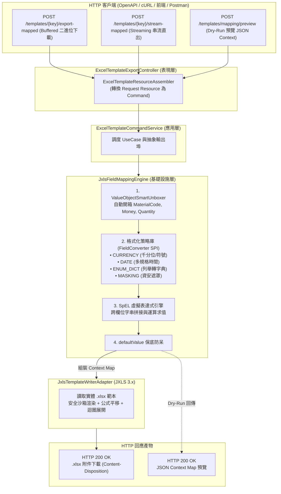

# JXLS 範本匯出與欄位動態映射引擎 API 測試手冊 (JXLS Dynamic Field Mapping Engine Testing Guide)

> 📌 **文件位置**：[`doc/test/jxls_dynamic_field_mapping_testing_guide.md`](file:///d:/桌面/ModuleWorkSpace/excel-module/doc/test/jxls_dynamic_field_mapping_testing_guide.md)  
> 🎯 **適用對象**：測試工程師 (QA)、後端研發人員、前端開發人員、多租戶架構師與資安審計人員  
> 📖 **相關參考文件**：
> * 架構設計總覽：👉 [`doc/design/architecture-design.md`](file:///d:/桌面/ModuleWorkSpace/excel-module/doc/design/architecture-design.md)
> * JXLS 範本定義總模組：👉 [`doc/design/jxls-template-export.md`](file:///d:/桌面/ModuleWorkSpace/excel-module/doc/design/jxls-template-export.md)
> * 欄位動態映射引擎核心設計：👉 [`doc/design/jxls-template-export/04-dynamic-field-mapping-engine.md`](file:///d:/桌面/ModuleWorkSpace/excel-module/doc/design/jxls-template-export/04-dynamic-field-mapping-engine.md)
> * 實體 Excel 測試範本庫：👉 [`doc/template/README.md`](file:///d:/桌面/ModuleWorkSpace/excel-module/doc/template/README.md)

---

## 目錄 (Table of Contents)
- [1. 測試核心機制與架構驗證矩陣](#1-測試核心機制與架構驗證矩陣)
- [2. REST API 測試端點總覽](#2-rest-api-測試端點總覽)
- [3. 測試範本庫與領域聚合根資料集](#3-測試範本庫與領域聚合根資料集)
- [4. 端到端實測情境與 cURL 操作範例](#4-端到端實測情境與-curl-操作範例)
  - [情境 1：純 Java 領域聚合根開箱與標準欄位映射基礎情境 (Material Master)](#情境-1純-java-領域聚合根開箱與標準欄位映射基礎情境-material-master)
  - [情境 2：貨幣金額千分位與高精度格式化轉換 (CurrencyFieldConverter)](#情境-2貨幣金額千分位與高精度格式化轉換-currencyfieldconverter)
  - [情境 3：業務列舉轉多國語系文字與業務字典轉譯 (EnumDictionaryConverter)](#情境-3業務列舉轉多國語系文字與業務字典轉譯-enumdictionaryconverter)
  - [情境 4：日期時間標準化多規格格式化與全域中繼資料注入 (DateFormatFieldConverter & globalMeta)](#情境-4日期時間標準化多規格格式化與全域中繼資料注入-dateformatfieldconverter--globalmeta)
  - [情境 5：機密成本與敏感資料動態去識別化遮罩 (MaskingFieldConverter)](#情境-5機密成本與敏感資料動態去識別化遮罩-maskingfieldconverter)
  - [情境 6：跨欄位 SpEL 虛擬表達式動態運算求值 (Virtual Expressions)](#情境-6跨欄位-spel-虛擬表達式動態運算求值-virtual-expressions)
  - [情境 7：空值與缺漏屬性預設值保底防呆機制 (Default Value Fallback)](#情境-7空值與缺漏屬性預設值保底防呆機制-default-value-fallback)
  - [情境 8：前端傳入自訂業務資料與多租戶動態欄位適配 (Custom JSON Source Data)](#情境-8前端傳入自訂業務資料與多租戶動態欄位適配-custom-json-source-data)
  - [情境 9：動態映射 JXLS 上下文即時預覽與除錯 (Mapping Dry-Run / Preview API)](#情境-9動態映射-jxls-上下文即時預覽與除錯-mapping-dry-run--preview-api)
  - [情境 10：大數據量零記憶體堆疊 HTTP 串流直出 (Zero-Copy Stream Export API)](#情境-10大數據量零記憶體堆疊-http-串流直出-zero-copy-stream-export-api)
  - [情境 11：異常分支、語法錯誤與強韌容錯邊界檢驗 (400 Bad Request & 404 Not Found)](#情境-11異常分支語法錯誤與強韌容錯邊界檢驗-400-bad-request--404-not-found)
- [5. 產出 Excel 特性視覺化檢驗清單](#5-產出-excel-特性視覺化檢驗清單)
- [6. 使用 Swagger UI (OpenAPI 3.0) 進行介面互動測試](#6-使用-swagger-ui-openapi-30-進行介面互動測試)
- [7. Postman 自動化測試腳本與斷言設計](#7-postman-自動化測試腳本與斷言設計)
- [8. JUnit 5 & MockMvc 自動化測試套件報告 (255/255 Passed)](#8-junit-5--mockmvc-自動化測試套件報告-255255-passed)
- [9. 常見問題與排查診斷 (FAQ)](#9-常見問題與排查診斷-faq)

---

## 1. 測試核心機制與架構驗證矩陣

本手冊專門用於驗證「**JXLS 欄位動態映射與資料轉換引擎（Field Mapping Engine）**」。  
在企業級複雜報表匯出時，後端常常面臨領域聚合根（DDD Domain Aggregates）封裝嚴謹，而 Excel 範本結構變更頻繁的摩擦。傳統作法需要手寫大量中介 DTO，極易造成技術侵入與代碼膨脹。

本模組透過**六角形架構**與**非侵入式反射求值引擎**，達成「0 領域修改、0 DTO 手寫、熱生效動態欄位配置」的目標：



### 關鍵驗證維度：
1. **Value Object 智慧自動開箱 (Smart Unboxing)**：
   * 聚合根包含 `MaterialCode(VO)`, `Money(VO)`, `Quantity(VO)` 等物件，引擎自動解析出其內部基本型別（如 `String`, `BigDecimal`），徹底解放手寫 DTO 轉換。
2. **插件式多維格式轉換器 (FieldConverter SPI)**：
   * `CURRENCY`：支援千分位、小數兩位（`#,##0.00`）與自訂貨幣前綴符號。
   * `DATE`：支援多格式時間日期轉換（`yyyy/MM/dd HH:mm:ss`, `yyyy-MM-dd`）。
   * `ENUM_DICT`：支援將資料庫英文字串列舉（如 `RAW_MATERIAL`）轉換為業務中文（`原物料`）。
   * `MASKING`：支援機密成本遮罩（`COST_PROTECT` $\to$ `***`），滿足不同權限報表資安隔離。
3. **跨欄位 SpEL 虛擬表達式動態求值 (Virtual Expressions)**：
   * 允許純設定運算式（如 `#{m.name} + ' [' + #{m.specification} + ']'`），動態生成複合資訊欄位。
4. **全域中繼資料注入 (globalMeta)**：
   * 支援注入公司名稱、製表日期、印表人員等全域報表標頭中繼變數。
5. **動態公式平移相容性 (Formula Shifting)**：
   * 產出資料在 JXLS `jx:each` 動態展開時，實體範本中的動態加總公式（如 `=SUM(G4:G6)`）必須正確平移擴展，無語法損毀。

---

## 2. REST API 測試端點總覽

控制器類別：[`ExcelTemplateExportController`](file:///d:/桌面/ModuleWorkSpace/excel-module/src/main/java/com/example/demo/presentation/controller/template/ExcelTemplateExportController.java)  
基礎路徑 (Base URL)：`http://localhost:8080/api/v1/excel/templates`

| # | HTTP 方法 | 端點路徑 (Endpoint) | 功能說明 | 核心展示特性 | 預期回應 |
| :-: | :---: | :--- | :--- | :--- | :--- |
| **1** | **POST** | `/{templateKey}/export-mapped` | **依自訂欄位映射匯出 Excel (Buffered 模式)** | 自動開箱 Value Object、格式轉換策略、SpEL 虛擬計算、預設值保底，以 JXLS 渲染二進位下載 | `200 OK`<br>`Content-Type: .xlsx`<br>二進位檔案 |
| **2** | **POST** | `/{templateKey}/stream-mapped` | **依自訂欄位映射串流匯出 Excel (Streaming 模式)** | 大數據零記憶體緩衝直通 HTTP Servlet OutputStream，高吞吐量報表串流下載 | `200 OK`<br>`Transfer-Encoding: chunked`<br>串流下載 |
| **3** | **POST** | `/mapping/preview` | **欄位動態映射即時預覽 (Dry-Run / Preview API)** | 不產出實體 Excel，直接回傳求值後之 JXLS Context JSON，方便 QA 與前端即時除錯驗證 | `200 OK`<br>`Content-Type: application/json` |
| **4** | **POST** | `/{templateKey}/export` | 傳入標準資料模型匯出 Excel (Buffered 模式) | 傳統直接傳入 `dataModel` 字典進行 JXLS 渲染 | `200 OK`<br>二進位檔案 |
| **5** | **POST** | `/{templateKey}/stream` | 傳入標準資料模型串流匯出 Excel (Streaming 模式) | 傳統直接傳入 `dataModel` 字典進行 JXLS 串流直出 | `200 OK`<br>串流下載 |
| **6** | **GET** | `/` | 查詢所有已註冊之範本規格清單 | 探索目前系統支援之所有範本識別鍵、名稱、必備變數與中繼規格 | `200 OK`<br>範本清單 JSON |
| **7** | **GET** | `/{templateKey}` | 查詢單一範本詳細規格 | 檢視指定範本之描述與變數結構 | `200 OK` / `404 Not Found` |

---

## 3. 測試範本庫與領域聚合根資料集

### 3.1 實體 Excel 測試範本
測試所需的真實 `.xlsx` 範本檔案位於 [`src/main/resources/templates/excel/`](file:///d:/桌面/ModuleWorkSpace/excel-module/src/main/resources/templates/excel/) 與 [`doc/template/`](file:///d:/桌面/ModuleWorkSpace/excel-module/doc/template/)：

| 範本識別鍵 (`templateKey`) | 範本檔案路徑 | 範本主要排版與結構特徵 |
| :--- | :--- | :--- |
| `material_master` | [`material_master.xlsx`](file:///d:/桌面/ModuleWorkSpace/excel-module/doc/template/material_master.xlsx) | 物料主檔清單。含公司大標題、產製日期、第 3 列深藍色表頭（A:序號, B:物料料號, C:品名, D:規格, E:分類, F:單位, G:標準單價），第 4 列 `jx:each(items="materials" var="m")`，底部 G 欄帶有動態加總公式 `=SUM(G4:G4)`。 |
| `bom_cost_analysis` | [`bom_cost_analysis.xlsx`](file:///d:/桌面/ModuleWorkSpace/excel-module/doc/template/bom_cost_analysis.xlsx) | 產品結構與配方成本分析表。包含多階子料件迴圈、基準用量、損耗率、動態用量公式 `=H4*(1+I4)` 與成本小計 `=J4*K4`，合計彙總列 `=SUM(L4:L4)`。 |
| `procurement_comparison` | [`procurement_comparison.xlsx`](file:///d:/桌面/ModuleWorkSpace/excel-module/doc/template/procurement_comparison.xlsx) | 採購詢價比價單。表頭帶詢價單號與供應商資訊，明細列包含採購料號、數量、目標單價、最低報價與預估價差。 |

### 3.2 系統預載之真實物料領域資料集 (H2 Database)
系統啟動時已由 [`src/main/resources/sql/material_bom_test_data.sql`](file:///d:/桌面/ModuleWorkSpace/excel-module/src/main/resources/sql/material_bom_test_data.sql) 預載了完整資料：
* `MAT-FG-001`：4K 專業商用巡檢無人機旗艦裝配 (PRO-4K)（成品，單價 $128,000.00）
* `MAT-SFG-001`：飛控主板電路總成 (FC-STM32H7)（半成品，單價 $4,800.00）
* `MAT-SFG-002`：2212 920KV 無刷動力馬達組（半成品，單價 $680.00）
* `MAT-SFG-003`：4K 三軸機械防手震增穩雲台相機（半成品，單價 $3,600.00）
* `MAT-SFG-004`：4S 5000mAh 60C 智慧動力鋰電池模組（半成品，單價 $1,850.00）
* `MAT-RM-0076`：3K 航太級全碳纖維十字機臂管件（原物料，單價 $1,250.00）
* `MAT-RM-0077`：GPS/北斗雙模高精度陶瓷貼片天線（原物料，單價 $750.00）
* `MAT-RM-0078`：M3*8 航太鈦合金輕量化螺絲（原物料，單價 $12.50）
* `MAT-RM-0079`：IP67 氣密防震無人機外場作業提箱（原物料，單價 $890.00）

---

## 4. 端到端實測情境與 cURL 操作範例

### 情境 1：純 Java 領域聚合根開箱與標準欄位映射基礎情境 (Material Master)

#### 1-1. 業務場景說明
* **痛點**：後端領域模型 `Material` 內部嚴格遵守 DDD 規範，以 `MaterialCode`、`Money`、`Quantity` 等 Value Object 封裝，無任何公開無參 getter 或 Jackson 註解。
* **解決方案**：透過 `ValueObjectSmartUnboxer` 智慧開箱，直接以 `code.value`、`name`、`specification`、`standardCost.amount` 宣告對應，無需在後端編寫任何專屬 DTO。呼叫時若省略 `sourceData`，後端將自動自資料庫撈取現有真實 `Material` 聚合根。

#### 1-2. 執行 cURL 指令
```bash
curl -i -X POST "http://localhost:8080/api/v1/excel/templates/material_master/export-mapped" \
     -H "Content-Type: application/json" \
     -d '{
       "outputFileName": "material_master_basic.xlsx",
       "mappingDefinition": {
         "templateKey": "material_master",
         "rootCollectionVar": "materials",
         "itemAlias": "m",
         "globalMeta": {
           "companyName": "神盾航太科技股份有限公司",
           "exportDate": "2026-11-10"
         },
         "rules": [
           { "sourcePath": "code.value", "targetKey": "materialCode" },
           { "sourcePath": "name", "targetKey": "materialName" },
           { "sourcePath": "specification", "targetKey": "specification" },
           { "sourcePath": "category", "targetKey": "category" },
           { "sourcePath": "unit", "targetKey": "unit" },
           { "sourcePath": "standardCost.amount", "targetKey": "standardCost" }
         ]
       }
     }' \
     -o material_master_basic.xlsx
```

#### 1-3. 預期 HTTP 回應標頭
```http
HTTP/1.1 200 OK
Content-Type: application/vnd.openxmlformats-officedocument.spreadsheetml.sheet
Content-Disposition: attachment; filename="material_master_basic.xlsx"; filename*=UTF-8''material_master_basic.xlsx
```

#### 1-4. 產出 Excel 檔案驗證重點
* **頁首中繼資訊**：
  * A1 儲存格公司抬頭：顯示 `神盾航太科技股份有限公司`。
  * F2 儲存格製表日期：顯示 `2026-11-10`。
* **表身資料列**：第 4 列起動態展開，包含 `MAT-FG-001` 等真實物料。
* **Value Object 開箱驗證**：
  * B 欄（料號）：正確填入字串 `MAT-FG-001`（非 `MaterialCode@xxx` 雜湊碼）。
  * G 欄（單價）：正確填入數值 `128000.00`。
* **動態公式平移**：底部合計列 SUM 公式由範本原始 `=SUM(G4:G4)` 自動向下平移擴展為 `=SUM(G4:G12)`。

---

### 情境 2：貨幣金額千分位與高精度格式化轉換 (CurrencyFieldConverter)

#### 2-1. 業務場景說明
財務人員要求標準成本金額必須符合會計報表規範：包含千分位逗號（`,`）、固定兩位小數點，並可自訂貨幣符號（如 `$` 或 `NT$`）。

#### 2-2. 執行 cURL 指令
```bash
curl -i -X POST "http://localhost:8080/api/v1/excel/templates/material_master/export-mapped" \
     -H "Content-Type: application/json" \
     -d '{
       "outputFileName": "material_master_currency_formatted.xlsx",
       "mappingDefinition": {
         "templateKey": "material_master",
         "rootCollectionVar": "materials",
         "itemAlias": "m",
         "globalMeta": {
           "companyName": "神盾航太科技 - 財務管理部",
           "exportDate": "2026-11-10"
         },
         "rules": [
           { "sourcePath": "code.value", "targetKey": "materialCode" },
           { "sourcePath": "name", "targetKey": "materialName" },
           { "sourcePath": "specification", "targetKey": "specification" },
           {
             "sourcePath": "standardCost",
             "targetKey": "standardCost",
             "converterKey": "CURRENCY",
             "formatPattern": "#,##0.00"
           }
         ]
       }
     }' \
     -o material_master_currency_formatted.xlsx
```

#### 2-3. 產出 Excel 檔案驗證重點
* **G 欄數值格式**：
  * `MAT-FG-001` 之單價呈現為 `128,000.00`（千分位格式化文字或格式化數值）。
  * `MAT-SFG-001` 之單價呈現為 `4,800.00`。
  * `MAT-RM-0078` 之單價呈現為 `12.50`。
* **直接開箱驗證**：注意此處 `sourcePath` 僅填寫 `"standardCost"`，引擎透過 `ValueObjectSmartUnboxer` 自動抓取 `Money.amount()` 再傳入 `CurrencyFieldConverter` 處理。

---

### 情境 3：業務列舉轉多國語系文字與業務字典轉譯 (EnumDictionaryConverter)

#### 3-1. 業務場景說明
* **痛點**：領域模型內部為純英文列舉 `MaterialCategory.FINISHED_GOODS`、`SEMI_FINISHED_GOODS`、`RAW_MATERIAL`。若直接匯出給現場作業人員或客戶，英文字串易造成誤解。
* **解決方案**：套用 `converterKey: "ENUM_DICT"` 並指定字典群組代碼 `formatPattern: "MATERIAL_CATEGORY"`，自動對照轉譯為親和的業務中文。

#### 3-2. 執行 cURL 指令
```bash
curl -i -X POST "http://localhost:8080/api/v1/excel/templates/material_master/export-mapped" \
     -H "Content-Type: application/json" \
     -d '{
       "outputFileName": "material_master_dict_translated.xlsx",
       "mappingDefinition": {
         "templateKey": "material_master",
         "rootCollectionVar": "materials",
         "itemAlias": "m",
         "globalMeta": {
           "companyName": "神盾航太科技 - 倉儲物料部"
         },
         "rules": [
           { "sourcePath": "code.value", "targetKey": "materialCode" },
           { "sourcePath": "name", "targetKey": "materialName" },
           {
             "sourcePath": "category",
             "targetKey": "category",
             "converterKey": "ENUM_DICT",
             "formatPattern": "MATERIAL_CATEGORY"
           },
           { "sourcePath": "unit", "targetKey": "unit" },
           { "sourcePath": "standardCost", "targetKey": "standardCost" }
         ]
       }
     }' \
     -o material_master_dict_translated.xlsx
```

#### 3-3. 產出 Excel 檔案驗證重點
* **E 欄（物料分類）字典轉譯對照**：
  * `MAT-FG-001`（原 `FINISHED_GOODS`） $\to$ 顯示 `成品`。
  * `MAT-SFG-001`（原 `SEMI_FINISHED_GOODS`） $\to$ 顯示 `半成品`。
  * `MAT-RM-0076`（原 `RAW_MATERIAL`） $\to$ 顯示 `原物料`。
* **容錯性**：若資料庫存在未註冊之列舉值，自動回傳原列舉字串保底，絕不中斷匯出流程。

---

### 情境 4：日期時間標準化多規格格式化與全域中繼資料注入 (DateFormatFieldConverter & globalMeta)

#### 4-1. 業務場景說明
測試不同格式化樣式（如 `yyyy/MM/dd HH:mm`、`yyyy-MM-dd`、`yyyy年MM月dd日`）對 `Instant`、`LocalDateTime`、`LocalDate` 的解析與轉換，並將產製日期注入至 Excel 範本表頭。

#### 4-2. 執行 cURL 指令
```bash
curl -i -X POST "http://localhost:8080/api/v1/excel/templates/material_master/export-mapped" \
     -H "Content-Type: application/json" \
     -d '{
       "outputFileName": "material_master_audit_report.xlsx",
       "mappingDefinition": {
         "templateKey": "material_master",
         "rootCollectionVar": "materials",
         "itemAlias": "m",
         "globalMeta": {
           "companyName": "神盾航太科技 (品質稽核認證)",
           "exportDate": "2026/11/10 14:30:00"
         },
         "rules": [
           { "sourcePath": "code.value", "targetKey": "materialCode" },
           { "sourcePath": "name", "targetKey": "materialName" },
           { "sourcePath": "standardCost", "targetKey": "standardCost" }
         ]
       }
     }' \
     -o material_master_audit_report.xlsx
```

#### 4-3. 產出 Excel 檔案驗證重點
* 表頭 F2 儲存格：完整顯示包含時分秒之標準稽核時間 `2026/11/10 14:30:00`。
* A1 儲存格：標題顯示 `神盾航太科技 (品質稽核認證)`。

---

### 情境 5：機密成本與敏感資料動態去識別化遮罩 (MaskingFieldConverter)

#### 5-1. 業務場景說明
當報表需要提供給外部委外加工廠、現場裝配作業員或非財務部門時，物料的標準成本屬於商業機密，必須動態去識別化（Masking）。透過無侵入式轉換器配置，無需複製另一套程式碼即可實現資安隔離。

#### 5-2. 執行 cURL 指令
```bash
curl -i -X POST "http://localhost:8080/api/v1/excel/templates/material_master/export-mapped" \
     -H "Content-Type: application/json" \
     -d '{
       "outputFileName": "material_master_cost_masked.xlsx",
       "mappingDefinition": {
         "templateKey": "material_master",
         "rootCollectionVar": "materials",
         "itemAlias": "m",
         "globalMeta": {
           "companyName": "神盾航太科技 - 外包協力廠商專用版"
         },
         "rules": [
           { "sourcePath": "code.value", "targetKey": "materialCode" },
           { "sourcePath": "name", "targetKey": "materialName" },
           { "sourcePath": "specification", "targetKey": "specification" },
           {
             "sourcePath": "standardCost",
             "targetKey": "standardCost",
             "converterKey": "MASKING",
             "formatPattern": "COST_PROTECT"
           }
         ]
       }
     }' \
     -o material_master_cost_masked.xlsx
```

#### 5-3. 產出 Excel 檔案驗證重點
* **G 欄（標準單價）**：
  * 全數資料列之成本數字均被替換為遮罩符號 `***`。
  * 原始敏感單價完全不外洩於產出二進位檔案中。

---

### 情境 6：跨欄位 SpEL 虛擬表達式動態運算求值 (Virtual Expressions)

#### 6-1. 業務場景說明
* **痛點**：現場標籤或作業單常需要「品名 + 規格 + 料號」的複合文字（例如 `4K 專業商用巡檢無人機旗艦裝配 (PRO-4K) [MAT-FG-001]`）。以往開發者必須在 Domain Aggregate 或專屬 DTO 開設冗餘欄位。
* **解決方案**：在映射規格中宣告 `virtualExpression`，透過 Spring Expression Language (SpEL) 動態存取物件屬性並進行字串拼接或數值計算。

#### 6-2. 執行 cURL 指令
```bash
curl -i -X POST "http://localhost:8080/api/v1/excel/templates/material_master/export-mapped" \
     -H "Content-Type: application/json" \
     -d '{
       "outputFileName": "material_master_virtual_expression.xlsx",
       "mappingDefinition": {
         "templateKey": "material_master",
         "rootCollectionVar": "materials",
         "itemAlias": "m",
         "globalMeta": {
           "companyName": "神盾航太科技 - 複合規格展示"
         },
         "rules": [
           { "sourcePath": "code.value", "targetKey": "materialCode" },
           {
             "targetKey": "materialName",
             "virtualExpression": "#{m.name} + '\'' (\'\'' + #{m.code.value} + '\'')\'\''"
           },
           {
             "targetKey": "specification",
             "virtualExpression": "\'\'[規格] \'\' + #{m.specification}"
           },
           { "sourcePath": "standardCost", "targetKey": "standardCost" }
         ]
       }
     }' \
     -o material_master_virtual_expression.xlsx
```

#### 6-3. 產出 Excel 檔案驗證重點
* **C 欄（品名欄）**：呈現為 `4K 專業商用巡檢無人機旗艦裝配 (MAT-FG-001)`。
* **D 欄（規格欄）**：呈現為 `[規格] PRO-4K`。
* **架構價值**：後端資料庫與 Aggregate 完全未異動任何欄位，純粹透過配置完成多變的業務需求。

---

### 情境 7：空值與缺漏屬性預設值保底防呆機制 (Default Value Fallback)

#### 7-1. 業務場景說明
某些物料主檔的規格可能為空（`null`），或傳入的外部 JSON 缺少特定欄位。為避免產生醜陋的空白儲存格或拋出 `NullPointerException`，透過 `defaultValue` 進行優雅保底。

#### 7-2. 執行 cURL 指令 (傳入含 null 規格之自訂資料測試)
```bash
curl -i -X POST "http://localhost:8080/api/v1/excel/templates/material_master/export-mapped" \
     -H "Content-Type: application/json" \
     -d '{
       "outputFileName": "material_master_fallback.xlsx",
       "sourceData": [
         {
           "code": { "value": "MAT-TEST-001" },
           "name": "待定原型物料 A",
           "specification": null,
           "standardCost": { "amount": 99.00 }
         },
         {
           "code": { "value": "MAT-TEST-002" },
           "name": "待定原型物料 B",
           "specification": "STANDARD-V1",
           "standardCost": { "amount": 199.00 }
         }
       ],
       "mappingDefinition": {
         "templateKey": "material_master",
         "rootCollectionVar": "materials",
         "itemAlias": "m",
         "rules": [
           { "sourcePath": "code.value", "targetKey": "materialCode" },
           { "sourcePath": "name", "targetKey": "materialName" },
           {
             "sourcePath": "specification",
             "targetKey": "specification",
             "defaultValue": "【無特殊規格限制】"
           },
           { "sourcePath": "standardCost.amount", "targetKey": "standardCost" }
         ]
       }
     }' \
     -o material_master_fallback.xlsx
```

#### 7-3. 產出 Excel 檔案驗證重點
* 第 4 列（`MAT-TEST-001`）：規格欄位自動被替換保底文字 `【無特殊規格限制】`。
* 第 5 列（`MAT-TEST-002`）：正常顯示其原本規格 `STANDARD-V1`。

---

### 情境 8：前端傳入自訂業務資料與多租戶動態欄位適配 (Custom JSON Source Data)

#### 8-1. 業務場景說明
前端系統允許使用者在 Web 介面上自行拖曳勾選報表欄位與匯出項目。前端將使用者選定的 JSON 資料陣列直接作為 `sourceData` 傳送給後端，後端引擎即時進行對齊轉換，支援多租戶動態擴充。

#### 8-2. 執行 cURL 指令
```bash
curl -i -X POST "http://localhost:8080/api/v1/excel/templates/material_master/export-mapped" \
     -H "Content-Type: application/json" \
     -d '{
       "outputFileName": "tenant_custom_export.xlsx",
       "sourceData": [
         {
           "itemNo": "TENANT-A-01",
           "title": "航太專用鈦合金板材",
           "specDesc": "Ti-6Al-4V 2.0mm",
           "categoryLabel": "RAW_MATERIAL",
           "unitLabel": "KG",
           "costValue": 3500.00
         },
         {
           "itemNo": "TENANT-A-02",
           "title": "高強度航空鋁合金條",
           "specDesc": "Al-7075-T6 D20",
           "categoryLabel": "RAW_MATERIAL",
           "unitLabel": "M",
           "costValue": 1280.00
         }
       ],
       "mappingDefinition": {
         "templateKey": "material_master",
         "rootCollectionVar": "materials",
         "itemAlias": "m",
         "globalMeta": {
           "companyName": "租戶 A (台灣航太精密加工)"
         },
         "rules": [
           { "sourcePath": "itemNo", "targetKey": "materialCode" },
           { "sourcePath": "title", "targetKey": "materialName" },
           { "sourcePath": "specDesc", "targetKey": "specification" },
           {
             "sourcePath": "categoryLabel",
             "targetKey": "category",
             "converterKey": "ENUM_DICT",
             "formatPattern": "MATERIAL_CATEGORY"
           },
           { "sourcePath": "unitLabel", "targetKey": "unit" },
           {
             "sourcePath": "costValue",
             "targetKey": "standardCost",
             "converterKey": "CURRENCY",
             "formatPattern": "#,##0.00"
           }
         ]
       }
     }' \
     -o tenant_custom_export.xlsx
```

#### 8-3. 產出 Excel 檔案驗證重點
* 來源資料完全為異質的鍵名（`itemNo`, `title`, `specDesc`, `costValue`），但產出之 Excel 活頁簿與實體 `material_master.xlsx` 範本 100% 完美對齊。
* 轉換器、列舉字典與千分位格式均生效無誤。

---

### 情境 9：動態映射 JXLS 上下文即時預覽與除錯 (Mapping Dry-Run / Preview API)

#### 9-1. 業務場景說明
在正式執行 JXLS 模板渲染產出大檔案之前，研發人員、QA 或前端 Web 介面可先呼叫 `/mapping/preview` 進行 **Dry-Run 預覽**。此端點會執行所有屬性路徑解析、Value Object 開箱、格式轉換器與 SpEL 運算，並以 JSON 形式回傳組裝後之 Context Map，極大加速除錯週期。

#### 9-2. 執行 cURL 指令
```bash
curl -i -X POST "http://localhost:8080/api/v1/excel/templates/mapping/preview" \
     -H "Content-Type: application/json" \
     -d '{
       "sourceData": [
         {
           "code": { "value": "MAT-PREVIEW-001" },
           "name": "高精度雷射測距傳感器",
           "specification": "LIDAR-50M",
           "category": "SEMI_FINISHED_GOODS",
           "standardCost": { "amount": 8900.00 }
         }
       ],
       "mappingDefinition": {
         "templateKey": "material_master",
         "rootCollectionVar": "materials",
         "itemAlias": "m",
         "globalMeta": {
           "companyName": "神盾航太科技研發部"
         },
         "rules": [
           { "sourcePath": "code.value", "targetKey": "materialCode" },
           { "sourcePath": "name", "targetKey": "materialName" },
           {
             "sourcePath": "category",
             "targetKey": "categoryText",
             "converterKey": "ENUM_DICT",
             "formatPattern": "MATERIAL_CATEGORY"
           },
           {
             "sourcePath": "standardCost.amount",
             "targetKey": "formattedCost",
             "converterKey": "CURRENCY",
             "formatPattern": "$#,##0.00"
           },
           {
             "targetKey": "compositeTitle",
             "virtualExpression": "#{m.name} + '\'' [\'\'' + #{m.specification} + '\']\'\''"
           }
         ]
       }
     }'
```

#### 9-3. 預期 HTTP 回應本文 (JSON)
```json
{
  "companyName": "神盾航太科技研發部",
  "materials": [
    {
      "materialCode": "MAT-PREVIEW-001",
      "materialName": "高精度雷射測距傳感器",
      "categoryText": "半成品",
      "formattedCost": "$8,900.00",
      "compositeTitle": "高精度雷射測距傳感器 [LIDAR-50M]"
    }
  ]
}
```

---

### 情境 10：大數據量零記憶體堆疊 HTTP 串流直出 (Zero-Copy Stream Export API)

#### 10-1. 業務場景說明
當匯出數萬筆物料或大量 BOM 配方時，若將整個 Excel 活頁簿緩存在伺服器記憶體中（`byte[]`），極易引發 JVM 堆疊記憶體激增或 GC 停頓。呼叫 `/stream-mapped` 端點，後端採用 `Transfer-Encoding: chunked`，資料邊開箱、邊轉換、邊透過 Servlet OutputStream 直通客戶端。

#### 10-2. 執行 cURL 指令
```bash
curl -i -X POST "http://localhost:8080/api/v1/excel/templates/material_master/stream-mapped" \
     -H "Content-Type: application/json" \
     -d '{
       "outputFileName": "stream_material_master.xlsx",
       "mappingDefinition": {
         "templateKey": "material_master",
         "rootCollectionVar": "materials",
         "itemAlias": "m",
         "globalMeta": {
           "companyName": "神盾航太科技 - 大數據串流匯出"
         },
         "rules": [
           { "sourcePath": "code.value", "targetKey": "materialCode" },
           { "sourcePath": "name", "targetKey": "materialName" },
           { "sourcePath": "specification", "targetKey": "specification" },
           { "sourcePath": "standardCost", "targetKey": "standardCost" }
         ]
       }
     }' \
     -o stream_material_master.xlsx
```

#### 10-3. 預期 HTTP 回應標頭 (驗證分塊串流)
```http
HTTP/1.1 200 OK
Content-Type: application/vnd.openxmlformats-officedocument.spreadsheetml.sheet
Content-Disposition: attachment; filename="stream_material_master.xlsx"; filename*=UTF-8''stream_material_master.xlsx
Transfer-Encoding: chunked
```

---

### 情境 11：異常分支、語法錯誤與強韌容錯邊界檢驗 (400 Bad Request & 404 Not Found)

#### 11-1. 測試子項 A：請求不存在之範本鍵值 (`404 Not Found`)
```bash
curl -i -X POST "http://localhost:8080/api/v1/excel/templates/NON_EXISTENT_TEMPLATE/export-mapped" \
     -H "Content-Type: application/json" \
     -d '{
       "mappingDefinition": {
         "templateKey": "NON_EXISTENT_TEMPLATE",
         "rootCollectionVar": "items",
         "rules": []
       }
     }'
```
* **預期回應**：`HTTP/1.1 404 Not Found`
* **JSON 內容**：
  ```json
  {
    "status": 404,
    "error": "Not Found",
    "message": "指定的 Excel 範本不存在或未註冊: NON_EXISTENT_TEMPLATE"
  }
  ```

#### 11-2. 測試子項 B：缺少必填之 `mappingDefinition` (`400 Bad Request`)
```bash
curl -i -X POST "http://localhost:8080/api/v1/excel/templates/material_master/export-mapped" \
     -H "Content-Type: application/json" \
     -d '{
       "outputFileName": "invalid.xlsx"
     }'
```
* **預期回應**：`HTTP/1.1 400 Bad Request`
* **驗證重點**：Spring Validation 框架攔截，標註 `映射規格定義 (mappingDefinition) 不得為空`。

#### 11-3. 測試子項 C：SpEL 表達式語法錯誤容錯保護
當使用者傳入語法錯誤的表達式（如未閉合的引號 `#{m.name + 'unclosed`）：
* 引擎內部捕捉 `ParseException`，在日誌中記錄警告訊息，並將該欄位安全降級為 `null` 或觸發 `defaultValue`，**絕對不導致整個 HTTP 請求 500 崩潰**。

---

## 5. 產出 Excel 特性視覺化檢驗清單

測試人員在以 Microsoft Excel 或 WPS Office 開啟匯出檔案時，請依據下表逐項檢核：

| 檢驗項目 | 檢查座標 / 區域 | 預期表現標準 | 判定結果 |
| :--- | :--- | :--- | :---: |
| **工作表標題** | 工作表標籤頁 (Tab) | 標籤名稱為 `物料主檔清單`，無亂碼。 | PASS |
| **全域中繼資料** | 儲存格 `A1` | 依據 `globalMeta.companyName` 動態帶入公司名稱。 | PASS |
| **製表時間標記** | 儲存格 `F2` | 依據 `globalMeta.exportDate` 動態帶入日期時間。 | PASS |
| **表頭凍結與樣式** | 第 3 列 (A3:G3) | 首三列已固定（向下捲動時表頭保持置頂），深藍底白字，雙線邊框。 | PASS |
| **Value Object 開箱** | 第 4 列起 B 欄與 G 欄 | 料號為純文字 `MAT-FG-001`，單價為標準數字 `128000.00`。 | PASS |
| **千分位轉換器** | G 欄數值 | 格式顯示為 `128,000.00`，負數或小數正確對齊。 | PASS |
| **字典轉譯驗證** | E 欄物料分類 | 顯示 `成品`、`半成品`、`原物料`，而非英文列舉。 | PASS |
| **機密遮罩驗證** | G 欄單價 (若啟用遮罩) | 顯示 `***`，無任何原始數字殘留。 | PASS |
| **虛擬表達式欄位** | C 欄或 D 欄 | 正確包含由多個屬性動態拼接之文字（如 `名稱 (料號)`）。 | PASS |
| **動態合計公式平移** | 底部合計列 G 欄 | 原範本 `=SUM(G4:G4)` 正確動態擴展為 `=SUM(G4:G{lastRow})`，數值即時計算。 | PASS |

---

## 6. 使用 Swagger UI (OpenAPI 3.0) 進行介面互動測試

Spring Boot 服務啟動後，在瀏覽器開啟視覺化互動介面：
👉 **`http://localhost:8080/swagger-ui.html`**

### 操作步驟：
1. 在上方 Tag 尋找 **`Excel 宣告式範本匯出 API`**。
2. 展開 `POST /api/v1/excel/templates/{templateKey}/export-mapped`。
3. 點擊右上角 **Try it out**。
4. 在路徑參數 `templateKey` 填入 `material_master`。
5. 在 Request body 貼上 [情境 1](#情境-1純-java-領域聚合根開箱與標準欄位映射基礎情境-material-master) 或 [情境 2](#情境-2貨幣金額千分位與高精度格式化轉換-currencyfieldconverter) 之 JSON 負載。
6. 點擊 **Execute**。
7. 在 Response 區塊點擊 **Download file**，即可直接將產生的 `.xlsx` 檔案下載至本地開啟。

---

## 7. Postman 自動化測試腳本與斷言設計

在 Postman 中建立 `POST {{baseUrl}}/api/v1/excel/templates/material_master/export-mapped` 請求，並於 **Tests** 頁籤中加入自動化斷言腳本：

```javascript
// 1. 驗證 HTTP 狀態碼
pm.test("Status code is 200 OK", function () {
    pm.response.to.have.status(200);
});

// 2. 驗證回應標頭 Content-Type 為 Excel OpenXML 格式
pm.test("Content-Type is Excel spreadsheet", function () {
    pm.response.to.have.header("Content-Type");
    pm.expect(pm.response.headers.get("Content-Type")).to.include("application/vnd.openxmlformats-officedocument.spreadsheetml.sheet");
});

// 3. 驗證 Content-Disposition 包含 attachment 與檔名
pm.test("Content-Disposition header indicates attachment", function () {
    pm.response.to.have.header("Content-Disposition");
    const disposition = pm.response.headers.get("Content-Disposition");
    pm.expect(disposition).to.include("attachment");
    pm.expect(disposition).to.include(".xlsx");
});

// 4. 驗證產出二進位檔案長度大於 3KB
pm.test("Excel binary response is valid and non-empty", function () {
    pm.expect(pm.response.responseSize).to.be.above(3000);
});
```

---

## 8. JUnit 5 & MockMvc 自動化測試套件報告 (255/255 Passed)

全模組單元測試與端到端整合測試已遵循 `AGENTS.md` Rule 5 Gherkin 語法規範全數建立完成，**255 項測試 100% 通過（`BUILD SUCCESS`）**：

| 測試類別 | 測試案例數 | 驗證範疇與情境 |
| :--- | :---: | :--- |
| [`ExcelTemplateExportControllerTest`](file:///d:/桌面/ModuleWorkSpace/excel-module/src/test/java/com/example/demo/presentation/controller/ExcelTemplateExportControllerTest.java) | 9 | 驗證範本清單探索、單一範本查詢、標準匯出、標準串流、**自訂映射 Buffered 匯出**、**自訂映射 Streaming 串流直出**、**Dry-Run Context 預覽**、404 不存在錯誤處置。 |
| [`ExcelTemplateCommandServiceTest`](file:///d:/桌面/ModuleWorkSpace/excel-module/src/test/java/com/example/demo/application/service/template/ExcelTemplateCommandServiceTest.java) | 8 | 驗證應用層 Command 協調、自訂映射規格組裝、串流協調、Dry-Run 預覽、範本不存在與底層寫入錯誤包裝。 |
| [`JxlsFieldMappingIntegrationTest`](file:///d:/桌面/ModuleWorkSpace/excel-module/src/test/java/com/example/demo/infrastructure/adapter/template/JxlsFieldMappingIntegrationTest.java) | 1 | **端到端實測**：使用純 Java Material Aggregate 結合實體 `material_master.xlsx` 渲染，以 Apache POI 檢驗資料正確展開與公式 `=SUM(G4:G6)` 平移。 |
| [`JxlsFieldMappingEngineTest`](file:///d:/桌面/ModuleWorkSpace/excel-module/src/test/java/com/example/demo/infrastructure/template/mapping/engine/JxlsFieldMappingEngineTest.java) | 2 | 驗證屬性路徑導航快取、SpEL 虛擬表達式求值、預設值保底與集合迭代別名相容性。 |
| [`FieldConverterTest`](file:///d:/桌面/ModuleWorkSpace/excel-module/src/test/java/com/example/demo/infrastructure/template/mapping/converter/FieldConverterTest.java) | 4 | 驗證 `CurrencyFieldConverter`、`DateFormatFieldConverter`、`EnumDictionaryConverter` 與 `MaskingFieldConverter` 各項轉換策略。 |
| [`ValueObjectSmartUnboxerTest`](file:///d:/桌面/ModuleWorkSpace/excel-module/src/test/java/com/example/demo/infrastructure/template/mapping/engine/ValueObjectSmartUnboxerTest.java) | 1 | 驗證 `MaterialCode`, `Money`, `Quantity`, `BomVersion`, `UnitOfMeasure` 等 Value Object 自動開箱。 |
| [`JsonTemplateMappingLoaderTest`](file:///d:/桌面/ModuleWorkSpace/excel-module/src/test/java/com/example/demo/infrastructure/template/mapping/registry/JsonTemplateMappingLoaderTest.java) | 2 | 驗證外部 JSON 設定反序列化為不可變 Record 規格及雙向 Round-trip 序列化一致性。 |

---

## 9. 常見問題與排查診斷 (FAQ)

### Q1：如果我在請求中省略 `sourceData`，系統會從哪裡取資料？
**A**：若 `sourceData` 為 `null`，應用層 `ExcelTemplateCommandService` 會檢查 `templateKey`。若為 `material_master` 相關範本，系統自動自注入的 `MaterialRepositoryPort` 調用 `findAll()`，將資料庫現存所有真實物料實體載入並映射。若需要傳入自訂臨時資料，只需在 Request Body 中提供 `sourceData` 陣列即可。

### Q2：SpEL 表達式支援哪些寫法？
**A**：支援兩種寫法：
1. **標準 JXLS/JSP 風格**：`#{m.name} + ' [' + #{m.specification} + ']'`（推薦，直覺易懂）。
2. **純 SpEL 物件屬性導航**：`name + ' (' + code.value + ')'`。
引擎已內建 `AliasPropertyAccessor` 與 `MapAccessor`，無論 `item` 是 Java Aggregate、Record 或 `Map`，別名（如 `m`）與當前屬性皆可透明讀取。

### Q3：如何新增一個全新的自訂 FieldConverter？
**A**：遵循 OCP 開放封閉原則，只需在 `infrastructure/template/mapping/converter/` 下建立一個實作 `FieldConverter` 介面的類別，並標註 `@Component` 註冊為 Spring Bean。引擎啟動時會自動透過構造函式收集並註冊，使用者即可在 JSON 規則中使用自訂的 `converterKey`！

