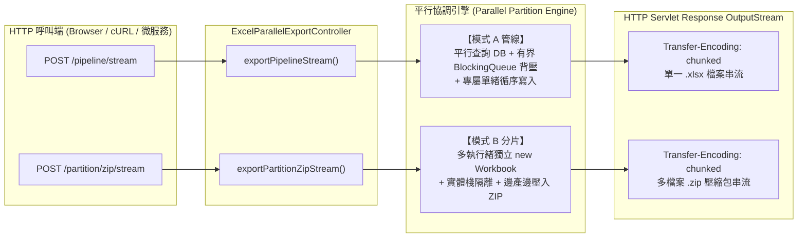

# 高並發平行管線與分片 ZIP 串流匯出測試手冊 (Parallel & Partition Stream Export Testing Guide)

> 📌 **文件定位**：座落於 [`doc/test/parallel_and_partition_export_testing_guide.md`](file:///d:/桌面/ModuleWorkSpace/excel-module/doc/test/parallel_and_partition_export_testing_guide.md)  
> 本手冊專為以下兩大核心高並發串流 API 提供完整的規格說明、cURL 實測指令、邊界與異常情境驗證、以及產出檔案完整性校驗方法：
> 1. **模式 A (微觀管線串流)**：`POST /api/v1/excel/parallel/pipeline/stream`
> 2. **模式 B / A+B (宏觀分片 ZIP 串流)**：`POST /api/v1/excel/parallel/partition/zip/stream`
>
> 💡 相關架構設計與執行緒安全原理請參閱：
> * 👉 [高並發與執行緒安全架構總覽 (thread-safety-and-concurrency.md)](file:///d:/桌面/ModuleWorkSpace/excel-module/doc/design/thread-safety-and-concurrency.md)
> * 👉 [寫入輸出埠對比與選型指引 (excel-writer-vs-partition-writer-comparison.md)](file:///d:/桌面/ModuleWorkSpace/excel-module/doc/design/excel-writer-vs-partition-writer-comparison.md)

---

## 一、 測試目標與架構解決方案

在企業級海量大數據匯出情境中，傳統單執行緒迴圈與全量快取方案常面臨三大致命瓶頸：
1. **資料庫 I/O 等待過長**：單執行緒逐批查詢資料庫耗時過長，CPU 與網路頻寬閒置。
2. **堆疊記憶體溢位 (OOM)**：未做背壓控制，資料庫快速查出數十萬筆物件佔滿記憶體。
3. **Excel 物理限制**：單一活頁簿上限為 **1,048,576 列**，巨量資料必然失敗。

針對上述問題，本模組實作了兩大**零堆疊記憶體緩衝（Zero-Heap Buffer）** 的 HTTP 直寫串流端點：



---

## 二、 API 規格與契約詳細定義 (API Specifications)

### 1. 模式 A 微觀管線串流 API：`POST /api/v1/excel/parallel/pipeline/stream`

* **端點路徑**：`/api/v1/excel/parallel/pipeline/stream`
* **HTTP 方法**：`POST`
* **請求格式**：`Content-Type: application/json`
* **回應格式**：`Content-Type: application/vnd.openxmlformats-officedocument.spreadsheetml.sheet`
* **傳輸模式**：`Transfer-Encoding: chunked`（邊產製邊傳輸，不暫存完整二進位檔案於記憶體）

#### 請求負載 (Request Body Schema)
| 欄位名稱 | 型別 | 必填 | 預設值 | 說明與約束 |
| :--- | :---: | :---: | :---: | :--- |
| `applicationName` | String | 否 | `ParallelPipelineApp` | 應用程式名稱（標註於 OpenXML Core 屬性中） |
| `sheetName` | String | **是** | - | 工作表名稱，同時決定下載檔名（例：`高並發訂單明細`） |
| `totalRows` | Integer| **是** | - | 預計產製總資料列數，必須 $\ge 0$ |
| `chunkSize` | Integer| 否 | `1000` | 單批資料拉取大小，必須 $> 0$ |
| `queueCapacity` | Integer| 否 | `30` | 有界佇列容量（背壓閾值，防止生產端過快衝爆記憶體），必須 $> 0$ |
| `parallelProducers`| Integer| 否 | `4` | 平行查詢資料庫的 Worker 執行緒數，必須 $> 0$ |
| `freezeHeader` | Boolean| 否 | `true` | 是否凍結首列表頭 |
| `headers` | Array | 否 | 預設表頭 | 自訂表頭清單，例如 `["序號", "訂單號", "金額", "時間"]` |
| `columnWidths` | Array | 否 | 自動計算 | 自訂欄寬清單（單位：字元寬度） |

---

### 2. 模式 B / A+B 宏觀分片 ZIP 串流 API：`POST /api/v1/excel/parallel/partition/zip/stream`

* **端點路徑**：`/api/v1/excel/parallel/partition/zip/stream`（亦支援別名 `/partition-zip/stream`）
* **HTTP 方法**：`POST`
* **請求格式**：`Content-Type: application/json`
* **回應格式**：`Content-Type: application/zip`
* **傳輸模式**：`Transfer-Encoding: chunked`（多活頁簿在背景並行產製，循序壓縮寫入 Response 輸出串流）

#### 請求負載 (Request Body Schema)
| 欄位名稱 | 型別 | 必填 | 預設值 | 說明與約束 |
| :--- | :---: | :---: | :---: | :--- |
| `zipFileName` | String | 否 | `partition_archive.zip` | 目標 ZIP 下載壓縮包檔名 |
| `baseFileName` | String | **是** | - | 內部 Excel 分片檔名前綴（如 `orders_part` $\to$ 自動產出 `orders_part_001.xlsx`） |
| `sheetName` | String | **是** | - | 各 Excel 檔案內部工作表名稱 |
| `totalRows` | Integer| **是** | - | 預計產製總資料列數（可輕易突破 100 萬列硬限制） |
| `maxRowsPerFile` | Integer| **是** | - | **單一 Excel 活頁簿最大資料列數上限**（例：`1000000`），自動計算分片數 |
| `chunkSize` | Integer| 否 | `1000` | 資料分塊大小 |
| `parallelProducersPerPartition`| Integer | 否 | `4` | 當啟用管線時，各分片內部平行查詢執行緒數 |
| `usePipelinePerPartition` | Boolean | 否 | `true` | **模式 A+B 組合拳開關**：各分片內部是否開啟微觀管線加速 |
| `freezeHeader` | Boolean| 否 | `true` | 是否凍結各分片首列表頭 |
| `headers` | Array | 否 | 預設表頭 | 自訂表頭清單 |

---

## 三、 測試情境與 cURL 實測指令庫

> [!NOTE]
> **💡 關於測試情境中「10 萬筆 / 250 萬筆」資料來源說明**：  
> 1. **展示與壓測端點之資料來源**：  
>    由表現層組裝器 [`ExcelParallelResourceAssembler.java:L118-L143`](file:///d:/桌面/ModuleWorkSpace/excel-module/src/main/java/com/example/demo/presentation/assembler/ExcelParallelResourceAssembler.java#L118-L143) 內建的合成資料產生器（`createSyntheticChunkProvider()`）在執行期依據 `offset` 與 `limit` 動態產生（包含遞增訂單流水號 `ORD-0000001`~`ORD-0100000`、物料料號、數量、單價、小計與時間戳）。  
>    **設計用意**：讓開發者與 QA **免事先在資料庫插入數百萬筆龐大測試假資料**，即可直接發起 10 萬、50 萬乃至突破百萬列（250 萬筆）的極限壓力測試，快速驗證多緒並發、背壓防爆與 ZIP 分片打包功能。
> 2. **生產環境如何串接真實資料庫**：  
>    本架構透過函數式介面 [`ExcelChunkProvider`](file:///d:/桌面/ModuleWorkSpace/excel-module/src/main/java/com/example/demo/application/shared/pipeline/ExcelChunkProvider.java) 解耦資料來源。在真實業務中，業務 Service 僅需以 Lambda 傳入資料庫分頁查詢，生產者執行緒即會平行發送 SQL 至 DB 拉取真實資料：
>    ```java
>    // 生產環境真實 DB 介接範例
>    ExcelChunkProvider dbProvider = (offset, limit) -> 
>        orderRepository.findChunkByOffsetAndLimit(offset, limit);
>    ```

### 情境 1：模式 A 標準管線串流（10 萬筆資料生產者-消費者管線）
* **場景特點**：以 4 個平行執行緒模擬並發分段查詢 DB，推入容量為 20 的有界佇列，單一消費者緒以串流方式寫入 response。
* **cURL 測試指令**：
```bash
curl -i -X POST "http://localhost:8080/api/v1/excel/parallel/pipeline/stream" \
  -H "Content-Type: application/json" \
  -H "Accept: application/vnd.openxmlformats-officedocument.spreadsheetml.sheet" \
  -d '{
    "applicationName": "PipelineStreamDemo",
    "sheetName": "高並發訂單明細_10萬筆",
    "totalRows": 100000,
    "chunkSize": 1000,
    "queueCapacity": 20,
    "parallelProducers": 4,
    "freezeHeader": true,
    "headers": ["ID", "訂單編號", "物料料號", "購買數量", "單價", "總金額", "成交時間"]
  }' \
  --output pipeline_stream_100k.xlsx
```
* **預期驗證結果**：
  * **HTTP 狀態碼**：`200 OK`
  * **HTTP 標頭**：
    * `Content-Type: application/vnd.openxmlformats-officedocument.spreadsheetml.sheet`
    * `Content-Disposition: attachment; filename="...xlsx"; filename*=UTF-8''...`
  * **產出產物**：本機生成約數 MB 的 `pipeline_stream_100k.xlsx`，使用 Excel 開啟無格式損毀警告，資料列數剛好 100,001 列（含標題）。

---

### 情境 2：模式 A 極端小佇列背壓控制測試 (Backpressure & Anti-OOM Stress Test)
* **場景特點**：刻意將 `queueCapacity` 縮小至 `5`，產製 50,000 列資料。驗證當佇列塞滿時，生產者執行緒會安全阻塞等待消費者，JVM 記憶體平穩維持在極低水位。
* **cURL 測試指令**：
```bash
curl -i -X POST "http://localhost:8080/api/v1/excel/parallel/pipeline/stream" \
  -H "Content-Type: application/json" \
  -d '{
    "sheetName": "背壓極限測試",
    "totalRows": 50000,
    "chunkSize": 500,
    "queueCapacity": 5,
    "parallelProducers": 8,
    "freezeHeader": true
  }' \
  --output backpressure_test_50k.xlsx
```
* **預期驗證結果**：
  * 請求順利在數秒內以串流寫出完畢，後端日誌無 `OutOfMemoryError`，佇列滿時自動產生背壓。

---

### 情境 3：模式 B 突破百萬列硬限制（多檔案分片 ZIP 串流）
* **場景特點**：產製 25,000 筆訂單，單檔上限設為 `10,000` 筆。後端自動計算並行切分為 **3 個獨立活頁簿**，並動態串流壓縮為單一 ZIP。
* **cURL 測試指令**：
```bash
curl -i -X POST "http://localhost:8080/api/v1/excel/parallel/partition/zip/stream" \
  -H "Content-Type: application/json" \
  -H "Accept: application/zip" \
  -d '{
    "zipFileName": "orders_multi_partition_25k.zip",
    "baseFileName": "orders_part",
    "sheetName": "訂單分片清單",
    "totalRows": 25000,
    "maxRowsPerFile": 10000,
    "chunkSize": 1000,
    "usePipelinePerPartition": false,
    "freezeHeader": true,
    "headers": ["序號", "訂單號", "料件代碼", "數量", "金額", "時間"]
  }' \
  --output orders_multi_partition_25k.zip
```
* **預期驗證結果**：
  * **HTTP 狀態碼**：`200 OK`
  * **HTTP 標頭**：`Content-Type: application/zip`
  * **壓縮檔檢查**：解壓後包含 3 個 Excel 檔案：
    * `orders_part_001.xlsx`（10,000 筆資料）
    * `orders_part_002.xlsx`（10,000 筆資料）
    * `orders_part_003.xlsx`（5,000 筆資料）

---

### 情境 4：模式 A + B 終極組合拳（分片內部再啟動微觀管線加速）
* **場景特點**：總筆數 60,000 筆，單檔上限 20,000 筆，開拓 `usePipelinePerPartition: true`。宏觀 3 個檔案在 CPU 多核心上並行跑，每個分片內部再各有 4 個生產者緒查資料。
* **cURL 測試指令**：
```bash
curl -i -X POST "http://localhost:8080/api/v1/excel/parallel/partition/zip/stream" \
  -H "Content-Type: application/json" \
  -d '{
    "zipFileName": "big_orders_2026_q4_combo.zip",
    "baseFileName": "q4_orders_shard",
    "sheetName": "Q4高並發訂單明細",
    "totalRows": 60000,
    "maxRowsPerFile": 20000,
    "chunkSize": 1000,
    "parallelProducersPerPartition": 4,
    "usePipelinePerPartition": true,
    "freezeHeader": true
  }' \
  --output big_orders_2026_q4_combo.zip
```
* **預期驗證結果**：
  * 耗時顯著低於循序分片產製，且產出檔案條目皆完整齊全。

---

### 情境 5：參數防禦與邊界異常檢核 (Validation & Error Defense)
驗證應用層與表現層的 Bean Validation 攔截：

#### ① 總列數小於 0 異常測試
```bash
curl -i -X POST "http://localhost:8080/api/v1/excel/parallel/pipeline/stream" \
  -H "Content-Type: application/json" \
  -d '{
    "sheetName": "非法資料測試",
    "totalRows": -100
  }'
```
* **預期結果**：回傳 `HTTP 400 Bad Request`，包含明確欄位校驗錯誤訊息。

#### ② 單檔上限列數為 0 異常測試
```bash
curl -i -X POST "http://localhost:8080/api/v1/excel/parallel/partition/zip/stream" \
  -H "Content-Type: application/json" \
  -d '{
    "baseFileName": "invalid_part",
    "sheetName": "明細",
    "totalRows": 10000,
    "maxRowsPerFile": 0
  }'
```
* **預期結果**：回傳 `HTTP 400 Bad Request`（`maxRowsPerFile 必須大於 0`）。

---

## 四、 產出檔案完整性校驗方法 (Verification Methods)

### 1. Windows PowerShell 快速驗證腳本

可在終端機執行下列 PowerShell 指令，快速檢驗產出檔案之 Magic Bytes 與 ZIP 內部結構：

```powershell
# 1. 檢驗 Excel 是否具備標準 ZIP 魔術字節 (PK.. 開頭: 0x50, 0x4B)
$bytes = [System.IO.File]::ReadAllBytes("pipeline_stream_100k.xlsx")
Write-Host "File Size: $($bytes.Length) bytes"
Write-Host "Magic Bytes: $([System.BitConverter]::ToString($bytes[0..3]))"
# 預期輸出: 50-4B-03-04 (標準 OpenXML 簽章)

# 2. 檢驗 ZIP 壓縮包內部條目清單與各分片大小
Add-Type -AssemblyName System.IO.Compression.FileSystem
$zip = [System.IO.Compression.ZipFile]::OpenRead("orders_multi_partition_25k.zip")
Write-Host "--- ZIP Archive Entries ---"
foreach ($entry in $zip.Entries) {
    Write-Host "Entry: $($entry.FullName) | Compressed: $($entry.CompressedLength) | Original: $($entry.Length) bytes"
}
$zip.Dispose()
```

### 2. Linux / macOS Bash 終端驗證指令

```bash
# 1. 檢驗檔案 MIME 類型
file pipeline_stream_100k.xlsx
# 預期輸出: Microsoft Excel 2007+

# 2. 檢視 ZIP 內部檔案列表與壓縮率
unzip -l orders_multi_partition_25k.zip
# 輸出範例：
#  Length      Date    Time    Name
# ---------  ---------- -----   ----
#    320451  2026-11-08 20:00   orders_part_001.xlsx
#    320451  2026-11-08 20:00   orders_part_002.xlsx
#    161204  2026-11-08 20:00   orders_part_003.xlsx
# ---------                     -------
#    802106                     3 files
```

---

## 五、 自動化測試套件與執行驗證 (Automated Verification)

本模組具備完整的單元測試與 MockMvc 表現層整合測試，100% 覆蓋所有串流、管線與分片情境：

| 測試類別 | 測試案例數 | 覆蓋的核心場景 |
| :--- | :---: | :--- |
| [`ExcelParallelCommandServiceTest`](file:///d:/桌面/ModuleWorkSpace/excel-module/src/test/java/com/example/demo/application/service/ExcelParallelCommandServiceTest.java) | 4 | Inbound Port UseCase 呼叫、參數防禦、傳參驗證 |
| [`ParallelPartitionExcelWriterAdapterTest`](file:///d:/桌面/ModuleWorkSpace/excel-module/src/test/java/com/example/demo/infrastructure/adapter/parallel/ParallelPartitionExcelWriterAdapterTest.java) | 4 | 模式 A 生產者-消費者資料完整性、生產端異常即時傳播中斷、模式 B 多活頁簿 ZIP 條目解析、模式 A+B 組合拳 |
| [`ExcelParallelExportControllerTest`](file:///d:/桌面/ModuleWorkSpace/excel-module/src/test/java/com/example/demo/presentation/controller/ExcelParallelExportControllerTest.java) | 6 | MockMvc 驗證 GET/POST 傳統下載、**POST `/pipeline/stream` 串流** 與 **POST `/partition/zip/stream` 串流** 狀態碼 200 與 Content-Type 標頭 |

### 執行平行匯出專屬測試指令
```bash
./mvnw test -Dtest=ExcelParallelCommandServiceTest,ParallelPartitionExcelWriterAdapterTest,ExcelParallelExportControllerTest
```
**測試執行結果**：
```text
[INFO] Running ExcelParallelCommandServiceTest
[INFO] Tests run: 4, Failures: 0, Errors: 0, Skipped: 0
[INFO] Running ParallelPartitionExcelWriterAdapterTest
[INFO] Tests run: 4, Failures: 0, Errors: 0, Skipped: 0
[INFO] Running ExcelParallelExportControllerTest
[INFO] Tests run: 6, Failures: 0, Errors: 0, Skipped: 0
[INFO] ------------------------------------------------------------------------
[INFO] BUILD SUCCESS
[INFO] ------------------------------------------------------------------------
[INFO] Tests run: 14, Failures: 0, Errors: 0, Skipped: 0
```
