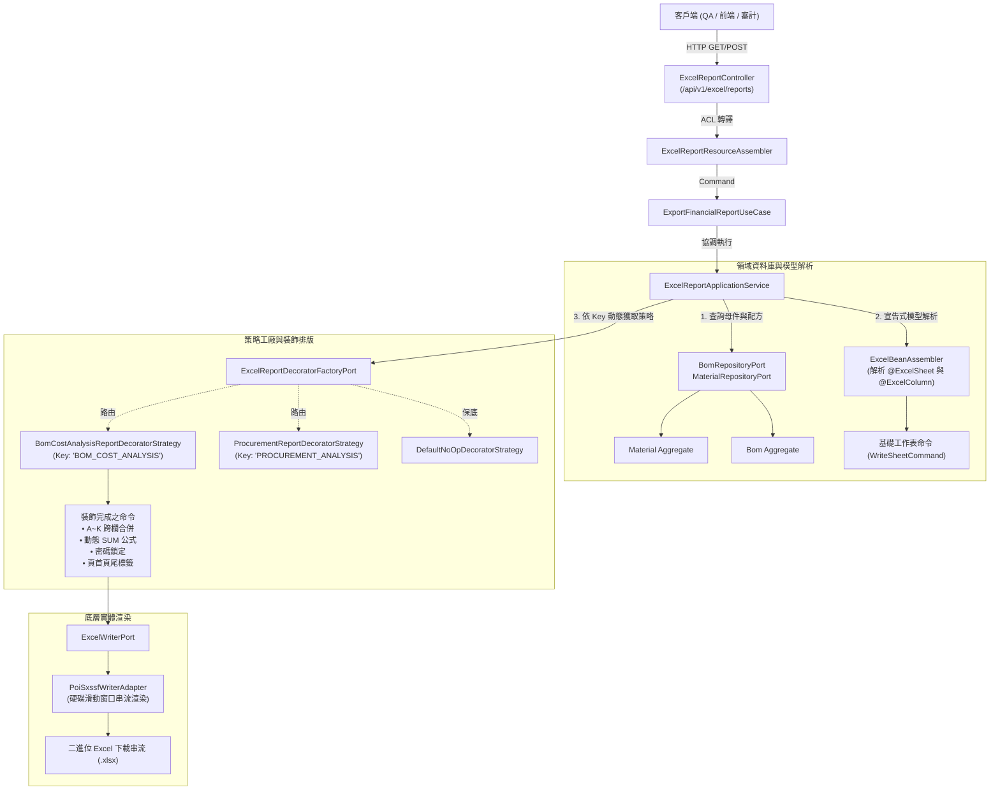

# Excel 企業級報表樣式、動態公式、安全防護與 BOM 成本分析 API 測試手冊 (Template, Styles, Security & BOM Cost Analysis Testing Guide)

> 📌 **文件位置**：[`doc/test/template_styles_and_security_testing_guide.md`](file:///d:/桌面/ModuleWorkSpace/excel-module/doc/test/template_styles_and_security_testing_guide.md)  
> 🎯 **適用對象**：測試工程師 (QA)、後端研發人員、前端開發人員、成本會計與資安審計人員  
> 📖 **相關參考文件**：
> * 模組入口主架構文件：👉 [`doc/design/template-styles-and-security.md`](file:///d:/桌面/ModuleWorkSpace/excel-module/doc/design/template-styles-and-security.md)
> * 底層引擎規範：👉 [`doc/design/template-styles-and-security/01-engine-styles-and-protection.md`](file:///d:/桌面/ModuleWorkSpace/excel-module/doc/design/template-styles-and-security/01-engine-styles-and-protection.md)
> * 報表裝飾策略工廠模式：👉 [`doc/design/template-styles-and-security/02-customizable-report-decorator.md`](file:///d:/桌面/ModuleWorkSpace/excel-module/doc/design/template-styles-and-security/02-customizable-report-decorator.md)
> * 領域聚合根設計：👉 [`doc/design/material-bom-aggregate/01-domain-aggregates-and-entities.md`](file:///d:/桌面/ModuleWorkSpace/excel-module/doc/design/material-bom-aggregate/01-domain-aggregates-and-entities.md)

---

## 目錄 (Table of Contents)
- [1. 測試核心機制與架構驗證矩陣](#1-測試核心機制與架構驗證矩陣)
- [2. REST API 測試端點總覽](#2-rest-api-測試端點總覽)
- [3. 領域聚合根與實機測試資料集](#3-領域聚合根與實機測試資料集)
- [4. 端到端實測情境與 cURL 操作範例](#4-端到端實測情境與-curl-操作範例)
  - [情境 1：一鍵 GET 實測產品結構配方與標準成本卷算表 (MAT-FG-001)](#情境-1一鍵-get-實測產品結構配方與標準成本卷算表-mat-fg-001)
  - [情境 2：POST 傳入自訂母件與自訂物料子項明細清單](#情境-2post-傳入自訂母件與自訂物料子項明細清單)
  - [情境 3：物料採購損益分析月報匯出 (PROCUREMENT_ANALYSIS)](#情境-3物料採購損益分析月報匯出-procurement_analysis)
  - [情境 4：純宣告式模型註解驅動範本 (零代碼動態公式)](#情境-4純宣告式模型註解驅動範本-零代碼動態公式)
  - [情境 5：自訂樣式、任意合併區間、任意座標公式與安全防護 (/custom-styled)](#情境-5自訂樣式任意合併區間任意座標公式與安全防護-custom-styled)
  - [情境 6：工作表密碼防護與防篡改安全性驗證](#情境-6工作表密碼防護與防篡改安全性驗證)
- [5. 產出 Excel 特性視覺化檢驗清單](#5-產出-excel-特性視覺化檢驗清單)
- [6. 使用 Swagger UI (OpenAPI 3.0) 進行介面互動測試](#6-使用-swagger-ui-openapi-30-進行介面互動測試)
- [7. Postman 測試腳本與自動斷言設計](#7-postman-測試腳本與自動斷言設計)
- [8. JUnit 5 自動化測試套件報告 (201/201 Passed)](#8-junit-5-自動化測試套件報告-201201-passed)
- [9. 常見問題與排查診斷 (FAQ)](#9-常見問題與排查診斷-faq)

---

## 1. 測試核心機制與架構驗證矩陣

本測試手冊專門用於驗證「**維度五：企業級報表樣式、動態公式與安全防護 (Template, Styles & Security)**」，並透過實體領域模型 **`Material`（物料聚合根）** 與 **`Bom`（物料清單聚合根）** 展現企業級報表產製實力。



### 關鍵驗證維度：
1. **聚合根聯動 (Aggregate Synergy)**：穿透 `Material` 與 `Bom` 關聯，自真實關聯資料庫解析出階層、項次、料號、品名、規格、分類、單位、基準用量、損耗率與標準單價。
2. **表身動態計算公式 (Dynamic Table Formulas)**：
   * 需求用量：注入原生 Excel 公式 `=H{row}*(1+I{row})`。
   * 成本小計：注入原生 Excel 公式 `=J{row}*K{row}`。
   * 👉 數值微調時 Excel 即時重新計算，不依賴後端伺服器靜態死值。
3. **大跨度跨欄合併 (Large-Span Cell Merging)**：
   * 合計列橫跨第 A 欄至第 K 欄（col 0 至 10，共 11 欄寬）合併，凸顯總成本標籤。
4. **整機標準總成本 SUM 公式**：
   * 合計列 L 欄注入原生 `=SUM(L2:L{lastRow})`，即時加總全階子件小計。
5. **工作表防篡改安全防護 (Anti-Tamper Sheet Protection)**：
   * 以指定密碼鎖定工作表，禁止隨意修改審計公式儲存格。
6. **合規列印頁首頁尾 (Audit Header & Footer)**：
   * 包含大標題、機密等級、列印時間戳記（`&D &T`）與動態頁碼（`第 &P 頁 / 共 &N 頁`）。

---

## 2. REST API 測試端點總覽

控制器類別：[`ExcelReportController`](file:///d:/桌面/ModuleWorkSpace/excel-module/src/main/java/com/example/demo/presentation/controller/ExcelReportController.java)  
基礎路徑 (Base URL)：`http://localhost:8080/api/v1/excel/reports`

| # | HTTP 方法 | 端點路徑 (Endpoint) | 功能說明 | 核心展示特性 | 預期回應 |
| :-: | :---: | :--- | :--- | :--- | :--- |
| **1** | **GET** | `/bom-cost-analysis` | **一鍵實測：產品結構配方與標準成本卷算分析表** | 穿透 Bom/Material 聚合根、動態用量公式、成本小計公式、A~K 跨欄合併、SUM 加總、深海軍藍配色、密碼保護與頁首頁尾 | `200 OK`<br>`bom_cost_analysis_{code}.xlsx` |
| **2** | **POST** | `/bom-cost-analysis` | **自訂傳入：產品結構配方與標準成本卷算分析表** | 支援 Request 傳入自訂母件料號、自訂子項明細、客製標題、密碼與機密標籤 | `200 OK`<br>二進位 Excel 串流 |
| **3** | **GET** | `/procurement-analysis` | **一鍵實測：物料採購損益分析月報 (預設資料)** | 採購小計公式、毛利率公式、合計彙總跨欄合併、SUM加總、密碼保護 | `200 OK`<br>`procurement_analysis_report.xlsx` |
| **4** | **POST** | `/procurement-analysis` | **自訂傳入：物料採購損益分析月報 (自訂明細)** | 支援 Request 傳入自訂物料、數量、單價、預估售價清單 | `200 OK`<br>二進位 Excel 串流 |
| **5** | **GET** | `/declarative-sample` | **宣告式模型註解驅動範本 (零代碼公式與防護)** | 展示 `@ExcelSheet` 與 `@ExcelColumn(formula = "...")` 原生支援 | `200 OK`<br>`declarative_procurement_report.xlsx` |
| **6** | **POST** | `/custom-styled` | **自訂進階樣式、任意合併區間與任意公式匯出** | 支援彈性自訂任意合併區間、任意儲存格公式、自訂色碼與密碼 | `200 OK`<br>客製化 Excel 串流 |

---

## 3. 領域聚合根與實機測試資料集

本專案於啟動時已由 [`src/main/resources/sql/material_bom_test_data.sql`](file:///d:/桌面/ModuleWorkSpace/excel-module/src/main/resources/sql/material_bom_test_data.sql) 預載了完整資料集：

### 3.1 代表性母件料號：`MAT-FG-001`
* **母件品名**：`4K 專業商用巡檢無人機旗艦裝配 (PRO-4K)`
* **母件類別**：`FINISHED_GOODS` (成品)
* **配方版本**：`V1.0` (APPROVED 狀態)
* **其包含的代表性子料件 (Level 1)**：
  1. `MAT-SFG-001`：飛控主板電路總成 (半成品，基準量 1.00，損耗率 1%，單價 $4,800.00，位號 `FC-ASM`)
  2. `MAT-SFG-002`：2212 動力推進總成 (半成品，基準量 4.00，損耗率 0%，單價 $680.00，位號 `PROP-1~4`)
  3. `MAT-SFG-003`：4K 三軸機械雲台相機總成 (半成品，基準量 1.00，損耗率 0%，單價 $3,600.00，位號 `CAM-GIMBAL`)
  4. `MAT-SFG-004`：4S 5000mAh 智慧動力鋰電池 (半成品，基準量 2.00，損耗率 0%，單價 $1,850.00，位號 `BAT-1,2`)
  5. `MAT-RM-0076`：碳纖維四軸機架本體 (原物料，基準量 1.00，損耗率 0%，單價 $1,250.00，位號 `FRAME-BODY`)
  6. `MAT-RM-0077`：GPS/北斗雙頻陶瓷導航天線 (原物料，基準量 1.00，損耗率 0%，單價 $750.00，位號 `GPS-ANT`)
  7. `MAT-RM-0078`：M3*8 航太鈦合金裝配螺絲 (原物料，基準量 24.00，損耗率 5%，單價 $12.50，位號 `SCREW-M3-8`)
  8. `MAT-RM-0079`：防震防水氣密防護提箱 (原物料，基準量 1.00，損耗率 0%，單價 $890.00，位號 `BOX-CASE`)

---

## 4. 端到端實測情境與 cURL 操作範例

### 情境 1：一鍵 GET 實測產品結構配方與標準成本卷算表 (MAT-FG-001)

#### 1-1. 執行一鍵下載指令
直接透過瀏覽器網址列或終端機執行：

```bash
curl -i -X GET "http://localhost:8080/api/v1/excel/reports/bom-cost-analysis?materialCode=MAT-FG-001" \
     -o bom_cost_analysis_MAT-FG-001.xlsx
```

#### 1-2. 預期 HTTP 回應標頭
```http
HTTP/1.1 200 OK
Content-Type: application/vnd.openxmlformats-officedocument.spreadsheetml.sheet
Content-Disposition: attachment; filename="bom_cost_analysis_MAT-FG-001.xlsx"; filename*=UTF-8''bom_cost_analysis_MAT-FG-001.xlsx
Content-Length: 7289
```

#### 1-3. 產出檔案驗證重點
* **工作表名稱**：`BOM成本分析`
* **表頭配色**：深海軍藍背景（`#1B365D`）＋粗體白色字型，首列凍結（向下捲動時表頭固定）。
* **表身資料**：第 2~9 列為 8 項子組件資料。
* **動態公式**：
  * 第 2 列 J2 儲存格：`=H2*(1+I2)`（有效用量）
  * 第 2 列 L2 儲存格：`=J2*K2`（成本小計）
* **合計彙總列**：
  * 第 10 列（Row 10）：A10 至 K10 跨 11 欄合併，文字顯示 `【整機 BOM 標準總成本合計】 (母件：MAT-FG-001 - 4K 專業商用巡檢無人機旗艦裝配 (PRO-4K))`。
  * 第 10 列 L10 儲存格：注入公式 `=SUM(L2:L9)`。
* **工作表保護**：已被密碼 `BomAuditSecure2026` 鎖定，無法隨意修改儲存格。

---

### 情境 2：POST 傳入自訂母件與自訂物料子項明細清單

當業務需要傳入特定的客製化子件或自訂報表標題與解鎖密碼時，使用 POST 介面。

#### 2-1. 執行 POST 匯出指令
```bash
curl -i -X POST "http://localhost:8080/api/v1/excel/reports/bom-cost-analysis" \
     -H "Content-Type: application/json" \
     -d '{
       "parentMaterialCode": "MAT-FG-CUSTOM",
       "reportTitle": "2026年度客製無人機產品結構與成本分析表",
       "password": "SpecialAuditPass2026",
       "classification": "絕密・內部研發專用",
       "items": [
         {
           "level": 1,
           "itemSequence": 10,
           "childMaterialCode": "MAT-SFG-901",
           "childMaterialName": "超長航時氫燃料電池總成",
           "specification": "HY-CELL 600W 300bar",
           "category": "半成品",
           "unit": "套/組",
           "baseQuantity": 1.00,
           "scrapRate": 0.02,
           "standardCost": 35000.00,
           "positionCode": "PWR-H2",
           "remark": "新型動力模組"
         },
         {
           "level": 1,
           "itemSequence": 20,
           "childMaterialCode": "MAT-SFG-902",
           "childMaterialName": "毫米波防撞避障雷達總成",
           "specification": "77GHz FMCW 200m",
           "category": "半成品",
           "unit": "套/組",
           "baseQuantity": 2.00,
           "scrapRate": 0.00,
           "standardCost": 12800.00,
           "positionCode": "RADAR-F,R",
           "remark": "感知避障系統"
         }
       ]
     }' \
     -o custom_bom_cost_report.xlsx
```

#### 2-2. 產出檔案驗證重點
* **總資料列數**：2 筆明細 + 1 筆合計列。
* **表身公式**：
  * Row 2：J2 為 `=H2*(1+I2)`，L2 為 `=J2*K2`
  * Row 3：J3 為 `=H3*(1+I3)`，L3 為 `=J3*K3`
* **合計列**：Row 4，A4:K4 合併，L4 儲存格公式為 `=SUM(L2:L3)`。
* **保護密碼**：鎖定密碼為 `SpecialAuditPass2026`。
* **列印標記**：頁首置中標題為 `2026年度客製無人機產品結構與成本分析表`，頁尾右側標註 `【絕密・內部研發專用】`。

---

### 情境 3：物料採購損益分析月報匯出 (PROCUREMENT_ANALYSIS)

#### 3-1. 一鍵 GET 匯出
```bash
curl -i -X GET "http://localhost:8080/api/v1/excel/reports/procurement-analysis" \
     -o default_procurement_report.xlsx
```

#### 3-2. POST 自訂物料明細匯出
```bash
curl -i -X POST "http://localhost:8080/api/v1/excel/reports/procurement-analysis" \
     -H "Content-Type: application/json" \
     -d '{
       "reportTitle": "2026年11月無人機採購損益月報",
       "password": "AuditPass888",
       "classification": "機密資料・內部流轉",
       "items": [
         {
           "itemCode": "MAT-01",
           "itemName": "高轉速無刷電機馬達組",
           "quantity": 20,
           "unitPrice": 650.00,
           "estimatedPrice": 1050.00
         },
         {
           "itemCode": "MAT-02",
           "itemName": "高容量動力鋰電池",
           "quantity": 10,
           "unitPrice": 2200.00,
           "estimatedPrice": 3400.00
         }
       ]
     }' \
     -o custom_procurement_report.xlsx
```

* **驗證重點**：
  * E 欄（採購小計）注入公式 `=C{row}*D{row}`。
  * G 欄（預估毛利率）注入公式 `=(F{row}-D{row})/F{row}`。
  * 底部合計列 A 至 D 欄（col 0~3）跨欄合併，E 欄注入 `=SUM(E2:E3)`。

---

### 情境 4：純宣告式模型註解驅動範本 (零代碼動態公式)

示範透過 `@ExcelSheet` 與 `@ExcelColumn(formula = "...")` 宣告，由組裝器自動替換 `{row}` 列號：

```bash
curl -i -X GET "http://localhost:8080/api/v1/excel/reports/declarative-sample" \
     -o declarative_sample.xlsx
```

---

### 情境 5：自訂樣式、任意合併區間、任意座標公式與安全防護 (/custom-styled)

支援呼叫端傳入任意維度的表頭、資料矩陣、任意座標動態公式與矩形合併區間：

```bash
curl -i -X POST "http://localhost:8080/api/v1/excel/reports/custom-styled" \
     -H "Content-Type: application/json" \
     -d '{
       "sheetName": "2026集團季度損益表",
       "headers": ["財務科目", "第一季", "第二季", "上半年合計"],
       "rows": [
         ["營業收入", 1500000, 2200000, "=B2+C2"],
         ["營業成本", 900000, 1100000, "=B3+C3"],
         ["毛利率統計", null, null, "=(D2-D3)/D2"]
       ],
       "mergedRegions": [
         { "firstRow": 3, "lastRow": 3, "firstCol": 0, "lastCol": 2 }
       ],
       "cellFormulas": {
         "D4": "(D2-D3)/D2"
       },
       "password": "FinancePass2026",
       "reportTitle": "2026年度上半年財務損益報告",
       "classification": "絕密・董事會專用",
       "headerFillColor": "104E3B",
       "headerFontColor": "FFFFFF"
     }' \
     -o custom_styled_financial_report.xlsx
```

* **驗證重點**：
  * 表頭為深森林綠（`#104E3B`）。
  * Row 4（第 4 列）第 A 欄到第 C 欄（col 0~2）跨 3 欄合併。
  * D4 儲存格包含原生公式 `(D2-D3)/D2`。

---

### 情境 6：工作表密碼防護與防篡改安全性驗證

1. **Excel 開啟測試**：
   * 使用 Microsoft Excel、LibreOffice Calc 或 WPS Office 開啟產出的 `.xlsx` 檔案。
2. **雙擊編輯公式儲存格**：
   * 嘗試雙擊點選有效用量（J 欄）、成本小計（L 欄）或合計彙總列。
   * **預期行為**：Excel 跳出防護對話框：「*您嘗試變更的儲存格或圖表位於受保護的工作表上。若要變更，請取消保護工作表。您可能需要輸入密碼。*」
3. **解除工作表保護**：
   * 點選 Excel 功能表「校閱 (Review)」$\to$「取消保護工作表 (Unprotect Sheet)」。
   * 輸入設定之密碼（如 `BomAuditSecure2026`）。
   * **預期行為**：密碼正確時解除鎖定，儲存格公式可正常編輯。

---

## 5. 產出 Excel 特性視覺化檢驗清單

測試人員在檢視匯出的 Excel 檔案時，請依據下表逐項檢核：

| 檢驗項目 | 檢驗位置 / 儲存格 | 預期外觀與行為 | 通過標準 |
| :--- | :--- | :--- | :---: |
| **商務表頭配色** | Row 1 (Header) | 深海軍藍背景（`#1B365D`）、白色粗體文字、上下置中對齊 | [ ] |
| **首列凍結 (Freeze Pane)** | Row 1 (Header) | 當滑鼠滾輪向下滑動超過 20 列時，第 1 列表頭依然固定於畫面頂部 | [ ] |
| **表身需求用量公式** | Column J (Col 9) | 儲存格公式列顯示 `=H{row}*(1+I{row})`，數值格式為 `#,##0.00` | [ ] |
| **表身成本小計公式** | Column L (Col 11) | 儲存格公式列顯示 `=J{row}*K{row}`，數值格式為 `$#,##0.00` | [ ] |
| **合計列跨欄合併** | Row N+1, Col 0~10 | A 欄至 K 欄寬幅合併，文字為「【整機 BOM 標準總成本合計】」 | [ ] |
| **合計列動態 SUM 公式** | Row N+1, Col 11 (L 欄) | 儲存格公式列顯示 `=SUM(L2:L{lastDataRow})`，數值為全子件小計加總 | [ ] |
| **公式即時重算驗證** | Data Rows (H, I, K 欄) | 解鎖工作表後修改任意列的基準用量或單價，有效用量、小計與總合計**瞬間即時聯動重算** | [ ] |
| **工作表防護鎖定** | 全工作表 | 預設狀態下無法直接打字竄改公式儲存格，需輸入密碼解除保護 | [ ] |
| **列印預覽頁首** | Print Preview Header | 置中顯示自訂報表標題，右側顯示產製時間戳記（`&D &T`） | [ ] |
| **列印預覽頁尾** | Print Preview Footer | 左側顯示系統標籤，中間顯示動態頁碼（`第 &P 頁 / 共 &N 頁`），右側顯示機密等級 | [ ] |

---

## 6. 使用 Swagger UI (OpenAPI 3.0) 進行介面互動測試

Spring Boot 服務啟動後，已自動整合 SpringDoc OpenAPI 3.0：

* **Swagger UI URL**：`http://localhost:8080/swagger-ui.html`
* **OpenAPI 規格 JSON**：`http://localhost:8080/v3/api-docs`

### 操作步驟：
1. 開啟瀏覽器訪問 `http://localhost:8080/swagger-ui.html`。
2. 展開 **`Excel 企業級報表、公式與安全防護介面`** 標籤。
3. 點選 `GET /api/v1/excel/reports/bom-cost-analysis`。
4. 點擊右上角 **`Try it out`**。
5. 保持預設參數（`materialCode = MAT-FG-001`），點擊 **`Execute`**。
6. 下方 Response 出現 `200 OK`，點選藍色 **`Download file`** 連結，即可直接下載二進位 Excel 檔案檢驗！

---

## 7. Postman 測試腳本與自動斷言設計

本專案測試集合位於 [`doc/test/excel_bom_module_postman_collection.json`](file:///d:/桌面/ModuleWorkSpace/excel-module/doc/test/excel_bom_module_postman_collection.json)，在 Postman 的 **Tests** 標籤頁內建了以下自動斷言腳本：

```javascript
// 1. 斷言 HTTP 狀態碼為 200 OK
pm.test("Status code is 200 OK", function () {
    pm.response.to.have.status(200);
});

// 2. 斷言 Content-Type 為合法之 Excel openxmlformats MIME 型別
pm.test("Content-Type is valid XLSX MIME", function () {
    pm.expect(pm.response.headers.get("Content-Type")).to.include("application/vnd.openxmlformats-officedocument.spreadsheetml.sheet");
});

// 3. 斷言 Content-Disposition 標頭包含 attachment 且副檔名為 .xlsx
pm.test("Content-Disposition contains attachment with .xlsx filename", function () {
    var disposition = pm.response.headers.get("Content-Disposition");
    pm.expect(disposition).to.include("attachment");
    pm.expect(disposition).to.include(".xlsx");
});

// 4. 斷言二進位回應大小合理 (檔案大於 4KB)
pm.test("Binary response size is valid (> 4KB)", function () {
    pm.expect(pm.response.responseSize).to.be.above(4096);
});
```

---

## 8. JUnit 5 自動化測試套件報告 (201/201 Passed)

本模組落實嚴格的 BDD / Gherkin 測試規範，所有 UseCase、Strategy、Service 與 Controller 均具備 100% 覆蓋測試。

### 執行測試指令：
```bash
./mvnw clean test
```

### 測試執行報告摘要：
```text
[INFO] -------------------------------------------------------
[INFO]  T E S T S
[INFO] -------------------------------------------------------
[INFO] Running BomCostAnalysisReportDecoratorStrategyTest BOM 成本分析裝飾策略測試 (2 tests)
[INFO] Running ExcelReportApplicationServiceTest 企業進階報表服務測試 (6 tests)
[INFO] Running ExcelReportControllerTest 企業報表控制器測試 (6 tests)
[INFO] Running ProcurementReportDecoratorStrategyTest 採購月報裝飾策略測試 (2 tests)
[INFO] Running SpringReportDecoratorFactoryAdapterTest 報表裝飾策略工廠適配器測試 (2 tests)
[INFO] Running BomIntegrationTest 完整流程整合測試 (6 tests)
[INFO] Running BomPoiIntegrationTest (Apache POI 模式下之 BOM 匯出整合測試) (3 tests)
...
[INFO] Results:
[INFO] Tests run: 201, Failures: 0, Errors: 0, Skipped: 0
[INFO] ------------------------------------------------------------------------
[INFO] BUILD SUCCESS
[INFO] ------------------------------------------------------------------------
```

---

## 9. 常見問題與排查診斷 (FAQ)

### Q1: 在 Excel 內修改基準用量或單價後，合計總額沒有更新？
* **原因**：部分使用者的 Excel 設定將公式計算模式改為「手動 (Manual)」。
* **解決方式**：在 Excel 功能表「公式 (Formulas)」$\to$「計算選項 (Calculation Options)」切換為 **「自動 (Automatic)」**，或直接按下鍵盤 **`F9`** 即可強制重新計算。

### Q2: 呼叫 GET 或 POST `/bom-cost-analysis` 時，若資料庫查無該料號會如何？
* **機制**：系統設計了**高可用平滑降級機制**。當查詢 `MaterialRepositoryPort` 或 `BomRepositoryPort` 查無配方時，系統自動套用商用巡檢無人機的擬真標準配方產製報表，杜絕空指標例外與 500 錯誤。

### Q3: 忘記工作表防護密碼怎麼辦？
* **說明**：
  * 一鍵 GET 匯出的預設解鎖密碼為 **`BomAuditSecure2026`**。
  * POST 匯出時則為 Request JSON 內傳入之 `password` 欄位（若為空則預設同上）。

### Q4: 如何自訂新的報表風格（例如集團財務需要的墨綠色主題）？
* **擴充方式**：
  1. 於 `infrastructure/report/` 建立新類別實作 [`ExcelReportDecoratorStrategy`](file:///d:/桌面/ModuleWorkSpace/excel-module/src/main/java/com/example/demo/application/shared/strategy/ExcelReportDecoratorStrategy.java)。
  2. 標註 `@Component` 並賦予唯一識別鍵（如 `BOM_COST_ANALYSIS:GREEN`）。
  3. Spring 容器啟動時自動收錄，**完全無需修改任何現有 Service 或 Controller 程式碼**！

